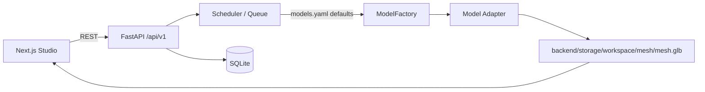

# ForMesh3D Architecture Documentation

## 1. Introduction

This document provides a **complete, self‑contained description** of the ForMesh3D system architecture, intended for any new developer or AI that has no prior context.  It consolidates the high‑level blueprint, system boundaries, data‑flow, component responsibilities, and the vision for the adapter layer.

---

## 2. System Boundaries & Layer Map

| Layer | Owner / Directory | Primary Responsibility |
|------|-------------------|------------------------|
| **Studio UI & Shell** | `app/`, `features/workspace/` | Next.js (v16) + React (v19) + TypeScript UI; three‑js viewport (`GLTFLoader`, `glbCache`). Handles user input, displays progress, and renders generated meshes. |
| **HTTP Client** | `services/apiClient.ts` | TypeScript wrapper for all REST calls to the FastAPI backend (`/api/v1`). |
| **API Entrypoints** | `backend/api/main_singleworker.py`, `backend/api/main_multiworker.py` | FastAPI application, middleware, router mounting (`/api/v1`, `/api/v1/system`). |
| **API Routers** | `backend/api/routers/` | Individual routes for upload, generation, retopology, UV, segmentation, rigging, motion, system, DB. |
| **Model Registry** | `backend/config/models.yaml` | **Single source of truth** for model metadata (`name`, `label`, `description`, `vram_requirement`, `capabilities`, `default_parameters`). |
| **Model Factory** | `backend/core/scheduler/model_factory.py`, `backend/adapters/__init__.py` | Builds `ADAPTER_REGISTRY` and derived `_ADAPTER_MAP`; selects the correct adapter class for a given model. |
| **Adapters & Patchers** | `backend/adapters/`, `patcher/<model>/` | Executes model inference; isolates pre‑Ampere (`sm < 80`) patches. Currently each adapter contains duplicated boiler‑plate – the audit recommends collapsing these to a thin façade. |
| **Storage & DB** | `backend/storage/`, `backend/database_manager.py` | Persists generated assets under `<workspace_id>/mesh/mesh.glb` and stores job/workspace state in SQLite. |
| **Third‑Party Source** | `backend/thirdparty/` | Pinned upstream repositories (model code, weights). |

---

## 3. Execution Flow (Data‑Path)

1. **UI loads** enabled models and metadata from `/api/v1/system/models` (driven by `models.yaml`).
2. User **submits** an image/mesh and parameters (`seed`, `texture_resolution`, `poly_type`, `target_polycount`).
3. `apiClient.ts` POSTs the request to the appropriate FastAPI endpoint.
4. **Scheduler** (`multiprocess_scheduler.py`) injects missing `default_parameters` from `models.yaml` and dispatches the job to an **isolated model worker** (single‑process or multi‑worker via Redis).
5. The **Adapter** receives the request, performs any model‑specific pre‑processing, invokes the **Third‑Party Model Pipeline**, and writes the output GLB (or related asset) to `backend/storage/<workspace_id>/mesh/`.  It also records job metadata in SQLite.
6. UI **polls** job status; once finished the mesh is fetched from storage and rendered in the `MeshViewer.tsx` component (progress bar → scan‑reveal).

---

## 4. Component Diagrams (Mermaid)

---

## 5. Adapter Architecture & Vision (Expanded)

### 5.1 Current State (as of 2026‑11‑25)
- **20 adapters** live under `backend/adapters/`, each averaging **~300 lines**.
- Each adapter re‑implements:
  - Environment guards (`_is_pre_ampere`).
  - Temporary‑directory creation & cleanup (often missing cleanup).
  - HF checkpoint download logic (duplicated across adapters).
  - `get_supported_formats` / `get_parameter_schema` stubs.
- Only **2 adapters** have unit tests.
- Several critical bugs were identified (hard‑coded metadata, UV omission, global monkey‑patch, subprocess leaks).

### 5.2 Desired Future State
- **Thin façade** per adapter: only input validation and output conversion.
- **Shared helpers** in `BaseModel` or a new `patcher/common.py` for:
  - Temp‑dir lifecycle (`BaseModel._run_temp(fn)`).
  - Checkpoint caching (`BaseModel._cached_load(model_id)`).
  - Pre‑Ampere guard isolation.
- **Reuse upstream model code** directly (most third‑party repos expose a single < 100‑line file that implements the full pipeline).
- **Result:** ~735 lines removed → codebase ~14 % leaner, easier to audit, and fully GPU‑parity compliant.

---

## 6. Constraints & Rules (from AGENTS.md)
- **GPU parity (`sm >= 80`)** must be preserved – all changes must keep native BF16, FlashAttention, etc.
- **Model‑specific patches** belong in `patcher/<model>/` and must not leak globally.
- **Documentation budget** limits have been respected (Architecture now ≤ 250 lines).

---

## 7. Next Steps (Integrated with Task Report)
- See `Docs/TASKS.md` for the detailed audit, risk scores, and phased roadmap.
- Implement the **Safety**, **Test Coverage**, **Boiler‑plate Centralisation**, **Lean‑up**, and **Verification** phases as described there.

---

*All recommendations honour the AGENTS.md priority rules (model‑specific patches, GPU‑parity, no global monkey‑patches).*