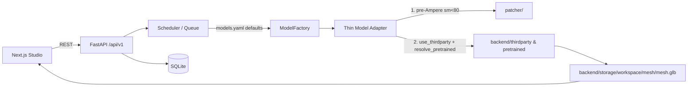

# ForMesh3D Architecture Documentation

## 1. Introduction

This document provides a **complete, self‑contained description** of the ForMesh3D system architecture, intended for any new developer or AI that has no prior context.  It consolidates the high‑level blueprint, system boundaries, data‑flow, component responsibilities, and the vision for the adapter layer.

---

## 2. System Boundaries & Layer Map

| Layer | Owner / Directory | Primary Responsibility |
|------|-------------------|------------------------|
| **Studio UI & Shell** | `app/`, `features/workspace/` | Next.js (v16) + React (v19) + TypeScript UI; three‑js viewport (`GLTFLoader`, `glbCache`). Handles user input, displays progress, and renders generated meshes. |
| **HTTP Client** | `services/apiClient.ts` | TypeScript wrapper for all REST calls to the FastAPI backend (`/api/v1`). |
| **API Entrypoints** | `backend/api/main_singleworker.py`, `backend/api/main_multiworker.py` | FastAPI application, middleware, router mounting (`/api/v1`, `/api/v1/system`). |
| **API Routers** | `backend/api/routers/` | Individual routes for upload, generation, retopology, UV, segmentation, rigging, motion, system, DB. |
| **Model Registry** | `backend/config/models.yaml` | **Single source of truth** for model metadata (`name`, `label`, `description`, `vram_requirement`, `capabilities`, `default_parameters`). |
| **Model Factory** | `backend/core/scheduler/model_factory.py`, `backend/adapters/__init__.py` | Builds `ADAPTER_REGISTRY` and derived `_ADAPTER_MAP`; selects the correct adapter class for a given model. |
| **Adapters & Patchers** | `backend/adapters/`, `backend/core/utils/upstream.py`, `patcher/<model>/` | Thin model adapters using `use_thirdparty`/`load_thirdparty_script` and `resolve_pretrained`, with `patcher/<model>/` applied first for `sm < 80` isolation. |
| **Storage & DB** | `backend/storage/`, `backend/core/scheduler/database_manager.py` | Persists immutable workspace assets under `<workspace_id>/mesh/` and animated exports under `<workspace_id>/animation/<clip>_vNNN/{animated.glb,motion.npz}`; SQLite is authoritative and the single workspace-root `metadata.json` is a projection. |
| **Motion Service** | `backend/services/motion_clips.py` | Safe motion preset discovery, bounded NPZ/NPY parsing, and `MotionClipV1` normalization for ARDY and user-uploaded clips; presets in `backend/motion_presets/`, user uploads/generated copies in backend/storage/presets/<preset_id>/. |
| **Third‑Party Source** | `backend/thirdparty/` | Pinned upstream repositories (model code, weights). |

---

## 3. Execution Flow (Data‑Path)

1. **UI loads** enabled models and metadata from `/api/v1/system/models` (driven by `models.yaml`).
2. User **submits** an image/mesh and parameters (`seed`, `texture_resolution`, `poly_type`, `target_polycount`).
3. `apiClient.ts` POSTs the request to the appropriate FastAPI endpoint.
4. **Scheduler** (`multiprocess_scheduler.py`) injects missing `default_parameters` from `models.yaml` and dispatches the job to an **isolated model worker** (single‑process or multi‑worker via Redis).
5. The **Adapter** receives the request, performs any model‑specific pre‑processing, invokes the **Third‑Party Model Pipeline**, and writes the output GLB (or related asset) to `backend/storage/<workspace_id>/mesh/`.  It also records job metadata in SQLite.
6. UI **polls** job status; once finished the mesh is fetched from storage and rendered in the `MeshViewer.tsx` component (progress bar → scan‑reveal).
7. (Motion) Completed ARDY jobs expose a `motion_clip_id`; the frontend resolves playable `MotionClipV1` clips through the Motion Service (`/api/v1/motion/clips/{clip_id}`) without raw filesystem paths, and binds them to the active rigged mesh in the viewport animation player.
8. Saving an animation exports a GLB with Three.js `GLTFExporter`, then posts it with the stable source asset and motion clip IDs. The backend copies the original NPZ, publishes a versioned `animation/<clip>_vNNN/` folder atomically, records an `animated_mesh` asset plus operation lineage in SQLite, and refreshes the workspace-root manifest. Device download remains a separate client action.

---

## 4. Component Diagrams (Mermaid)

---

## 5. Adapter Architecture (Thin Pluggable Loader)

- **15 adapters** under `backend/adapters/` (12 enabled, 3 disabled: `pixal3d`, `trellis2`, `taoflowforge`) now route through `backend/core/utils/upstream.py` (`use_thirdparty`, `load_thirdparty_script`, `resolve_pretrained`, `resolve_thirdparty`).
- **Execution order:** `patcher.<model>.apply_patch()` runs **first** (only inside that model's worker), then `use_thirdparty(...)` / `load_thirdparty_script(...)` runs the official upstream pipeline with local weights from `backend/pretrained/<Model>` (failing fast if missing).
- **Clean boundaries:** Each adapter carries a standard ASCII header and numbered sections; shared utilities (`BaseModel`, `upstream.py`) replace duplicated path/temp-dir/download boilerplate.

---

## 6. Constraints & Rules (from AGENTS.md)
- **GPU parity (`sm >= 80`)** must be preserved – all changes must keep native BF16, FlashAttention, etc.
- **Model‑specific patches** belong in `patcher/<model>/` and must not leak globally.
- **Documentation budget** limits have been respected (Architecture now ≤ 250 lines).

---

## 7. Next Steps (Integrated with Task Report)
- See `Docs/TASKS.md` for the detailed audit, risk scores, and phased roadmap.
- Implement the **Safety**, **Test Coverage**, **Boiler‑plate Centralisation**, **Lean‑up**, and **Verification** phases as described there.

---

*All recommendations honour the AGENTS.md priority rules (model‑specific patches, GPU‑parity, no global monkey‑patches).*