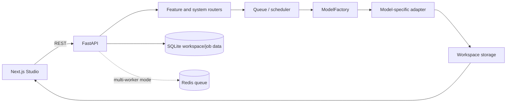

# ForMesh3D — System Blueprint

> Audited on 2026-11-22 against `dev`. This is a code-wiring blueprint, not a GPU performance or inference certification.

## Deployment

- Frontend: Next.js 16 / React 19 / TypeScript, Bun 1.4.2.
- Backend: FastAPI / Python 3.10, normally exposed on port 7842.
- Local Studio: Next.js on port 3000.
- Single-worker entrypoint: `backend/api/main_singleworker.py`; scheduler is embedded.
- Multi-worker entrypoint: `backend/api/main_multiworker.py`; API workers use Redis and a separate scheduler service.
- Persistent workspace files and SQLite database live under `backend/storage/`.

## Topology

## Model wiring

`backend/config/models.yaml` controls model enablement and capabilities. `ModelFactory.ADAPTER_REGISTRY` maps model IDs to adapter modules/classes. `backend/adapters/_ADAPTER_MAP` supplies the runtime probe's installed-adapter inventory.

Enabled configured model families include Hunyuan3D Shape v2.1, Hunyuan3D DiT Mini Turbo, TripoSG, TRELLIS, Stable Fast 3D, Hunyuan3D Paint v2.0/v2.1, PartField, TriFlow, PartUV, SkinTokens, and ARDY.

Disabled but retained: Unique3D, Pixal3D, TRELLIS.2, and TaoFlowForge. Keep their config and support code unchanged during cleanup. Configured enablement does not imply installed weights or verified inference.

## Workspace and viewer

- Stable workspace route: `/workspace/generate/<workspace_id>`.
- Frontend uses `services/apiClient.ts` for shared API operations.
- Mesh display is local: download GLB, parse with `GLTFLoader`, render in the Three.js viewport.
- The removed WebSocket/WebRTC streaming engine is not part of the current architecture.
- SQLite-backed job/workspace state and the on-disk workspace are owned by backend storage/database modules.

## API entrypoints

Both FastAPI entrypoints mount the system router at `/api/v1/system` and at `/api/v1` for direct compatibility aliases. Feature routers are mounted under `/api/v1`; the database router is mounted under `/api/v1/system/database`. See [api-documentation.md](api-documentation.md) and the live `/docs` schema.

## Engineering constraints

1. Trace callers, dynamic imports, registrations, route mounts, tests and third-party imports before deleting code.
2. Preserve all disabled model adapters and model-specific support code.
3. Preserve third-party compatibility shims when upstream source imports them dynamically.
4. Keep SQLite/storage ownership centralized; do not add parallel metadata files or stores.
5. Compile first-party Python packages, patchers and scripts separately from the pinned third-party submodule; upstream syntax failures must be tracked independently.
6. Treat static checks and CPU CI as contract checks only; GPU inference needs a suitable host and installed checkpoints.
