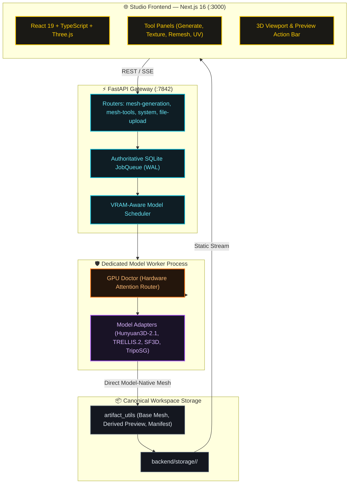
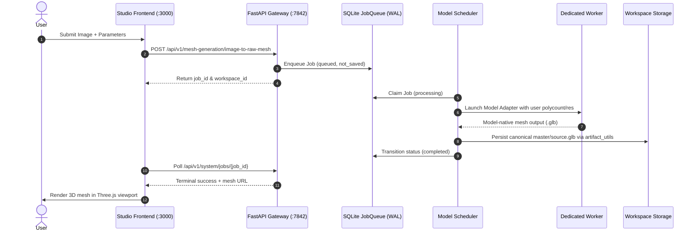

# ForMesh3D — System Blueprint

> **System Version**: 0.2.0 (FastAPI + Next.js 16, Python 3.10, GPU Doctor)
> **Target Deployment**: Single Personal VPS / Workstation (Trusted Local Network)
> **Last Audited**: November 14, 2026
> **Context Policy**: Max 250 lines strictly enforced.

---

## 1. Executive System Overview

ForMesh3D is an open-source, self-hosted generative 3D asset creation platform. It converts concept images into high-fidelity 3D meshes using direct upstream neural inference without destructive downstream decimation or smoothing.

### Core Stack
- **Frontend Studio**: Next.js 16 (React 19, TypeScript, Three.js 0.186, Tailwind CSS) on Port 3000.
- **API Gateway**: FastAPI (Python 3.10, Conda env `3daigc-api`, AsyncIO, Pydantic V2) on Port 7842.
- **GPU Doctor & Attention Engine**: Standalone hardware planner (`patcher/doctor.py`), precision router (native BF16 for `sm >= 80`, chunked SDPA for `sm < 80`), and VRAM safety buffers.
- **Model Execution**: Dedicated worker process managed by `MultiprocessModelScheduler` with GPU mutex locks and dynamic parameter passthrough (`native_target_polycount`, `texture_resolution`).
- **Database & Queue**: Authoritative SQLite database (`backend/storage/job_queue.db`) running in WAL mode with FIFO priority queue (`JobQueue`) and capacity cap of 10.
- **Storage & Artifacts**: Canonical storage under `backend/storage/<workspace_id>/` orchestrated by `WorkspaceStorageManager` and `backend/core/utils/artifact_utils.py`.

---

## 2. System Architecture Topology

---

## 3. End-to-End Generation & Workspace Lifecycle

---

## 4. Key Architectural Contracts

### 4.1 Model-Native Source Fidelity
- Generative models produce direct geometry; downstream lossy postprocessing is eliminated.
- User parameter passthrough (`native_target_polycount`, `texture_resolution`, `seed`) routes directly from UI into adapters without router-level interceptors.
- `master/source.glb` remains immutable once persisted in the workspace; derived tool operations generate preview assets (`_v002`, `_v003`) that can be explicitly Committed or Discarded via the Action Bar.

### 4.2 Hardware Isolation & Safety (Priority Rule 1)
- **Modern GPUs (`sm >= 80`)**: Zero regressions. Executes in 100% native upstream mode (official FlashAttention, native BF16, locked inference schedules).
- **Pre-Ampere GPUs (`sm < 80`)**: Fallbacks isolated strictly behind `_is_pre_ampere` checks (query-chunked SDPA, FP16/FP32 guards).
- **Patcher Isolation**: Runtime fixes live strictly in `patcher/<model-name>/` inside dedicated worker processes, preventing global monkeypatch leaks.

### 4.3 Workspace Dual State Machine
- **Execution State Machine**: `queued` -> `processing` -> `completed` | `failed` | `interrupted` | `cancelled`.
- **Persistence State Machine**: `not_saved` -> `saving` -> `saved` | `save_failed` | `discarded` | `cleanup_pending` | `preview_expired`.
- Terminal states are immutable. Preview retention is managed via `/api/v1/workspace/operations/{operation_id}/keep` and `discard`.
