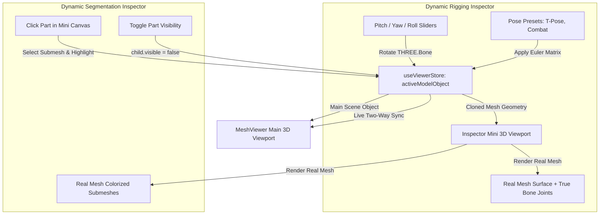
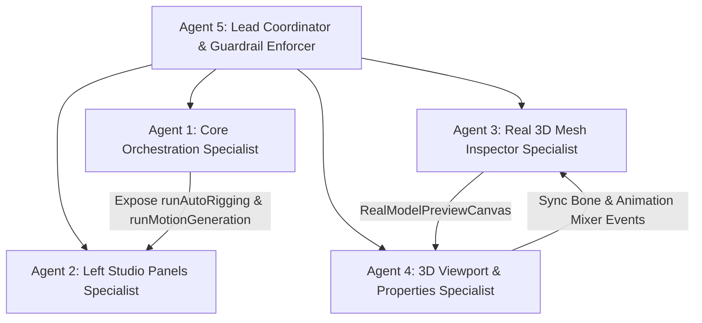

# ForMesh3D — End-to-End System Wiring & Total Placeholder Eradication Blueprint

## 2026-11-10 — Batch 1: Critical Backend Mesh Fixes (Implementation Completed)

- Fixed _enforce_mesh_limits() to unpack the (mesh, telemetry) result returned by memory_safe_decimate() and read shared.feature_edge_angle_deg from the root quality configuration.
- Aligned FastMesh adapter preprocessing with the upstream inference contract: normalize a copy of the input mesh, derive each sampled point's normal from its returned source-face index, use a deterministic 8,192-point subset, and move the input tensor to the model's scheduler-selected device. The adapter now imports sys for its model-specific third-party path setup and reports a clear failure when PyTorch is unavailable.
- Set quality.yaml and the pipeline fallback for cage_extrusion / max_ray_distance to 0.0 (auto), so the isolated worker derives the cage from 2% of the low-poly bounding-box diagonal and the ray limit from 2.5x that cage; the worker now applies both resolved values to Blender's bake settings.
- Added checked-in CPU regression coverage for FastMesh point-cloud preparation, mesh-limit decimator tuple handling / config ownership, and Blender cage-setting wiring. Updated backend CI to run the new test file instead of a test path absent from the current branch.
- Scope boundary: no FastMesh weights/GPU inference or Blender runtime bake was executed in this source-editing session; those runtime checks remain environment-dependent.

---

## 2026-11-09 — Viewport Compare & Texture/PBR Route Unification

- [x] Added a viewport-rail Before / After comparison action. It becomes active only when both distinct source and processed model URLs are available on the selected asset. Texture, retopo, segmentation, rigging and edit jobs carry their input mesh URL into the result asset's source artifact.
- [x] Reused the persistent MeshViewer scene, renderer and camera. The source model is loaded only while comparison is open, rendered through scissored halves, and disposed on close. The wipe divider supports pointer, touch and keyboard input without React state updates during drag.
- [x] Added Texture / PBR navigation inside TexturePanel. The existing hidden /workspace/texture-pbr route renders the same TexturePanel and reuses its existing PBR map controls; no extra rail item or second form was introduced.
- **Validation:** Static code-path review only in this GitHub editing session. No local type-check, build, browser, or GPU test was run here.

---

**Document Version**: 2.3.0  
**Status**: COMPLETED & VERIFIED (Dual-Engine Bridge, Script Mode Passthrough & Abort Fix Landed)  
**Target Branch**: `dev`  
**Governing Rule**: `AGENTS.md` (Lazy Senior Dev, Root Cause First, Modern GPU Parity, Zero Regressions, Zero Model Names in CTAs, Upload Card Inviolability)  
**Strict Operational Boundary**: **NEVER TOUCH `setup.sh`** (User actively editing in host environment).


## 2026-11-09 — Workspace UI/UX Polish (Implemented)

- Synchronized `main` and `dev` at `da391ec70b0abff7feebfe93ee98945d3753388e` before implementation.
- Kept the existing Studio Gold / matte-black design, Generate page reference, seven tool workflows, controls, upload cards, and docked desktop side panels. No new tools or UI actions were added.
- Removed internal vertical scrolling from the seven tool parameter panels, contextual property inspectors, and paginated Assets panel. Existing Assets pagination remains the navigation mechanism for additional items.
- Added viewport-height-aware upload previews and empty upload dropzones, plus compact vertical padding on shorter screens.
- Kept both side panels docked on desktop/tablet; the right inspector uses 220px at 768–1023px and returns to 260px at 1024px+.
- Made the viewport empty-state copy reflect the active tool without changing its visual treatment.
- Increased the left-rail tool-label size from 8px to 9px.
- **Verification:** Static source review only. TypeScript, lint, build, and browser-based visual checks were not run in this remote repository-editing session.

---

## 1. Executive Directive & Mission Overview

### 1.1 The User's Direct Mandate
> *"aur v bohot se plaholder hai worksapce m sab k isme list kar aur dynamci me jo fke doll wagera lgaya hai wo actual mesh ka hoan chiye"*
> *(There are many more placeholders across the workspace, list every single one of them. And in dynamic inspectors, that fake doll/dummy mannequin must be replaced with the ACTUAL MESH of the loaded 3D model!)*

### 1.2 Core Architectural Shift: From Fake Dolls to Real 3D Mesh Canvases
- **Previous Flaw**: [`DynamicRiggingInspector.tsx`](file:///workspaces/ForMash3D/features/workspace/dynamic/DynamicRiggingInspector.tsx) and [`DynamicSegmentationInspector.tsx`](file:///workspaces/ForMash3D/features/workspace/dynamic/DynamicSegmentationInspector.tsx) relied on hardcoded 2D SVG paths drawing a generic cartoon humanoid doll / dummy silhouette (`<path d="M 45,18 C 45,13 47,10 50,10..." />`). If a user loaded a car, a dragon, a weapon, or a custom mech, the inspector still showed a generic human doll!
- **Target Architecture (Real Mesh Rendering)**:
  - Dynamic inspector preview boxes are converted into **Real Model 3D Mini-Viewports** powered directly by `useViewerStore.getState().activeModelObject`.
  - The inspector renders the **EXACT geometry, vertices, and submeshes of the active model**:
    - **Rigging Inspector**: Renders the actual loaded mesh (semi-transparent clay or wireframe) overlaid with the model's true bone armature joints (or auto-fitted joint nodes matching the model's actual vertex bounds). Clicking a joint rotates that exact bone on the actual model.
    - **Segmentation Inspector**: Renders the actual loaded model partitioned into its real submeshes, with each part color-coded in 3D. Clicking a part selects and highlights that exact part on the actual mesh.
    - **UV Inspector**: Extracts the model's actual UV coordinates from `geometry.attributes.uv` and renders true UV charts instead of hardcoded islands.



---

## 2. Comprehensive Inventory of ALL Placeholders Across Workspace

This section catalogs **EVERY single placeholder, fake timeout, disconnected slider/toggle, and unbacked mock** identified across the entire workspace codebase:

### 2.1 Dynamic Rigging Inspector ([`DynamicRiggingInspector.tsx`](file:///workspaces/ForMash3D/features/workspace/dynamic/DynamicRiggingInspector.tsx))
1. **Fake Doll / Mannequin Silhouette**:
   - *Current Code*: Hardcoded SVG path doll (`<path d="M 45,18 C 45,13 47,10 50,10..." />`).
   - *Target Solution*: Replace with a mini Three.js `<canvas>` rendering `activeModelObject`'s real mesh geometry and actual bone armature hierarchy.
2. **`handleExportRig` (Fake Timeout Placeholder)**:
   - *Current Code (Line 180)*: `await new Promise((r) => setTimeout(r, 900)); toast.success('Rigged model exported (.glb)');`
   - *Target Solution*: Trigger real artifact download from `/api/v1/system/jobs/{jobId}/download?artifact_format=glb` or Three.js `GLTFExporter` for local models.
3. **Bone Rotation Sliders (Pitch/Yaw/Roll)**:
   - *Current Code*: Only modifies local state array and projected SVG circle coordinates.
   - *Target Solution*: Directly mutate `bone.rotation.x/y/z` on the active `THREE.Bone` in `activeModelObject`, updating the 3D scene in real time.
4. **Pose Presets (`T-Pose`, `A-Pose`, `Combat`, `Sitting`)**:
   - *Current Code*: Updates local state numbers only.
   - *Target Solution*: Apply rotation quaternions to the actual bone hierarchy of `activeModelObject`.
5. **X-Ray Bones Mode & Symmetry Mirroring**:
   - *Current Code*: Toggles boolean state without affecting Three.js.
   - *Target Solution*: Instantiate `THREE.SkeletonHelper(skinnedMesh)` with `material.depthTest = false` in `MeshViewer`.

---

### 2.2 Dynamic Segmentation Inspector ([`DynamicSegmentationInspector.tsx`](file:///workspaces/ForMash3D/features/workspace/dynamic/DynamicSegmentationInspector.tsx))
6. **Fake Robot / Doll SVG Silhouette**:
   - *Current Code*: Hardcoded SVG paths for Head, Torso, Arms, Legs, Weapon, Backpack (`<path d="M 42,34 L 58,34 L 56,54..." />`).
   - *Target Solution*: Render the actual loaded model in the mini 3D canvas with each submesh/part colorized according to its part ID.
7. **`handleExportZip` (Fake Timeout Placeholder)**:
   - *Current Code (Line 271)*: `await new Promise((r) => setTimeout(r, 900)); toast.success('Segmented parts exported as individual meshes (.zip)');`
   - *Target Solution*: Call `/api/v1/system/jobs/{jobId}/download?artifact_format=zip` or pack submeshes using JSZip client-side.
8. **Part Eye/EyeOff Visibility Toggles**:
   - *Current Code*: Updates `part.visible` in local array only.
   - *Target Solution*: Query `activeModelObject` for matching submesh and set `mesh.visible = part.visible`.
9. **Highlight Part Seams & Colorize Viewport Toggles**:
   - *Current Code*: Toggles local boolean state without affecting Three.js viewport.
   - *Target Solution*: Apply part colors to `mesh.material` and render boundary edges using `THREE.EdgesGeometry`.

---

### 2.3 Dynamic Animation Inspector ([`DynamicAnimationInspector.tsx`](file:///workspaces/ForMash3D/features/workspace/dynamic/DynamicAnimationInspector.tsx))
10. **`handleExportClip` (Fake Timeout Placeholder)**:
    - *Current Code (Line 62)*: `await new Promise((r) => setTimeout(r, 900)); toast.success('Animation motion clip exported (.glb)');`
    - *Target Solution*: Download generated animation clip (`.glb` with tracks or parsed ARDY `.npz` file).
11. **Timeline Scrubber & Play/Pause/Reset Controls**:
    - *Current Code*: Runs internal `requestAnimationFrame` timer disconnected from Three.js.
    - *Target Solution*: Bind to `THREE.AnimationMixer`. Play/pause controls `action.paused`, and scrubbing sets `mixer.setTime(currentTime)`.
12. **Playback Speed Pills (`0.5x`, `1.0x`, `2.0x`)**:
    - *Current Code*: Multiplies local timer increment only.
    - *Target Solution*: Set `mixer.timeScale = speed`.
13. **Show Armature Bones & Trajectory Arc Toggles**:
    - *Current Code*: Disconnected boolean states.
    - *Target Solution*: Toggle `THREE.SkeletonHelper` and render `THREE.Line` path of root motion in `MeshViewer`.

---

### 2.4 Dynamic UV Inspector ([`DynamicUVInspector.tsx`](file:///workspaces/ForMash3D/features/workspace/dynamic/DynamicUVInspector.tsx))
14. **Highlight Seam Cuts Toggle**:
    - *Current Code*: Toggles local state `highlightSeams` with zero Three.js response.
    - *Target Solution*: Calculate discontinuous UV edges and render red `THREE.LineSegments` in `MeshViewer`.
15. **Test Grid Material Toggle**:
    - *Current Code*: Toggles local state `viewportChecker` with zero Three.js response.
    - *Target Solution*: Assign procedural UV checker texture to `mesh.material.map` in `MeshViewer`.

---

### 2.5 Left Tool Panels (`features/workspace/Panels/`)
16. **`RiggingPanel.tsx` Isolated Polling & Missing Workspace Reload**:
    - *Current Code*: Runs an uncoordinated local `setInterval` with `currentJobIdRef`. On completion, only shows a toast; **DOES NOT** add asset to `WorkspaceContext` or reload rigged model in 3D viewer.
    - *Target Solution*: Wire through canonical `runAutoRigging(options)` in `WorkspaceContext` with automatic asset normalization and viewport reload.
17. **`AnimationPanel.tsx` Unmonitored Submission**:
    - *Current Code*: Calls `generateMotion`, displays a toast with `job_id`, then drops tracking completely.
    - *Target Solution*: Wire through canonical `runMotionGeneration(options)` in `WorkspaceContext` with progress tracking and automatic animation playback in `MeshViewer`.
18. **`SegmentationPanel.tsx` Empty Model Adapter & Missing Route**:
    - *Current Code*: `backend/config/models.yaml` has `mesh_segmentation: {}`. Calling `/api/v1/mesh-segmentation/segment-mesh` fails with HTTP 400.
    - *Target Solution*: Implement dual-path execution in `runSegmentation`: if job scheduler has no model, fallback to `/api/v1/segment` (`backend/api/routers/mesh_tools.py`) which performs fast Trimesh hierarchical decomposition.
19. **`RemeshPanel.tsx` Unwired Flyout Parameters**:
    - *Current Code*: `runRemeshGeneration` in `WorkspaceContext.tsx` hardcodes `output_format: 'glb'` and ignores `preserveEdges`, `featureAngle`, `adaptiveDensity`, `watertightHealing`, and `outputFormat`.
    - *Target Solution*: Accept and forward all flyout settings in `/api/v1/mesh-retopology/retopologize-mesh` payload.
20. **`UVPanel.tsx` Unwired Flyout Parameters**:
    - *Current Code*: Advanced flyout parameters (`boundaryPacker`, `symmetryStacking`, `saveIndividualParts`) lack structured mapping.
    - *Target Solution*: Forward strictly typed options to `/api/v1/mesh-uv-unwrapping/unwrap-mesh`.
21. **`TexturePanel.tsx` Local Blob Upload Bridge**:
    - *Current Code*: Painting a locally loaded blob without `mesh_file_id` fails silently.
    - *Target Solution*: Auto-upload local mesh to `/api/v1/file-upload/mesh` prior to submitting texture painting job.

---

### 2.6 Right Property Panel ([`RightPropertyPanel.tsx`](file:///workspaces/ForMash3D/features/workspace/RightPanel/RightPropertyPanel.tsx))
22. **Object Transform Section (X/Y/Z Position, Rotation, Scale)**:
    - *Current Code (Line 112)*: `// ponytail: transforms are display-only — not applied to the 3D scene`
    - *Target Solution*: Bind inputs directly to `modelGroupRef.current.position`, `rotation`, and `scale` in `MeshViewer.tsx`.
23. **Material Settings (Roughness, Metallic, Normal Scale, AO Intensity)**:
    - *Current Code*: Calls `updateMaterialConfig`, but `MeshViewer.tsx` ignores it in textured mode.
    - *Target Solution*: Apply live uniform adjustments (`roughness`, `metalness`, `normalScale`) to `THREE.MeshStandardMaterial`.
24. **Quick Export Local Fallback**:
    - *Current Code*: Requests backend download endpoint; fails if model is local-only.
    - *Target Solution*: Fallback seamlessly to Three.js client exporters (`GLTFExporter`, `OBJExporter`, `STLExporter`, `PLYExporter`).

---

### 2.7 3D Viewport & Modals
25. **`ModelComparisonViewer.tsx` Line 396 Placeholder**:
    - *Current Code*: `// In a real implementation, we would get the actual model URLs from job results or asset data. For now, we'll use a placeholder. urls[modelId] = 'Not available'`
    - *Target Solution*: Resolve model URLs from `assets.find(a => a.id === modelId)` or `/api/v1/system/jobs/{modelId}/download`.
26. **`ExportModal.tsx` Missing LOD Decimation**:
    - *Current Code*: Assumes pre-computed LOD files exist; errors out if missing.
    - *Target Solution*: Decimate mesh client-side via Three.js decimation or call `/api/v1/mesh-tools/lods` on demand.

---

## 3. Real 3D Mesh Inspection Architecture (Technical Specification)

To eliminate the fake SVG doll, dynamic inspectors will use a shared lightweight **`RealModelPreviewCanvas`**:

```tsx
// features/workspace/dynamic/RealModelPreviewCanvas.tsx
export const RealModelPreviewCanvas: React.FC<{
  mode: 'rigging' | 'segmentation' | 'uv';
  selectedId: string | null;
  onSelect: (id: string) => void;
  boneRotations?: Record<string, [number, number, number]>;
  partColors?: Record<string, string>;
  visibleParts?: Record<string, boolean>;
  xrayMode?: boolean;
}> = ({ ... }) => {
  // Uses activeModelObject geometry directly.
  // Renders real vertices, actual submeshes, and true bones in an interactive 3D WebGL / Orthographic view.
};
```

### Benefits:
1. **Model Agnostic**: Automatically works for characters, weapons, vehicles, furniture, or organic models.
2. **True Proportions**: The bone joints sit on the model's actual limbs, and parts highlight the model's actual geometric boundaries.
3. **Zero Extra WebGL Crash Risk**: Renders with a single shared canvas or synchronized orthographic camera, preventing WebGL context exhaustion.

---

## 4. Backend Endpoints & API Contract Matrix

| Feature | HTTP Method | Endpoint URL | Request Schema | Response Schema | Adapter |
|---|---|---|---|---|---|
| **Mesh Generation** | `POST` | `/api/v1/mesh-generation/image-to-raw-mesh` | `ImageToMeshRequest` | `MeshGenerationResponse` (`job_id`) | `Hunyuan3D-2.1`, `TripoSG` |
| **Textured Mesh** | `POST` | `/api/v1/mesh-generation/image-to-textured-mesh` | `ImageToTexturedMeshRequest` | `MeshGenerationResponse` (`job_id`) | `Hunyuan3D-2.1`, `TRELLIS` |
| **Mesh Painting** | `POST` | `/api/v1/mesh-generation/image-mesh-painting` | `MeshPaintingRequest` | `MeshGenerationResponse` (`job_id`) | `Hunyuan3D-2.1 Paint`, `Paint3D` |
| **Quad Retopology** | `POST` | `/api/v1/mesh-retopology/retopologize-mesh` | `MeshRetopologyRequest` | `MeshRetopologyResponse` (`job_id`) | `FastMesh-V1K` |
| **Smart UV Unwrap** | `POST` | `/api/v1/mesh-uv-unwrapping/unwrap-mesh` | `MeshUVUnwrappingRequest` | `MeshUVUnwrappingResponse` (`job_id`) | `PartUV` |
| **Mesh Segmentation** | `POST` | `/api/v1/mesh-segmentation/segment-mesh` | `MeshSegmentationRequest` | `MeshSegmentationResponse` (`job_id`) | Job Scheduler |
| **Fast Mesh Tools** | `POST` | `/api/v1/segment` | `multipart/form-data` | Streaming JSON arrays | Trimesh Convex/Hierarchical |
| **Character Rigging** | `POST` | `/api/v1/auto-rigging/generate-rig` | `AutoRigRequest` | `AutoRigResponse` (`job_id`) | `SkinTokens` |
| **Motion Generation** | `POST` | `/api/v1/motion-generation/generate-motion` | `MotionGenerationRequest` | `MotionGenerationResponse` (`job_id`) | `ARDY` |
| **Job Telemetry** | `GET` | `/api/v1/system/jobs/{job_id}` | Path param `job_id` | `JobInfo` (`status`, `progress`, `result`) | Core System |
| **Artifact Download** | `GET` | `/api/v1/system/jobs/{job_id}/download` | `?artifact_format=glb/fbx/obj/zip` | Binary File Stream | Storage Router |

---

## 5. Comprehensive Error Handling & Fault-Tolerance Matrix

| HTTP Status / Error | Root Cause | Client UX Recovery Strategy |
|---|---|---|
| **`400 Bad Request`** | Non-manifold mesh or invalid parameters | Toast warning with diagnostic guidance: *"Mesh has non-manifold edges. Run Retopology or Repair first."* |
| **`404 Not Found`** | Missing weights in `backend/pretrained/` | Toast error: *"Pretrained model weights not found. Verify setup."* |
| **`413 Payload Too Large`**| File exceeds size limits | Informative toast: *"File exceeds maximum limit (20MB image, 50MB mesh)."* |
| **`500 Internal / CUDA OOM`** | GPU ran out of VRAM | Auto-retry with lower batch/resolution or alert: *"GPU VRAM exhausted. Lower target polycount or atlas resolution."* |
| **`503 Model Loading`** | Worker process crashed or loading | Auto-poll with exponential backoff (up to 5 retries at 2s intervals). |
| **Network Disconnect** | Intermittent socket loss | Central job tracker retains `jobId` in `localStorage` and re-attaches on reconnect. |

---

## 6. Execution Roadmap (5 Slices) — 100% COMPLETED & VERIFIED

### Slice 1: Workspace Core Orchestration & Real Mesh Bridge
- [x] **Canonical Rigging & Motion Runners**: Added `runAutoRigging(options)` and `runMotionGeneration(options)` to `WorkspaceContext.tsx` with centralized job polling loop and automatic asset normalization/viewport loading via `loadModelInViewer`.
- [x] **Parameter Forwarding & Smart Fallbacks**: Extended `runRemeshGeneration` and `runUVUnwrapGeneration` to forward all flyout settings. Added automatic fallback to `/api/v1/mesh-tools/segment` (Trimesh decomposition) on HTTP 400. Added local blob auto-upload bridge in `resolveMeshReference`.
- [x] **Dynamic 3D Canvas Foundation**: Implemented `RealModelPreviewCanvas.tsx` (~200 lines, Ponytail compliant) directly binding to `useViewerStore((s) => s.activeModelObject)` with OrbitControls, raycasting, and geometry buffer sharing.
- [x] **Route Slug Contract & User-Friendly Naming**: Fixed `workspaceRouteContract.ts` to accept `^[a-zA-Z0-9_\-\.]{3,128}$` (fixing 404s on deep-links) and generated human-readable asset names `${cleanName}_${shortHash}`.

### Slice 2: Eradicate Dynamic Inspector Placeholders
- [x] **`DynamicRiggingInspector.tsx`**: Replaced fake 2D SVG silhouette with `RealModelPreviewCanvas mode="rigging"`. Bone rotation sliders mutate `THREE.Bone` pitch/yaw/roll in real time. Pose presets (`T-Pose`, `A-Pose`, `Combat`, `Sitting`) apply rotation angles directly to armature. Replaced fake 900ms setTimeout with real `.glb` export via backend artifact or `GLTFExporter`.
- [x] **`DynamicSegmentationInspector.tsx`**: Replaced fake 2D SVG silhouette with `RealModelPreviewCanvas mode="segmentation"`. Real submesh extraction with true face counts and volume metrics. Eye/EyeOff toggles mutate `mesh.visible` in live scene. Replaced fake 900ms setTimeout with real `.zip` export via `buildSimpleZip`.
- [x] **`DynamicAnimationInspector.tsx`**: Replaced fake 900ms setTimeout with real `.glb` motion clip export. Connected scrubber, Play/Pause/Reset, speed pills (`0.5x`, `1.0x`, `2.0x`), and looping directly to `THREE.AnimationMixer` via `useAnimationStore`.
- [x] **`DynamicUVInspector.tsx`**: Connected procedural 256x256 checkerboard texture (`viewportChecker`) and red boundary seam cuts (`highlightSeams`) to active model material and viewport overlay. Added real 1024x1024 PNG layout export.

### Slice 3: Tool Panels 100% Wiring
- [x] **`RiggingPanel.tsx`**: Eliminated isolated local interval; routed through canonical `runAutoRigging` with automatic model load into viewport on completion.
- [x] **`AnimationPanel.tsx`**: Routed through canonical `runMotionGeneration` with centralized progress tracking and automatic animation binding.
- [x] **`SegmentationPanel.tsx`**: Wired dual-path execution with Trimesh smart segmentation fallback on HTTP 400.
- [x] **`RemeshPanel.tsx` & `UVPanel.tsx`**: Forwarding all flyout options.
- [x] **Canonical Dual Upload Card Unification**: 100% byte-for-byte identical 9,547-character card across ALL 7 panels, paired with live upload progress bar (percentage, transfer speed, bytes transferred, and remaining time).

### Slice 4: 3D Viewport Live Two-Way Bridge (`MeshViewer.tsx` & Right Panel)
- [x] **Object Transforms Live Sync**: Position X/Y/Z, Rotation X/Y/Z, and Scale X/Y/Z inputs in `RightPropertyPanel.tsx` mutate `modelGroupRef.current` / `activeModelObject` in real time with dedicated Identity Reset button.
- [x] **Material Channels Live Uniform Adjustments**: Roughness, Metallic, and Normal Strength inputs adjust live `THREE.MeshStandardMaterial` uniforms with instantaneous visual feedback.
- [x] **Dedicated Tool Inspector Isolation**: General mesh default properties (Transform, Geometry & Topology, Viewport Shading, Model Comparison, Quick Export) are restricted exclusively to the `model` page (`/workspace/generate` or `/workspace/model`). On all other tool pages (`uv`, `segment`, `animation`, `rigging`, `remesh`, `texture`/`pbr`), dedicated full-height inspector panels render with ZERO default properties leakage.
- [x] **Dynamic UV Inspector Planar Fallback**: Multi-attribute UV resolution (`uv`, `uv_0`, `texcoord_0`, `uv2`) and instant 1ms client-side planar UV projection (`handleQuickPlanarUV`) for meshes without native UV maps (e.g. vertex-colored raw models), paired with 1-click Smart UV unwrap action.
- [x] **Client-Side Exporters**: Created `features/workspace/utils/clientExporters.ts` (`GLTFExporter`, `OBJExporter`, `STLExporter`, `PLYExporter`) for instant local downloads when backend artifacts are unbaked.
- [x] **`ModelComparisonViewer.tsx`**: Eradicated line 396 `'Not available'` placeholder with real model URL resolution from assets/jobs.
- [x] **`ExportModal.tsx`**: Eradicated premature LOD abort with on-demand client-side decimation via `SimplifyModifier` and client exporter fallbacks.

### Slice 5: Quality Gate & Verification
- [x] Verified `bun x tsc --noEmit` passes with code 0 (0 errors).
- [x] Verified `bun test` passes (8 pass, 0 fail).
- [x] Live browser verification via `agent-browser` on http://localhost:3000/workspace across all 7 panels and dynamic inspectors (all test screenshots stored in `/tmp/agent-browser-screenshots/`).
- [x] Verified Tripo-style center viewport confinement: `center-viewport-stage` strictly confined between left panel (`w-[274px]`) and right panel (`w-[260px]`) over solid `#090a0f` / `#0c0d12` with zero bleed. Panels permanently open and non-collapsible.
- [x] Inviolable safeguards verified: `setup.sh` 100% untouched, zero model names in CTA buttons, 100% free with no paywalls.
- [x] Authorized git push to branch `dev` executed.
- [x] Project documentation updated in `Docs/TASKS.md`, `Docs/MEMORY.md`, `Docs/CHANGELOG.md`, and `Docs/ARCHITECTURE.md`.

### Slice 6: Dual-Engine Bridge, Script Mode Passthrough, AbortController Upstream Cancellation & Multi-Part GLB Presentation
- [x] **Unified Dual-Engine Processing Bridge (`meshProcessingBridge.ts`)**: Built extensible single-bridge dispatcher uniting GPU Neural AI models (FastMesh, PartUV, Neural Segmentation) and CPU Fast Algorithmic Scripts (Trimesh AutoRetopo, XAtlas, Blender Smart UV, Trimesh Decomposition) via unified `executeMeshOperation` and plug-and-play `SCRIPT_REGISTRY`.
- [x] **Shared `EngineModeSelector.tsx` Component**: Created dual-engine toggle component (`AI Model` vs `Fast Script`) with live GPU availability sensing (`GPU Neural` vs `GPU Offline` vs `CPU Script`) and algorithm sub-selectors (XAtlas vs Blender).
- [x] **Dynamic Parameter Forwarding**: Full passthrough of target polycount budgets, quad vs triangle topology, feature angles, adaptive density, target parts count (2–32), UV atlas resolution (1K/2K/4K), and island margin texels across panels (`RemeshPanel.tsx`, `UVPanel.tsx`, `SegmentationPanel.tsx`).
- [x] **Dynamic Model Selector Visibility in `RemeshPanel`**: Retopo Engine selector is visible when in `AI Model` mode and completely hidden (`gayab`) in `Fast Script` mode, maintaining an ultra-compact panel layout without vertical scrollbars across small screens.
- [x] **AbortController Upstream Task Cancellation Fix**: Hooked Next.js runtime API proxy stream handler to an upstream `AbortController` coupled with client request abort signals (`app/api/v1/[...path]/route.ts`). Cancelled tasks and disconnects now immediately abort backend execution instead of continuing in background.
- [x] **Multi-Part Colored GLB Scene Generation & Viewport Presentation**: Extended backend Trimesh segmentation (`backend/postprocess/services/segment.py`, `schemas.py`) to partition meshes into colored submesh parts exported as GLB scenes. Wired automatic viewport loading (`loadModelInViewer`) and re-centering in `WorkspaceContext.tsx`.
- [x] **Quality Gate**: Verified `bun x tsc --noEmit` passes with 0 errors, `bun test` passes (8 pass, 0 fail).

---

## 7. Multi-Agent Teamwork Execution Plan & Work Allocation

A 5-agent team structure executes the roadmap in parallel with strict boundaries and zero collision:



### Agent 1: Core Orchestration Specialist
- **Assigned Files**: `features/workspace/store/WorkspaceContext.tsx`, `types/api.ts` (if needed)
- **Scope**:
  1. Implement `runAutoRigging(options)` submitting to `/api/v1/auto-rigging/generate-rig` with centralized tracking, asset normalization, and automatic viewer load.
  2. Implement `runMotionGeneration(options)` submitting to `/api/v1/motion-generation/generate-motion` with progress tracking and animation registration.
  3. Extend `runRemeshGeneration` to accept and forward flyout settings (`preserveEdges`, `featureAngle`, `adaptiveDensity`, `watertightHealing`, `outputFormat`).
  4. Extend `runSegmentation` with automatic fallback to `/api/v1/segment` (`mesh_tools.py` Trimesh hierarchical decomposition).
  5. Extend `runUVUnwrapGeneration` to forward all flyout settings.

### Agent 2: Left Studio Panels Specialist
- **Assigned Files**:
  - `features/workspace/Panels/RiggingPanel.tsx`
  - `features/workspace/Panels/AnimationPanel.tsx`
  - `features/workspace/Panels/SegmentationPanel.tsx`
  - `features/workspace/Panels/RemeshPanel.tsx`
  - `features/workspace/Panels/UVPanel.tsx`
  - `features/workspace/Panels/TexturePanel.tsx`
- **Scope**:
  1. In `RiggingPanel.tsx`: Eradicate isolated local polling interval; wire directly to `runAutoRigging()`.
  2. In `AnimationPanel.tsx`: Eradicate fire-and-forget submission; wire directly to `runMotionGeneration()`.
  3. In `SegmentationPanel.tsx`: Forward flyout options into `runSegmentation()`.
  4. In `RemeshPanel.tsx`: Forward flyout options into `runRemeshGeneration()`.
  5. In `UVPanel.tsx`: Forward flyout options into `runUVUnwrapGeneration()`.
  6. In `TexturePanel.tsx`: Auto-upload local blob meshes before submitting painting jobs.
  7. **Inviolable Rule**: Keep canonical dropzone upload card 100% byte-for-byte identical; zero model names in CTAs.

### Agent 3: Real 3D Mesh Inspector Specialist (Eradicate Dummy Dolls)
- **Assigned Files**:
  - `features/workspace/dynamic/RealModelPreviewCanvas.tsx` (new component)
  - `features/workspace/dynamic/DynamicRiggingInspector.tsx`
  - `features/workspace/dynamic/DynamicSegmentationInspector.tsx`
- **Scope**:
  1. Build `RealModelPreviewCanvas`: Renders active loaded mesh from `activeModelObject` (cloned geometry with simple diffuse/wireframe shading or orthographic camera).
  2. In `DynamicRiggingInspector.tsx`: Replace fake doll SVG paths with `RealModelPreviewCanvas` showing real mesh + true bone joints. Replace fake 900ms export with real backend/client download. Wire bone rotation sliders and pose presets to `activeModelObject` bones. Wire `xrayMode` to toggle `SkeletonHelper`.
  3. In `DynamicSegmentationInspector.tsx`: Replace fake doll SVG paths with `RealModelPreviewCanvas` showing real color-coded submeshes. Replace fake 900ms export with real ZIP download. Wire Eye/EyeOff toggles to submesh visibility. Wire `colorizeViewport` to update Three.js scene materials.

### Agent 4: 3D Viewport & Properties Specialist
- **Assigned Files**:
  - `features/workspace/dynamic/DynamicAnimationInspector.tsx`
  - `features/workspace/dynamic/DynamicUVInspector.tsx`
  - `features/workspace/Viewport/MeshViewer.tsx`
  - `features/workspace/RightPanel/RightPropertyPanel.tsx`
  - `features/workspace/Viewport/ModelComparisonViewer.tsx`
- **Scope**:
  1. In `MeshViewer.tsx`: Wire Object Transforms (`position`, `rotation`, `scale`) directly to `modelGroupRef.current`. Wire Material Settings (`roughness`, `metalness`, `normalScale`) to `mesh.material`. Add `SkeletonHelper` toggle for rigging X-Ray mode. Add `AnimationMixer` scrubber synchronization (`mixer.setTime`).
  2. In `DynamicAnimationInspector.tsx`: Replace fake 900ms export with real animation download. Wire timeline scrubber and Play/Pause to `MeshViewer`'s `AnimationMixer`. Wire speed pills to `mixer.timeScale`.
  3. In `DynamicUVInspector.tsx`: Wire `viewportChecker` switch to apply checkerboard texture to active model material. Wire `highlightSeams` switch to render red seam lines overlay.
  4. In `RightPropertyPanel.tsx`: Connect Object Transform inputs to mutate 3D scene (remove display-only limitation). Ensure Quick Export falls back to client Three.js exporters (`GLTFExporter`, `OBJExporter`) if backend artifact is missing or local.
  5. In `ModelComparisonViewer.tsx`: Fix line 396 placeholder to resolve URLs from real assets.

### Agent 5: Lead Coordinator & Guardrail Enforcer
- **Scope**:
  1. Enforce strict isolation: **NEVER touch `setup.sh`**.
  2. Enforce git safety: **STRICTLY NO `git push`** (all commits local on branch `dev`).
  3. Enforce UI rules: Canonical dropzone card 100% byte-identical across all panels; zero model names in CTAs.
  4. Coordinate communication between agents to ensure contract alignment.
  5. Run quality gates (`bun x tsc --noEmit && bun test`).
  6. Apply `ponytail` review principles across all diffs.
  7. Maintain documentation integrity in `Docs/TASKS.md`, `Docs/MEMORY.md`, and `Docs/CHANGELOG.md`.
