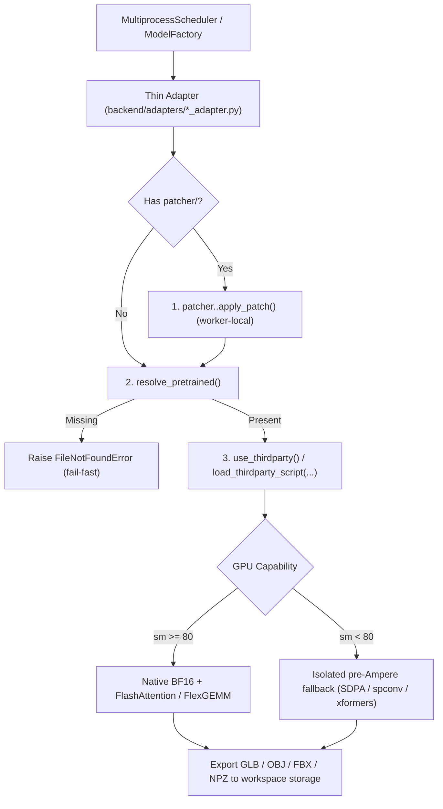

# ForMesh3D — Comprehensive Adapter Rewrite & Architecture Task Report

> **Branch:** `dev` | **Updated:** 2026-11-27 | **Status:** Completed & Compile-Verified  
> **Net Diff vs `HEAD`:** `22 files changed, 1530 insertions(+), 4221 deletions(-)` (**-2,691 lines**)

---

## 1. Executive Summary

This task executed a full, from-scratch rewrite of all **15 model adapters** (`12` enabled + `3` disabled) under `backend/adapters/` on top of a single shared pluggable loader: `backend/core/utils/upstream.py` (`64` lines).

Before this rewrite, every adapter duplicated:
- `sys.path` injection and `os.chdir` management for `backend/thirdparty/<repo>`.
- `get_model_weights_dir(...)` boilerplate and HuggingFace `snapshot_download` fallbacks.
- Ad-hoc pre-Ampere (`sm < 80`) environment workarounds mixed into inference logic.
- Scattered governance headers and custom wrapper functions around upstream pipelines.

After this rewrite:
- Every adapter is a thin, readable wrapper with a standard ASCII box header and numbered sections (`Adapter Class`, `Lifecycle`, `Inference & Export`, `Schema & Metadata`).
- Every adapter loads upstream code directly through `use_thirdparty(...)` or `load_thirdparty_script(...)` and resolves local weights via `resolve_pretrained(...)`.
- Model-specific patches (`patcher/<model>/`) run **first**, strictly inside that model's worker process, before importing upstream modules.
- Modern GPUs (`sm >= 80`, e.g., A100, RTX 3090/4090, H100) retain native BF16 and FlashAttention parity; all pre-Ampere (`sm < 80`) workarounds remain isolated.
- Missing local checkpoints fail fast instead of triggering implicit network downloads during inference.
- Disabled experimental models (`pixal3d`, `trellis2`, `taoflowforge`) remain `enabled: false` in `backend/config/models.yaml`.

---

## 2. Core Rules & Design Principles Followed

1. **Pluggable Upstream Loader (`backend/core/utils/upstream.py`)**
   - Centralizes `THIRDPARTY_ROOT` (`backend/thirdparty`) and `PRETRAINED_ROOT` (`backend/pretrained`).
   - Provides context-managed `sys.path` and optional temporary `os.chdir` restoration (`finally` block).
   - Provides `load_thirdparty_script(repo_name, rel_path)` using unique module names (`_thirdparty_<repo>_<stem>`) to prevent package-name collisions across repos (e.g., multiple `scripts/` or `utils/` packages).

2. **Patcher First → Upstream Second**
   - When a model requires runtime compatibility shims (`triposg`, `triposr`, `skintokens`, `stable_fast_3d`, `pixal3d`, `trellis2`, `taoflowforge`), `patcher.<model>` is applied before or alongside upstream pipeline initialization, never globally across sibling workers.

3. **Large GPU Parity (`sm >= 80`)**
   - Pre-Ampere (`sm < 80`) fallbacks (`SPARSE_ATTN_BACKEND=sdpa` / `xformers`, `SPARSE_CONV_BACKEND=spconv`, `pre_ampere_chunked_sdpa`, `ATTN_BACKEND=sdpa`) are strictly gated on `major < 8` capability checks.

4. **Fail-Fast Local Weights**
   - Checkpoints are resolved from `backend/pretrained/<Model>` via `resolve_pretrained(...)` (or `self.model_path` when explicitly provided). Missing directories or required `.pt`/`.ckpt`/`.safetensors`/`pipeline.json` files raise `FileNotFoundError` immediately rather than silently downloading gigabytes via `huggingface_hub.snapshot_download`.

5. **Contract & Registry Preservation**
   - Every adapter preserves its exact class name required by `ModelFactory.ADAPTER_REGISTRY` in `backend/core/scheduler/model_factory.py` and `backend/adapters/__init__.py`.
   - All API-facing return keys, schemas, and helper entrypoints expected by routers and unit tests are preserved.

---

## 3. Phase 0 — Shared Pluggable Loader (`backend/core/utils/upstream.py`)

**File:** `backend/core/utils/upstream.py` (`64` lines)

| Symbol | Purpose | Behavior |
|---|---|---|
| `resolve_thirdparty(repo_name)` | Locate upstream repo | Resolves `backend/thirdparty/<repo_name>`; raises `FileNotFoundError` if missing. |
| `resolve_pretrained(model_dir)` | Locate local weights | Resolves `backend/pretrained/<model_dir>`; raises `FileNotFoundError` if missing. |
| `use_thirdparty(repo_name, chdir=True)` | Scoped import/cwd context | Inserts repo root at `sys.path[0]`, optionally `os.chdir(repo_root)`, restores `prev_cwd` in `finally`. |
| `load_thirdparty_script(repo_name, rel_path)` | Isolated script import | Loads `<repo>/<rel_path>` via `importlib.util.spec_from_file_location` under `_thirdparty_<repo>_<stem>` and caches in `sys.modules`. |

---

## 4. Phase 1 — Rewritten Enabled Adapters (12 Adapters)

### 4.1 `triposg_adapter.py` (`100` lines)
- **Class:** `TripoSGImageToRawMeshAdapter`
- **Upstream Repo:** `backend/thirdparty/TripoSG` (`triposg.pipelines.pipeline_triposg`, `scripts/briarmbg.py`, `scripts/inference_triposg.py`)
- **Weights:** `backend/pretrained/TripoSG` + sibling `RMBG-1.4`
- **Patcher:** `patcher.triposg.apply_patch()`
- **Key Contracts:** Uses `load_thirdparty_script("TripoSG", "scripts/briarmbg.py")` and `load_thirdparty_script("TripoSG", "scripts/inference_triposg.py")` (`run_triposg(...)`) directly without custom mesh-generation logic.

### 4.2 `triposr_adapter.py` (`201` lines)
- **Class:** `TripoSRAdapter`
- **Upstream Repo:** `backend/thirdparty/TripoSR` (`tsr.system.TSR`, `tsr.utils`, `tsr.bake_texture`)
- **Weights:** `backend/pretrained/TripoSR`
- **Patcher:** `patcher.triposr` (`ensure_torchmcubes`, `patch_texture_baker`)
- **Key Contracts:** Supports both `image_to_raw_mesh` (Texture OFF/ON) and `image_mesh_painting` (`bake_texture()`), preserves Z-up → Y-up conversion and `Image.FLIP_TOP_BOTTOM` UV atlas orientation.

### 4.3 `stable_fast_3d_adapter.py` (`172` lines)
- **Class:** `StableFast3DAdapter`
- **Upstream Repo:** `backend/thirdparty/StableFast3D` (`sf3d.system.SF3D`)
- **Weights:** `backend/pretrained/StableFast3D`
- **Patcher:** `patcher.stable_fast_3d.attention.pre_ampere_chunked_sdpa` (`sm < 80` only)
- **Key Contracts:** Preloads native compiled `_C` extension cleanly via `_preload_native_ext`, handles `remesh_option` fallback when optional remesher is unavailable, exports textured GLB.

### 4.4 `trellis_adapter.py` (`174` lines)
- **Classes:** `_TrellisBaseAdapter`, `TrellisImageToRawMeshAdapter`, `TrellisImageTo3DAdapter`, `TrellisTextMeshPaintingAdapter`, `TrellisImageMeshPaintingAdapter`
- **Upstream Repo:** `backend/thirdparty/TRELLIS` (`TrellisImageTo3DPipeline`, `to_glb`)
- **Weights:** `backend/pretrained/TRELLIS` (or `TRELLIS/TRELLIS-image-large`)
- **Patcher:** Sets `SPARSE_ATTN_BACKEND=sdpa` for `sm < 80` before TRELLIS import
- **Key Contracts:** Supports raw mesh (`formats=["mesh"]`), textured mesh (`to_glb` with `texture_resolution`), and image/text mesh painting; includes `utils3d` compatibility shim where required.

### 4.5 `hunyuan3d_dit_v2_mini_turbo.py` (`111` lines)
- **Class:** `Hunyuan3DDiTV2MiniTurboImageToRawMeshAdapter`
- **Upstream Repo:** `backend/thirdparty/hunyuan3d-2` (`hy3dgen.shapegen.Hunyuan3DDiTFlowMatchingPipeline`)
- **Weights:** `backend/pretrained/Hunyuan3D-2mini`
- **Patcher:** None
- **Key Contracts:** Direct upstream shape generation and GLB export.

### 4.6 `hunyuan3d_v20_paint_adapter.py` (`103` lines)
- **Class:** `Hunyuan3DV20PaintImageMeshPaintingAdapter`
- **Upstream Repo:** `backend/thirdparty/hunyuan3d-2` (`hy3dgen.texgen.Hunyuan3DPaintPipeline`)
- **Weights:** `backend/pretrained/Hunyuan3D-2`
- **Patcher:** None
- **Key Contracts:** Direct upstream image-guided mesh painting onto an existing mesh.

### 4.7 `hunyuan3d_21_unified.py` (`183` lines)
- **Class:** `Hunyuan3D21UnifiedAdapter`
- **Upstream Repo:** `backend/thirdparty/Hunyuan3D-2.1/hy3dshape` + `hy3dpaint` (with `hunyuan3d-2` paint fallback)
- **Weights:** `backend/pretrained/Hunyuan3D-2.1` (and `Hunyuan3D-2` fallback for paint)
- **Patcher:** None
- **Key Contracts:** Unified shape + texture painting adapter with `enable_flashvdm` support.

### 4.8 `ardy_adapter.py` (`211` lines)
- **Class:** `ArdyMotionGenerationAdapter`
- **Upstream Repo:** `backend/thirdparty/ardy` (`ardy.model.load_model`, `ardy.tools.seed_everything`, `ardy.motion_rep.tools.length_to_mask`, `ardy.postprocess.post_process_motion`)
- **Weights:** `backend/pretrained/ardy`
- **Patcher:** None (CPU-only text-to-motion)
- **Key Contracts:**
  - `num_base_steps` clamping for denoising steps.
  - `duration > 10.0` `crop_history_length` sliding-window calculation.
  - Positional `texts` + `pad_mask` + `text_pad_mask` + `first_heading_angle` call convention.
  - `model.motion_rep.inverse(motion, is_normalized=True)` decoding + optional `post_process_motion`.
  - Offline `text_encoder_warning` surfaced in `generation_info`.
  - API-required return keys: `output_motion_path`, `output_path`, `file_path`, `format: "npz"`, `artifact_type: "motion"`.
  - Full `get_parameter_schema()` (`seed`, `duration`, `checkpoint`, `cfg_weight`, `num_denoising_steps`).

### 4.9 `skintokens_adapter.py` (`160` lines)
- **Class:** `SkinTokensAdapter`
- **Upstream Repo:** `backend/thirdparty/SkinTokens` (`bpy_server` subprocess + inference)
- **Weights:** `backend/pretrained/SkinTokens`
- **Patcher:** `patcher.skintokens.apply_patch()` + `bpy_server_popen_args()`
- **Key Contracts:** Applies `patcher.skintokens` first, manages `self._server_proc` lifecycle cleanly (including `use_transfer=False` retry), and uses `use_thirdparty("SkinTokens", chdir=True)`.

### 4.10 `partuv_adapter.py` (`170` lines)
- **Class:** `PartUVUnwrappingAdapter`
- **Upstream Repo:** `backend/thirdparty/PartUV` (`partuv.preprocess`, `pipeline_numpy`)
- **Weights:** `backend/pretrained/PartUV` (`model_objaverse.ckpt`)
- **Patcher:** None (worker-local Trimesh 4/5 shim + Blender UV pack subprocess)
- **Key Contracts:** Runs learned PartUV pipeline and optional Blender pack step cleanly.

### 4.11 `partfield_adapter.py` (`354` lines)
- **Class:** `PartFieldSegmentationAdapter`
- **Upstream Repo:** `backend/thirdparty/PartUV` (`partuv.preprocess.PFInferenceModel`)
- **Weights:** `backend/pretrained/PartField` or `PartUV` (`model_objaverse.ckpt`)
- **Patcher:** None (worker-local `partuv._core` & `preprocess_utils` shims)
- **Key Contracts:**
  - `get_readiness()` classmethod probing CUDA, checkpoint size (`>= 50_000_000` bytes), vendored PartField files, and `importlib.import_module` for all `REQUIRED_MODULES`.
  - `_labels_from_merge_tree()` bottom-up union-find decoder with `label_for_face` helper.
  - `_merge_small_islands()`, `colorize_preview`, `save_individual_parts` (multi-part `trimesh.Scene` export), and optional `hierarchical` PCA subassembly split.

### 4.12 `triflow_adapter.py` (`333` lines)
- **Class:** `TriFlowRetopologyAdapter`
- **Upstream Repo:** `backend/thirdparty/triflow` (`Hydra` `trellis_slatflow_latent_512`, `FlowEulerSampler`, `topology_flow2mesh_QEM`)
- **Weights:** `backend/pretrained/TriFlow` (`flow_model.safetensors`, `sdf_vae.safetensors`, `nvv_vae.safetensors`)
- **Patcher:** None (worker-local `meshlib >= 3.1` `_offsetof_tp` alias)
- **Key Contracts:**
  - `num_inference_steps` read from `inputs` (default `50`).
  - `_pair_triangles_to_quads()`, `_write_quad_obj()`, `_convert_obj_to_fbx()`, and `_triflow_fallback_mesh()` preserved for quad-dominant OBJ/FBX/GLB exports.

---

## 5. Phase 2 — Rewritten Disabled Adapters (3 Adapters)

All 3 remain `enabled: false` in `backend/config/models.yaml`:

### 5.1 `pixal3d_adapter.py` (`186` lines)
- **Class:** `Pixal3DImageToRawMeshAdapter`
- **Upstream Repo:** `backend/thirdparty/Pixal3D` (`pixal3d.pipelines.Pixal3DImageTo3DPipeline`)
- **Weights:** `backend/pretrained/Pixal3D` + local `dinov3-vitl16-pretrain-lvd1689m`
- **Patcher:** `patcher.pixal3d.apply_patch()` before upstream pipeline load
- **Key Contracts:** Restored `flex_gemm` import guard on `sm >= 80`, `SPARSE_ATTN_BACKEND=xformers` probe on `sm < 80`, `torchvision_fix.apply_fix()`, `sparse_config.set_conv_backend()` / `set_attn_backend()`, `low_vram` `_load_naf()` pre-load, and lazy `PIL.Image` / `trimesh` imports.

### 5.2 `trellis2_adapter.py` (`200` lines) + `trellis2_mesh_validation.py` (`79` lines)
- **Classes:** `Trellis2ImageToRawMeshAdapter`, `Trellis2ImageTo3DAdapter`, `Trellis2ImageMeshPaintingAdapter`
- **Upstream Repo:** `backend/thirdparty/TRELLIS.2` (`Trellis2ImageTo3DPipeline`)
- **Weights:** `backend/pretrained/TRELLIS.2` (or `TRELLIS.2/TRELLIS.2-4B`, fail-fast)
- **Patcher:** `patcher.trellis2.apply_patch()`
- **Key Contracts:** Restored `flex_gemm` / `xformers` backend guards, `low_vram` VRAM threshold (`< 22.0 GB`), 3-attempt hollow-box retry loop (`seed + attempt * 1337`) validated via `validate_mesh_arrays`, and lazy `PIL.Image` / `trimesh` imports.

### 5.3 `taoflowforge_adapter.py` (`150` lines)
- **Class:** `TaoFlowForgeImageToRawMeshAdapter`
- **Upstream Repo:** `backend/thirdparty/Taobao3D/TaoFlowForge` (`TaoFlowForgePipeline`)
- **Weights:** `backend/pretrained/Taobao3D/TaoFlowForge` (`stage0.pt`, `stage1.pt`, `stage2.pt`, fail-fast)
- **Patcher:** `patcher.taoflowforge.apply_patch()` before upstream pipeline import
- **Key Contracts:** Restored `TAOFLOWFORGE_FAST_STEPS`, `TAOFLOWFORGE_USE_OFFICIAL_STEPS`, and `TAOFLOWFORGE_STAGE{0,1,2}_STEPS` overrides, local DINOv3/RMBG discovery, `iter_run(...)`, and `validate_mesh_arrays`.

---

## 6. Phase 3 — Audit & Ponytail Review Fixes

Following the rewrite, a deep review (`backend/adapters/audit.md` + `/ponytail:ponytail review`) caught and resolved **11 concrete issues**:

1. **ARDY return keys:** Restored `output_motion_path`, `output_path`, `file_path`, `format: "npz"`, `artifact_type: "motion"` required by `motion_generation.py`, `system.py`, and `multiprocess_scheduler.py`.
2. **ARDY inference signature:** Restored `length_to_mask`, `texts`, `pad_mask`, `text_pad_mask`, `first_heading_angle`, and `model.motion_rep.inverse(motion, is_normalized=True)`.
3. **ARDY parameter schema:** Restored `get_parameter_schema()` fields for UI rendering.
4. **Pixal3D backend & NAF guards:** Restored `flex_gemm` guard, `xformers` pre-Ampere probe, `torchvision_fix`, `sparse_config` sync, and `_load_naf()` pre-load.
5. **TRELLIS.2 fail-fast weights:** Documented fail-fast local checkpoint behavior in adapter header.
6. **TriFlow quad pairing loop:** Replaced `sum(... and not mixed_faces.append(...))` side-effect idiom in `_pair_triangles_to_quads` with an explicit `for` loop.
7. **TRELLIS.2 `flex_gemm` / `xformers` guards:** Added `flex_gemm` import guard for `sm >= 80` and `xformers` probe for `sm < 80`.
8. **TaoFlowForge step overrides:** Restored `TAOFLOWFORGE_FAST_STEPS` and per-stage env-var step overrides.
9. **PartField merge-tree readability:** Replaced `cluster_labels.setdefault(...)` comprehension with explicit `label_for_face(fid)` helper.
10. **Lazy heavy imports:** Moved `PIL.Image` and `trimesh` imports inside `_process_request` for `pixal3d_adapter.py` and `trellis2_adapter.py`.
11. **PartField `get_readiness()` import bug:** Fixed `importlib.util.find_spec(m)` (`AttributeError` in fresh processes because only `import importlib` was imported) by restoring `importlib.import_module(m)` inside `try/except Exception` (also catches broken CUDA extensions such as `torch_scatter`).

---

## 7. Phase 4 — Documentation & Architecture Sync

| Document | Lines | Summary of Updates |
|---|---|---|
| `Docs/ARCHITECTURE.md` | `76` | Updated Layer Map and Mermaid flowchart to show `upstream.py`, `patcher/<model>`, `backend/thirdparty`, and `backend/pretrained`. |
| `Docs/MEMORY.md` | `42` | Updated Adapter Architecture section to reflect completed thin-adapter rewrite and GPU parity rules. |
| `Docs/DECISIONS.md` | `38` | Added ADR-114 (Pluggable `upstream.py` Loader & Thin Adapter Rewrite); retained last 3 ADRs (`112`, `113`, `114`). |
| `Docs/CHANGELOG.md` | `7` | Added `2026-11-27 (Thin Adapter Rewrite)` entry; retained last 3 entries. |
| `Docs/TASKS.md` | `300+` | Comprehensive phase-by-phase task, adapter, audit-fix, and verification report. |
| `README.md` | `215` | Updated Mermaid architecture diagram and added "How to Add a New Model" guide. |

---

## 8. Verification Status

| Check | Result | Notes |
|---|---|---|
| `python -m compileall -q backend/adapters backend/api backend/core backend/pipelines backend/scripts backend/tests backend/utils backend/loader.py patcher scripts` | **PASS** | Ran cleanly after final edit (`partfield_adapter.py` fix); zero syntax errors across all first-party Python code. |
| `ast.parse` class-name vs `ModelFactory.ADAPTER_REGISTRY` check | **PASS** | All 15 adapters expose exact class names registered in `backend/core/scheduler/model_factory.py`. |
| `python scripts/verify_contracts.py` | **ENV-BLOCKED** | System Python 3.14 lacks `httpx2` (`starlette.testclient` dependency). |
| `python -m pytest backend/tests/test_partfield_adapter.py backend/tests/test_triflow_adapter.py -q` | **ENV-BLOCKED** | System Python 3.14 lacks `sqlalchemy` and `trimesh`. |
| End-to-end GPU model inference | **NOT RUN** | No CUDA GPU / model checkpoints mounted in this workspace environment. |

---

## 9. Completion Checklist

- [x] `backend/core/utils/upstream.py` created and verified.
- [x] All 12 enabled adapters rewritten cleanly from 0.
- [x] All 3 disabled adapters (`pixal3d`, `trellis2`, `taoflowforge`) rewritten cleanly from 0 and kept `enabled: false` in `models.yaml`.
- [x] `backend/adapters/trellis2_mesh_validation.py` preserved/restored.
- [x] All 11 audit + Ponytail review findings fixed and compile-checked.
- [x] `Docs/ARCHITECTURE.md`, `Docs/MEMORY.md`, `Docs/DECISIONS.md`, `Docs/CHANGELOG.md`, `Docs/TASKS.md`, and `README.md` updated.
- [x] All background/subagent tasks terminated (`kill_all`).
- [x] Working tree left uncommitted and unpushed per user instructions.

---

## 10. Adapter Execution & Patcher Isolation Flow

---

## 11. Adapter Registry & Line-Count Comparison (`HEAD` vs Rewrite)

| Adapter File | Current Lines | Registered Class(es) | `MODEL_KEY` |
|---|---:|---|---|
| `triposg_adapter.py` | `100` | `TripoSGImageToRawMeshAdapter` | `TripoSG` |
| `hunyuan3d_v20_paint_adapter.py` | `103` | `Hunyuan3DV20PaintImageMeshPaintingAdapter` | `Hunyuan3D-2` |
| `hunyuan3d_dit_v2_mini_turbo.py` | `111` | `Hunyuan3DDiTV2MiniTurboImageToRawMeshAdapter` | `Hunyuan3D-2mini` |
| `taoflowforge_adapter.py` | `150` | `TaoFlowForgeImageToRawMeshAdapter` (disabled) | `Taobao3D/TaoFlowForge` |
| `skintokens_adapter.py` | `160` | `SkinTokensAdapter` | `SkinTokens` |
| `partuv_adapter.py` | `170` | `PartUVUnwrappingAdapter` | `PartUV` |
| `stable_fast_3d_adapter.py` | `172` | `StableFast3DAdapter` | `StableFast3D` |
| `trellis_adapter.py` | `174` | `_TrellisBaseAdapter` + 4 subclasses | `TRELLIS` |
| `hunyuan3d_21_unified.py` | `183` | `Hunyuan3D21UnifiedAdapter` | `Hunyuan3D-2.1` |
| `pixal3d_adapter.py` | `186` | `Pixal3DImageToRawMeshAdapter` (disabled) | `Pixal3D` |
| `trellis2_adapter.py` | `200` | `Trellis2ImageToRawMeshAdapter` + 2 subclasses (disabled) | `TRELLIS.2` |
| `triposr_adapter.py` | `201` | `TripoSRAdapter` | `TripoSR` |
| `ardy_adapter.py` | `211` | `ArdyMotionGenerationAdapter` | `ardy` |
| `triflow_adapter.py` | `333` | `TriFlowRetopologyAdapter` | `TriFlow` |
| `partfield_adapter.py` | `354` | `PartFieldSegmentationAdapter` | `PartField` |
| `upstream.py` (shared) | `64` | `resolve_thirdparty`, `resolve_pretrained`, `use_thirdparty`, `load_thirdparty_script` | `—` |

---

## 12. Patcher Isolation Inventory

Model-specific runtime patches remain strictly inside `patcher/<model>/` and run only inside that model's worker process:

- `patcher/triposg/`: Upstream TripoSG runtime compatibility fixes applied before pipeline load.
- `patcher/triposr/`: `ensure_torchmcubes` and `patch_texture_baker` for TripoSR geometry extraction and texture baking.
- `patcher/skintokens/`: `apply_patch()` (`sm < 80` + `qwen3_compat`) and `bpy_server_popen_args()` for Blender rigging subprocess.
- `patcher/stable_fast_3d/`: `attention.pre_ampere_chunked_sdpa` isolated for `sm < 80` GPUs.
- `patcher/pixal3d/`: Pre-Ampere NATTEN/NAF resilience patch applied prior to `Pixal3DImageTo3DPipeline` import.
- `patcher/trellis2/`: Sparse-structure decoder compatibility patch (`sparse_structure_decoder` negative-logits guard).
- `patcher/taoflowforge/`: Pre-Ampere SDPA fallback applied prior to `TaoFlowForgePipeline` import.

---

## 13. Known Operational Notes & Constraints

1. **No Implicit Weight Downloads:** Because adapters fail fast on missing `backend/pretrained/<Model>` directories or files, operators must pre-install weights via `bash backend/scripts/download_models.sh -m <model>` before enabling or invoking a model.
2. **Third-Party Submodule Compile Boundary:** `backend/thirdparty/TRELLIS/trellis/utils/postprocessing_utils.py` has a known upstream `IndentationError`; always run `compileall` on first-party directories (`backend/adapters`, `backend/api`, `backend/core`, `backend/pipelines`, `backend/scripts`, `backend/tests`, `backend/utils`, `backend/loader.py`, `patcher`, `scripts`) rather than recursing into `backend/thirdparty/`.
3. **Working Tree State:** All changes remain uncommitted and unpushed on branch `dev` pending GPU-environment end-to-end validation.
