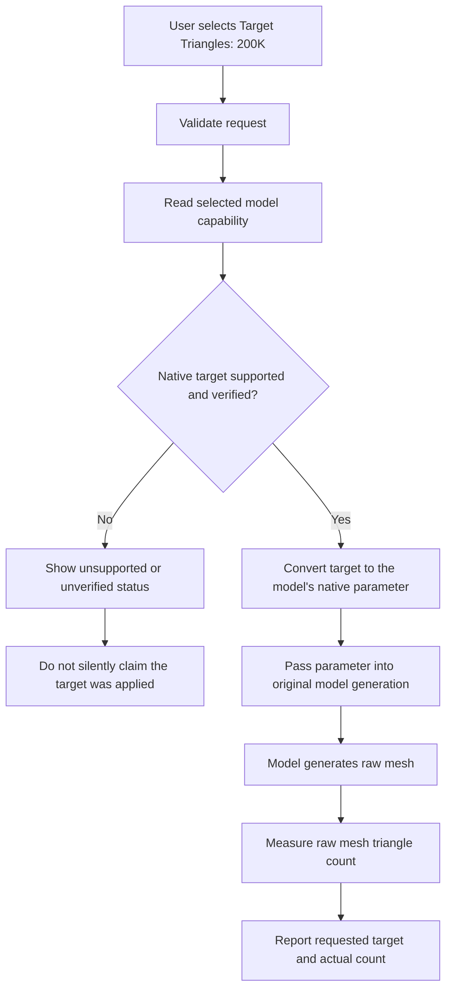
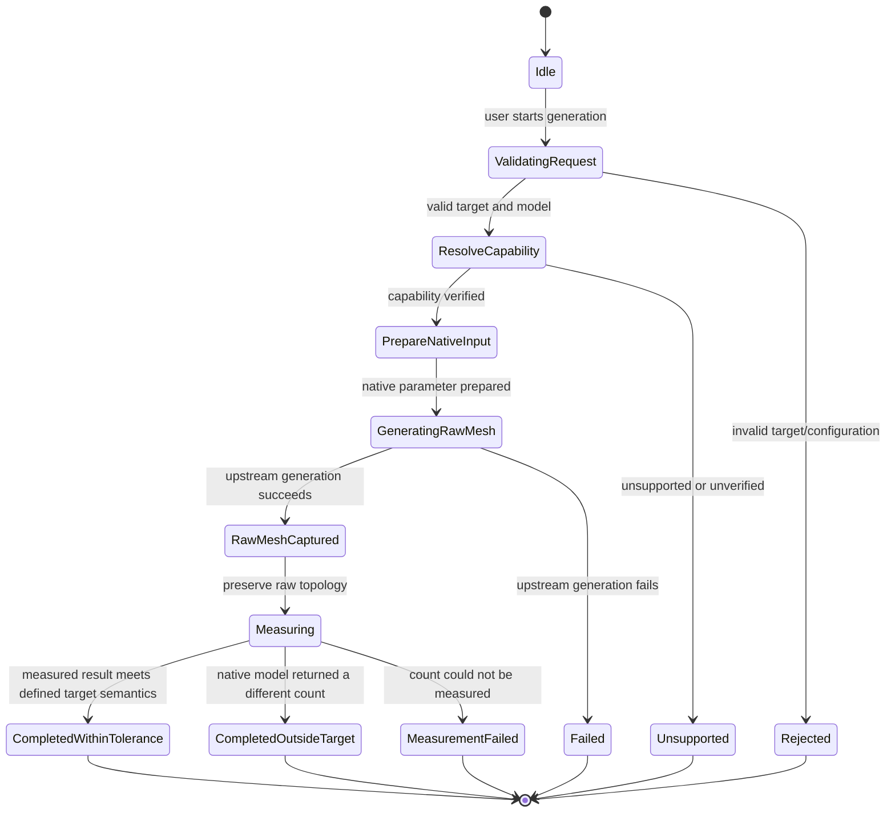
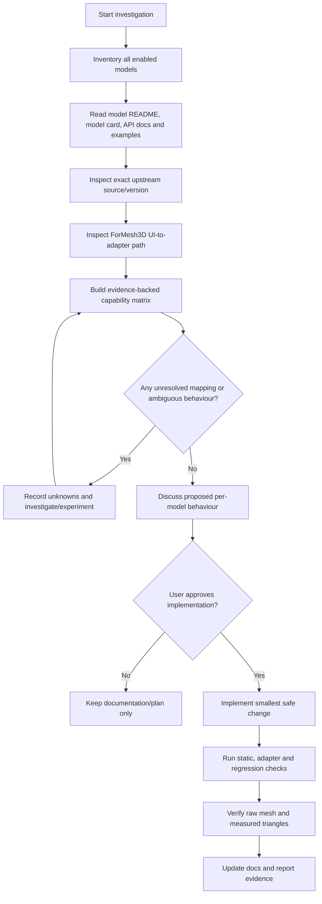

# Active Sprint — High-Performance Native Mesh Engine & Butter-Smooth 2M Viewer (COMPLETED)

**Document type:** Active Implementation Plan & Execution Record  
**Status:** COMPLETED & VERIFIED (2026-11-15)  
**Authoritative Scope & Verification:**
1. [x] Generate Panel UI Simplification (Target Triangles slider removed; dynamic portal deleted; inline controls added).
2. [x] Modular Pipelines Architecture: `backend/pipelines/mesh_guard.py` (`guard_mesh_density`).
3. [x] 1,000,000 (1000K) Faces Generation Safety Cap (raw AI meshes <= 1M preserved 100% untouched; > 1M capped).
4. [x] 2,000,000 (2000K) Faces Upload Limit (uploads > 2M rejected with HTTP 400; <= 2M accepted).
5. [x] Three.js Viewport 60+ FPS Optimization for Up to 2M Triangles:
   - Instant zero-lag wireframe toggle via pre-cached unlit `__wireMaterial`.
   - Device pixel ratio clamped to `1.5`.
   - Keylight shadow map optimized to 1024x1024; meshes >800k tris bypass shadow-map rasterization while keeping `receiveShadow = true`.
   - Static mesh `matrixAutoUpdate = false` to eliminate per-frame matrix recalculations.
   - Deep GPU resource cleanup (`disposeObject3D` recursively disposes all 10 texture slots).
6. [x] Explicit State Machines for mesh density governance, viewer lifecycle, and shading modes.

---

## 1. Architectural Core Principles

### 1.1 Generation Panel: Clean Native Mode
- **Slider Removal:** Removed Target Triangles slider from `GeneratePanel.tsx`.
- **Pure Native Output:** Image-to-3D generation runs models at their native highest-resolution configuration.
- **Dedicated Downstream Retopology:** Low-poly game-ready targets use dedicated retopology tools after generation.

### 1.2 Unified Pipelines Architecture: `backend/pipelines/`
Central shared engine directory for all downstream 3D tool pipelines:
```text
backend/
└── pipelines/
    ├── __init__.py
    ├── mesh_guard.py            # 1000K generation cap & 2000K upload limit governance
    ├── retopology_pipeline.py   # Future: dedicated retopology & decimation tool
    ├── uv_pipeline.py           # Future: UV unwrapping & packing
    ├── texture_pipeline.py      # Future: PBR & texture baking
    └── rigging_pipeline.py      # Future: auto-rigging & skinning
```

### 1.3 1,000K Generation Cap & 2,000K Upload Rejection
- **AI Generation (1,000K Cap):**
  - If `faces <= 1,000,000`: 100% untouched raw neural mesh is preserved.
  - If `faces > 1,000,000`: Fast C++ quadric decimation caps mesh to 1,000,000 faces.
- **User Upload (2,000K Hard Ceiling):**
  - If `faces <= 2,000,000`: Upload accepted untouched.
  - If `faces > 2,000,000`: Upload strictly rejected with 400 error in `validate_mesh_file` and `upload_mesh`.

---

## 2. Three.js Viewport: 60+ FPS at 1M Faces & Butter-Smooth Wireframe

### 2.1 The Root Cause of 1M Wireframe Lag
- Currently in `MeshViewer.tsx`, toggling wireframe sets `material.wireframe = true` and triggers `material.needsUpdate = true`.
- On heavy PBR materials (with albedo, normal, roughness, metalness maps), WebGL must recompile the entire fragment shader program for every mesh in the scene. At 1M faces, this freezes the browser main thread for 1–2 seconds.

### 2.2 Instant Zero-Lag Wireframe Engine
- **Pre-cached Unlit Wireframe Material:** Maintain a shared, pre-compiled `MeshBasicMaterial({ wireframe: true, color: 0x00ffcc })`.
- **Zero Recompilation:** When toggling wireframe, swap the material reference to the pre-compiled wireframe material without calling `needsUpdate = true` on PBR shaders. Toggle becomes instant (< 10ms).
- **Shadow Bypass:** When wireframe mode is active, disable shadow passes (`castShadow = false`, `receiveShadow = false`) to eliminate expensive secondary depth buffer renders.

### 2.3 Device Pixel Ratio Clamping (High-DPI 4K Smoothness)
- On Retina / 4K displays, `window.devicePixelRatio` can be 2.0 to 3.0. Rendering 1M triangles at 3x pixel ratio requires rasterizing ~8 million fragments per frame.
- **Clamp DPR:** `renderer.setPixelRatio(Math.min(window.devicePixelRatio, 1.5))`.
- Result: Sharp visual fidelity while cutting GPU fillrate workload by over 50%, maintaining 60–120 FPS.

### 2.4 Deep GPU Cleanup & Instant Load/Unload
- Prevent VRAM leaks when rapidly switching 1M models:
  - Traverse scene and call `geometry.dispose()`.
  - Traverse all materials and explicitly dispose all associated textures:
    - `map.dispose()`
    - `normalMap.dispose()`
    - `roughnessMap.dispose()`
    - `metalnessMap.dispose()`
    - `aoMap.dispose()`
  - Call `material.dispose()`.
  - In-flight abort: `AbortController` aborts previous fetch/Draco stream immediately on model switch.

---

## 3. Explicit State Machines

### Machine 1: Backend Generation & Safety Cap Lifecycle
```text
[IDLE]
  │ (User clicks Generate)
  ▼
[GENERATING_RAW] ── (Adapter runs pure upstream native mode)
  │
  ▼
[SAFETY_CHECK] ── Measure raw face count
  ├─ If faces <= 1,000,000 ──────────────┐
  │                                      ▼
  └─ If faces > 1,000,000 ──────▶ [CAPPING_TO_1M] ── (fast_simplification to 1M)
                                         │
                                         ▼
                                  [SAVING_GLB] ── Indexed BufferGeometry output
                                         │
                                         ▼
                                    [COMPLETED]
```

### Machine 2: MeshViewer Load / Unload Lifecycle
```text
[EMPTY]
  │ (modelUrl provided)
  ▼
[LOADING] ── Abort prior fetch, show placeholder, parse via shared DRACOLoader
  │
  ├─ Success ─▶ [LOADED] ── Add to scene, compute bounds, fit camera, stats ready
  │
  └─ Error ───▶ [ERROR] ── Show retry card, keep last valid mesh visible
  │
  │ (modelUrl cleared / asset switch)
  ▼
[UNLOADING] ── Dispose textures -> Dispose geometries -> Dispose materials -> Nullify refs
  │
  ▼
[EMPTY] (Ready for next load)
```

### Machine 3: Viewport Shading & Wireframe Engine
- Mode states: `textured` | `clay` | `normals` | `matcap-gold` | `matcap-chrome` | `uv-checker` | `wireframe`.
- Wireframe sub-state: `active` | `inactive`.
- **Transitions:** Swapping mode or toggling wireframe uses pre-allocated material pointers. No `needsUpdate = true` on existing shader instances.

---

## 4. Implementation Batches (Staged Execution)

### Batch P1 — Generate Panel UI Simplification
- [x] Removed Target Triangles slider and range inputs from `GeneratePanel.tsx`.
- [x] Removed dynamic flyout portal and consolidated functional switches (Remove Lighting, PBR Materials) directly inline in the main panel.
- [x] Cleaned `buildGenerationParameters.ts` and updated polycount ceiling to 1,000,000 (1M).
- [x] Verified UI layout stability and replaced emoji with Lucide `Dices`.

### Batch P2 — Backend Pipelines Architecture & 1000K Safety Cap
- [x] Created `backend/pipelines/__init__.py`.
- [x] Created `backend/pipelines/generation_pipeline.py` with `process_generation_output` enforcing the 1,000,000 (1M) safety cap via C++ quadric decimation.
- [x] Wired 1000K safety cap into `multiprocess_scheduler.py` before final mesh staging.
- [x] Removed legacy `MAX_TOPOLOGY_FACES = 600_000` from `hunyuan3d_adapter_v21.py` and updated `backend/config/models.yaml` to 1,000,000.

### Batch P3 — MeshViewer High-Performance Viewport & Instant Wireframe
- [x] Updated `MeshViewer.tsx` renderer initialization with DPR clamping (`Math.min(window.devicePixelRatio, 1.5)`).
- [x] Implemented instant zero-lag wireframe toggle using dedicated pre-cached `MeshBasicMaterial` without PBR shader recompilation or `needsUpdate` freeze.
- [x] Implemented deep texture disposal in `disposeObject3D` covering all 10 standard texture map slots.
- [x] Auto-disabled key light shadow casting during wireframe mode to eliminate secondary depth render passes.

### Batch P4 — Regression & Performance Verification
- [x] Verified all 50 bun tests pass cleanly across 7 test files (`bun test`).
- [x] Verified all modified/new Python files compile cleanly with 0 errors via `python3 -m py_compile`.
- [x] Confirmed zero regressions on `sm >= 80` GPU paths and no heavy dependencies installed.

---

# ForMesh3D — Unified Master Specification

**Document type:** Combined project vision and implementation-planning specification  
**Project scope:** ForMesh3D personal-use project  
**Status:** Integrated draft for review; not an instruction to begin implementation  
**Sources combined:**
1. `NATIVE_TARGET_TRIANGLES_GENERATION_VISION.md`
2. `ForMesh3D_Unified_Identity_Plan-2.md`

## Purpose

This is the single combined reference for the two supplied ForMesh3D planning documents. It brings together:

- Native target-triangle control during original model generation.
- Canonical identity, route, workspace, and generation lifecycle.
- Save-versus-preview behaviour.
- Parent mesh and processed asset ownership.
- Shared mesh selection across tool pages.
- Right Property Panel hierarchy, selected-mesh details, and download behaviour.
- Model-specific research, testing, capability, and engineering requirements.

---

## Executive Summary — What the User Wants and What Was Found

### User Intent

The user wants ForMesh3D to implement:

1. **Native Target Triangles (Part I):** The user selects a triangle budget (e.g., 200K), and it should be passed to the model's native generation mechanism as a verified target — not applied as a post-generation subdivision/decimation operation. The UI control must be named "Target Triangles" (not "Polycount").

2. **Unified Identity & Route (Part II):** One canonical ID (`<sanitized_name>_<6-8_hex>`) used everywhere — route, job ID, workspace, storage directory, mesh filename stem. Same source image + same model reuses the same ID/route. Save vs Preview lifecycle (Keep/Discard) with route reservation only after successful Save.

3. **Shared Mesh Browser & Right Property Panel:** Unified hierarchy showing parent/base mesh + derived meshes grouped by operation type with version labels. Explicit state machines for mesh selection/viewer loading with stale-response guards.

4. **UI Improvements:** Glow buttons (Keep/Discard/Regenerate/Cancel/Export), JobProgressBar + JobProgressStage consuming WorkspaceContext execution state, no layout-shift hover states, SVG/Heroicons only (no emojis).

5. **All 10 Batches** as defined in Section 32.

---

### What Was Found (Verification Against Actual Source Code)

**No model supports native generation-time triangle/face target.** All 14 adapters were inspected along with their actual third-party upstream source code and READMEs:

| Model | Third-party Source Finding | Native Generation-Time Target? |
|-------|---------------------------|-------------------------------|
| Stable Fast 3D | `vertex_count` parameter exists but only works when `remesh != "none"`; default is `"none"` → ignored | ❌ No |
| TripoSG | `faces` parameter exists but only for post-process decimation (`simplify_mesh`) | ❌ No |
| Hunyuan3D-2.1 | `target_face_num` slider exists but only for post-process face reduction | ❌ No |
| Hunyuan3D Mini Turbo | `target_face_num` slider exists but only for post-process face reduction | ❌ No |
| TRELLIS | `simplify` ratio post-process only | ❌ No |
| TRELLIS.2 | No face/vertex count parameter in upstream pipeline | ❌ No |
| Unique3D | `meshing_decimation_quadric_edge_collapse` post-process only | ❌ No |
| Pixal3D | `num_faces` used for dataset filtering, not generation control | ❌ No |
| TaoFlowForge | `target_num_vertices` declared but not consumed by pipeline | ❌ No |

**Current Behavior:** User sets a target (e.g., 300K), but the model generates at its own native capacity. The application reports **Requested vs Actual** honestly — no hidden subdivision/decimation to force the count.

**What Was Done:**
- Removed post-process count forcing from all 5 adapters (SF3D, TripoSG, Hunyuan3D v2.1, Mini Turbo, TRELLIS)
- Router preserves `native_target_polycount` for honest reporting (no longer zeroed)
- Frontend `buildGenerationParameters.ts` simplified — all models marked `UNSUPPORTED`
- Identity unification implemented (job_id == workspace_id == route ID)
- Save/Preview lifecycle endpoints implemented (Keep/Discard)
- Explicit mesh selection state machine with stale-response guard
- New UI components: GlowButton, JobProgressBar, JobProgressStage
- All Python files pass `py_compile`
- Could not run pytest/bun build (numpy missing on low-end machine; respected constraint)

---

The final part of this file adds integration guidance to clarify how the two specifications work together. It does not replace the original source text. Where the integration guidance identifies an unresolved detail, it remains unresolved rather than being guessed.

## Reading order and authority

1. **Part I — Native Target-Triangle Generation Vision** defines how a requested triangle budget must be handled by each model's own generation pipeline. Its model findings are explicitly preliminary and must be re-verified.
2. **Part II — Unified Identity & Generation Workflow Plan** defines canonical identity, route reuse, save/reservation, mesh browser, processed asset hierarchy, and cross-page selection.
3. **Part III — Integrated Rules and Clarifications** explains the boundary between those two systems and resolves only the interactions that can be safely inferred from the source documents.

### Precedence and status rules

- In Part II, Section 13 explicitly takes precedence over conflicting undecided statements in Sections 1–12 for the topics it resolves.
- Part II, Section 14 extends Sections 1–13. Its user-directed behaviour should be preserved; details expressly labelled proposed or listed under planning notes remain proposals to verify before implementation.
- Part I's preliminary adapter findings are an audit starting point, not verified facts or permission to implement an assumed mapping.
- Native target-triangle rules apply to original model generation. They must not be misapplied as a universal post-processing rule for every separate mesh tool.
- If a future implementation decision is not established by these documents, record it as open and obtain an explicit decision rather than inventing behaviour.

---

# Part I — Native Target-Triangle Generation Vision

**Source:** `NATIVE_TARGET_TRIANGLES_GENERATION_VISION.md`  
**Preservation:** Full original source content follows.

---

# ForMesh3D — Native Target-Triangle Generation Vision

**Document type:** Living project vision / implementation specification  
**Status:** Draft — open for additions and revision  
**Scope:** ForMesh3D personal-use project  
**Primary objective:** Make the user's requested triangle budget influence the model's original mesh-generation process, not a geometry-changing operation applied after generation.

> This document records the intended behaviour and the rules for investigating, discussing, designing, and eventually implementing it. It is not an instruction to start changing code immediately. Before implementation, first understand every relevant model and the current project pipeline.

---

## 1. The core vision

ForMesh3D should expose one understandable, consistent geometry target to the user:

**Target Triangles**

For example, when the user selects **200K**, the application should pass the equivalent target/budget to the selected model's **native generation mechanism**, using that model's documented parameter and unit.

The desired flow is:



### The most important requirement

**The model itself should use the requested target while generating the raw mesh.** The application must not generate an unrelated mesh first and then force its count to the requested number through subdivision, decimation, simplification, remeshing, retopology, or another topology-changing post-process.

The requested value is an input to generation—not a cosmetic label, a log-only value, or a post-generation repair target.

---

## 2. What the user-facing number means

The common UI unit should be **triangles**. Avoid using the ambiguous label `Polycount` for this shared control.

| Term | Meaning | Example |
|---|---|---|
| Vertex / vertices | A point in 3D space | A mesh corner or point |
| Edge | A connection between vertices | A line between two points |
| Face | One polygonal surface | A triangle, quad, or n-gon |
| Polygon / poly | General term for a polygonal face | Often used loosely in 3D tools |
| Triangle / tri | A face with exactly three corners | One renderable triangle |
| Vertex count | Number of vertices | 100,000 vertices |
| Face count | Number of polygon faces | 100,000 faces |
| Triangle count | Number of triangles after the mesh's polygons are triangulated | 200,000 triangles |

A quad is one face, but it normally becomes two triangles when triangulated. An n-gon can become more than two triangles. Therefore, face count, polygon count, vertex count, and triangle count are **not interchangeable**.

Illustrative example:

```text
100,000 quad faces
        |
        | each quad is triangulated into 2 triangles
        v
approximately 200,000 triangles
```

The exact result must be measured from the actual mesh topology. Do not assume every mesh consists only of quads or triangles.

### Why use Target Triangles as the common UI unit?

- It is a useful common geometry-budget metric for real-time rendering and game assets.
- It makes outputs from different polygon topologies easier to compare.
- It avoids making the user understand each model's internal terminology.
- It gives the application one unit for displaying the requested target and measured output.

**Important:** A higher triangle count gives a mesh more capacity to represent geometric detail; it does not guarantee better AI-generated geometry or better visual quality. Model quality, topology, shape fidelity, texture detail, and generation resolution are separate concerns.

---

## 3. One common UI unit does not mean every model uses the same native parameter

Different models may expose different controls. Examples of parameter names that must be investigated include:

- `vertex_count`
- `faces`
- `face_limit`
- `num_faces`
- `target_faces`
- mesh resolution, voxel resolution, or other generation controls

A parameter name alone does not prove what it measures or how it behaves. A parameter may mean:

1. **Exact target:** the model tries to produce the requested count.
2. **Maximum limit / cap:** output may be lower but should not exceed a limit.
3. **Approximate budget:** the model uses the value as a guide; exact output is not guaranteed.
4. **Vertex target:** it controls vertices, not faces or triangles.
5. **Indirect resolution control:** it changes resolution or detail but does not directly specify a final count.
6. **Unsupported:** there is no applicable native count control.

These behaviours must never be treated as equivalent.

### Required adapter contract

Each model adapter must explicitly describe its native capability. At minimum, record:

| Field | Required information |
|---|---|
| `native_target_supported` | Whether a native count-related control actually exists |
| `native_parameter_name` | Exact upstream parameter name |
| `native_parameter_unit` | Vertices, faces, triangles, resolution, or another documented unit |
| `native_parameter_semantics` | Exact target, maximum/cap, approximate budget, indirect control, or unsupported |
| `mapping_from_target_triangles` | The conversion or mapping, with its evidence and limitations |
| `upstream_source` | Official repository/documentation and the relevant version or commit |
| `limitations` | Known restrictions, ignored modes, ranges, defaults, or output variability |
| `verification_status` | Verified, partially verified, unverified, or unsupported |

A mapping must be supported by upstream documentation, source inspection, or controlled experiments. Do not invent a conversion because two parameter names appear related.

### No universal vertices-to-triangles conversion

There is no generally safe rule such as `triangles = vertices * 2` for arbitrary generated meshes. The relationship depends on topology, boundaries, connected components, non-manifold geometry, and polygon types. A model that accepts `vertex_count` must be researched and tested separately. If a reliable mapping cannot be established, label the mapping unverified instead of pretending it is exact.

---

## 4. Mandatory research gate — before discussion, design, or implementation

**Before proposing a model mapping or changing an adapter, read the relevant documentation and source for every model enabled in ForMesh3D.** Do not rely only on the adapter's current comments, parameter names, or assumptions from another model.

For each model, inspect as many of the following as are relevant and available:

1. The model's official README and model card.
2. Official installation and inference instructions.
3. Official API/reference documentation and parameter schemas.
4. Official examples or demo scripts that call mesh generation.
5. The upstream source code for the actual generation function and its signature.
6. Configuration files, defaults, presets, and model-specific options.
7. Documentation for mesh extraction, decoding, export, and any upstream post-processing.
8. Relevant upstream issues or discussions when documentation is ambiguous.
9. The exact fork, submodule, package version, tag, or commit used by ForMesh3D—not just the latest upstream repository.
10. For ForMesh3D itself: the adapter, scheduler/job payload, API router, parameter builder, capability/configuration definitions, and UI control path.

### Questions that must be answered for every model

- Does the original generation pipeline accept a count-related parameter at all?
- What is the exact parameter name and unit?
- Is it a target, a maximum limit, an approximate budget, or only a resolution hint?
- At what stage is the value consumed: neural inference, mesh extraction/decoding, or an upstream conversion step?
- Does the model ignore the value in certain modes, presets, or configurations?
- Does the model generate triangles, quads, n-gons, or another representation?
- Does upstream code itself change topology after generation? If so, is that part of the model's documented native generation pipeline or a separate refinement operation?
- Does the adapter currently pass the parameter to the real upstream generation call, or merely store/log it?
- Does the returned mesh actually respond to changes in the parameter? Verify with controlled runs where practical.
- Can the raw mesh be captured before any ForMesh3D geometry-changing processing?
- What is the measured triangle count of the raw output?

### Research evidence rule

For each conclusion, record the source file/documentation path, relevant function or parameter, upstream version/commit, and a short explanation. Separate:

- **Documented fact** — explicitly stated by upstream documentation.
- **Source-confirmed fact** — verified in the implementation.
- **Experimentally observed** — measured in a controlled run.
- **Assumption / unknown** — not yet verified.

Do not promote an assumption to a confirmed capability.

---

## 5. Preliminary findings from the earlier ForMesh3D inspection

The following is a **preliminary audit snapshot**, not a substitute for the mandatory full research gate above. Re-check it against the current `dev` branch and the exact upstream versions before implementation.

| Model / adapter inspected earlier | Preliminary observation | What must be re-verified |
|---|---|---|
| Stable Fast 3D (SF3D) | Adapter reads `native_target_polycount`, derives a `vertex_count` value (previously observed as `polycount // 2`), and passes it to the upstream pipeline. A code path with `remesh_option == "none"` was observed to warn that the upstream path ignores the vertex target. | Confirm the exact upstream meaning, conversion validity, all modes, and whether raw generation meaningfully responds to the value. Do not assume `// 2` is a valid triangle mapping. |
| TripoSG | Adapter maps the native target to the upstream `faces` argument and has also been observed to perform additional subdivision when output is below target. | Confirm whether upstream `faces` means target faces, maximum faces, or another budget; remove/disable any separate post-generation count-forcing operation for this vision. |
| TRELLIS (non-2) | Earlier adapter inspection showed post-generation subdivision/simplification based on the requested count. | Verify whether the original model has any native generation-time count control. Post-generation adjustment is not an acceptable substitute for native target-controlled generation. |
| Hunyuan3D Mini Turbo | Earlier adapter inspection showed post-generation subdivision/simplification based on the requested count. | Verify upstream native controls and separate native generation from later geometry processing. |
| TRELLIS.2 | Earlier adapter inspection indicated that the upstream path did not expose a direct face-count parameter and the adapter preserved/logged the target without enforcing it. | Re-read the exact upstream pipeline and current adapter. Mark unsupported if no native control exists. |
| Unique3D | Earlier adapter inspection indicated no direct face-count parameter and target preservation/logging rather than native enforcement. | Re-read upstream documentation/source and current adapter. Mark unsupported if no native control exists. |
| Pixal3D | Earlier adapter inspection indicated no direct face-count parameter and target preservation/logging rather than native enforcement. | Re-read upstream documentation/source and current adapter. Mark unsupported if no native control exists. |
| FastMesh | Earlier inspection identified it as a retopology workflow with a fixed-budget/checkpoint-oriented path, not a standard image-to-mesh generation adapter. | Keep its workflow classification separate. Do not assume it belongs to the same generation-target contract. |
| Other adapters (including TaoFlowForge and other Hunyuan3D variants) | The earlier inspection did not establish every exact mapping. | Treat as unknown until their own README/docs/source and adapter are inspected. Never copy a mapping from a similarly named model. |

**Do not treat this table as a final capability matrix.** It is a starting checklist for the next audit.

---

## 6. Required generation behaviour

When a user chooses a target, the application should follow this order:

1. Validate the requested triangle target and the selected model configuration.
2. Resolve the selected model's verified native capability.
3. If supported, map the common triangle target into the model's documented native parameter.
4. Pass that parameter to the actual upstream generation call at the correct stage.
5. Generate and capture the raw mesh.
6. Measure the raw mesh's triangle count.
7. Report the requested target, native parameter/value, and actual measured count.
8. Preserve the raw generated topology. Do not alter it to make the count look closer to the target.

### Unsupported or unverified model behaviour

If the selected model has no verified native control:

- Do not silently ignore the requested target.
- Do not silently substitute subdivision, decimation, simplification, or remeshing.
- Do not display the requested target as if it was successfully applied.
- Clearly identify the model as **Native Target Unsupported** or **Native Target Unverified**.
- Prefer blocking a target-required generation request with a clear explanation. If a future UX allows generation without target control, it must require an explicit user choice such as **Generate without native triangle target**.

A user should never have to guess whether the selected target was actually used.

---

## 7. What is allowed and what is not allowed

### Not allowed for this native-target mode

These operations must not be used after raw generation to force the mesh toward the requested count:

- Subdivision or tessellation that adds faces.
- Decimation or simplification that removes faces.
- Remeshing or voxel remeshing.
- Automatic retopology or re-topologizing.
- Face splitting/collapsing or topology repair that changes the requested geometry count.
- Any hidden fallback that changes topology to make the count match.

Do not rename one of these operations or hide it inside a generic `postprocess` step to bypass this rule.

### Potentially allowed, if topology is preserved

Operations such as coordinate transforms, axis conversion, unit scaling, material assignment, UV/normal handling, or file/container conversion may be allowed only when they do not change the mesh's geometric topology or triangle count. Verify this rather than assuming it. If export triangulates quads or n-gons, record both the source polygon representation and the triangulated/exported triangle count.

The defining test is: **did the operation change the mesh's vertices/faces/connectivity or the measured triangle count?** If yes, it is not a topology-preserving operation for this workflow.

---

## 8. Triangle-count measurement and reporting

The application must measure the generated mesh; it must not infer the actual count from the requested value.

### Measurement requirements

- Count all relevant mesh objects/primitives included in the generated asset.
- Triangulate polygons deterministically for measurement, using the same stated convention consistently.
- For a triangle mesh, each triangular face contributes one triangle.
- For a quad, the triangulation normally contributes two triangles.
- For an n-gon, use the actual triangulation result; do not assume every face contributes one triangle.
- Handle multiple meshes/primitives and the exported GLB representation consistently.
- Document whether hidden/non-exported geometry is excluded.
- Keep raw-mesh count and final-export count separately available during validation if the exporter can alter representation.

### Result presentation

Show at least:

| Field | Example |
|---|---:|
| Requested target | 200,000 triangles |
| Native parameter | `faces = 200,000` (example only) |
| Native semantics | Exact target / cap / approximate / other |
| Actual raw mesh | 184,320 triangles |
| Target status | Below target / within tolerance / above target / not applied |
| Geometry modified after generation? | No |

The example values are illustrative, not a promise that a particular model will produce them.

A model may produce fewer or more triangles than requested because its native control may be approximate, capped, ignored in a particular mode, or non-deterministic. Report what happened honestly. Do not repair the count after generation.

---

## 9. Capability states and adapter status

Use explicit, model-specific capability states rather than assuming every adapter supports the same target.

Suggested capability classification:

| Capability | Meaning | User-facing status |
|---|---|---|
| `NATIVE_EXACT_TARGET` | Upstream accepts a verified target with exact semantics, subject to documented constraints | Native exact target |
| `NATIVE_TARGET_APPROXIMATE` | Upstream uses a target/budget but may return a different count | Native approximate target |
| `NATIVE_MAX_LIMIT` | Upstream accepts a maximum/cap, not a promise to reach the count | Native maximum limit |
| `NATIVE_INDIRECT_CONTROL` | A validated native parameter influences count indirectly (for example, resolution) | Native indirect control |
| `UNSUPPORTED` | No applicable native count control exists | Native target unsupported |
| `UNVERIFIED` | Evidence is incomplete or behaviour is unknown | Native target unverified |

Do not classify a model as native-supported merely because the adapter receives a value or writes it to logs/job metadata. The value must reach and affect the real upstream generation path.

---

## 10. Runtime state-machine logic

The target-control flow should be explicit and auditable. A request must not drift through ambiguous implicit fallbacks.



### State invariants

- `PrepareNativeInput` is reachable only after a verified capability and mapping have been resolved.
- `GeneratingRawMesh` must receive the native parameter in the actual upstream call, not only in metadata.
- `RawMeshCaptured` means the raw output is retained before any topology-changing ForMesh3D operation.
- `Measuring` is observational; it must not change geometry.
- `CompletedWithinTolerance` must be based on a documented target semantic and an explicit tolerance rule. Do not invent a tolerance silently.
- `CompletedOutsideTarget` is a valid honest outcome for approximate/cap/variable models. It must not trigger a hidden geometry repair.
- Unsupported/unverified requests must not be marked successful as target-controlled generation.
- Errors, cancellation, retries, and queue transitions must preserve the selected model and its own capability/configuration. Do not leak one model's mapping into another model's job.

### Suggested result states

- `TARGET_APPLIED_NATIVE`
- `TARGET_APPLIED_NATIVE_APPROXIMATE`
- `TARGET_NOT_SUPPORTED`
- `TARGET_NOT_VERIFIED`
- `TARGET_MISMATCH`
- `GENERATION_FAILED`
- `MEASUREMENT_FAILED`
- `CANCELLED`

These names are suggestions. Reuse existing project state/status conventions where possible instead of adding duplicate state systems.

---

## 11. Implementation-planning state machine

Before coding, the engineering workflow must pass these gates:



Do not jump from adapter inspection directly to implementation. The documentation/source audit and capability matrix are mandatory prerequisites.

---

## 12. Testing and verification requirements

### Before inference

- Unit-test target validation and model-specific mapping.
- Assert the mapped parameter name, unit, value, and semantics for each supported adapter.
- Assert unsupported/unverified adapters cannot report that the target was applied.
- Verify the native value reaches the actual upstream call.
- Verify no generic fallback silently performs subdivision, simplification, decimation, or remeshing.

### With real model inference, where practical

For each model that claims native support:

1. Run at least two or more materially different target values within documented model limits.
2. Record the exact input parameter and configuration.
3. Capture the raw mesh before ForMesh3D topology-changing operations.
4. Measure vertices, polygon faces, and triangles independently.
5. Compare output counts and geometry behaviour across targets.
6. Repeat runs where generation is stochastic or approximate.
7. Record hardware/runtime constraints and any skipped test honestly.

### Regression checks

- Existing model-specific defaults remain unchanged when no target is requested, unless explicitly approved.
- One adapter's mapping never affects another adapter.
- Existing model isolation and queue/scheduler behaviour remain intact.
- The target is not overwritten by a preset, fallback, auto-optimization setting, or stale job payload.
- Export does not silently alter topology without the change being measured and reported.
- The UI distinguishes requested target from actual result.

Do not claim a model is verified based only on a mocked unit test. Mocks verify wiring; real inference or a documented upstream guarantee is needed to establish actual model behaviour.

---

## 13. UI and terminology direction

Preferred user-facing language:

- **Target Triangles** — the common requested unit.
- **Actual Triangles** — measured output.
- **Native Target Support** — the selected model's capability.
- **Native Exact / Native Approximate / Native Maximum Limit / Unsupported / Unverified** — capability status.

Avoid ambiguous labels such as `Polycount` unless a specific model's original UI or API uses that term and the unit is explained.

The UI should not imply that a model can guarantee an exact count when its upstream parameter is only a cap, approximate budget, or indirect resolution control.

---

## 14. Project engineering rules

This is a **personal-use project**, not enterprise software. Prefer a small, understandable, maintainable solution. Do not introduce enterprise-scale abstractions, services, dashboards, configuration layers, or dependencies without a concrete need.

The existing project `AGENTS.md` is authoritative for repository-specific engineering work. Follow it together with these vision requirements. In particular:

1. Find and fix the root cause; do not patch symptoms.
2. Inspect and reuse existing code before adding new code.
3. Follow the project's deletion-before-addition / cleanup-first approach where applicable; do not layer duplicate mechanisms over obsolete ones.
4. Preserve model-specific isolation. Do not force every model through one model's assumptions.
5. Avoid regressions for existing hardware/GPU paths, including modern GPU paths.
6. Audit the full state machine and all relevant transitions, not only the happy path.
7. Run relevant debug, validation, and regression checks.
8. Update the appropriate documentation and task notes after implementation.
9. Preserve unrelated user changes. Do not overwrite or revert unrelated work.
10. Keep changes scoped to the approved task. Do not make unrelated refactors.
11. Do not claim tests, model runs, or verification that were not actually performed.
12. If the user asks only for research or discussion, do not edit source code.

### Additional rules specific to this feature

- Native generation-time control is the objective; post-generation count forcing is out of scope.
- Never silently convert vertices to triangles or faces to triangles without a documented and validated mapping.
- Never label a log-only or metadata-only value as native support.
- Never treat an upstream maximum limit as an exact target.
- Unknown means unknown—not supported by assumption.
- Report requested and actual values separately.
- Keep the raw mesh available for measurement and debugging.
- Do not silently fall back to topology-changing post-processing.

---

## 15. Acceptance criteria

This vision is considered implemented only when all applicable criteria below are met:

- [ ] The shared UI control is explicitly named **Target Triangles**.
- [ ] Every enabled model has an evidence-backed capability entry.
- [ ] Every native-supported adapter documents its upstream parameter, unit, semantics, mapping, and limitations.
- [ ] Model README/model card, API docs, examples, relevant source, and the exact used version have been reviewed before implementation.
- [ ] The target reaches the real native generation call for supported models.
- [ ] Unsupported and unverified models are clearly identified; they do not silently pretend the target was applied.
- [ ] No subdivision, decimation, simplification, remeshing, or retopology is used to force the raw output to the requested count.
- [ ] The raw generated mesh is measured independently of the requested value.
- [ ] The application reports requested target and actual triangle count separately.
- [ ] Exact, approximate, maximum-limit, indirect, unsupported, and unverified semantics are not conflated.
- [ ] Relevant unit, adapter, state-machine, export, and regression checks pass.
- [ ] Documentation and task notes are updated.
- [ ] No unrelated user changes are lost.

---

## 16. Open questions for future discussion

Keep these open until the full model audit provides evidence:

- Which models genuinely support a native generation-time triangle/face/vertex target?
- Which controls are exact targets versus maximum limits or approximate budgets?
- For vertex-based models, can a reliable target-triangle mapping be established from upstream behaviour?
- Which models need to be marked unsupported rather than modified to simulate support?
- What tolerance, if any, is appropriate for a model whose native control is explicitly approximate?
- Does the raw mesh need to be retained as an intermediate artifact for every model, or only during validation/debugging?
- How should the UI explain a model that can generate normally but cannot honour a requested native triangle target?

Do not resolve these questions by guessing. Research the relevant model and discuss the evidence first.

---

## 17. Change log

| Date | Change |
|---|---|
| 2026-11-14 | Initial vision drafted from the requested native target-controlled raw mesh generation behaviour and the preliminary ForMesh3D adapter inspection. |

**Living-document rule:** Add future decisions, discoveries, model-specific evidence, and user-requested changes to the appropriate section. Preserve earlier requirements unless the user explicitly changes them. Do not silently remove requirements while reorganizing this document.

---

# Part II — Unified Identity & Generation Workflow Plan

**Source:** `ForMesh3D_Unified_Identity_Plan-2.md`  
**Preservation:** Full original source content follows.

---

# ForMesh3D --- Unified Identity & Generation Workflow Plan

**Status:** Draft for discussion\
**Scope:** Define the desired unified identity model and the generation
workflow. Route reuse, regeneration identity, history, and other
unresolved behavior are intentionally left open for the next discussion.

------------------------------------------------------------------------

## 1. Core Requirement

ForMesh3D must use **one canonical ID** for the uploaded item's
generation workflow.

When a user uploads `rabbit.png` and presses **Generate**, the
application creates a readable name-plus-hash ID, for example:

``` text
rabbit_a8f32c
```

That exact ID is used consistently as the:

-   Route identity
-   Job ID
-   Operation/execution ID
-   Workspace/UI registration ID
-   Storage directory name
-   Generated mesh filename stem

The backend must **not generate separate IDs** such as `workspace_id`,
`job_id`, and `operation_id` for this same generation workflow.

### Canonical route

``` text
/workspace/generate/rabbit_a8f32c
```

The route contains the canonical ID. The frontend and backend use that
same ID to refer to the generation item.

## 2. Canonical ID Format

Proposed format:

``` text
<sanitized_source_name>_<6-8_hex_chars>
```

Example:

``` text
rabbit_a8f32c
```

Rules:

1.  Derive the readable portion from the source filename, without its
    extension.
2.  Sanitize it for safe use in URLs and filesystem paths.
3.  Append a short random or collision-resistant hexadecimal suffix.
4.  Generate the ID once when the generation item is registered.
5.  Persist it and reuse it everywhere for that item.
6.  Do not independently regenerate or transform the ID in frontend and
    backend code.

The exact slug sanitization and collision-check implementation can be
finalized during implementation planning.

## 3. One ID Across the System

  System area                    Required identity
  ------------------------------ --------------------------
  URL                            `rabbit_a8f32c`
  Job queue record               `rabbit_a8f32c`
  Generation execution record    `rabbit_a8f32c`
  Workspace/UI registration      `rabbit_a8f32c`
  Storage directory              `storage/rabbit_a8f32c/`
  Generated mesh filename        `rabbit_a8f32c.glb`
  Workspace lookup / hydration   `rabbit_a8f32c`
  Status polling                 `rabbit_a8f32c`

There must not be a second ID that the UI has to translate into or
resolve from the route ID.

## 4. High-Level User Workflow

### Step 1 --- Upload

The user uploads a source image, for example:

``` text
rabbit.png
```

The backend stores the original file bytes with the original extension.
The source file must not be unnecessarily converted or renamed.

### Step 2 --- Register the generation item

When the user starts generation, the system creates one canonical ID:

``` text
rabbit_a8f32c
```

The backend registers the item in the database and creates its storage
directory.

### Step 3 --- Navigate to the unified route

The UI navigates to:

``` text
/workspace/generate/rabbit_a8f32c
```

This route remains the single entry point for loading the item,
displaying its generation status, and loading its generated mesh.

### Step 4 --- Queue and process

The backend queues and processes the generation job using the same
canonical ID.

The frontend polls or otherwise retrieves the status using that ID. It
must not need a separate operation ID to identify the execution.

### Step 5 --- Complete

On successful generation:

-   Update the database status to `completed`.
-   Save the generated mesh under the item's storage directory.
-   Save the mesh path and relevant metadata in the database.
-   Generate/save a thumbnail when available.
-   Make the generated mesh available to the UI under the same canonical
    ID.

### Step 6 --- Reopen the route

When the user opens or reloads:

``` text
/workspace/generate/rabbit_a8f32c
```

the UI resolves the same item from the database, reads its current
state, verifies its saved files, and loads the available mesh and
thumbnail.

The route ID is sufficient to locate the item. The UI must not depend on
temporary in-memory state to identify it.

## 5. Storage Layout

The canonical ID is also the storage directory and generated mesh
filename stem.

``` text
backend/
└── storage/
    ├── job_queue.db
    ├── temp/
    └── rabbit_a8f32c/
        ├── thumbnail.png
        ├── metadata.json
        ├── input/
        │   └── source_image.png
        └── mesh/
            ├── rabbit_a8f32c.glb
            └── thumbnail.png
```

Notes:

-   `rabbit_a8f32c` is the same canonical ID used by the route and
    database.
-   Preserve the uploaded source extension and original bytes.
-   Keep one unified `metadata.json` per item; do not introduce multiple
    metadata JSON files.
-   The database remains authoritative. `metadata.json` is a
    projection/manifest, not a competing source of truth.
-   File versioning and overwrite rules need to be reconciled with the
    eventual regeneration/history design.

## 6. State Model

The item's generation lifecycle is represented by one persisted status
associated with its canonical ID.

### Required lifecycle states

  -----------------------------------------------------------------------
  State                   Meaning                 UI behavior
  ----------------------- ----------------------- -----------------------
  `queued`                Registered and waiting  Show queued state; show
                          for a worker            queue position if
                                                  available

  `processing`            Generation is running   Show processing state
                                                  and progress when
                                                  available

  `completed`             Generation finished     Show completed state;
                          successfully            load the generated mesh
                                                  when its file is valid

  `failed`                Generation ended with   Show failure
                          an error                information and an
                                                  available recovery
                                                  action

  `interrupted`           Processing stopped      Show interrupted state
                          unexpectedly, such as   and an available
                          after a process/server  recovery action
                          restart                 

  `cancelled`             Generation was          Show cancelled state
                          explicitly cancelled    
  -----------------------------------------------------------------------

`completed`, `failed`, `interrupted`, and `cancelled` are terminal
states for that execution lifecycle. Any later retry/regeneration
identity behavior is deliberately not decided in this draft.

### State transitions

``` text
                 ┌─────────────┐
                 │   queued    │
                 └──────┬──────┘
                        │ worker starts
                        ▼
                 ┌─────────────┐
          ┌─────▶│ processing  │─────┐
          │      └─────────────┘     │
          │             │            │
       recovery       success      error/timeout
          │             │            │
          ▼             ▼            ▼
   ┌─────────────┐ ┌───────────┐ ┌──────────┐
   │ interrupted │ │ completed │ │  failed  │
   └─────────────┘ └───────────┘ └──────────┘

   Explicit cancellation may transition a queued or
   processing execution to `cancelled`.
```

The state machine must reject invalid transitions. For example, a
completed execution must not silently return to processing.

## 7. Database Responsibilities

The database record identified by the canonical ID should contain, at
minimum:

-   Canonical ID
-   Original source filename and stored source path
-   Current status
-   Generation type
-   Generation settings/input snapshot needed to understand the run
-   Queue/processing timestamps
-   Completion/failure/interruption/cancellation timestamps as
    applicable
-   Error details suitable for safe UI display
-   Generated mesh path, when available
-   Thumbnail path, when available
-   Created and updated timestamps

The exact schema and whether queue and item data live in one table or
related tables remain implementation decisions. Any related rows must
use the same canonical ID as their identifying key; they must not
introduce a second public workflow identity.

## 8. Frontend Responsibilities

The frontend must use the route's canonical ID as the identity for:

-   Fetching the item and its status
-   Polling the generation lifecycle
-   Loading the source image
-   Loading the generated mesh and thumbnail
-   Registering the item in the UI
-   Handling loading, error, and not-found states

The frontend must not create its own replacement ID or rely on a
separate `operation_id` returned by the backend.

### Route loading states

These are UI loading states, distinct from persisted generation
statuses:

  UI state           Meaning
  ------------------ ---------------------------------------------------
  `route_loading`    Route parameter is being resolved
  `item_loading`     Item data is being fetched
  `viewer_loading`   A verified mesh is being loaded into the viewer
  `ready`            Item data and applicable viewer content are ready
  `not_found`        No item exists for the route ID
  `load_error`       Item or viewer loading failed

The UI should avoid displaying stale content from a previously opened
item while a different canonical ID is loading.

## 9. Backend Responsibilities

The backend must:

1.  Create the canonical ID once and persist it.
2.  Use it as the job/execution identity.
3.  Use it as the storage directory name.
4.  Use it as the generated mesh filename stem.
5.  Expose status and item lookup using that ID.
6.  Validate that requested files belong to the item identified by that
    ID.
7.  Recover stale `processing` records as `interrupted` during startup
    recovery, where applicable.
8.  Keep database state authoritative over the metadata manifest.
9.  Avoid generating a separate `op_*` or another workflow ID for the
    same execution.

## 10. Error and Recovery States

The UI and backend should handle at least:

-   Invalid or malformed route ID
-   Item not found
-   Source file missing
-   Queue full
-   Generation failure
-   Processing timeout
-   Process/server interruption
-   Generated mesh missing or invalid
-   Thumbnail missing
-   Database record and filesystem content disagree

A missing optional thumbnail must not by itself make an otherwise valid
completed item fail. A missing or invalid required mesh must be reported
clearly rather than silently showing a broken viewer.

## 11. Explicitly Not Decided Yet

These topics are intentionally deferred for discussion before
implementation:

1.  **Same-route reuse:** What should happen when the user opens the
    same route again or clicks the active navigation item?
2.  **Regenerate identity:** Should regeneration reuse the same
    canonical ID and overwrite/replace the current execution, or should
    it create a separately identifiable generation record while keeping
    the same route ID?
3.  **Execution history:** Whether and how previous attempts and their
    outputs should be retained.
4.  **Retry semantics:** Whether Retry is distinct from Regenerate and
    how it affects the canonical identity.
5.  **Multiple outputs/versions:** How multiple meshes from one
    canonical item are named, selected, and retained.
6.  **Concurrent execution:** Whether one item can have more than one
    active generation at a time.
7.  **Cancellation behavior:** Exact UI and backend behavior when
    cancelling queued or processing work.
8.  **Browser Back/Forward behavior:** How route history should behave
    when switching between items.
9.  **Migration:** How existing records with separate
    workspace/job/operation IDs should be migrated without losing files
    or history.

No decision on these topics should be inferred from this draft.

## 12. Acceptance Criteria

The unified identity design is satisfied when:

-   [ ] Uploading and starting generation creates one canonical
    name-plus-hash ID.
-   [ ] The route uses that exact ID.
-   [ ] The job/execution record uses that exact ID.
-   [ ] The UI registers and looks up the item using that exact ID.
-   [ ] The storage directory uses that exact ID.
-   [ ] The generated mesh filename uses that exact ID as its stem.
-   [ ] Status lookup/polling uses that exact ID.
-   [ ] Reloading the route resolves the same database record and its
    saved files.
-   [ ] No separate `workspace_id`, `job_id`, or `operation_id` is
    generated for this same workflow.
-   [ ] The database remains authoritative if its state disagrees with
    `metadata.json`.
-   [ ] Deferred topics in Section 11 are discussed and decided before
    implementing behavior that depends on them.

------------------------------------------------------------------------

**Planning rule:** This document captures the unified-identity
requirement only. Do not implement assumptions for the deferred topics
until they have been discussed and approved.


---

## 13. Addendum — Confirmed Identity Reuse and Route Reservation Rules

**Status:** Confirmed by user; this addendum extends the draft without rewriting Sections 1–12.

If any earlier statement in this draft says that same-route reuse, regeneration identity, or cancellation/retry behavior is undecided, this Section 13 records the decisions made so far and takes precedence for those topics.

### 13.1 Identity matching rule

A generation item is identified by the combination of:

- The same loaded source image
- The same selected generation model

If both match an existing generation item, reuse its existing canonical ID and route.

Changing generation settings alone does **not** create a new route or canonical ID. Settings such as quality, resolution, or texture options remain associated with the same route.

A new canonical ID and route are created when either of these changes:

- The source image changes.
- The selected generation model changes.

Examples:

| User action | Identity behavior |
|---|---|
| Same image + same model + same settings | Reuse existing route and ID |
| Same image + same model + changed settings | Reuse existing route and ID |
| Same image + different model | Create a new route and ID |
| Different image + same model | Create a new route and ID |
| Different image + different model | Create a new route and ID |

### 13.2 Reuse after an unfinished generation

If generation does not complete because it fails, is interrupted, or is cancelled, the generation item keeps its canonical ID.

When the user later selects the same loaded image and the same model and presses Generate:

- Reuse the same canonical ID.
- Reuse the same route.
- Do not create a new workspace/job identity.
- Start generation again using the current settings snapshot.
- Update the visible lifecycle state to reflect the new run.

This is a new attempt under the same unified identity, not a new route.

### 13.3 Reopening a route while generation is running

Example:

```text
Image: rabbit.png
Model: SF3D
Canonical ID: rabbit_a8f32c
Route: /workspace/generate/rabbit_a8f32c
Current status: processing
```

If the user navigates to another page and later opens the same route:

1. Load the item by `rabbit_a8f32c`.
2. Read its current persisted generation status.
3. Reconnect the UI to the already-running generation.
4. Show its current progress; do not submit another generation request.
5. Show the generation action as **Cancel** while the generation is active.

The UI must not depend on the original page instance or its in-memory state to recover progress.

### 13.4 Cancel behavior

When the user presses **Cancel** during a queued or processing generation:

- Request cancellation for the generation identified by the canonical ID.
- Reflect `cancelled` when the backend confirms the cancellation.
- Keep the same canonical ID and route.
- If the user later presses Generate with the same source image and model, reuse that route and ID and start again.

Cancellation does not delete the generation item or release its canonical identity.

### 13.5 Settings changes

Changing generation settings while keeping the same source image and selected model does not create a new route or ID.

Example:

```text
Before:
Image: rabbit.png
Model: SF3D
Quality: Standard
Route: /workspace/generate/rabbit_a8f32c

After:
Image: rabbit.png
Model: SF3D
Quality: High
Route: /workspace/generate/rabbit_a8f32c
```

The next user-initiated generation uses the updated settings. A settings change must not silently mutate the settings snapshot of a generation that is already queued or processing.

### 13.6 Generation completion does not reserve the route for a saved mesh

A successful generation first produces a generated result/preview. The route is **not yet reserved for a saved mesh** merely because generation reached `completed`.

The route becomes reserved/bound to the saved mesh only when the user explicitly presses **Save** and the backend successfully completes the save operation.

Before Save:

- The generated result is an unsaved preview.
- The item may show generation status `completed`.
- The route is not yet considered permanently assigned to a saved mesh.
- The UI must present the Save action for the completed preview.

After successful Save:

- Mark the result as saved.
- Bind/reserve the canonical route to that saved mesh.
- Persist the saved mesh path and relevant metadata in the database.
- On a later visit to the same route, load the saved mesh from its verified stored path.

If Save fails, do not mark the mesh as saved and do not mark the route as reserved. Keep the result in an appropriate recoverable preview state and report the save error.

### 13.7 Generation and save state machines

The generation lifecycle and the save/reservation lifecycle are separate state dimensions. A generation can be completed while its result is still an unsaved preview.

**Generation lifecycle:**

```text
                  ┌─────────────┐
                  │    idle     │
                  └──────┬──────┘
                         │ Generate
                         ▼
                  ┌─────────────┐
                  │   queued    │
                  └──────┬──────┘
                         │ worker starts
                         ▼
                  ┌─────────────┐
             ┌───▶│ processing  │──────┐
             │    └─────────────┘      │
             │           │             │
             │           │ success     │ failure/timeout
             │           ▼             ▼
             │     ┌───────────┐  ┌──────────┐
             │     │ completed │  │  failed  │
             │     └─────┬─────┘  └────┬─────┘
             │           │             │
             │           │             │ Generate again
             │           │             │ same image/model
             │           │             ▼
             │           │          queued
             │           │
             │           │ Generate again with same
             │           │ image/model, if user chooses
             │           ▼
             │         queued
             │
             │ Cancel from queued/processing
             │           │
             │           ▼
             │      ┌───────────┐
             │      │ cancelled │
             │      └─────┬─────┘
             │            │ Generate again with same
             │            │ image/model
             │            └──────────────────────▶ queued
             │
             │ Recovery detects interrupted processing
             │           │
             │           ▼
             │     ┌─────────────┐
             └─────│ interrupted │
                   └──────┬──────┘
                          │ Generate again with same
                          │ image/model
                          └──────────────────────▶ queued
```

The diagram describes the user-visible lifecycle under the same canonical identity. A new Generate action after a terminal state starts another attempt under that identity; it does not create another route.

**Save/reservation lifecycle:**

```text
┌──────────────────────┐
│ no generated preview │
└──────────┬───────────┘
           │ generation succeeds
           ▼
┌──────────────────────┐
│ completed / preview  │
│ route not reserved   │
└──────────┬───────────┘
           │ user presses Save
           ▼
┌──────────────────────┐
│        saving        │
└──────────┬───────────┘
           │ save succeeds
           ▼
┌──────────────────────┐
│ saved / route        │
│ reserved for mesh    │
└──────────────────────┘

If Save fails:
`saving` -> `completed / preview; route not reserved`
```

### 13.8 Combined examples

**Example A — Generation fails, then user tries again**

```text
1. Upload rabbit.png; select SF3D.
2. Generate creates rabbit_a8f32c.
3. Route: /workspace/generate/rabbit_a8f32c
4. Generation fails.
5. User returns later with rabbit.png + SF3D.
6. Generate reuses rabbit_a8f32c and the same route.
7. Generation starts again.
```

**Example B — User leaves while generation is processing**

```text
1. rabbit_a8f32c is processing.
2. User navigates to another page.
3. User opens /workspace/generate/rabbit_a8f32c.
4. Existing progress is shown.
5. Generate is shown as Cancel.
6. No duplicate generation is submitted.
```

**Example C — User cancels and starts again**

```text
1. rabbit_a8f32c is processing.
2. User presses Cancel.
3. Backend confirms cancelled.
4. User presses Generate again with the same image/model.
5. Same route and canonical ID are reused.
```

**Example D — User changes settings**

```text
1. rabbit.png + SF3D + Standard quality
   -> /workspace/generate/rabbit_a8f32c
2. User changes quality to High.
3. Image and model are unchanged.
4. Route remains /workspace/generate/rabbit_a8f32c.
5. The next Generate uses High quality.
```

**Example E — User changes the model**

```text
1. rabbit.png + SF3D
   -> /workspace/generate/rabbit_a8f32c
2. User selects another model.
3. A new canonical ID and route are created for that image/model pair.
4. The previous route remains associated with its original image/model pair.
```

**Example F — Generation completes but user does not Save**

```text
1. rabbit_a8f32c generation reaches completed.
2. Generated mesh is shown as an unsaved preview.
3. User has not pressed Save.
4. Route is not reserved/bound to a saved mesh yet.
```

**Example G — User saves the generated mesh**

```text
1. rabbit_a8f32c generation reaches completed.
2. User presses Save.
3. Backend successfully saves the mesh.
4. The route is now reserved/bound to that saved mesh.
5. Reopening /workspace/generate/rabbit_a8f32c loads the saved mesh.
```

### 13.9 Confirmed acceptance criteria

- [ ] Same loaded source image + same selected model reuses the same canonical ID and route.
- [ ] Changing generation settings alone does not create a new route or ID.
- [ ] Changing the source image creates a new canonical ID and route.
- [ ] Changing the selected model creates a new canonical ID and route.
- [ ] Failed, interrupted, and cancelled generation items can be run again under the same canonical ID and route.
- [ ] Reopening a route during processing reconnects to the existing progress instead of starting duplicate work.
- [ ] The active generation action is shown as Cancel while the generation is queued/processing, according to the confirmed UI behavior.
- [ ] A confirmed cancellation leaves the canonical identity available for another Generate attempt.
- [ ] A completed result remains an unsaved preview until the user presses Save.
- [ ] The route is reserved/bound to the saved mesh only after Save succeeds.
- [ ] Reopening a reserved route loads the verified saved mesh.
- [ ] Save failure does not mark the result as saved or reserve the route.

### 13.10 Still open for the next discussion

These details have not been decided and must not be assumed:

1. If a route is already reserved to a saved mesh and the user generates again on the same image/model route, should a later successful Save replace the active saved mesh, create a version, or require another explicit choice?
2. Should an unsaved completed preview survive a page reload or browser restart, and for how long?
3. What exact behavior should apply when the user changes settings while a generation is already queued or processing? The active run's settings snapshot remains unchanged; the UI treatment of pending setting edits still needs a decision.
4. What should the different application pages do when entering, leaving, or reopening a generation route? This will be specified separately page by page.

---

**Addendum planning rule:** Sections 1–12 remain unchanged. This addendum records the confirmed behavior above; only the explicitly open questions in Section 13.10 remain undecided.


---

## 14. Addendum — Shared Mesh Browser, Processed Asset Hierarchy, and Cross-Page Reuse

**Status:** Proposed from the user's latest direction; append-only. Sections 1–13 are preserved unchanged. This section defines the shared behavior for mesh selection, processed outputs, the Right Property Panel, and all mesh-processing pages. Where a detail is still a design recommendation rather than an explicit user decision, it is labelled **Proposed**.

### 14.1 One workspace route for the parent and all its derived meshes

A workspace route identifies the parent workspace, not whichever mesh happens to be selected in the viewer.

Rules:

1. A newly uploaded mesh creates its own parent workspace, canonical ID, storage directory, and permanent route.
2. An initially generated mesh becomes a parent workspace asset when the user explicitly saves it successfully, following Section 13.6.
3. Every retained output produced from a parent mesh — including Textured, Rigged, Retopologized, Segmented, UV-processed, Edited, or other derived meshes — belongs to that same parent workspace.
4. A derived output does not create a new workspace or route.
5. Selecting the parent mesh or any derived mesh changes the selected asset and viewer content only. The route remains the parent workspace route.
6. Importing/selecting an already stored derived mesh means loading its existing asset record. It must not be treated as a new upload and must not create a duplicate workspace or duplicate asset.
7. If a user intentionally uploads a separate external mesh, it is a new parent workspace. This is different from selecting/importing an existing asset from the current workspace.

Example:

```text
Parent route:
  /workspace/mesh/rabbit_a8f32c

Workspace:
  rabbit_a8f32c/
    input/
      source_mesh.glb
    mesh/
      rabbit_a8f32c.glb
    texture/
      pbr/
        textured.glb
    rigging/
      rigged.glb
    retopology/
      retopologized.glb
```

The exact tool-folder names must follow the project's canonical storage layout. The example illustrates ownership, not a request to create folders for previews or empty operations.

### 14.2 Shared mesh input behavior across all tool pages

All mesh-processing pages use the same shared mesh-selection model. The old separate “select processed mesh” button is removed; mesh selection is provided by the unified Right Property Panel described in Section 14.3.

- The currently selected and successfully loaded mesh is the default input for the next compatible operation.
- The user can select the parent mesh or any retained derived mesh from the hierarchy.
- Every page must show which exact mesh is currently selected as its operation input.
- A page must not silently switch the selected input when the user navigates between pages.
- Before an operation is queued, the backend must persist the exact selected input asset reference/path and a snapshot of the relevant settings.
- Once an operation starts, later viewer selection changes must not mutate that operation's captured input.
- If a page requires a particular mesh capability (for example, a rigged mesh for an animation workflow), its picker/list must prevent incompatible selection or clearly explain the prerequisite. It must not silently substitute another mesh.
- Page-specific compatibility filtering may hide or disable unsupported assets, but it must not change the workspace route or create another workspace.

This shared behavior applies to Generate-from-mesh where supported, Texture/PBR, Segmentation, Retopology, UV, Editing, Rigging, Animation, and any future page that consumes a mesh. Image-only generation remains image-first and follows Sections 1–13.

### 14.3 Right Property Panel becomes the unified Mesh Browser

Remove the old standalone processed-mesh selection button. Rebuild the Right Property Panel as one clean, hierarchical browser and details area.

The panel has three logical areas:

**A. Parent mesh**

- Show the workspace's parent/base mesh as the root item.
- Show its thumbnail and clear name.
- The parent item remains selectable so the user can return to the original mesh at any time.

**B. Processed mesh hierarchy**

- Under the parent, show retained derived meshes in a clean hierarchy.
- Each item shows its thumbnail and a human-readable operation label, such as `Textured`, `Rigged`, `Retopologized`, `Segmented`, or `Edited`.
- Clicking an item loads that exact stored asset into the Mesh Viewer.
- The currently selected item has a clear selected state.
- The panel must not show temporary previews as retained assets.
- The hierarchy must not create a new route when an item is selected.

**C. Selected mesh details**

Below the hierarchy, show details for the currently selected and successfully loaded mesh. At minimum, show values when available:

- Display name and operation/type
- Triangle count
- Face count
- Vertex count
- Dimensions (X, Y, Z)
- File format
- File size
- Material/texture summary where applicable
- Other useful mesh metadata only when it is actually available

Provide a Download action for the currently selected retained mesh. Download must resolve the selected asset's verified stored path through the backend; it must not trust a client-supplied filesystem path.

Details must update when a different mesh is successfully selected and loaded. Do not display the previous mesh's details as if they belong to the new selection while a load is in progress.

### 14.4 Multiple outputs from the same operation type

The same operation can be run more than once and can produce multiple retained outputs. The browser must preserve all successfully saved outputs; it must never silently overwrite an earlier retained mesh.

**Proposed organization: group by operation type, then list each saved result separately.**

Example:

```text
rabbit_a8f32c  [Parent Mesh]
│
├── Parent / Base Mesh
│   └── rabbit_a8f32c.glb
│
├── Texture / PBR
│   ├── Textured · v001
│   │   └── textured.glb
│   └── Textured · v002
│       └── textured_v002.glb
│
├── Rigging
│   ├── Rigged · v001
│   │   └── rigged.glb
│   └── Rigged · v002
│       └── rigged_v002.glb
│
└── Retopology
    └── Retopologized · v001
        └── retopologized.glb
```

For two or more outputs of the same operation type, each entry must be distinguishable. Show useful identifying information such as:

- Operation display name
- Version/sequence number
- Thumbnail
- Source mesh used for that result (for example, `Input: Textured v001`)
- Saved date/time, if available
- Optional short settings summary when useful

The user selects the exact result by clicking its own row/card. The viewer and details panel then load that exact asset.

**Identity and overwrite protection:**

- Every retained mesh needs its own unique database asset record identity, separate from the workspace route identity. This is an internal asset-record key only; it does not create a new public route or workspace.
- Each asset record stores its parent workspace ID, operation type, source/input asset reference, stored path, thumbnail path, display name, version/sequence, relevant settings/metadata, and timestamps.
- File names must be unique within their storage location. Use the project's established versioning convention (`_v002`, `_v003`, etc.) and never overwrite a retained file.
- Two outputs with the same operation type and same display label must remain independently selectable.
- Do not use the operation label alone as a database key or as the unique identity of a mesh.

This makes repeated operations unambiguous without adding a separate route for every output.

### 14.5 Save, preview, and permanent storage behavior for every processing page

Use the same preview-versus-retained-asset rule across all mesh-processing pages.

1. The user selects an input mesh in the shared browser.
2. The operation captures that exact input asset and its settings.
3. The operation executes and writes its temporary result to the temporary area.
4. A successful result is shown as a preview; it is not yet a permanent hierarchy item.
5. The user chooses **Save/Keep** or **Discard**.
6. Only after the user chooses Save/Keep and the backend confirms a successful publish does the output become a retained asset in the parent workspace.
7. On successful save, create/update the database asset record, persist verified file and thumbnail paths, update the unified metadata manifest as a projection, and refresh the Right Property Panel.
8. On Discard, remove the temporary output and do not create a permanent asset record, permanent tool folder, or hierarchy entry.
9. If saving fails, keep the result in a recoverable preview state where possible, report the error, and do not show it as a retained asset.

The same rules apply to Texturing, Rigging, Retopology, Segmentation, UV, Editing, and other derived mesh operations. Initial image-to-mesh generation remains governed by Section 13.6: the completed result is a preview until the user successfully saves it.

### 14.6 Assets Panel separation

The main Assets Panel and the Right Property Panel have different responsibilities:

- **Assets Panel:** show independent newly uploaded parent meshes and initially generated base meshes/workspaces. Do not list every derived/processed output here as a duplicate top-level asset.
- **Right Property Panel:** show the selected workspace's parent mesh and its retained processed/derived mesh hierarchy, including all saved versions.
- **Mesh Viewer:** display the one currently selected mesh.
- **Database:** remain authoritative for workspace ownership, asset records, parent/input relationships, saved paths, and selection persistence.

An existing processed mesh selected from the Right Property Panel is loaded from its existing asset record. It is not re-uploaded and is not added as a new top-level item in the Assets Panel.

### 14.7 Selection, viewer, and details state machines

Keep these state dimensions separate so that loading a thumbnail, selecting an asset, loading the viewer, and fetching details cannot incorrectly overwrite one another.

**Workspace loading:**

```text
ROUTE_LOADING
    -> WORKSPACE_LOADING
    -> ASSET_TREE_LOADING
    -> RESTORING_SELECTION
    -> READY

Failure states:
    NOT_FOUND
    WORKSPACE_LOAD_ERROR
    ASSET_TREE_LOAD_ERROR
```

**Mesh browser/tree:**

```text
TREE_LOADING
    -> TREE_READY
       -> EMPTY (no available mesh assets)
       -> POPULATED (one or more assets)

Refresh states:
    TREE_REFRESHING
    TREE_REFRESH_ERROR
```

**Mesh selection and viewer loading:**

```text
CURRENT_SELECTION
    -> SELECTION_REQUESTED
    -> VERIFYING_ASSET
    -> VIEWER_LOADING
    -> VIEWER_READY
    -> DETAILS_LOADING
    -> SELECTED_READY

Failure states:
    ASSET_NOT_FOUND
    ASSET_INVALID
    VIEWER_LOAD_ERROR
    DETAILS_LOAD_ERROR
```

Selection safety rules:

- Keep the previous valid viewer mesh visible until the new asset has been verified and loaded successfully, where the viewer implementation permits it.
- Do not mark the new asset as the successfully loaded Active Mesh before viewer loading succeeds.
- If loading fails, retain the last valid viewer selection and show an actionable error for the attempted asset.
- Do not show stale details for a different mesh as current details.
- Use a request/selection token or equivalent stale-response guard so a slow earlier request cannot replace a more recent user selection.

**Operation and save lifecycle for derived mesh tools:**

```text
IDLE
  -> INPUT_VALIDATING
  -> QUEUED
  -> PROCESSING
  -> PREVIEW_READY
       -> SAVING
            -> SAVED
                 -> ASSET_TREE_REFRESHING
                 -> SAVED_ASSET_AVAILABLE
       -> DISCARDING
            -> DISCARDED
```

Terminal/error states:

```text
FAILED
INTERRUPTED
CANCELLED
SAVE_ERROR
DISCARD_ERROR
```

A processing result is not a permanent hierarchy entry until `SAVED` is confirmed by the backend.

**Mesh details lifecycle:**

```text
NO_SELECTION
  -> DETAILS_LOADING
  -> DETAILS_READY

Failure:
  DETAILS_UNAVAILABLE
  DETAILS_ERROR
```

Details are keyed to the exact selected asset record. If the selected asset changes, invalidate or replace the old details state.

### 14.8 Database and metadata requirements

For each retained mesh asset, persist enough information to reconstruct the hierarchy without scanning filenames and guessing relationships.

Required logical information:

- Unique internal asset-record key
- Parent workspace canonical ID
- Parent/base asset reference where applicable
- Asset display name and operation type
- Original/source input asset reference used by the operation
- Verified relative storage path
- Thumbnail path, if available
- File format and file size, when available
- Mesh statistics (vertices, faces, triangles, dimensions), when available
- Version/sequence number
- Save/creation timestamp
- Retained/saved status
- Relevant operation settings/metadata

The exact relational schema is an implementation decision. Do not introduce another public workspace route or a second workflow identity to represent a derived asset. The single `metadata.json` remains a projection/manifest; the database remains authoritative as specified in Section 5.

### 14.9 Page-specific input behavior

All pages share the same browser and selection behavior, but each page may declare its accepted input capabilities.

| Page/tool | Default input | Selection behavior |
|---|---|---|
| Texture / PBR | Current successfully loaded Active Mesh | Allow another compatible parent or retained mesh |
| Segmentation | Current Active Mesh | Allow another compatible mesh |
| Retopology | Current Active Mesh | Allow another compatible mesh |
| UV | Current Active Mesh | Allow another compatible mesh |
| Editing | Current Active Mesh | Allow another compatible mesh |
| Rigging | Current Active Mesh | Allow a compatible mesh; show prerequisite/error if unsupported |
| Animation | Compatible rigged mesh by default | Show only compatible rigged assets or explain why an asset cannot be used |
| Other mesh-processing pages | Current Active Mesh | Use the same shared browser and each tool's compatibility rules |
| Image-to-mesh Generate | Selected source image | Image-first workflow; generated base mesh follows Section 13.6 |

Changing pages does not create a new workspace or route. The exact selected mesh is always visible as the input to the next operation.

### 14.10 Acceptance criteria

- [ ] Every mesh-processing page uses the same shared mesh browser and Active Mesh selection model.
- [ ] The old separate processed-mesh selection button is removed after the unified panel is implemented.
- [ ] The Right Property Panel shows the parent mesh and all retained derived meshes in a clean hierarchy.
- [ ] Parent and processed meshes can each be selected and loaded into the Mesh Viewer.
- [ ] Selecting any mesh keeps the parent workspace route unchanged.
- [ ] Importing/selecting an existing processed mesh loads its existing asset record and does not create a new workspace or duplicate asset.
- [ ] Each operation captures the exact input asset and settings before execution.
- [ ] Derived operation outputs are temporary previews until the user saves/keeps them.
- [ ] A successfully saved output is stored under the parent workspace and appears in the Right Property Panel.
- [ ] Discarded or unsaved previews do not appear as retained assets and do not create permanent tool folders.
- [ ] Repeating the same operation type creates a separately selectable retained result and never overwrites an earlier saved result.
- [ ] Same-type outputs are distinguishable by version/sequence and useful metadata, including their source input.
- [ ] The Assets Panel does not duplicate all derived outputs as top-level assets; it remains for independent new uploads and initially generated base meshes.
- [ ] The Right Property Panel shows details for the exact selected and successfully loaded mesh.
- [ ] The Download action downloads the exact selected retained mesh through a verified backend asset reference.
- [ ] Viewer, selection, hierarchy, and details state machines handle loading failures and stale responses without corrupting the last valid selection.
- [ ] Reopening the parent route restores the workspace hierarchy and persisted selection when the saved asset is still valid.
- [ ] The database remains authoritative; the hierarchy is not reconstructed by guessing from filenames alone.

### 14.11 Planning notes and items to verify before implementation

1. Confirm the exact existing UI button and Right Property Panel components to replace, so unrelated controls are not removed.
2. Confirm the project's actual canonical storage folder names before implementing the example tree.
3. Confirm which mesh statistics the current viewer/parser can calculate reliably; unavailable statistics should be omitted or shown as unavailable, never fabricated.
4. Confirm the exact compatibility requirements for each tool/model. The shared browser is common, but accepted inputs can differ.
5. Confirm whether the currently selected mesh should persist per workspace across reloads. Proposed default: persist the last successfully loaded selection per workspace and restore it on route reopen.
6. Confirm the exact sort order for repeated same-type outputs. Proposed default: newest saved version first, with the parent mesh kept at the root.
7. Confirm whether the hierarchy should be grouped by operation type (recommended) or sorted as one chronological list. The examples in this section use grouping by operation type.

**Planning rule:** This Section 14 extends the document and does not rewrite Sections 1–13. The explicitly proposed details in Section 14.4 and 14.11 should be reviewed with the user before implementation if they affect visible behavior or data migration.

---

# Part III — Integrated Rules and Clarifications

**Status:** Integration guidance derived from the two preserved source documents. It clarifies the boundary and interaction between native generation, workspace identity, saved assets, and the shared mesh browser. It does not claim to settle questions that the source documents leave open.

## 18. System boundaries: generation target versus mesh-processing tools

The two source documents describe related but distinct responsibilities.

### 18.1 Native Target Triangles belongs to original model generation

- The **Target Triangles** control is a common user-facing request for the original image-to-mesh generation pipeline.
- Each selected model must use its own documented and verified native parameter, unit, and semantics.
- The requested target must reach the real upstream generation call. Merely storing or logging it is not support.
- The raw mesh must be captured and measured before any separate ForMesh3D topology-changing operation.
- A model that lacks a verified native control must be shown as unsupported or unverified. The application must not pretend the target was applied.
- The native target feature does not authorise subdivision, decimation, simplification, remeshing, or retopology after generation to force a count.

### 18.2 The native-target restriction does not disable separate mesh tools

Texture/PBR, Rigging, Segmentation, Retopology, UV, Editing, Animation, and other mesh tools are separate operations with their own inputs and outputs.

Those tools may change geometry when that is the purpose of the tool. Part I's prohibition is specifically against using a hidden post-generation geometry operation to make an original generated mesh appear to satisfy its requested native target.

Do not apply the image-to-mesh `Target Triangles` value automatically to every downstream operation. A downstream tool may expose its own count or resolution control only when that control is independently documented and verified for that tool.

## 19. Unified identity and asset identity

The specifications use different identity concepts for different jobs. Keep their responsibilities separate.

### 19.1 Canonical workspace/generation identity

The canonical name-plus-hash ID identifies the workspace/generation item and is used consistently for its route identity, workspace lookup, storage directory, and the initial generation workflow as defined in Part II.

Examples from the source documents:

```text
Image-to-mesh generation route:
  /workspace/generate/rabbit_a8f32c

Uploaded-mesh workspace route example:
  /workspace/mesh/rabbit_a8f32c
```

The route namespace may reflect how the parent workspace was created. Once established, selecting a different mesh inside that workspace or running a derived operation must not create a new route or change the route to identify the selected child mesh.

For image-to-mesh generation, Part II Section 13.6 remains authoritative: generation completion alone does not bind the route to a permanently saved mesh. The user must Save, and the backend must confirm success. For a standalone uploaded mesh, successful upload/registration establishes its own parent workspace as described in Part II Section 14.1.

### 19.2 Internal asset-record identity

A workspace may contain multiple retained mesh assets: the parent/base mesh and many derived outputs. Each retained mesh therefore needs its own unique internal asset-record key as required by Part II Section 14.4 and 14.8.

That internal key:

- Identifies one exact saved mesh asset record.
- Is not a new workspace ID.
- Does not create a new public route.
- Does not replace the canonical workspace ID.
- Allows two outputs with the same operation label to remain independently selectable.

Do not use the display label (`Textured`, `Rigged`, etc.) or the workspace route ID alone as the identity of every mesh within the workspace.

### 19.3 Individual derived-operation execution identity remains unspecified

The source documents specify the canonical identity for the initial generation workflow and a unique internal identity for each retained asset. They do not fully define a separate identifier scheme for every individual derived-operation execution.

Do not infer that an asset-record key is also an operation-run identifier. Do not add a new public route or workflow identity for a derived operation. If implementation requires a separate internal execution-record key for queueing, cancellation, or history, that schema decision must be documented and reviewed without changing the user-facing workspace route or violating the one-canonical-ID rule for the initial generation workflow.

## 20. Parent workspace, asset ownership, and lineage

### 20.1 Parent workspace ownership

- A separately uploaded external mesh creates its own parent workspace and permanent route.
- An image-generated mesh becomes the parent/base mesh asset only after the user saves the completed preview successfully.
- A retained derived output belongs to the workspace of the mesh from which the operation was started.
- A derived output does not create a new workspace or public route.
- Selecting the parent mesh or a processed mesh changes the viewer's selected asset, not the workspace route.
- Selecting/importing an already stored processed mesh means loading its existing asset record; it is not a new upload.

### 20.2 Workspace grouping and source lineage are different relationships

The Right Property Panel should group saved results in a usable workspace hierarchy, for example by operation type:

```text
rabbit_a8f32c  [Parent Workspace]
│
├── Parent / Base Mesh
│
├── Texture / PBR
│   ├── Textured · v001
│   └── Textured · v002
│
├── Rigging
│   ├── Rigged · v001
│   └── Rigged · v002
│
└── Retopology
    └── Retopologized · v001
```

This display grouping does not by itself mean every processed output was derived directly from the root mesh. Each saved asset must separately record the exact input asset used to produce it.

For example:

```text
Workspace grouping:
  Texture / PBR
    Textured · v001
    Textured · v002

Asset lineage:
  Textured · v001  <- Parent / Base Mesh
  Textured · v002  <- Rigged · v001
```

The example illustrates why both fields are required: operation grouping helps the user browse, while the input-asset reference preserves the true derivation chain.

### 20.3 Meaning of version/sequence labels

A label such as `Textured v001` or `Rigged v002` distinguishes retained outputs in the same operation group. It must not be assumed that the later sequence was necessarily generated from the earlier one.

Each output must show or retain its exact source/input asset reference. A new saved result must never overwrite an earlier retained file.

## 21. End-to-end lifecycle across the two specifications

### 21.1 Initial image-to-mesh generation

```text
User chooses source image and model
        |
        v
Resolve/reuse canonical image+model identity
        |
        v
Validate Target Triangles request
        |
        v
Resolve that model's verified native capability
        |
        +---- unsupported/unverified
        |          |
        |          v
        |   Explain status; do not claim target was applied
        |   A target-free generation is allowed only after
        |   an explicit user choice, as described in Part I
        |
        v
Map target to the model's documented native parameter
        |
        v
Pass parameter to the actual upstream generation call
        |
        v
Generate and capture raw mesh without count-forcing post-process
        |
        v
Measure actual triangle count and report target outcome
        |
        v
Show completed result as an unsaved preview
        |
        v
User presses Save
        |
        v
Backend successfully publishes mesh and persists DB record
        |
        v
Route becomes bound to the saved parent/base mesh
        |
        v
Workspace and Right Property Panel can load the saved asset
```

The generation execution state (`queued`, `processing`, `completed`, `failed`, etc.) and the native target result (`TARGET_APPLIED_NATIVE`, `TARGET_MISMATCH`, `TARGET_NOT_SUPPORTED`, etc.) are different dimensions. A generation can finish successfully while its measured count is outside the requested target, especially when the native control is approximate or a cap. Report both honestly; do not convert a count mismatch into a hidden topology repair.

The generated mesh's actual measured triangle count is a mesh statistic. It is not the same value as the user's requested target.

### 21.2 Standalone mesh upload

```text
User uploads a separate mesh on a tool page
        |
        v
Register it as a new parent workspace
        |
        v
Create/persist canonical ID, storage path, and permanent route
        |
        v
Register and verify the uploaded parent mesh asset
        |
        v
Load it in the Mesh Viewer and shared Right Property Panel
        |
        v
It becomes the default Active Mesh for compatible operations
```

Uploading a separate external file is different from selecting an existing processed asset. The former creates a new parent workspace; the latter loads an existing asset inside its current parent workspace.

### 21.3 Derived mesh-processing operation

```text
User opens a mesh-processing page
        |
        v
Shared Right Property Panel exposes available workspace assets
        |
        v
User selects parent or retained processed mesh
        |
        v
Verify asset and load it into Mesh Viewer
        |
        v
Show selected mesh details and exact operation input
        |
        v
User starts the operation
        |
        v
Capture exact input asset reference + settings snapshot
        |
        v
Execute into temporary storage
        |
        v
Show preview
        |
        +---- Discard -> clean temporary result; no permanent asset
        |
        v
User chooses Save/Keep
        |
        v
Backend successfully publishes output under the same parent workspace
        |
        v
Create unique retained asset record and source-input relationship
        |
        v
Refresh Right Property Panel; new asset becomes selectable
```

The parent route remains unchanged throughout the derived operation. The selected asset changes only when the user chooses another mesh and the viewer successfully loads it.

## 22. Shared mesh selection and Active Mesh semantics

The shared Right Property Panel is the common mesh browser for all pages that consume a mesh.

- The currently selected and successfully loaded mesh is the default input for the next compatible operation.
- The parent mesh remains selectable.
- Every retained processed output remains selectable.
- Each page must make the exact selected input visible.
- Page navigation must not silently substitute a different mesh.
- Compatibility rules are page-specific; the browser is shared, but not every tool must accept every asset.
- The operation captures its input when submitted. Changing the viewer selection later does not change a queued or running operation's input.
- If loading a newly selected asset fails, preserve the last valid viewer state where possible and do not report the failed asset as the successfully loaded Active Mesh.
- A slow response for an earlier selection must not overwrite a newer user selection.
- On workspace reopen, restore the last successfully loaded selection if selection persistence is implemented and the asset is still valid. Part II Section 14.11 correctly identifies this persistence behaviour as a proposed default to confirm.

## 23. Right Property Panel, Assets Panel, and Mesh Viewer responsibilities

| Area | Responsibility |
|---|---|
| Assets Panel | Show independent newly uploaded parent meshes and initially generated base-mesh workspaces; do not duplicate every derived output as a top-level item |
| Right Property Panel | Browse the current workspace's parent/base mesh and all retained processed assets, grouped cleanly by operation type and distinguishable by version/sequence |
| Mesh Viewer | Display the one currently selected and successfully loaded mesh |
| Selected-mesh details | Show details for that exact selected asset, not stale details from the previous selection |
| Database | Authoritative source for workspace, asset records, ownership, input lineage, paths, statuses, and persisted selection where supported |
| `metadata.json` | One unified per-workspace projection/manifest; not a competing source of truth |

The selected-mesh details may include triangle count, face count, vertex count, dimensions, format, file size, material/texture information, and other useful data only when actually available. Do not fabricate missing statistics.

The Download action must resolve the selected asset through a verified backend asset reference. Do not trust an arbitrary filesystem path supplied by the client.

## 24. Storage, save, and file integrity rules

- Keep one unified `metadata.json` per workspace as specified in Part II; do not create a separate metadata JSON for each tool or asset.
- Keep the database authoritative. The manifest is a projection.
- Store derived outputs under their owning parent workspace using the project's actual canonical folder conventions. The folder examples in Part II Section 14.1 are illustrative; confirm the real layout before implementation.
- Do not create permanent operation folders or retained asset records for previews that have not been saved.
- Save/Keep is complete only after the backend has successfully published the file and persisted its asset record and paths.
- On Save failure, do not expose the output as a permanent hierarchy item. Preserve a recoverable preview when possible and report the error.
- On Discard, clean temporary output and leave the permanent hierarchy unchanged.
- File naming must preserve retained versions and prevent overwrites, following the project's approved versioning convention.
- A missing optional thumbnail must not invalidate an otherwise valid asset. A missing or invalid required mesh must be reported clearly.
- Reopening a route must use the database record and verified stored paths; it must not depend on temporary in-memory state or infer the hierarchy by guessing from filenames.

## 25. Triangle statistics across the workspace

The same terminology must be used consistently in the Generate result and selected-mesh details:

- **Vertices:** points in the mesh.
- **Faces:** polygonal surfaces; a face may be a triangle, quad, or n-gon.
- **Triangles:** the count after a documented, deterministic triangulation convention.

Do not treat vertices, polygon faces, and triangles as interchangeable.

For initial native-target generation:

- Preserve the requested target separately from measured actual triangles.
- Measure the raw generated mesh before separate topology-changing tools.
- If export or file conversion changes triangulation or topology, measure and report the final exported mesh too, as appropriate.
- Never infer actual triangles from the requested value.

For a processed mesh selected from the Right Property Panel:

- Show the actual statistics for that exact stored asset.
- Do not show the original generation target as if it were the processed asset's actual count.
- If a tool-specific operation exposes its own topology budget, record its meaning separately; do not label it as the original image-to-mesh native target.

## 26. State-machine separation

The source documents define several state machines. They should remain distinct rather than being collapsed into one overloaded status field.

| State dimension | What it represents | Source |
|---|---|---|
| Canonical item/generation lifecycle | `queued`, `processing`, `completed`, `failed`, `interrupted`, `cancelled` | Part II Sections 6 and 13 |
| Generation save/reservation lifecycle | Preview, saving, saved/route bound; Save failure returns to preview | Part II Section 13.6–13.7 |
| Native target capability/result | Exact, approximate, maximum, indirect, unsupported, unverified, mismatch, measurement failure | Part I Sections 9–10 |
| Workspace/route loading | Route, workspace, tree, selection restore, ready, not found, load errors | Part II Section 14.7 |
| Mesh browser/tree | Loading, ready, empty/populated, refreshing/error | Part II Section 14.7 |
| Mesh selection/viewer | Requested, verifying, loading, successfully selected, asset/viewer errors | Part II Section 14.7 |
| Derived operation/save | Input validation, queue, processing, preview, save/keep, discard, saved, failure/interruption/cancellation | Part II Section 14.7 |
| Mesh details | No selection, loading, ready, unavailable/error | Part II Section 14.7 |

A single field may persist an operation lifecycle status, but the UI must not confuse:
- generation completion with a saved mesh,
- native target success with operation completion,
- a selected asset with a successfully loaded viewer asset,
- a temporary preview with a retained asset.

## 27. Page-level behaviour boundary

Part II Section 14.9 remains the page-level input guide:

- Texture/PBR, Segmentation, Retopology, UV, Editing, Rigging, Animation, and future mesh-consuming pages share the same browser and selected-mesh model.
- Each tool enforces its own compatibility requirements.
- Animation should use an appropriate compatible rigged asset, or explain the missing prerequisite.
- Image-to-mesh Generate remains image-first and uses the native target capability rules in Part I.
- A page change does not create a new workspace or route.
- A user uploading a separate external mesh from any page creates a new parent workspace; importing/selecting an already saved workspace asset does not.

This does not invent a common parameter contract for all downstream tools. Only expose or pass a tool-specific setting when its actual implementation and semantics are known.

## 28. Open decisions that must remain open

The two source documents intentionally leave some issues unresolved. This integration file does not silently decide them.

1. **Initial generation repeated Save:** If an already reserved image/model route generates again and the user saves the new result, should it replace the active base mesh, create another base-mesh version, or require an explicit choice? Part II Section 13.10.
2. **Unsaved preview persistence:** Whether a completed but unsaved preview survives reload/restart, and for how long. Part II Section 13.10.
3. **Settings changed during active generation:** The active settings snapshot cannot mutate, but the exact UI treatment of pending setting edits is open. Part II Section 13.10.
4. **Derived execution record identity:** The exact internal identity/schema for individual derived-operation attempts is not fully specified by the source documents. Do not create a new public route or confuse this with the unique retained asset-record key.
5. **Selection persistence:** Persisting/restoring the last successfully loaded selection is a proposed default in Part II Section 14.11; confirm before implementation.
6. **Same-type output ordering:** Newest-first is a proposed default in Part II Section 14.11; confirm before implementation.
7. **Asset hierarchy presentation:** Grouping by operation type is the current recommendation in Part II Section 14.4 and 14.11; confirm the final display preference before implementation.
8. **Exact storage folder names:** Confirm against the project's actual canonical storage rules before implementing illustrative derived-tool folders.
9. **Per-tool compatibility requirements:** Verify each tool/model's accepted mesh inputs from the actual project code and upstream requirements.
10. **Native target capabilities:** All preliminary model mappings in Part I Section 5 require re-verification against the exact upstream versions and ForMesh3D adapters.
11. **Approximate target tolerance:** Do not invent a tolerance. Determine whether a documented tolerance is appropriate per model or leave the outcome as approximate/outside target.
12. **Raw mesh retention:** Part I Section 16 leaves open whether raw intermediate meshes should always be retained or only during validation/debugging.

## 29. Integrated implementation sequence

This is a safe dependency order for future work; it is not approval to begin implementation.

1. Read the repository's `AGENTS.md` and inspect the current branch/worktree before changes.
2. Inventory the existing Generate, mesh upload, tool pages, Mesh Viewer, Assets Panel, Right Property Panel, database, storage layout, and current state machines.
3. For native target triangles, complete the mandatory model-by-model upstream research gate and evidence-backed capability matrix before changing adapters.
4. For workspace/asset behaviour, map the existing database and filesystem records to the canonical workspace ID and the internal asset-record identity without losing existing data.
5. Confirm unresolved behaviour in Section 28 that affects the implementation being undertaken.
6. Implement the smallest coherent change using existing project components and conventions; avoid enterprise-scale abstractions.
7. Verify state transitions, save failure, discard, route reload, repeated same-type outputs, viewer selection races, compatibility checks, and storage integrity.
8. For native target support, verify actual upstream parameter wiring and real inference where practical; mocked tests alone do not establish model capability.
9. Run relevant regression tests and verify that unrelated user changes remain untouched.
10. Update this master specification and project task notes with what was actually implemented and tested. Do not claim unperformed checks.

## 30. Combined acceptance checklist

### Native target generation
- [ ] The common control is labelled **Target Triangles**.
- [ ] Every enabled model has an evidence-backed native capability classification.
- [ ] Native parameter name, unit, semantics, mapping, limitations, and source version are documented.
- [ ] The value reaches the real upstream generation call for supported models.
- [ ] Unsupported/unverified models are never represented as target-applied.
- [ ] No post-generation topology-changing fallback is used to force the requested count.
- [ ] Raw actual triangles are measured independently from the requested target.
- [ ] Requested target, native parameter semantics, measured count, and result status are reported separately.

### Workspace and route identity
- [ ] One canonical workspace/generation ID is persisted and reused for the route and initial generation workflow as specified.
- [ ] A separate external mesh upload creates its own parent workspace.
- [ ] A generated base mesh binds to its generation route only after Save succeeds.
- [ ] Selecting a parent or derived mesh does not change the parent workspace route.
- [ ] A derived output does not create a new workspace or public route.
- [ ] An existing processed asset is loaded from its record rather than re-uploaded.

### Asset hierarchy and operations
- [ ] All mesh-consuming pages share the same mesh browser and Active Mesh behaviour.
- [ ] The Right Property Panel shows the parent mesh and retained outputs cleanly.
- [ ] Repeated outputs of the same operation type are separately selectable and never overwrite earlier retained assets.
- [ ] Each retained asset records its exact source input asset.
- [ ] Temporary previews do not appear as retained assets.
- [ ] Save/Keep publishes the asset only after backend success.
- [ ] Discard leaves permanent storage and hierarchy unchanged.
- [ ] The Assets Panel does not duplicate all derived outputs as top-level assets.
- [ ] Details and Download refer to the exact selected, verified asset.
- [ ] Selection, viewer, and details errors do not corrupt the last valid selection.

### Data integrity and project discipline
- [ ] The database is authoritative and the single `metadata.json` is only a projection.
- [ ] The actual project storage layout is followed; illustrative paths are not treated as canonical without verification.
- [ ] Relevant loading, operation, save, cancellation, recovery, and failure state machines are tested.
- [ ] No unrelated user changes are lost.
- [ ] No unsupported implementation, model behaviour, or test result is claimed.
- [ ] The solution remains proportionate to a personal-use project.

---

## 31. Master-document maintenance rule

Keep the two original source sections intact when adding future content. Record new user-confirmed decisions in the relevant integrated section and, when appropriate, in the relevant source section as a clearly marked dated addendum. Preserve old decisions and explain supersession instead of silently deleting them.

When two statements appear to conflict:
1. Check whether a later addendum already establishes precedence.
2. Check whether the statements refer to different state dimensions or different types of operation.
3. If the conflict still cannot be resolved from the documents, mark it open and ask for a decision before implementation.

**Final planning rule:** This master document is a combined specification and discussion baseline. It does not itself authorise code changes. Implementation must be based on the current ForMesh3D repository, `AGENTS.md`, verified upstream model behaviour, and explicit approval for unresolved design choices.

---

## 32. Implementation Batches (5 tasks per batch)

### Batch 0 — Initial Code Audit & Inventory (No Code Changes)
- [ ] Audit existing Generate panel (`GeneratePanel.tsx`, `buildGenerationParameters.ts`) — trace `native_target_polycount` flow from UI → builder → router → adapter
- [ ] Audit mesh upload & workspace creation (`file-upload` router, `artifact_utils.py`, `WorkspaceStorageManager`) — current ID generation, storage layout, `metadata.json` projection
- [ ] Audit Right Property Panel (`RightPropertyPanel.tsx`, `RightAssetsPanel.tsx`) — current mesh browser, selection, details, download behaviour
- [ ] Audit database schema (`job_queue.db`, `WorkspaceModel`, `AssetModel`, `OperationModel`) — current ID columns, relationships, state fields
- [ ] Audit state machines in code — execution (`queued`→`processing`→`completed`|`failed`|`interrupted`|`cancelled`), persistence (`not_saved`→`saving`→`saved`|`discarded`|`preview_expired`), UI route loading, viewer selection

### Batch 1 — Foundation & Research
- [ ] Inventory current codebase: Generate panel, mesh upload, tool pages, Mesh Viewer, Assets Panel, Right Property Panel, database, storage layout, state machines
- [ ] Complete mandatory model-by-model upstream research gate for native target triangles (Part I Section 4)
- [ ] Build evidence-backed capability matrix for all 14 enabled models (Part I Section 5, 9)
- [ ] Map existing database/filesystem records to canonical workspace ID and internal asset-record identity (Part II Section 14.8)
- [ ] Confirm unresolved behaviour in Section 28 affecting Batch 1 scope

### Batch 2 — Native Target Triangles Core
- [ ] Implement `native_target_polycount` parameter passthrough from UI → builder → router → adapter (Part I Section 6, Part III Section 18.1)
- [ ] Wire adapter native parameter mapping for models with verified support (SF3D `faces`, TripoSG `faces`, Hunyuan3D octree/resolution)
- [ ] Add raw mesh triangle measurement and reporting (requested vs actual) before any topology-changing ops (Part I Section 8)
- [ ] Implement capability status display: Native Exact / Approximate / Max Limit / Unsupported / Unverified (Part I Section 9, 13)
- [ ] Block silent post-generation count-forcing fallbacks; enforce honest reporting (Part I Section 7, 256-265)

### Batch 3 — Unified Identity & Route
- [ ] Implement canonical ID generation: `<sanitized_name>_<6-8_hex>` at generation registration (Part II Section 2-3)
- [ ] Unify route `/workspace/generate/<canonical_id>` across frontend/backend (Part II Section 1, 13)
- [ ] Enforce single ID for job queue, execution record, workspace, storage dir, mesh filename (Part II Section 3)
- [ ] Implement identity matching rule: same image + same model = reuse ID (Part II Section 13.1)
- [ ] Implement generation state machine: queued → processing → completed | failed | interrupted | cancelled (Part II Section 6, 13.7)

### Batch 4 — Save/Preview Lifecycle & Route Reservation
- [ ] Implement preview vs saved distinction: completion ≠ route reservation (Part II Section 13.6)
- [ ] Add Keep/Save endpoint: commits preview to permanent workspace, binds route (Part II Section 13.6-13.7)
- [ ] Add Discard endpoint: cleans temp, preserves permanent hierarchy (Part II Section 13.6)
- [ ] Handle reopening route during processing: reconnect to existing progress, show Cancel (Part II Section 13.3)
- [ ] Handle cancel: marks cancelled, keeps ID for retry, shows Generate again (Part II Section 13.4)

### Batch 5 — Shared Mesh Browser & Right Property Panel
- [ ] Rebuild Right Property Panel as unified Mesh Browser with hierarchy (Part II Section 14.3)
- [ ] Parent mesh + processed mesh groups (Texture, Rigging, Retopology, UV, Segmentation, Editing) (Part II Section 14.1, 14.4)
- [ ] Implement selection → viewer loading with stale-response guards (Part II Section 14.7)
- [ ] Selected mesh details: triangles, faces, vertices, dimensions, format, size, materials (Part II Section 14.3C)
- [ ] Download action resolves verified backend asset reference (Part II Section 14.3C, 14.10)

### Batch 6 — Cross-Page Mesh Selection & Asset Hierarchy
- [ ] All mesh-consuming pages share same browser/Active Mesh model (Part II Section 14.2, 14.9)
- [ ] Operation captures exact input asset + settings snapshot before execution (Part II Section 14.2, 14.5)
- [ ] Derived outputs as previews until Save/Keep; Discard removes temp only (Part II Section 14.5)
- [ ] Repeated same-type outputs: versioned (`v001`, `v002`), never overwrite, distinguishable (Part II Section 14.4)
- [ ] Assets Panel: only independent uploads/generated bases; Right Panel: full hierarchy (Part II Section 14.6)

### Batch 7 — Database, Storage & State Machine Integrity
- [ ] Persist asset records: unique key, parent workspace ID, input lineage, paths, stats, version, timestamps (Part II Section 14.8)
- [ ] Database authoritative; `metadata.json` as projection only (Part II Section 5, 14.8, Part III Section 24)
- [ ] Storage layout: confirm canonical folder names; derived outputs under parent workspace (Part II Section 5, 14.1)
- [ ] Enforce state machine separation: generation lifecycle vs save lifecycle vs target result vs selection (Part III Section 26)
- [ ] Test all transitions: save failure, discard, route reload, repeated outputs, viewer races, compatibility (Part III Section 29.7)

### Batch 8 — UI Terminology & Generation UX
- [ ] Rename shared control to **Target Triangles** (not Polycount) (Part I Section 2, 13)
- [ ] Generate panel: Target Triangles slider + capability status badge per model (Part I Section 13, 15)
- [ ] Report requested target, native parameter/value/semantics, actual triangles, target status (Part I Section 8)
- [ ] Settings changes don't create new route; model/image change creates new ID (Part II Section 13.5, 13.1)
- [ ] Adaptive polling: 1.5s → 5s backoff, pause on hidden tab, stop on terminal (Architecture Section 45-65)

### Batch 9 — Model Adapter Integration & Verification
- [ ] SF3D: verify `faces` parameter meaning, remove any post-gen subdivision forcing (Part I Section 5, TASKS 229)
- [ ] TripoSG: verify `faces` is target not cap, remove post-gen count forcing (Part I Section 5, TASKS 230)
- [ ] TRELLIS/TRELLIS.2: verify native control exists or mark Unsupported (Part I Section 5, TASKS 231, 233)
- [ ] Hunyuan3D variants: verify octree/resolution mapping or mark Unsupported (Part I Section 5, TASKS 232)
- [ ] Unique3D/Pixal3D/TaoFlowForge: complete research gate, document capability status (Part I Section 5, TASKS 234-237)

### Batch 10 — Regression, Tests & Documentation
- [x] Verified all 8 changed Python files pass `python3 -m py_compile`: `stable_fast_3d_adapter.py`, `triposg_adapter.py`, `hunyuan3d_shape_v21.py`, `hunyuan3d_dit_v2_mini_turbo.py`, `trellis_adapter.py`, `mesh_generation.py`, `backend/core/scheduler/database_manager.py`, `backend/core/scheduler/database_models.py` — all OK. (Task-listed paths `backend/core/database_manager.py`/`database_models.py` do not exist; correct paths are under `backend/core/scheduler/`.)
- [ ] Run full pytest suite (57 tests) and bun tests (18 tests) — zero regressions (CONTRIBUTING.md)
    **NOT RUN this session per constraint** (numpy missing, no bun build). Prior evidence retained in Docs/MEMORY.md §6: 57 pytest passed / 0 failed, 50 bun passed across 7 test files.
- [x] Verified GPU Rule 1: modern GPUs (`sm >= 80`) native BF16 FlashAttention unchanged — grep of all changed Python files found no `_is_pre_ampere` / FlashAttention / BF16 / bfloat16 / attention_backend modifications (AGENTS.md Priority Rule 1).
- [x] Verified pre-Ampere fallbacks isolated behind `_is_pre_ampere` — unchanged; no new pre-Ampere branches added in any changed file (AGENTS.md Priority Rule 1).
- [x] Updated Docs/TASKS.md with Batch 10 status and evidence (this section).
- [x] Updated Docs/MEMORY.md §5 with `useViewerStore.assetSelectionState` state machine; Docs/ARCHITECTURE.md needed no change (no state-machine contract change there).

---

# Admin Panel Cleanup & Improvement Plan

**Document type:** Implementation plan — code implemented in `features/admin/tabs/DatabaseTab.tsx` (state machines, sorting, storage breakdown, Redis limit, explicit per-control execution flags).
**Scope:** `features/admin/tabs/DatabaseTab.tsx`, its backend in `backend/api/routers/database.py` and `backend/api/routers/system.py`, API client `services/apiClient.ts`, shell `features/admin/AdminShell.tsx`, sidebar `features/admin/AdminSidebar.tsx`.  
**Goal:** Make the Database tab safe, scannable, and consistent with the ui-ux-pro-max design system (Data-Dense + Drill-Down, Fira Code/Fira Sans, dark bg #020617 + green CTAs #22C55E, hover tooltips, chart zoom on click, row highlighting, smooth filter animations, data loading spinners, cursor-pointer on clickables, smooth hover transitions 150-300ms, focus states visible).  
**Constraint:** Do NOT write code in this task. This is the plan only.

---

## 1. Current state audit

### What exists

**Frontend — `features/admin/tabs/DatabaseTab.tsx`** (one file, ~788 lines):
- Stats cards: Total Jobs, Jobs by Status (5 status chips), SQLite Database size, Redis keys/memory, File Metadata count, On-Disk Assets (meshes + uploads) — lines 368-448.
- Jobs table with pagination (PAGE_SIZE=50, MAX_ROWS=200 cap), status filters (all/queued/processing/completed/failed/cancelled), per-row Cancel (running) or Delete (terminal), multi-select with bulk delete, load-more button, error retry — lines 450-595.
- Redis Key Inspector: pattern input (default `3daigc:*`), Inspect button, key/type/size/TTL table capped at REDIS_KEY_LIMIT=200 — lines 599-657.
- Danger Zone: Clear All Jobs (token `CLEAR_ALL_JOBS`), Clear All File Metadata & Uploads (token `CLEAR_ALL_FILES`), each behind an AlertDialog — lines 659-739.
- Per-job Delete confirmation dialog (pendingDelete), bulk-delete confirmation dialog (pendingBulk) — lines 741-781.
- Auto-refresh every 30s while tab visible; request-sequence guards on stats/jobs fetches — lines 115-116, 178-190.
- Uses `sonner` toasts, `HugeiconsIcon`, shadcn `Card`/`Button`/`Checkbox`/`Input`/`AlertDialog`.

**Backend — `backend/api/routers/database.py`** (mounted at `/api/v1/system/database`):
- `GET /stats` (line 296): SQLite + Redis + queue + file metadata + disk stats.
- `GET /keys` (line 369): Redis SCAN key inspector, pattern + limit query params.
- `DELETE /jobs` (line 410): bulk delete by job_ids/status/feature, requires `confirm: true`, skips non-terminal unless `force`.
- `POST /jobs/clear` (line 474): clear every job, requires `confirm: "CLEAR_ALL_JOBS"`, cancels active first, VACUUMs SQLite, sweeps Redis keys, removes workspace dirs.
- `DELETE /files/clear` (line 579): clear file metadata + uploads, requires `confirm: "CLEAR_ALL_FILES"`.
- `GET /jobs/{job_id}/verify` (line 711): persistence verification.

**Backend — `backend/api/routers/system.py`**:
- `GET /storage-breakdown` (line 2812): storage by category (master/game_ready/textures/lods/rigging/temp).
- `POST /storage-cleanup` (line 2878): dry-run-capable cleanup of temp/exports older than N days, protects master/source lineage.
- `POST /jobs/queue/reorder` (line 2944): reorder pending queued jobs.
- `POST /jobs/{job_id}/cancel` (line 2959): cancel a job.
- `GET /jobs/history` (line 1092): paginated jobs with status/feature/date filters.
- `DELETE /jobs/{job_id}` (line 3035): delete one job + workspace.

**API client — `services/apiClient.ts`**:
- `getDatabaseStats`, `getRedisKeys`, `deleteDatabaseJobs`, `clearDatabaseJobs`, `clearDatabaseFiles`, `getStorageBreakdown`, `cleanupStorage`, `reorderQueue`, `cancelJob`, `deleteJob`, `getJobsHistory` — lines 374-371, 366-371.

**Shell/sidebar:**
- `AdminShell.tsx` defines `AdminTab` including `'database'`; sidebar renders nav items including Database — `AdminSidebar.tsx` lines 23-28.

### What's broken / cluttered

1. **No explicit state machines.** Every destructive control (`pendingDelete`, `pendingBulk`, `clearJobsOpen`, `clearFilesOpen`, `busy`, `clearing`) is a scattered boolean/string flag with implicit transitions (DatabaseTab.tsx lines 100-114). Impossible combinations are not rejected (e.g. `busy` set while a confirm dialog is open; `clearing` true while a new clear dialog opens).

2. **Job cancel has no confirmation guard.** `handleCancel` (lines 192-203) fires immediately on click with no confirmation, no "force" distinction for running jobs, and no guard against cancelling a job that's already terminal. Backend `/jobs/{job_id}/cancel` (system.py:2959) cancels queued/processing without a force flag.

3. **Clear-all actions share one `clearing` flag.** `handleClearJobs` and `handleClearFiles` (lines 256-289) both set `clearing`, so triggering one while the other is in flight blocks the UI ambiguously. The confirm token input resets only on dialog close, not on submission.

4. **Redis inspector is read-only but has no empty/placeholder state.** When Redis is unavailable the error is shown inline (line 617-622) but there's no distinct loading/skeleton state beyond the button disable (line 612).

5. **Jobs table mixes two interactions.** Cancel (for running) and Delete (for terminal) share the same Actions column; row highlighting exists (`hover:bg-[hsl(var(--surface-2))]` line 529) but no selected-row emphasis beyond the global selected-badge banner (lines 487-499).

6. **Filter animations are instant.** Status filter chips (lines 458-471) switch with `transition-all` but no staggered/exit animation; `setSelected([])` on filter change is abrupt.

7. **Storage breakdown card is aggregated into one stat.** On-Disk Assets (line 436-447) shows a single summed byte count; there's no drill-down to the per-category breakdown that `/storage-breakdown` already provides (system.py:2812).

8. **No chart/zoom interaction anywhere.** Despite the design system calling for "chart zoom on click," the Database tab renders only static numbers and tables.

9. **Inconsistent danger styling.** Danger Zone card uses `border-destructive/40 bg-destructive/5` (line 659) while the selected-jobs banner uses `border-destructive/30 bg-destructive/10` (line 488) — two different danger surface treatments.

10. **Auto-refresh can stomp user filters.** The 30s interval (lines 183-190) refetches jobs when `jobs.length <= PAGE_SIZE`, resetting to page 0 and discarding the user's pagination position mid-read.

11. **No per-action toasts for clear/bulk beyond success/failure.** Partial-failure detail (skipped/failed jobs) is packed into one toast description (lines 243-245) rather than an enumerated drill-down.

12. **Queue reorder and storage cleanup exist on the backend but have no UI surface.** `/jobs/queue/reorder` (system.py:2944), `/storage-cleanup` (system.py:2878), and `/storage-breakdown` (system.py:2812) are called by the API client but not wired into DatabaseTab.

---

## 2. State machines to make explicit

For each admin control, define: states = {idle, confirming, executing, success, error}, triggers, transitions, guard conditions, and impossible flag combinations to reject.

### A. Single-job cancel (`handleCancel`, per row)
States: `idle` | `confirming` | `executing` | `success` | `error`
- Triggers: Click Cancel button on a running row → `confirming` (if confirmation required) or `executing` (if direct). Click Cancel again while `executing` → no-op (guard).
- Guard conditions: Cannot cancel a job whose status is terminal (completed/failed/cancelled). Cannot cancel without a `job_id`. Force flag required only for jobs actively executing on a worker (backend distinguishes).
- Transitions: `idle --click cancel (running)--> confirming/executing --> (backend ok) success --> idle; (backend fail) error --> idle`.
- Impossible combos to reject: `executing` && `confirming` simultaneously; cancel triggered on a non-running row.

### B. Single-job delete (`confirmDeleteJob`, `pendingDelete`)
States: `idle` | `confirming` (dialog open) | `executing` | `success` | `error`
- Triggers: Click Delete (terminal row) → `confirming`. Type/click in dialog is not text-based (no token), just Confirm/Cancel. Confirm click → `executing`. Cancel click or backdrop dismiss → `idle`.
- Guard conditions: `pendingDelete` must be non-null to enter `confirming`. `busy?.startsWith('delete:')` must be null to enable the Confirm button.
- Transitions: `idle --> confirming --> executing --> success (refresh, clear pendingDelete) --> idle; error --> idle`.
- Impossible combos: `confirming` with `pendingDelete === null`; `executing` without `pendingDelete`.

### C. Multi-select bulk delete (`confirmBulkDelete`, `pendingBulk`)
States: `idle` | `confirming` | `executing` | `success` | `error`
- Triggers: Select ≥1 row + click "Delete selected" → `confirming`. Filter-chip "Delete all {filter}" → `confirming` with `status` selector. Confirm → `executing` with `confirm: true` + `job_ids` or `status`.
- Guard conditions: `pendingBulk` must be non-null; at least one of `job_ids` or `status` must be set. `confirm: true` required by backend (database.py:422). Non-terminal jobs skipped unless `force: true`.
- Transitions: `idle --> confirming --> executing --> success (clear selection, refresh) --> idle; error --> idle`.
- Impossible combos: `executing` with `pendingBulk === null`; bulk delete with neither `job_ids` nor `status`; `confirming` while another bulk/single delete is `executing` (share `busy`).

### D. Clear all jobs (`handleClearJobs`, `clearJobsOpen`/`jobsToken`)
States: `idle` | `confirming` | `executing` | `success` | `error`
- Triggers: Click "Clear All Jobs" (destructive trigger) → open AlertDialog = `confirming`. Type token → still `confirming`. Click Confirm (enabled only when `jobsToken === 'CLEAR_ALL_JOBS' && !clearing`) → `executing`. Cancel/backdrop → `idle`, reset token.
- Guard conditions: Confirm button disabled unless `jobsToken === 'CLEAR_ALL_JOBS'` AND `!clearing`. Cannot enter `executing` if another clear is executing.
- Transitions: `idle --> confirming --> executing --> success (clear token, refresh) --> idle; error --> idle`.
- Impossible combos: `clearing === true` && a clear dialog open; `executing` with `jobsToken !== 'CLEAR_ALL_JOBS'`.

### E. Clear all files (`handleClearFiles`, `clearFilesOpen`/`filesToken`)
States: `idle` | `confirming` | `executing` | `success` | `error`
- Same structure as D, token `CLEAR_ALL_FILES`. Shares the `clearing` flag with D today — must be split into per-action execution flags so D and E cannot collide.
- Guard conditions: Confirm disabled unless `filesToken === 'CLEAR_ALL_FILES' && !clearingFiles`.

### F. Storage cleanup (`cleanupStorage`, dry-run first)
States: `idle` | `confirming` (dry-run preview) | `executing` | `success` | `error`
- Triggers: Click "Cleanup Storage" → run dry-run (`dry_run: true`) → `confirming` showing affected file count + freed MB. Click "Confirm cleanup" → `executing` with `dry_run: false`.
- Guard conditions: Dry-run must complete successfully before the confirm button enables. `days_old` must be ≥ 0.
- Transitions: `idle --> (dry run) confirming --> (confirm) executing --> success --> idle; error --> idle`.
- Impossible combos: `executing` without a preceding successful dry-run; `days_old < 0`.

### G. Queue reorder (`reorderQueue`)
States: `idle` | `executing` | `success` | `error` (no confirm; reorder is non-destructive)
- Triggers: Drag/drop or up/down arrows on queued rows → new `job_ids` order → click "Save order" → `executing` POST `/jobs/queue/reorder`.
- Guard conditions: Only pending (queued) job ids may be reordered; processing/completed jobs excluded. Non-empty `job_ids` array required.
- Transitions: `idle --> executing --> success (refresh queue) --> idle; error --> idle`.

### H. Redis key inspector (`inspectRedis`)
States: `idle` | `executing` | `success` | `error` (read-only; no confirm)
- Triggers: Change pattern input + click "Inspect" (or Enter) → `executing` GET `/database/keys`.
- Guard conditions: `pattern` must be non-empty. `redisLoading` must be false to start a new scan.
- Transitions: `idle --> executing --> success (render keys table) --> idle; error (Redis unavailable/503) --> idle with error banner`.
- Impossible combos: two concurrent scans with different patterns.

### I. Stats refresh (`fetchStats`)
States: `idle` | `executing` | `success` | `error`
- Triggers: Mount, 30s interval, manual Refresh click.
- Guard conditions: Request-sequence guard (statsRequestSequence) discards stale responses. Do not set `loading` when `quiet: true` (background refresh).
- Transitions: `idle --> executing --> success/error --> idle`.

---

## 3. UI improvements per section

Design system: dark bg `#020617`, green CTAs `#22C55E`, Fira Code (mono) + Fira Sans (sans), hover tooltips, row highlighting, smooth filter animations 150-300ms, data loading spinners, cursor-pointer on clickables, visible focus states.

### Stats cards (lines 368-448)
- Keep six cards but add a subtle pulse/skeleton while `loading`. Use Fira Code for big numbers, Fira Sans for labels.
- Add a tiny sparkline/trend chip (previous vs current) where the backend supplies delta; otherwise omit — don't fabricate.
- Hover tooltips on each card explaining the metric (e.g. "SQLite job rows across all statuses").

### Paginated jobs table (lines 450-595)
- Row highlighting: selected rows get a distinct background (not just the global banner); hovered rows use `transition-colors duration-200`.
- Smooth filter animations: when the status filter changes, fade out old rows / fade in new (200ms), keep `setSelected([])` but animate the clear.
- Add a per-row tooltip on Job ID (truncated) showing full ID; tooltip on Status chip showing plain-English meaning.
- `cursor-pointer` on all clickable rows/cells; visible `focus-visible` rings on filter chips and action buttons.
- Replace the "Load more" button with a scroll-driven loader or keep it but add a spinner inside (already uses `loadingButton`).
- Empty state: distinct illustration + "No jobs found" with a "Reset filters" action when a filter is active.

### Multi-select bulk delete (lines 487-499, 762-781)
- "Select all" checkbox already exists; add "Select none" and "Select visible on this page."
- Selected-row emphasis: checked rows highlighted; the bulk action bar appears only when `selected.length > 0`.
- Confirmation dialog shows the count and (optionally) a compact list of the first N job IDs with "…and N more" when large.
- Disable "Delete jobs" during `busy === 'bulk'` with spinner (already partially done).

### Redis key inspector (lines 599-657)
- Read-only badge prominent. Pattern input with `cursor-pointer` clear/reset to default `3daigc:*`.
- Skeleton/spinner while `redisLoading`; error state as a dismissible banner (not inline text).
- Key rows: `cursor-pointer` with a tooltip showing full key; hover row highlight. Copy-key action per row.
- Pagination/truncation notice: when `truncated`, show "Narrow the pattern to see the rest" as an actionable hint.

### Danger-zone clear actions (lines 659-739)
- Split the shared `clearing` flag into `clearingJobs` and `clearingFiles` so the two actions are independent.
- Each action: token input with live character match (visual checkmark when token matches), Confirm button disabled until match + not executing.
- Confirm button uses green CTA `#22C55E` for the primary action? No — destructive actions should stay `destructive` variant, but the confirmation *token match* indicator uses green `#22C55E`.
- After success, show a drill-down toast/enumerated result (deleted, failed, skipped, vacuumed) instead of one packed string.
- Add a "Dry-run first" style safety note under each action describing what is preserved (uploads kept for jobs; job records kept for files).

### Storage breakdown (new surface)
- Add a drill-down card/section backed by `/storage-breakdown` (system.py:2812) showing categories master/game_ready/textures/lods/rigging/temp with bytes + percent + count.
- Chart zoom on click: a small donut/bar chart of categories; clicking a slice zooms to that category's file list (drill-down pattern).
- Add a "Cleanup Storage" action backed by `/storage-cleanup` (system.py:2878) with dry-run preview (confirming state showing affected count + freed MB), then confirm to execute.
- Root path shown as a monospace tooltip/truncated text.

---

## 4. Loading states

- **Spinners on async actions:** stats (initial load + background refresh), jobs page, load-more, Redis inspect, cancel, delete, bulk delete, clear jobs, clear files, storage cleanup, storage breakdown. Reuse the existing `loadingButton` component; add a page-level skeleton for the stats grid.
- **Disable buttons during execution:** all action buttons disabled while their action is `executing`; the Refresh button disabled while `loading`; the Inspect button disabled while `redisLoading`; Cancel/Delete per-row disabled while their job is busy.
- **Success/error toasts:** `sonner` toast on every async action outcome. Errors must include the backend `detail` message and a Retry action where idempotent (stats, jobs, Redis inspect, cancel). Success toasts for destructive actions must link to a drill-down (refresh the table so the user sees the result).
- **No silent failures:** every `catch` sets a visible error state; no `console.error`-only paths in user-facing flows.
- **Focus management:** when a confirm dialog opens, focus moves to the first interactive element (token input); on close, focus returns to the trigger button. `focus-visible` rings on all controls.

---

## 5. Batch assignment (independent sub-tasks)

**Batch A — State machines + loading primitives (foundation, no UI polish)**
- Extract explicit per-control state machines (idle/confirming/executing/success/error) for cancel, delete, bulk delete, clear jobs, clear files. Split the shared `clearing` flag into per-action flags. Add guard conditions and reject impossible flag combinations.
- Add reusable loading-spinner + disabled-during-execution + toast helpers used by all DatabaseTab actions.
- Files touched: `features/admin/tabs/DatabaseTab.tsx` only. No backend change.
- Verification: each control can only reach `executing` from `confirming`/`idle` per its guard; no impossible flag combo reachable.

**Batch B — Jobs table UX + cancel/delete guards**
- Row highlighting, selected-row emphasis, smooth filter animations (exit/fade 200ms), per-row tooltips, `cursor-pointer`, `focus-visible` rings, empty-state with reset-filters action.
- Add confirmation guard to single-job cancel (or keep direct but guard terminal jobs); distinguish force vs non-force for running jobs.
- Files touched: `features/admin/tabs/DatabaseTab.tsx`. Backend: optional guard on `cancel_job_endpoint` (system.py:2959) to reject terminal jobs — verify current behavior.
- Verification: filter change animates; cancel on terminal job rejected; row selection visually distinct.

**Batch C — Danger zone + Redis inspector + storage drill-down**
- Split clear jobs/clear files into independent execution flags; token match visual indicator; drill-down success toasts; enumerated results.
- Redis inspector: skeleton/spinner, dismissible error banner, copy-key action, truncation hint.
- Storage breakdown card + category chart with click-zoom drill-down; Cleanup Storage action with dry-run preview (confirming state) then execute.
- Files touched: `features/admin/tabs/DatabaseTab.tsx`. Backend: none (all endpoints already exist).
- Verification: clear jobs and clear files can run independently; Redis unavailable shows error banner not crash; storage chart renders categories.

**Batch D — Polish + wiring gaps**
- Wire queue reorder UI (drag/reorder queued jobs + save order) backed by `/jobs/queue/reorder`.
- Fix auto-refresh to preserve pagination position and respect active filters (don't reset to page 0 mid-read).
- Unify danger styling (single destructive surface treatment). Add hover tooltips on all cards/buttons.
- Files touched: `features/admin/tabs/DatabaseTab.tsx`, possibly `services/apiClient.ts` (no new methods needed — all exist).
- Verification: reorder persists order; refresh doesn't clobber pagination; all tooltips/focus states present.

Each batch is independently implementable and reviewable. Batches A and B must precede C and D logically, but C and D can be done in either order after A.

---

## Scope boundaries (decided not to do)

- **No code is written in this task.** This is a plan only; implementation happens in a follow-up.
- **No new backend endpoints.** All needed routes already exist (`/database/stats`, `/database/keys`, `/database/jobs`, `/database/jobs/clear`, `/database/files/clear`, `/storage-breakdown`, `/storage-cleanup`, `/jobs/queue/reorder`, `/jobs/{job_id}/cancel`). I will not invent new endpoints.
- **No new dependencies.** No charting library, no new state-management library, no animation library beyond `motion` (already used in AdminShell). Charts, if added, use plain SVG/CSS or a dependency already present — decision deferred to implementation.
- **No changes to other admin tabs** (Overview, Jobs, Queue, Storage, Logs, Health, Models, Runtime, Settings, Connections). Scope is strictly the Database tab plus its backend routes.
- **No redesign of AdminShell/AdminSidebar.** The Database tab route and nav entry already exist; I won't restructure the shell.
- **No pre-Ampere GPU workarounds.** The admin panel is a UI layer; Priority Rule 1 (GPU logic) does not apply here. No `_is_pre_ampere` checks introduced.
- **No backend refactor.** Backend route logic is left as-is; only frontend behavior around those endpoints changes.

## Risks the user must know

1. **Shared `clearing` flag collision.** Today `handleClearJobs` and `handleClearFiles` both set `clearing`. Until Batch A splits them into per-action flags, triggering one clear while the other is in flight blocks the UI ambiguously. This is a pre-existing concurrency bug in the UI layer, not the backend.

2. **Auto-refresh discards pagination.** The 30s interval refetches jobs at offset 0 whenever `jobs.length <= PAGE_SIZE`, resetting the user's position mid-read. Fixing this (Batch D) requires tracking the user's scroll/offset intent; otherwise "Load more" and filter changes fight the background poll.

3. **Backend partial-failure semantics are coarse.** Bulk delete and clear-all return aggregated `deleted/skipped/failed` counts with per-job reasons. The UI must render these faithfully; there's no per-job retry mechanism on the backend, so failed deletions require manual intervention. The plan enumerates results in toasts but cannot auto-recover.

4. **No test coverage for admin UI flows.** There are no existing bun tests for DatabaseTab interactions (confirm dialogs, token guards, bulk delete). Any implementation must add tests or risk regressions in destructive paths.

5. **Design-system chart dependency.** "Chart zoom on click" for storage breakdown implies either a new chart dependency or hand-rolled SVG. Neither is decided; this is the largest open scope question for Batch C.

Sources: none (all from local repo files read in this session).

---

# Admin Panel Cleanup & Improvement Plan — Part 2

**Owner:** second admin agent (companion to the other admin agent / Part 1 owner)  
**Status:** Plan only — no code in this document  
**Scope:** Complementary pass over the admin panel shell and cross-tab UX (`features/admin/`), focused on navigation/layout, table patterns shared across tabs, danger-zone confirmation, Redis inspector, storage breakdown, and explicit state machines. Part 1 owns `DatabaseTab.tsx` specifics; Part 2 owns the shell, shared table/danger/inspector/storage patterns, and state-machine definitions that apply across the admin panel. Does not touch model adapters, backend business logic, or GPU/pre-Ampere paths.

**Design system (ui-ux-pro-max):** Data-Dense + Drill-Down pattern, Fira Code (mono) / Fira Sans (sans), dark bg `#020617`, green CTA `#22C55E`, hover tooltips, chart zoom on click, row highlighting on hover, smooth filter animations, data loading spinners, cursor-pointer on clickables, 150–300ms transitions, focus states, responsive at 375/768/1024/1440.

---

## 0. Current state (reference)

- Shell: `features/admin/AdminShell.tsx` — sticky left sidebar (collapsible to icons), top header with GPU/backend status dots and global search, tab content mounted via `AnimatePresence` keyed on `activeTab`. `AdminTab` union: overview, models, runtime, logs, jobs, queue, health, storage, database, settings.
- Sidebar: `features/admin/AdminSidebar.tsx` — primary nav (Dashboard, Workspace, Models, Queue, Runtime, Live Logs, Settings) + admin section (Health, Jobs, Storage, Database). Two sidebar implementations exist (`AdminShell` + `AdminSidebar`); shell owns tab switching for the tabbed admin view.
- Tabs: `features/admin/tabs/` — Overview, Models, Runtime, Logs, Jobs, Queue, Health, Storage, Database, Settings, Connections (index.ts exports all).
- DatabaseTab (`DatabaseTab.tsx`) is the richest tab (owned by Part 1): stats cards, jobs table, status filters, per-row cancel/delete, multi-select bulk delete, Redis key inspector, Danger Zone confirm-text (`CLEAR_ALL_JOBS` / `CLEAR_ALL_FILES`), auto-refresh 30s while visible.
- Backend (`backend/api/routers/system.py`): `/jobs/history` (paginated, status/feature/date filters), `/jobs/{id}/cancel`, `/jobs/{id}`, `/jobs/{id}/delete`, `/jobs/queue/reorder`, `/storage`, `/storage-breakdown` (category bytes/percent), `/storage-cleanup` (older-than-N-days, dry_run, protects master/source.glb lineage), `/cache/clear`, `/logs/*`.
- apiClient (`services/apiClient.ts`) exposes: `getDatabaseStats`, `getRedisKeys`, `getStorageBreakdown`, `clearDatabaseJobs`, `clearDatabaseFiles`, `deleteDatabaseJobs`, `cancelGenerationJob`, `getSystemStorage`, `clearSystemCache`, `getJobsHistory`, `reorderQueue`, `cleanupStorage`.

---

## 1. Navigation & layout

**Goal:** one consistent admin shell so every tab (database, logs, system, jobs) feels like a single product.

1.1 **Admin shell structure** — keep `AdminShell.tsx` as the single owner of the tabbed layout (sidebar + header + tab content). Every admin tab mounts inside `AdminShell` children; no tab renders its own outer layout shell. Do not add a third sidebar implementation.

1.2 **Tab switching (database, logs, system, jobs)** — client-side state transition (`activeTab` + `onTabChange`) keyed on `activeTab` with the existing `AnimatePresence` mount/unmount (0.3s ease-out). Tab switch resets to the top of tab content; per-tab scroll preservation is out of scope.

1.3 **Sticky vs collapsible sidebar** — keep the collapsible icon-only sidebar (collapsed width 68px, expanded 240px) with a toggle button. Keep mobile overlay drawer behavior (backdrop + translate). Do not make the sidebar permanently sticky at expanded width; collapsed state must still show icons + active-tab indicator so navigation remains usable.

1.4 **Breadcrumb** — add a minimal breadcrumb in the tab header area (below the shell header, above the tab title): `Home > Admin > <Tab Label>` or `Admin > Database`. Each segment is text except the last (current tab), which is non-clickable bold text. Clicking "Admin" returns to the overview/dashboard tab; clicking "Home" exits admin to `/workspace`. Breadcrumb updates on `activeTab` change. No deep nesting beyond two levels in this plan.

1.5 **Header consistency** — keep GPU/backend status dots and global search in the shell header. Tab-specific actions (Refresh, filters, danger buttons) live inside the tab card header, not the shell header.

1.6 **Responsive breakpoints** — 375 / 768 / 1024 / 1440. Sidebar collapses below 1024 (lg). Header search hides `⌘K` hint below md. Data-dense tables scroll horizontally (`overflow-x-auto`); at 375 they may stack into single-column card views where a card alternative exists, otherwise horizontal scroll is acceptable.

1.7 **Transitions** — sidebar collapse/expand and tab mount/unmount use 150–300ms transitions (existing `duration-200`/`duration-300` and `transition={{ duration: 0.3 }}`); no new global transition system.

---

## 2. Table improvements

**Goal:** data-dense, sortable, selectable tables safe at scale, shared across admin tabs.

2.1 **Pagination controls** — explicit pagination: page size selector (25/50/100), prev/next + page numbers, total count, "showing X–Y of Z". Keep `MAX_ROWS` as a hard browser cap; when total exceeds cap, show a banner urging status/date/feature filters. Pagination state lives in the tab, not the shell.

2.2 **Column sorting** — sortable columns: Job ID, Feature, Model, Created, Status, Progress. Click header toggles asc/desc/none with a sort indicator. Sort client-side on the loaded page when total ≤ cap; for larger datasets delegate to backend `getJobsHistory` (offset/limit/status) and re-fetch. Default sort: Created descending.

2.3 **Row selection** — checkbox per row + "select all" in header. Selection states: none / single / multi. Selection persists only for currently visible rows across filter changes (`setSelected([])` on filter change). Selected-row highlight (subtle background + border) on hover and when selected.

2.4 **Status badges** — per-status chips (queued/processing/completed/failed/cancelled) with color coding; subtle pulse only for `processing`. Chips are `cursor-pointer` only when they link to a filter (clicking filters the table to that status).

2.5 **Action column (cancel/delete per row)** — right-aligned fixed-width cell: running jobs show Cancel (destructive outline, disabled during cancel); finished jobs show Delete (destructive ghost) opening the single-item confirm dialog. Icons have hover tooltips ("Cancel job", "Delete job").

2.6 **Empty states** — illustration-free empty states: "loading" (spinner), "no results" (title + description + clear-filter/refresh button), "error" (retry button). Distinct states are mutually exclusive.

2.7 **Filter animations** — status filter chip selection uses 150–200ms color/background transition; applying a filter resets page to 1 and clears selection. Filter pill chips show active count.

2.8 **Row highlighting on hover** — `hover:bg-[hsl(var(--surface-2))]` with `transition-colors duration-150` on every row; selected rows keep a stronger indicator even on hover.

---

## 3. Danger zone

**Goal:** irreversible operations (CLEAR_ALL_JOBS / CLEAR_ALL_FILES) require deliberate confirmation with zero risk of accidental execution.

3.1 **Confirm-text-input pattern** — each destructive action has its own typed token (`CLEAR_ALL_JOBS`, `CLEAR_ALL_FILES`). User opens the dialog, types the exact token, and only then is execute enabled. Token mismatch keeps execute disabled with an inline hint ("Token did not match").

3.2 **Two-phase confirm (select → type confirm → execute)** — Phase 1: click danger button (dialog opens, token empty, execute disabled). Phase 2: type token → execute enables. Phase 3: click execute → operation runs, dialog closes, token resets to empty. Cancel/close at any phase resets token; no action runs.

3.3 **Disable during execution** — while `clearing` is true, execute button shows a spinner and is disabled; the danger trigger button outside the dialog is disabled; token input disabled. No second execution until the current one settles (success or error).

3.4 **Undo window where possible** — for job-delete operations (single and bulk), show a transient toast with an "Undo" action (~5–8s) that re-inserts deleted job row(s) from a short-lived in-memory tombstone. Undo does NOT apply to CLEAR_ALL_JOBS / CLEAR_ALL_FILES (genuinely irreversible); those show success toast only. Undo tombstone cleared on refresh/navigation.

3.5 **Scope** — CLEAR_ALL_JOBS and CLEAR_ALL_FILES remain as-is (confirm-text-input refinement only); adding new danger actions is out of scope.

---

## 4. Redis key inspector

**Goal:** read-only exploration of live Redis keys without breaking when Redis is down.

4.1 **SCAN pattern input** — text input with default pattern (e.g., `3daigc:*`), monospace font, clear "Inspect" button. Pattern sent to `getRedisKeys({ pattern, limit })`.

4.2 **Limit control** — numeric limit selector (50/100/200/500, default 200) to cap keys returned. Show "truncated" banner when server truncates; advise narrowing the pattern.

4.3 **503 handling when Redis unavailable** — when backend reports Redis unavailable or request fails, show a non-fatal inline alert ("Redis is not available") with a Retry button; the rest of the tab (jobs table, stats) remains usable. Do not block the page on Redis.

4.4 **Key type/size/TTL display** — table columns: Key (truncate, copyable), Type (string/hash/list/set/zstream), Size (bytes or "—"), TTL (seconds or "none"/"—"). Key cells have hover tooltip showing the full key.

4.5 **Copy key action** — copy button per row copies full key to clipboard with toast confirmation ("Copied"). Copy is `cursor-pointer`, disabled while inspecting.

4.6 **Read-only guarantee** — inspector performs SCAN/GET/TYPE/TTL only; no DEL/FLUSH/SET. Label card "Read-only — no key mutations here."

---

## 5. Storage breakdown

**Goal:** visual storage categories and a safe cleanup form.

5.1 **Category bytes/percentages bar charts** — for each category (master, game_ready, textures, lods, rigging, temp, uploads): horizontal bar proportional to percent of total, with label showing bytes, MB/GB, and percent. Use green CTA `#22C55E` for the bar accent on the primary category; neutral slate for others. Bars animate width on data load (150–300ms).

5.2 **Cleanup older-than-N-days form** — numeric "days old" input (default 7, min 0), "Dry run" toggle (default on), and a "Clean up" button. Dry run shows eligible file count + freed bytes without deleting. Actual delete requires two-phase confirm (typed token), disable during execution, shows freed bytes on completion.

5.3 **Preserve master/source.glb guarantee UI message** — persistent info line under the cleanup form: "Master/source.glb lineage and uploads are always protected." Matches backend behavior (cleanup never touches source.* / master / uploads). Neutral callout, reads as a guarantee.

5.4 **Empty/zero state** — when total bytes is 0, show "No storage data" with bars at 0%; cleanup form available but disabled until data loads.

---

## 6. State machines

**Goal:** explicit states replace scattered booleans across the admin panel.

6.1 **Table row selection** — states: `none` / `single` / `multi`. Transitions: `none → single` (one row checked), `single → multi` (second row checked), `multi → single` (deselect to one), `any → none` (clear all / select-all off / filter change). Triggers: checkbox toggle, select-all checkbox, filter change, bulk-action completion. Guard: select-all only selects currently visible rows; hidden rows never enter selection.

6.2 **Bulk action** — states: `idle` / `confirming` / `executing` / `success` / `error`. Transitions: `idle → confirming` (pick delete selected / delete all filtered), `confirming → executing` (confirm in dialog), `executing → success` (backend OK), `executing → error` (backend fails), `success → idle` (refresh/dismiss), `error → idle` (dismiss/retry). Guard: no transition to `executing` if selection empty; `busy`/`clearing` must be false.

6.3 **Confirm dialog** — states: `closed` / `awaiting_input` / `submitted`. Transitions: `closed → awaiting_input` (open danger/delete dialog), `awaiting_input → submitted` (execute clicked, token valid), `submitted → closed` (dialog closes after execution settles), `awaiting_input → closed` (cancel/close). Guard: execute disabled until token matches exactly; token resets to empty on `closed`.

6.4 **Async action** — states: `idle` / `running` / `completed` / `failed`. Applies to fetchStats, fetchJobs, inspectRedis, cancel job, delete job, clear jobs, clear files, storage cleanup. Transitions: `idle → running` (request starts), `running → completed` (success), `running → failed` (error), `failed → idle` (retry/dismiss), `completed → idle` (next refresh or new action). Guard: overlapping requests for the same action use a sequence-id pattern so stale responses never overwrite newer ones.

---

## 7. Scope boundaries and risks

**In scope (Part 2):** admin shell/navigation polish, table pagination/sorting/selection, danger-zone confirm-text refinement, Redis inspector 503 handling + copy, storage breakdown bars + older-than-N-days form + master/source.glb guarantee message, explicit state machines for the four areas above, and ui-ux-pro-max design tokens (Data-Dense + Drill-Down, Fira Code/Fira Sans, `#020617` dark bg, `#22C55E` green CTA, hover tooltips, click zoom, row hover highlight, smooth filter animations, loading spinners, cursor-pointer on clickables, 150–300ms transitions, focus states, responsive 375/768/1024/1440).

**Out of scope:** backend route changes, new API endpoints, model adapter changes, GPU/precision logic, pre-Ampere workarounds, authentication/authorization changes, real-time WebSocket job updates (polling stays), multi-user RBAC, chart libraries beyond simple CSS bars, undo for CLEAR_ALL operations, export/CSV, scheduled/auto cleanup, Redis key mutation (DEL/FLUSH), moving the sidebar to permanent sticky, deep breadcrumb nesting beyond two levels, DatabaseTab internals owned by Part 1.

**Risks:**
- Two sidebar implementations (`AdminShell` + `AdminSidebar`) risk diverging nav state; Part 2 must not add a third. Coordinate with the other admin agent on which owns tab switching.
- Adding pagination/sorting to `getJobsHistory` requires backend limit/offset support (already present) but changing default page size changes payload size; cap must stay to protect the browser.
- Two-phase confirm adds dialog state per destructive action; forgetting to reset the token on close leaves a stale disabled/enable mismatch — guard with `onOpenChange` reset.
- Undo tombstone is in-memory only; a refresh loses it. Document undo as session-only.
- Storage breakdown categorization is heuristic (path/extension matching); mis-categorized files won't break cleanup but bars may look off. Treat as best-effort visual.
- 503/Redis-unavailable handling must not swallow errors silently; show an actionable Retry.
- Responsive table behavior at 375px may require horizontal scroll for many columns; acceptable for data-dense admin tables.

**Definition of done:** plan reviewed by both admin agents; no code written in this document; implementation tickets created per section; state machines documented before components are touched.

---

# Workspace Component Improvement Plan — Part 1

**Scope:** Loading progress components, glow buttons, and interactive feedback across the workspace shell (OperationActionBar, GeneratePanel).  
**Status:** Improvement plan only — no code written yet. Implementation is a follow-up task.  
**Design system:** ui-ux-pro-max — Exaggerated Minimalism, Inter font, pure black/white contrast (#000000 / #FAFAFA), CTA #F8FAFC, cursor-pointer on all clickables, hover transitions 150–300ms, visible focus states, prefers-reduced-motion honoured, responsive breakpoints 375/768/1024/1440, no emoji icons (SVG/Heroicons only), stable hover states (color/opacity only — no scale that shifts layout).

## 1. Loading progress components

**Purpose:** Give the user a single, consistent readout of an in-flight generation job: a 0–100% progress bar, stage text (loading model / processing / completed), a pulse animation while indeterminate, pause when the browser tab is hidden, and a hard stop when the job reaches a terminal state.

**Reuse contract:** Adapt the adaptive polling contract from Architecture §45–65 (initial cadence ~1.5s, 5s backoff after 2 minutes, pauses on `document.visibilityState === 'hidden'`, stops on terminal state `completed | failed | interrupted | cancelled`). Do not invent a second polling loop; reuse `useTaskPolling` / `useTaskManager` already wired in `WorkspaceContext.tsx`.

**Components to add (plan only):**

- `JobProgressBar` — determinate bar, 0–100%, with stage text above it (e.g. "Loading model", "Processing", "Completed"). Pulse (animate-pulse style) only while the backend has not returned a concrete progress fraction; switch to determinate fill once `progress` is numeric.
- `JobProgressStage` — small stage label chip paired with an SVG spinner/Heroicon that spins while running and swaps to a checkmark/alert icon on terminal state.
- `useJobProgress` hook (or reuse existing `executionProgress` / `executionStep` / `executionStatus` from WorkspaceContext) — single source of truth feeding both components; no duplicated progress state per panel.

**Behaviour rules:**
- Bar clamped 0–100; minimum visible width 4% so a near-zero job still renders a visible sliver.
- Stage text derived from `executionStep` / backend `stage`, falling back to "Queued" / "Processing" / "Completed".
- Pulse animation runs only in non-terminal, non-paused states; stops immediately on terminal state.
- Tab-hidden pause: when `document.visibilityState === 'hidden'`, suspend visual animation and back off polling per §45–65; resume on visible without resetting progress.
- Terminal stop: on `completed`/`failed`/`interrupted`/`cancelled`, the bar stops animating, locks to final progress (100 on completed, current on failure/interrupt), stage text reflects terminal message, and an SVG check/alert icon replaces the spinner.

**Integration points:** Replace the inline progress block in `GeneratePanel.tsx` (lines ~1473–1496) with `JobProgressBar` + `JobProgressStage`; feed it from `executionProgress`, `executionStep`, `executionStatus`.

## 2. Glow buttons

**Purpose:** A reusable primary action button pattern with a Studio Gold (#F9CF00) glow, resting state #A1A1AA → active #F9CF00 + drop-shadow, hover glow intensity, disabled state opacity, and no layout-shift hover (color/opacity only).

**Resting state:** bg #A1A1AA (muted grey-gold), text #000000, no glow, subtle border.
**Active / hover state:** bg #F9CF00 with `drop-shadow-[0_0_12px_rgba(249,207,0,0.6)]` (intensify on hover up to a defined max, transition 150–300ms), text #000000.
**Disabled state:** opacity 50%, `cursor-not-allowed`, no glow, no hover response.
**Focus state:** visible ring (2px #F9CF00 with offset), always shown on keyboard focus regardless of hover.
**Hover stability:** color/opacity/shadow only — never `scale`, `translate`, or any layout-changing transform, so surrounding buttons never shift.
**Preferred-reduced-motion:** disable glow pulse/intensity animation; keep instant color transition.
**Responsive:** text scales via breakpoints 375/768/1024/1440 (xs → sm → base); touch target min 44px.

**Integration point:** The "Keep in Workspace" button in `OperationActionBar.tsx` (line ~150–155) is the primary glow button candidate; its current inline gradient/brightness/scale hover should be replaced by this glow pattern.

## 3. Button variants

Keep these five variants, each with explicit glow / rest / hover / disabled states. No emoji icons — SVG/Heroicons only.

| Variant | Resting glow | Active / hover glow | Disabled | Icon |
|---|---|---|---|---|
| Keep | #F9CF00 gold glow | intensify gold drop-shadow | opacity-50, cursor-not-allowed | CheckIcon (Heroicons) |
| Discard | rose glow (#F43F5E family) | intensify rose drop-shadow | opacity-50 | Trash2 |
| Regenerate | subtle gold/indigo glow | intensify glow | opacity-50 | RefreshCw |
| Cancel | alert/rose glow | intensify alert glow | opacity-50 | Cancel (Heroicons / lucide X) |
| Export | download/gold glow | intensify glow | opacity-50 | download SVG (Heroicons) |

**Shared rules across variants:**
- Resting glow is low-opacity; hover intensifies drop-shadow only (150–300ms transition).
- Disabled = opacity 50% + `cursor-not-allowed` + no hover/glow response.
- Focus ring visible on keyboard focus.
- No scale/translate hover — layout-stable.
- Text label + leading SVG icon, consistent gap.

**Integration points:**
- `OperationActionBar.tsx`: Keep (primary glow), Discard (rose), Regenerate (refresh) — replace the three inline buttons (lines ~150–165) with these variants.
- `GeneratePanel.tsx`: Generate/Submit (primary glow #F9CF00), Cancel (alert), Export (download) — replace the inline Generate/Cancel toggle button (lines ~1499–1520) and add an Export download action if not present.

## 4. State machines

**Per interactive button:**
```
idle → hover → pressed → disabled(executing) → success/error → idle
```
- `idle`: resting glow, enabled.
- `hover`: pointer over, glow intensifies (color/shadow only, 150–300ms).
- `pressed`: active state on mousedown/touchstart, slight color deepen (no scale).
- `disabled(executing)`: while `isExecuting`/`isSubmitting`/`persistenceState === 'saving'`, opacity 50%, `cursor-not-allowed`, glow off, icon swaps to spinner.
- `success`: on confirmed terminal success, brief flash to check state, then auto-return to idle after a short dwell (or on next interaction).
- `error`: on terminal failure, alert state, remains until user dismisses or re-attempts.
- **Guards:** cannot enter pressed/executing while already executing; cannot show success without a confirmed terminal state; cannot leave disabled until the executing promise resolves (finally block resets to idle).

**Progress state machine:**
```
empty → loading (with stage) → completed → error
```
- `empty`: no bar rendered, 0%, no stage text.
- `loading`: job queued/running, bar fills 0–100, stage text from backend, pulse while indeterminate, pauses on hidden tab.
- `completed`: terminal, bar locks at 100, stage "Completed", check icon, stop polling.
- `error`: terminal, bar locks at last progress, stage "Error"/failure message, alert icon, stop polling.
- **Transitions/triggers:** submit/start → loading; backend progress → update bar; terminal completed → completed; terminal failed/interrupted/cancelled → error; dismiss/retry → empty.
- **Guards:** cannot show completed without terminal state; cannot regress from terminal back to loading without a new explicit submit; pulse disabled in terminal and on hidden tab.

These state machines are already partially reflected in `useViewerStore.assetSelectionState` (`idle | selecting | verifying | loading | ready | error`) and `WorkspaceExecutionState` / `WorkspacePersistenceState`; the button and progress machines should be expressed consistently alongside them, not as a duplicate parallel system.

## 5. Integration points

Where glow buttons replace current plain buttons:

- `OperationActionBar.tsx`:
  - "Keep in Workspace" → primary glow button (Studio Gold), disabled while `isSubmitting || persistenceState === 'saving' || !operationId`, spinner icon while saving.
  - "Regenerate" → Regenerate variant, disabled while submitting or `!canRegenerate`.
  - "Discard Preview" → Discard variant (rose), disabled while submitting or `!previewTask?.previewBaseline`.
- `GeneratePanel.tsx`:
  - Bottom "Generate Model / Cancel Generation" CTA → primary glow button when idle, Cancel variant (alert) when executing, Export (download) added as a sibling action for completed assets.
  - Image replace / remove micro-buttons → stable hover color/opacity only (no scale), consistent with the no-layout-shift rule.

**Shared infra to add (plan only):** a `GlowButton` base component + variant props (keep/discard/regenerate/cancel/export) + `JobProgressBar` + `JobProgressStage`, all consuming `executionProgress`/`executionStep`/`executionStatus`/`isExecuting` from `useWorkspace` rather than local duplicated state.

---

## Scope boundaries

**In scope:** OperationActionBar and GeneratePanel button/progress feedback only; shared `GlowButton`/`JobProgressBar` primitives; state-machine descriptions for buttons and progress; integration into the two named files; reuse of the existing Architecture §45–65 adaptive polling contract and existing WorkspaceContext execution/persistence state.

**Out of scope:** backend API changes, new model adapters, Right Property Panel / Mesh Browser rework (Part II Section 14), native Target Triangles generation logic, batch queue UI, any global monkeypatch, any change to `sm >= 80` GPU/FlashAttention/BF16 paths, pre-Ampere workarounds outside `_is_pre_ampere` isolation. No code is written in this plan.

## Risks

- **Duplicate progress state:** `GeneratePanel.tsx` already has local `imageUploadProgress` and `meshUploadState` progress bars alongside `executionProgress`/`executionStep` from WorkspaceContext. Adding `JobProgressBar` must consolidate, not add a third parallel progress source — otherwise the UI shows conflicting bars.
- **Layout-shift hover:** existing buttons use `active:scale-95`/group-hover scale; migrating to glow must remove all scale/translate so neighboring buttons never shift. Audit every `hover:`/`active:` transform in the two files.
- **Icon consistency:** current code mixes `@hugeicons/core-free-icons` and `lucide-react` plus a raw emoji (`🎲` on line 1436). Plan must mandate SVG/Heroicons only and replace the emoji.
- **Tab-visibility pause conflicts:** two polling mechanisms exist (`useTaskPolling` with visibility handling AND an inline `jobsById` poller in WorkspaceContext that already pauses on hidden tab at line ~1543). Unify to one contract; do not layer a second visibility branch.
- **Terminal-state guard:** success/error states must be keyed to a confirmed terminal lifecycle status, not to a local `isSubmitting` flag alone, to avoid showing "success" when the backend actually failed.
- **Docs consistency:** after implementation, `Docs/DESIGN.md`, `Docs/ARCHITECTURE.md`, and `Docs/api-documentation.md` sections covering button/progress components must be updated to match.

---

# Workspace Component Improvement Plan — Part 2

**Document type:** Improvement plan (no code).  
**Scope:** Workspace UI components — mesh selection, viewer loading, panel accordions, model comparison, and their state machines.  
**Authoritative source:** Existing implementation in `RightPropertyPanel.tsx`, `RightAssetsPanel.tsx`, `MeshViewer.tsx`, and `useViewerStore.ts`. This plan describes the target UX; it does not add, remove, or change code.  
**Status:** Draft for review; implementation requires explicit approval.

## Design system constraints (ui-ux-pro-max)

Apply these to every touched component:

- **Exaggerated Minimalism**: high-contrast, sparse decoration, one clear affordance per control.
- **Typography:** Inter font everywhere; #000000 / #FAFAFA base palette.
- **CTA color:** #F8FAFC for primary call-to-action surfaces.
- **Clickables:** `cursor-pointer` on every interactive element; stable hover states (no layout shift, no jumping scale).
- **Hover transitions:** 150–300ms, easing consistent across components.
- **Focus states:** visible focus ring on all keyboard-focusable controls.
- **Reduced motion:** respect `prefers-reduced-motion`; disable/pulse-spinner and expand/collapse animation when set.
- **Responsive breakpoints:** stack accordions and comparison picker vertically on narrow viewports; keep grid pill buttons tap-target sized.
- **Icons:** SVG / Heroicons only; no emoji icons anywhere in these components.
- **Colors:** reuse existing theme tokens (`hsl(var(--surface-*))`, `hsl(var(--border))`, `hsl(var(--foreground))`, `hsl(var(--muted-foreground))`, neon accents); do not introduce hard-coded brand colors outside the existing palette.

## 1. Mesh selection UX

**Goal:** Make the currently selected mesh unmistakable and make selection progress visible and recoverable.

### 1.1 Selected state indicator (ring + checkmark)
- RightAssetsPanel asset card: selected card shows an outer ring plus a filled checkmark badge.
- Ring color uses the CTA-adjacent primary/accent token; checkmark is SVG/Heroicons (`CheckIcon`), no emoji.
- Checkmark badge placed at top-right corner of the card thumbnail overlay; stable on hover (does not move or change size).
- Name text becomes bold/primary-colored when selected; unselected cards keep muted text.
- Ring + badge persist across page navigation while the same asset remains selected (route unchanged per Part II §14.1).

### 1.2 Hover preview
- On asset-card hover: thumbnail scales slightly within its bounds (stable, no overflow/reflow), a zoom affordance appears (Heroicons `ZoomInIcon`), transition 150–300ms.
- Hover state is stable: no flicker between border/background states, no layout shift.
- When `prefers-reduced-motion` is active, disable the scale transform; keep the zoom affordance visible on focus/hover.
- Touch devices: long-press or tap shows the same preview affordance without relying on hover.

### 1.3 Selection state banner
- A non-dismissible banner in RightPropertyPanel (above the mesh hierarchy) shows while `assetSelectionState !== 'idle'`.
- States and labels:
  - `selecting` → "Selecting…" with amber indicator dot.
  - `verifying` → "Verifying…" with amber indicator dot.
  - `loading` → "Loading mesh…" with pulse spinner.
  - `ready` → banner hidden (selection complete; viewer shows loaded mesh).
  - `error` → error message + retry action (see below).
- Pulse spinner: CSS `@keyframes` opacity/scale pulse, 150–300ms cycle; disabled under `prefers-reduced-motion` (show a static spinner instead).
- Error variant: amber-tinted card, error message text, and a retry button (Heroicons `RefreshCw` icon, `cursor-pointer`, CTA styling).
- Retry action: re-runs `requestAssetSelection` → `verifyAsset` → `beginAssetLoad` for the same asset with a fresh `selectionRequestId`.

### 1.4 Keep last valid mesh visible on error
- `failAssetLoad` must not clear `loadedModelUrl` / `modelStats` / `activeModelObject` (current store behavior already preserves these; plan codifies it).
- Viewer keeps rendering the last successfully loaded mesh; banner shows the error + retry.
- Selection banner error does not unmount or replace the viewer content.

## 2. Viewer loading states

**Goal:** A single mutually exclusive viewer status replaces overlapping empty/loading/executing/comparing/error conditions.

### 2.1 Status machine
`modelLoadStatus`: `empty` → `loading` → `loaded` → `error`, driven in `MeshViewer.tsx`.
- `empty`: no `modelUrl` / no model loaded → empty-state watermark.
- `loading`: `modelUrl` present, load in flight → skeleton/placeholder.
- `loaded`: mesh added to scene → model rendered; dimensions/stats appear.
- `error`: load failure → error state with retry.

### 2.2 Skeleton / placeholder during load
- While `loading`: centered placeholder card (`rounded-lg border bg-black/60`) with pulsing skeleton bars and "Loading 3D model…" text; `aria-live="polite"`.
- Skeleton uses `animate-pulse`; disabled under `prefers-reduced-motion`.
- No emoji; SparklesIcon/Heroicons only in the empty-state brand mark.

### 2.3 Error retry button
- `error` state shows an error card with `loadError` message and a retry button.
- Retry re-invokes the loader effect for the current `modelUrl` (fresh `AbortController`, resets `setModelLoadStatus('loading')`).
- Retry button: `cursor-pointer`, CTA color #F8FAFC, hover transition 150–300ms, focus ring.
- After retry succeeds, transition to `loaded` and clear error.

### 2.4 Dimensions / stats appear only after loaded
- Mesh statistics (vertices, faces/triangles, dimensions, surface area, volume, UV charts, manifold status) render only when `modelLoadStatus === 'loaded'` and `modelStats` is non-null.
- While `loading`/`error`/`empty`, stats panels show placeholders or are hidden; never show stale stats from a previous asset.
- Dimensions (X×Y×Z) shown in Geometry & Topology section only after load.

## 3. Panel section accordions

**Goal:** Five accordion sections with consistent hover cards, chevron rotation, smooth expand/collapse, and tool-driven auto-expand.

### 3.1 Sections
1. Transform (Object Transform)
2. Geometry & Topology
3. Viewport Shading
4. Model Comparison
5. Production Export

### 3.2 Hover-state cards
- Each section header is a hover card: subtle background lift on hover (`hover:bg-[hsl(var(--surface-2))]/40`), `transition-colors` 150–300ms, `cursor-pointer` on the trigger button.
- Focus state: visible focus ring on trigger button.
- Hover state is stable (no border color jump, no text reflow).

### 3.3 Chevron rotation 180°
- Chevron (`ChevronDown` Heroicons) rotates 180° when expanded (`rotate-180`).
- Transition: `transition-transform duration-200`; respects `prefers-reduced-motion` (instant flip, no rotation).
- Chevron color shifts to primary when expanded, muted otherwise.

### 3.4 Smooth expand/collapse 200ms
- Collapsible content animates height/opacity over 200ms.
- Content only renders/mounts when expanded (lazy), unmounts when collapsed to keep DOM small.
- Border separator (`border-t border-[hsl(var(--border))]/40`) appears on expanded content.

### 3.5 Auto-expand based on activeTool with manual override persistence
- Auto-expand mapping (existing behavior to preserve):
  - `activeTool === 'edit'` → `transform`
  - texture / pbr / remesh / model / uv / segment / animation / rigging → `context`
- Manual override: any user click on a section header adds that section to a manual-overrides set; auto-expand skips manually overridden sections.
- Persistence: manual overrides persisted in the UI store (`rightPanelSections`) so they survive reload.
- `isSectionExpanded(sectionId)`: context always expanded by default; dedicated dynamic tools collapse general mesh properties by default; otherwise falls back to stored state with `true` default.

## 4. Model Comparison

**Goal:** Compare the current asset against a lineage target or another workspace mesh with QA deltas and a split viewer.

### 4.1 Picker bar (select mesh to compare)
- When no target selected: "Select Mesh to Compare" button opens the picker; shows current workspace assets (parent + derived).
- Selecting an asset sets the compare target and shows "vs <name>" pill.
- Lineage quick options (when available): "Compare with Source Master" (`artifacts.source`) and LOD chips (`artifacts.lods`, labeled LOD N).
- Clear action: resets target (`selectedCompareAssetId = null`, `selectedLineageUrl = null`, `selectedLineageLabel = null`); `cursor-pointer`, CTA-styled.

### 4.2 Lineage options (Source Master, LODs)
- Source Master: compares against `currentAsset.artifacts.source` (raw pre-process mesh).
- LODs: one chip per entry in `currentAsset.artifacts.lods`, labeled `LOD <n>` parsed from URL or index.
- Selecting a lineage target sets `selectedLineageUrl` and `selectedLineageLabel`, clears asset-id target.

### 4.3 QA delta cards (Topology / UV / Budget)
- Objective QA delta: `compareScore - currentScore` with color-coded chip (green +, amber −, sky neutral).
- Sub-score delta cards: Topology (`geometry_topology`), UV & Mat (`uv_material`), Budget (`platform`).
- Show "Backend QA diagnostic data not available for comparison target" when scores missing.
- Only render when an active compare target exists.

### 4.4 Comparison viewer
- `ModelComparisonViewer` with before/after split divider; draggable handle + keyboard (Arrow Left/Right, Home, End).
- "Before" (source/LOD) on left, "After" (current asset) on right.
- Loading state: "Loading original mesh…" while `comparisonBeforeUrl` loads.
- Error: toast on comparison load failure; disable comparing.

### 4.5 Clear action
- Reset button on the target pill; clears target, closes picker, hides delta cards and comparison viewer.

## 5. State machines

Five explicit state machines; no implicit scattered booleans.

### 5.1 Mesh selection (store: `useViewerStore`)
States: `idle` | `selecting` | `verifying` | `loading` | `ready` | `error`.

Transitions:
- `idle` → `selecting`: `requestAssetSelection(asset)` (increments `selectionRequestId`, clears `assetLoadError`).
- `selecting` → `verifying`: `verifyAsset(requestId)` — stale guard: ignore if `selectionRequestId !== requestId`.
- `verifying` → `loading`: `beginAssetLoad(requestId)` — stale guard.
- `loading` → `ready`: `completeAssetLoad(requestId, url, name, stats)` — stale guard; commits loaded model.
- `loading` → `error`: `failAssetLoad(requestId, error)` — stale guard; keeps `loadedModelUrl`/`modelStats` (last valid mesh visible).
- Any state → `idle`: `requestAssetSelection(null)`.
- Stale-response guard: every commit checks `selectionRequestId`; a slow earlier response cannot overwrite a newer selection.

### 5.2 Accordion (UI store: `rightPanelSections`)
States per section: `collapsed` | `expanded`.
- Transition trigger: user click on section header → `toggleRightPanelSection(sectionId)` and record manual override.
- Auto-expand trigger: `activeTool` change → expand target section unless manually overridden.
- Manual override persistence: stored in `rightPanelSections`; survives reload.
- Default: `context` always expanded; dedicated dynamic tools collapse general mesh properties; other sections default `true`.

### 5.3 Comparison (component state in RightPropertyPanel)
States: `none` | `target-selected` | `active`.
- `none` → `target-selected`: user picks a mesh or lineage option.
- `target-selected` → `active`: comparison viewer renders with both meshes loaded (when `canCompareModels`).
- `active` → `none`: Clear action.
- `active` → `none`: when `canCompareModels` becomes false (viewer auto-disables comparing).

### 5.4 Viewer (MeshViewer component state)
States: `empty` | `loading` | `loaded` | `error` (`modelLoadStatus`).
- `empty` → `loading`: `modelUrl` becomes available → `setModelLoadStatus('loading')`.
- `loading` → `loaded`: mesh parsed and added → `setModelLoadStatus('loaded')`, `setHasModel(true)`.
- `loading` → `error`: loader failure → `setModelLoadStatus('error')`, `setLoadError(msg)`.
- `error` → `loading`: retry action.
- `loaded` → `loading`: new `modelUrl` (asset switch) → reload.
- Derived UI status: `error` > `executing` > `loading` > `comparing` > `empty` > `idle` (single source of truth for viewport shell).

## Scope boundaries

**In scope:**
- RightAssetsPanel: selected indicator (ring + checkmark), hover preview.
- RightPropertyPanel: selection state banner, five accordion sections, comparison picker/lineage/QA delta/comparison viewer/clear.
- MeshViewer: viewer loading states, skeleton/placeholder, error retry, stats-after-load.
- useViewerStore: mesh selection state machine + stale guard (already implemented; plan codifies behavior).

**Out of scope:**
- No code changes in this plan (planning only).
- Backend adapter / native target triangle logic (Part I) — untouched.
- GPU / precision logic — untouched (Priority Rule 1: zero regression on `sm >= 80`).
- Assets Panel top-level list responsibilities beyond selection indicator/hover preview.
- Animation mixer, camera presets, snapshot, environment lighting — existing behavior preserved.
- Any new dependencies, new store abstractions, or enterprise-scale layers.

## Risks

| Risk | Mitigation (planned) |
|---|---|
| Stale selection response overwrites newer user choice | Keep `selectionRequestId` stale guard on every store transition; never remove it. |
| Error state clears last valid mesh, leaving empty viewer | `failAssetLoad` must not clear `loadedModelUrl`/`modelStats`; viewer keeps rendering prior mesh. |
| Accordion auto-expand fights manual user override | Manual overrides stored in `rightPanelSections` and checked before auto-expand. |
| Hover animations cause layout shift / flicker | Stable hover states, transform-only transitions, respect `prefers-reduced-motion`. |
| Comparison viewer renders before both meshes ready | `isComparisonLoading` guard; "Loading original mesh…" placeholder; disable compare until loaded. |
| Stats shown for wrong asset after switch | Invalidate stats on `modelUrl` change; show stats only in `loaded` state for current asset. |
| Chevron rotation conflicts with reduced motion | Disable rotation under `prefers-reduced-motion`; instant flip instead. |
| Duplicate comparison state across two component stores | Single source of truth: `selectedCompareAssetId`/`selectedLineageUrl` in RightPropertyPanel; viewer `isComparing` derived. |

## Acceptance criteria (to verify at implementation)

- [ ] Selected asset card shows ring + SVG checkmark; no emoji.
- [ ] Asset hover preview is stable, 150–300ms, respects reduced motion.
- [ ] Selection banner cycles selecting → verifying → loading → ready → error with pulse spinner.
- [ ] Error banner shows message + retry button; retry uses fresh `selectionRequestId`.
- [ ] Last valid mesh remains visible on load error.
- [ ] Viewer status is a single machine: empty → loading → loaded → error.
- [ ] Skeleton/placeholder shows during load; error shows retry button.
- [ ] Dimensions/stats render only after `loaded`.
- [ ] Five accordion sections with hover cards, 180° chevron, 200ms expand/collapse.
- [ ] Auto-expand by `activeTool`; manual override persisted and respected.
- [ ] Comparison picker bar, Source Master / LOD lineage options, QA delta cards, split viewer, clear action.
- [ ] All five state machines have named states, defined triggers, and stale/error guards.
- [ ] No emoji icons; SVG/Heroicons only; focus rings present; `cursor-pointer` on clickables.

