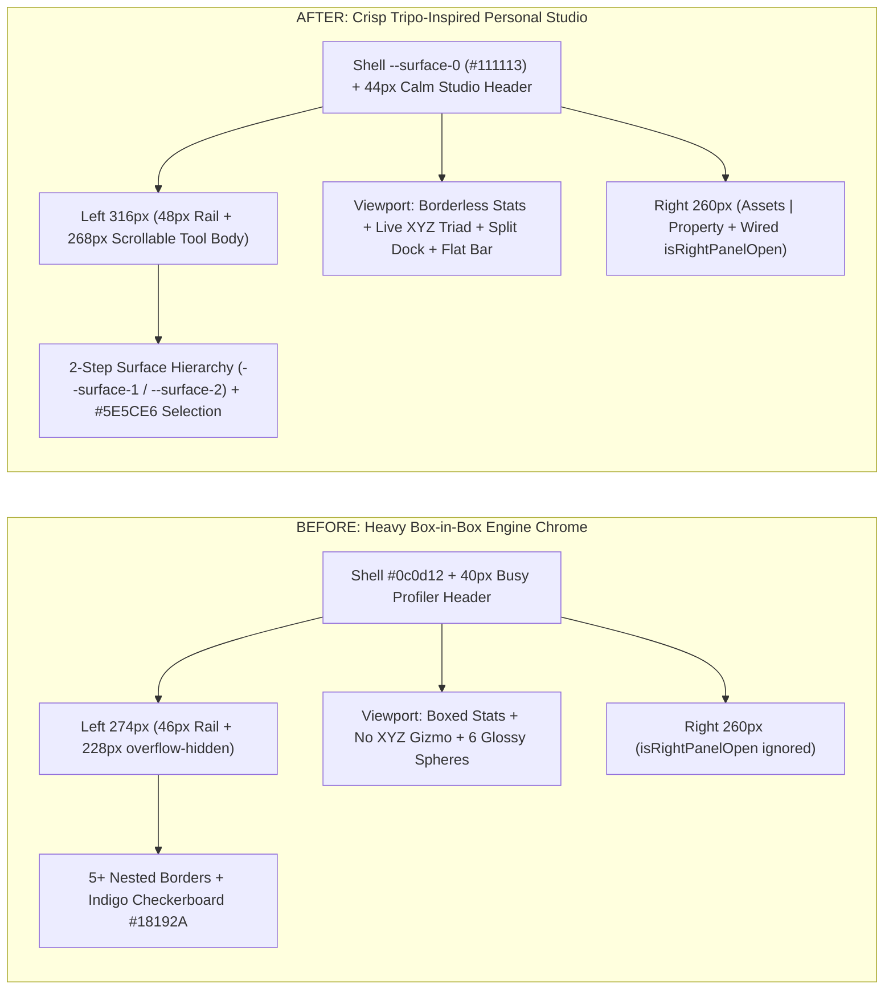
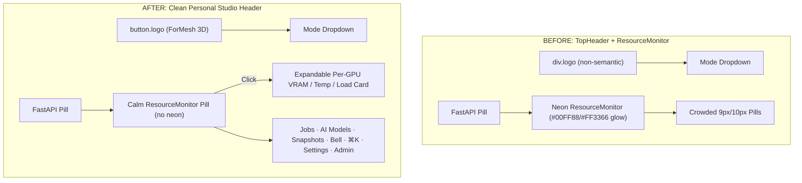
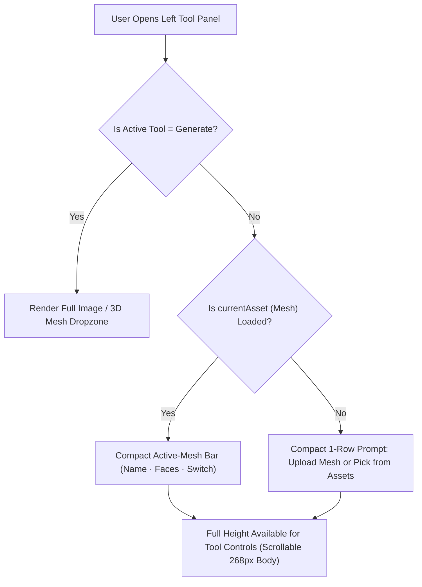
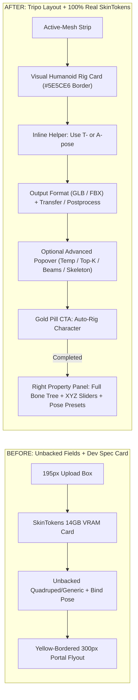
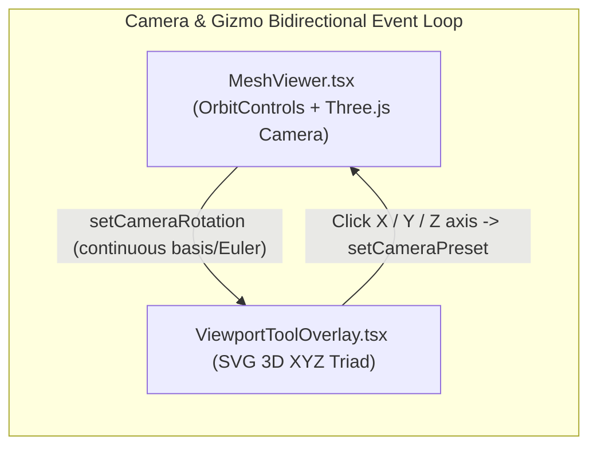

# ForMesh3D — Comprehensive UI/UX & Motion/Rigging Master Plan

> **Updated:** 2026-11-26 | **Branch:** `dev` | **Target:** Desktop-first Personal Self-Hosted 3D Studio  
> **Reference Sources:** `.brain/WORKSPACE_REF/RIGGING_PRESETS.png`, `.brain/WORKSPACE_REF/ANIMETION.png`, `.brain/WORKSPACE_REF/xyz_and_tool_rail.png`, `AGENTS.md`, `Docs/PRD.md`, `Docs/DESIGN.md`, `Docs/api-documentation.md`  
> **Note:** Per explicit user instruction, this master plan exceeds the standard 150-line `Docs/TASKS.md` budget so any human or AI agent can execute every phase end-to-end with zero ambiguity.

---

## 1. Vision, Principles & Hard Guardrails

### 1.1 Product Vision
ForMesh3D is a **personal, self-hosted 3D AI studio** (Next.js 16 + React 19 + Three.js + FastAPI + SQLite). The goal of this overhaul is to transform the workspace from a heavy, boxed, engine-profiler aesthetic into a **crisp, calm, Tripo-inspired creative studio** where the 3D mesh is the hero—while preserving every personal-operator capability that makes ForMesh3D useful locally (live FastAPI & GPU/VRAM/CPU/RAM profiler, local model management, snapshots, jobs, and full offline/self-hosted control).

### 1.2 Non-Negotiables (`AGENTS.md` + User Directives)
1. **Zero SaaS Clutter:** Do **not** add DCC Bridge, Credits, Upgrade buttons, Black Friday/promo banners, Creator Hub, or Tripo branding. Keep **ForMesh 3D** branding.
2. **Keep Personal Operator Tools:** Keep `FastAPI Online` status pill, live expandable `ResourceMonitor` (GPU/VRAM/CPU/RAM), `Jobs`, `AI Models`, `Snapshots`, `Notifications`, `Search (⌘K)`, and `Settings / Admin`.
3. **Desktop-First:** Optimize for desktop studio viewports (`>= 1024px`, laptop `1280×720` to `4K`). Do not over-engineer mobile-only drawers or touch-first compromises that clutter desktop.
4. **Low-End Machine Smoothness:** Reuse already-installed `motion`, `@radix-ui/*`, `three`, and `zustand`. Avoid heavy `backdrop-blur` over WebGL canvases, avoid unnecessary re-renders, and keep animations lightweight (`prefers-reduced-motion: reduce` respected).
5. **Strict File Reuse & Zero Orphans:** Upgrade existing files in place (`app/globals.css`, `WorkspaceShell.tsx`, `TopHeader.tsx`, `LeftNavigation.tsx`, `ViewportToolOverlay.tsx`, `MeshViewer.tsx`, `simple-tooltip.tsx`, `SettingsModal.tsx`, `ExportModal.tsx`). Remove verified dead/orphan files (`features/workspace/Panels/StudioToolTemplate.tsx`, `public/assets/xyz-orientation-gizmo.png`, duplicate CSS classes).
6. **Styling Discipline (`app/globals.css` Only):** Eliminate all 228 raw component hex literals (`#0c0d12`, `#141421`, `#161722`, `#18192A`, `#1b1b2f`, `#F9CF00`) in favor of semantic CSS variables in `app/globals.css`. Shift from 525 micro-text (`7–11px` ALL CAPS) nodes to readable **12–13px Title/Sentence case** labels, reserving `font-mono` strictly for numeric counts, VRAM, seeds, and FPS.
7. **Backend Guardrails (`AGENTS.md` Priority Rules 1–3 + User Scope):**
   - **DO NOT TOUCH** `backend/adapters/ardy_adapter.py` (working state).
   - **DO NOT TOUCH** working model adapters (`hunyuan3d_*`, `triposr_*`, `triposg_*`, `trellis_*`, `stable_fast_3d_*`, `partfield_*`, `partuv_*`, `triflow_*`, `skintokens_adapter.py` inference pipeline) or `patcher/<model>/` (`sm >= 80` parity must remain 100% intact).
   - **DO NOT TOUCH** `backend/core/scheduler/multiprocess_scheduler.py` (4,155L), `backend/api/routers/system.py` (3,510L), `backend/api/main_multiworker.py`, or `backend/core/scheduler/redis_job_queue.py`.
   - **DO NOT SAVE** uploaded/premade motion presets inside `backend/storage/`. Use a dedicated directory `backend/motion_presets/` (with `.gitkeep`) for `.npz` presets + optional `.png`/`.webp` thumbnails.

---

## 2. Before vs After Architecture & Flowcharts

### 2.1 Overall Workspace Shell & Surface Hierarchy

#### Before (Current State)
- `WorkspaceShell.tsx` wraps the app in `bg-[#0c0d12]` with 5+ nested border/shadow layers (`border-white/[0.08] shadow-2xl` → `--surface-1` → inner card border → `#18192A` dashed checkerboard).
- Left drawer is cramped: `46px` rail + `228px` tool body (`274px` total) with `.workspace-tool-body { overflow: hidden; }`, clipping controls on shorter laptop screens (`<= 850px` height).
- `#right-inspector-assets-column` renders unconditionally without reading `isRightPanelOpen`, and `WorkspaceShell.tsx#L424` passes hardcoded `isRightPanelOpen={false}` to `ViewportToolOverlay`.
- Cool blue-black/indigo (`#0c0d12`, `#141421`, `#161722`, `#18192A`, `#6366F1`) clashes with pure yellow (`#F9CF00`) borders, badges, and stark `#FFFFFF` active pills.

#### After (Target State)
- Clean 3-column Tripo-inspired studio layout on neutral graphite charcoal (`#111113` canvas, `#18181B` floating panels, `#222226` nested controls):
  - **Left Rail (`48px`) + Left Tool Column (`268px`) = `316px`**, with `overflow-y: auto` (`scrollbar-thin`) inside `.workspace-tool-body` so nothing ever clips.
  - **Center 3D Viewport** occupies maximum horizontal & vertical space with quiet radial charcoal backdrop, borderless top-right telemetry, interactive XYZ triad, split right tool dock, and a flat bottom action bar.
  - **Right Panel (`260px`)** switches cleanly between `Assets` and `Property` (keeping the full `DynamicRiggingInspector` bone tree & sliders, `DynamicSegmentationInspector`, `DynamicUVInspector`).
  - **Selection & Accent Discipline:** Calm indigo (`#5E5CE6`) reserved for active selection outlines/cards; Studio Gold (`#F5C542`) reserved strictly for primary CTAs and the active left-rail tool.



---

### 2.2 Top Header & Live Server Profiler (`TopHeader.tsx` + `ResourceMonitor.tsx`)

#### Before
- `TopHeader.tsx` (`h-10`, 40px) packs 9 elements with raw hexes and `9–10px` labels.
- Logo is a clickable `<div>` (`TopHeader.tsx#L87-L100`) instead of a semantic `<button>`.
- `ResourceMonitor.tsx` uses neon glow colors (`#FF3366`, `#FF9900`, `#FFD700`, `#00FF88` with `shadow-[0_0_8px_...]`) inline in the top bar, making the studio look like a server monitor.

#### After
- `TopHeader.tsx` (`h-11`, 44px) uses calm `--surface-0` background with a subtle bottom hairline (`--border`):
  - **Left:** Semantic `<button>` with **ForMesh 3D** logo + `3D Workspace` mode dropdown (`3D Model Studio`, `Quad Remesh`, `PBR Texture Studio`, `Animation & Rigging`).
  - **Right (Personal Studio Only):**
    1. `FastAPI Online` / `Offline` status pill (links to System view)
    2. Compact `ResourceMonitor` pill (`GPU% · RAM% · CPU%` in calm semantic text, no neon shadows) — clicking expands the full per-GPU VRAM, temperature, load, and RAM/CPU profiler popover
    3. `Jobs` recent chip (`RecentJobsChip`)
    4. `AI Models` button (`/admin?tab=models`)
    5. `Snapshots` menu (`SnapshotMenu`)
    6. `Notifications` bell (`NotificationCenter`)
    7. `Search (⌘K)` trigger (`CommandPalette`)
    8. `Settings` & `Admin` buttons



---

### 2.3 Upload Authority & Active-Mesh Flow (All 7 Tool Panels)

#### Before
- Every single tool panel (`GeneratePanel`, `TexturePanel`, `RemeshPanel`, `UVPanel`, `SegmentationPanel`, `RiggingPanel`, `AnimationPanel`) embeds a `195px` tall checkerboard upload dropzone (`"1-TO-1 EXACT UNTOUCHED UPLOAD CARD"`).
- On downstream tools (`Rig`, `Animate`, `Texture`, `Retopo`, `UV`, `Segment`), this wastes ~35% of the left drawer height even when a mesh is already loaded in the viewport, pushing real tool controls into overflow or into portal flyouts.

#### After
- **Single Upload Authority:** Only `GeneratePanel` (Image / 3D Mesh) and `RightAssetsPanel` (Assets Library) render the full drag-and-drop upload card.
- **Downstream Tools (`Texture`, `Remesh`, `UV`, `Segment`, `Rig`, `Animate`):**
  - When `currentAsset` is loaded: render a **compact Active-Mesh Bar** (`~44px` tall) showing mesh thumbnail/icon, asset name, triangle/face count, and a subtle `Switch` button (focuses Assets or opens file picker).
  - When `currentAsset` is `null`: render a **compact 1-row Upload / Select Mesh prompt** (`~56px` tall) with `Select from Assets` + `Upload Mesh` actions.



---

### 2.4 Rigging Page Flow (`RiggingPanel.tsx` + `auto_rigging.py` + `DynamicRiggingInspector.tsx`)

#### Before
- `RiggingPanel.tsx` shows:
  1. `195px` checkerboard upload box
  2. `"SkinTokens Auto-Rig · 14GB VRAM"` developer spec card
  3. Unbacked `Skeleton Template` (`humanoid | quadruped | generic`) and `Bind Pose Normalization` (`T-Pose Auto | A-Pose Stand`) — **neither `auto_rigging.py` nor `skintokens_adapter.py` reads these fields**
  4. `Facial & Finger Bones` switch
  5. `300px` yellow-bordered portal flyout with `Biharmonic Geodesic`, `Max Influences`, `Export Format`, `Symmetry Snapping`, `Sampling Temperature`, `Top-K`, `Beams`, `Texture & Scale Transfer`, `Voxel Skin Postprocess`
- Meanwhile, `DynamicRiggingInspector.tsx` (Right Property Panel) holds the 17-bone tree, X/Y/Z sliders, Symmetry Snap, X-Ray skeleton toggle, and Pose Presets (`T-Pose`, `A-Pose`, `Combat`, `Sitting`).

#### After (Matching `RIGGING_PRESETS.png` Layout + Real SkinTokens Contract)
- **Left `RiggingPanel.tsx` (Clean Tripo-Style Hierarchy):**
  1. **Header:** `3D Rigging` (clean title case, `13px` semibold)
  2. **Compact Active-Mesh Bar** (replaces `195px` upload box)
  3. **Rig Type Visual Card:** `Humanoid Rig` visual card (matching `RIGGING_PRESETS.png` card aesthetic with `--selection` `#5E5CE6` focus border; no fake `quadruped`/`generic` options that SkinTokens doesn't support)
  4. **Inline Helper Pill:** `"Use a T- or A-pose mesh for best auto-rigging results."` (subtle muted banner)
  5. **Output Format Selector:** Clean Tripo-style dropdown/segmented control (`GLB (Skinned)` | `FBX (Maya/Unreal)`) backed by `AutoRigRequest.output_format`
  6. **Core SkinTokens Toggles:** `Texture & Scale Transfer` (`use_transfer`) and `Voxel Skin Postprocess` (`use_postprocess`)
  7. **Clean Advanced Popover (optional tuning):** `Use Skeleton` (`use_skeleton`), `Sampling Temperature` (`temperature`), `Top-K` (`top_k`), `Num Beams` (`num_beams`) — styled with `--surface-2` + `--border` (no neon yellow flyout border)
  8. **Sticky Bottom Primary CTA:** Gold pill button `Auto-Rig Character` (`--primary` `#F5C542` with dark text)
- **Right `DynamicRiggingInspector.tsx` (Restyled, Full Capability Kept):**
  - Keep the complete 17-bone hierarchy tree, X/Y/Z rotation sliders, Symmetry Snap, X-Ray Skeleton toggle, Pose Presets (`T-Pose`, `A-Pose`, `Combat`, `Sitting`), and `Export Rig (.glb)`, restyled cleanly with `--surface-*`, `--selection`, and `--primary` tokens.



---

### 2.5 Animation Page & `.npz` Preset Flow (`AnimationPanel.tsx` + `backend/motion_presets/` + Viewport Player)

#### Before
- `AnimationPanel.tsx` has a `195px` upload box, a single-line `<input>` prompt (`h-7.5`), 4 tiny text chips, and hides duration, FPS, ground lock, looping, skeleton profile (`Core Humanoid / G1 Unit`), and random seed inside a yellow-bordered `300px` portal flyout.
- `ardy_adapter.py` outputs `.npz` motion arrays (`output_motion_path`), which cannot be directly played as a `.glb` `AnimationClip` in `MeshViewer.tsx` without decoding/attaching.
- Playback timeline scrubber (`DynamicAnimationInspector.tsx`) is buried inside the Right Property Panel.

#### After (Matching `ANIMETION.png` Layout + Dynamic `.npz` Preset Engine)
- **Left `AnimationPanel.tsx` (Two-Tier Tripo Layout):**
  1. **Header:** `Animation` (`13px` semibold) + compact Active-Mesh indicator
  2. **Top Focal Card (`Create Your Own Animation`, framed with `--selection` `#5E5CE6` subtle border):**
     - Multi-line prompt `<textarea>` (`"Describe a motion... e.g. A character walks forward"`) — **no** fake Video-to-Motion tab since ARDY is text-to-motion
     - Inline **Duration slider + numeric badge** (`1.0s – 15.0s`, e.g. `4.0 s`) right below the textarea
     - Primary button inside the card: `Generate Motion` (submits to existing `POST /api/v1/motion` / ARDY unchanged!)
  3. **Bottom Section (`Preset` | `Saved` Tabs + Search + Upload `.npz` Trigger):**
     - **`Preset` tab:** Auto-loads all `.npz` files from `backend/motion_presets/` via `GET /api/v1/motion/presets`. Renders a **2-column Tripo-style card grid** (`aspect-square` / `4:5` dark charcoal card with `<clip-name>.png/.webp` thumbnail if present, or clean animated motion icon + clip name + duration/FPS badge).
     - **`Saved` tab / Upload `.npz`:** Lets the user upload their own `.npz` clip (parsed client-side in memory / saved in `localStorage` metadata without writing to `backend/storage/`!) or save generated ARDY `.npz` results to quick presets.
     - **Clean Advanced Popover:** `Frame Rate` (`24 / 30 / 60 FPS`), `Foot Skating Cleanup`, `Looping Motion`, `Target Skeleton` (`Core Humanoid` / `G1 Unit`), `Random Seed`.
- **Client-Side `.npz` → Three.js `AnimationClip` Binder:**
  - Clicking **any** `.npz` preset (from `backend/motion_presets/`, user `.npz` upload, or completed ARDY job) fetches/reads the `.npz` (ZIP of `.npy` arrays via lightweight JS/TS `.npy`+ZIP reader using built-in `DecompressionStream` / `Response` or `fflate` if tiny — zero heavy deps!), extracts joint rotations/positions + `fps`, maps them onto the active rigged `.glb` skeleton (`THREE.Skeleton` / `THREE.Bone` hierarchy) as a real `THREE.AnimationClip`, and **immediately plays it in `MeshViewer.tsx`**!
- **Floating Viewport Bottom Player Bar:**
  - When an animated clip is loaded/active on the mesh, a sleek floating timeline scrubber appears cleanly above the bottom action bar in `ViewportToolOverlay.tsx` (`Play/Pause`, `Reset`, `Loop`, `0.5x / 1x / 2x` speed, `Frame X / Y`, and `Export Baked GLB` using `GLTFExporter` with the attached `AnimationClip`).

```mermaid
flowchart TD
    subgraph ANIM_BEFORE["BEFORE: Buried Controls + Disconnected .npz"]
        AB1["195px Upload Box"] --> AB2["Single-Line Input + 4 Chips"]
        AB2 --> AB3["Duration/FPS/Seed in Portal Flyout"]
        AB3 --> AB4["ARDY outputs .npz (Not Playable on Rigged GLB)"]
        AB4 --> AB5["Scrubber Buried in Right Property Panel"]
    end

    subgraph ANIM_AFTER["AFTER: Tripo 2-Tier Motion Studio + Live .npz Binder"]
        AA1["Top Card (#5E5CE6 border): Multi-Line Prompt + Inline Duration + Generate"] -->|"POST /api/v1/motion"| AA2["ARDY Job -> .npz Output"]
        AA3["Bottom 2-Col Grid: Preset (.npz from backend/motion_presets/) | Upload .npz"] --> AA4["Client-Side .npz -> THREE.AnimationClip Binder"]
        AA2 --> AA4
        AA4 -->|"Attaches to activeModelObject Bones"| AA5["Instant Live Playback in MeshViewer.tsx"]
        AA5 --> AA6["Floating Viewport Bottom Timeline Scrubber + Export Baked GLB"]
    end
```



---

### 2.6 Viewport HUD, XYZ Triad & Bottom Dock (`xyz_and_tool_rail.png`)

#### Before
- Top-right mesh stats (`Faces`, `Verts`) sit inside a bordered card (`ViewportToolOverlay.tsx#L201-L215`) without `Topology`.
- `MeshViewer.tsx#L1448` broadcasts `setCameraRotation`, but **zero components listen to it**, leaving no XYZ gizmo.
- Right dock stacks 7 buttons in one tall pill (`ViewportToolOverlay.tsx#L227-L341`) with an inert `<span>` for `?`.
- Bottom dock renders 6 glossy 3D-beveled spheres with yellow rings (`ViewportToolOverlay.tsx#L442-L555`).

#### After (Matching `xyz_and_tool_rail.png`)
- **Top-Right Borderless Telemetry + Live XYZ Triad:**
  - Borderless, crisp right-aligned text over canvas: `Topology: Triangle/Quad`, `Faces: N / N`, `Vertices: N / N`.
  - Directly beside it: **Interactive SVG/CSS 3D XYZ Triad** (`X` red, `Y` green, `Z` blue) inside `ViewportToolOverlay.tsx` listening to `setCameraRotation` (emitting continuous camera quaternion/Euler or unit basis vectors from `MeshViewer.tsx`). Clicking `+X/-X/+Y/-Y/+Z/-Z` dispatches `setCameraPreset` to snap the camera smoothly.
- **Split Right Tool Dock (2-Piece):**
  - **Pill 1 (3 grouped viewport icons with hairline dividers):** `Viewport Settings` (Camera angles, Lighting tone, Exposure), `Capture Snapshot`, `Wireframe / Grid`.
  - **Detached Circular Buttons below:** `?` (interactive keyboard/orbit shortcuts popover, NOT an inert `<span>`) and `Reset Camera` / `History`.
- **Flat Bottom Action Bar:**
  - Clean horizontal pill bar (`Reset View`, `Shading` popover containing `PBR`, `Clay`, `Normals`, `Wireframe`, `Gold MatCap`, `UV Checker`, `Before/After Wipe` toggle, and primary `Export` button).



---

## 3. Explicit State Machines (Per `AGENTS.md`)

### 3.1 Tool Panel Active-Mesh & Upload State Machine
| State | Entry Condition | UI Rendering | Allowed Transitions |
| :--- | :--- | :--- | :--- |
| `tool_generate` | `activeTool === 'model'` | Full `Image \| 3D Mesh` upload card + model selector + settings | Upload file → `asset_ready`; Switch tool → `tool_downstream_*` |
| `tool_downstream_empty` | `activeTool !== 'model'` and `!currentMeshAsset` | Compact 1-row `"No active mesh — Select from Assets or Upload"` + disabled Run CTA | Pick from Assets / Upload → `tool_downstream_ready` |
| `tool_downstream_uploading` | File upload in progress (`useMeshAssetUpload`) | Inline compact progress bar (`filename`, `%`, `MB`, cancel) | Complete → `tool_downstream_ready`; Error/Cancel → `tool_downstream_empty` |
| `tool_downstream_ready` | `activeTool !== 'model'` and `currentMeshAsset` valid | Compact Active-Mesh bar (`name`, `faces`, `Switch`) + full tool controls + enabled Run CTA | Submit job → `tool_executing`; Clear/Switch → `tool_downstream_empty` |
| `tool_executing` | Job queued or running | Progress bar (`executionProgress`, `executionStep`) + `Cancel` button | Complete → `tool_downstream_ready`; Cancel/Fail → `tool_downstream_ready` (with toast/diagnostic) |

### 3.2 `.npz` Motion Preset & Playback State Machine
| State | Trigger | Behaviour | Error / Recovery Path |
| :--- | :--- | :--- | :--- |
| `idle` | No motion clip attached | Floating bottom player hidden; `AnimationPanel` shows Create + Presets | N/A |
| `loading_clip` | Click preset `.npz`, upload `.npz`, or ARDY job completes | Fetch `/api/v1/motion/presets/<file>` or read local `File` `ArrayBuffer` | Parse/network error → `clip_error` (toast + reset to `idle`) |
| `binding_clip` | `.npz` parsed into joint tracks + `fps` | Match joint names/indices onto `activeModelObject` skeleton (`THREE.AnimationClip` + `THREE.AnimationMixer`) | No skeleton on `activeModelObject` → warn `"Rig mesh first with Auto-Rig"` (`clip_error`) |
| `playing` | Binding succeeds or user clicks `Play` | `requestAnimationFrame` advances `useAnimationStore.currentTime`; `MeshViewer` updates `AnimationMixer` | User drags scrubber / clicks `Pause` → `paused`; Asset changes → `idle` |
| `paused` | User clicks `Pause` or scrubs timeline | Holds pose at `currentTime` | Click `Play` → `playing`; Click `Reset` → `paused` (`t=0`); Export → `exporting_glb` |
| `exporting_glb` | User clicks `Export Baked GLB` | `GLTFExporter.parse(activeModelObject, { binary: true, animations: [clip] })` | Success → browser download + return to `paused`; Error → toast + return to `paused` |

### 3.3 Modal & Tooltip Accessibility State Machine
| Component | Before (Broken) | After (Explicit Radix State) |
| :--- | :--- | :--- |
| `SimpleTooltip` (`components/ui/simple-tooltip.tsx`) | Hover-only CSS `group-hover:opacity-100` (`<span>` never reachable on keyboard/touch) | Wraps `StyledTooltip` (`@radix-ui/react-tooltip`): `closed` ↔ `open` on pointer hover **and** keyboard `:focus-visible`, dismissed on `Escape` / blur |
| `SettingsModal` & `ExportModal` | Custom `fixed inset-0` `<div>` without focus trap, `role="dialog"`, or focus return | Uses `Dialog` + `DialogContent` (`@radix-ui/react-dialog`): `closed` → `open` (focus trapped, `aria-modal`, `Escape` + outside click handled) → `closed` (focus returns to trigger) |

---

## 4. Backend Implementation Plan (Scoped & Safe)

> **Reminder:** `ardy_adapter.py`, `skintokens_adapter.py`, all other model adapters, `patcher/<model>/`, `multiprocess_scheduler.py`, `system.py`, `main_multiworker.py`, and `redis_job_queue.py` remain **untouched**.

### 4.1 Dynamic `.npz` Motion Presets Directory & Endpoints
1. **Directory Creation:**
   - Create `backend/motion_presets/.gitkeep` (strictly outside `backend/storage/`).
   - Convention for user-dropped files inside `backend/motion_presets/`:
     - `<clip_name>.npz` — motion clip data (ARDY-compatible `.npz` or joint-angle/position arrays + `fps`)
     - `<clip_name>.png` or `<clip_name>.webp` (optional) — matching thumbnail image auto-paired by stem name
2. **Router Additions in `backend/api/routers/motion_generation.py`:**
   - `GET /api/v1/motion/presets`:
     - Scans `backend/motion_presets/` for `*.npz` files (sorted by name, ignoring hidden files).
     - Reads lightweight `.npz` metadata (`fps`, `num_frames`, `duration`, `text` if present, without loading heavy arrays into JSON).
     - Checks if `<stem>.png` or `<stem>.webp` exists alongside it and returns `thumbnail_url` if found.
     - Returns `{ presets: [{ id, name, filename, duration, fps, num_frames, thumbnail_url, download_url }] }`.
   - `GET /api/v1/motion/presets/{filename}`:
     - Uses canonical path-traversal-safe resolution (`Path.resolve()` verified inside `MOTION_PRESETS_DIR`, `.npz` extension only).
     - Streams/serves the `.npz` binary with `application/octet-stream`.
   - `GET /api/v1/motion/presets/thumbnail/{filename}`:
     - Safe resolution for `.png` / `.webp` thumbnails inside `backend/motion_presets/`.

### 4.2 Rigging API Alignment (`backend/api/routers/auto_rigging.py`)
- Audit `AutoRigRequest` in `backend/api/routers/auto_rigging.py`:
  - Keep existing fields (`mesh_path`, `mesh_file_id`, `rig_mode`, `output_format` [`glb` | `fbx`], `model_preference`, `model_parameters`, `workspace_id`) backward-compatible so no existing tests break.
  - Ensure `RiggingPanel.tsx` sends only real SkinTokens-supported parameters in `model_parameters` (`use_skeleton`, `use_transfer`, `use_postprocess`, `top_k`, `num_beams`, `temperature`) and removes unbacked `quadruped`/`generic` & `bind_pose` UI controls.

---

## 5. Complete Phase-by-Phase Execution Checklist

### Phase 1 — Design Tokens & CSS Cleanup (`app/globals.css`)
- [ ] **1.1** Update `:root` and `@theme` variables in `app/globals.css` to Tripo-inspired neutral charcoal (`--surface-0: 240 6% 7%`, `--surface-1: 240 5% 10%`, `--surface-2: 240 5% 14%`, `--surface-3: 240 5% 18%`, `--border: 0 0% 100% / 0.08`, `--selection: 241 73% 63%`, `--primary: 44 90% 61%`).
- [ ] **1.2** Set readable base font sizing (`12px–13px` UI body/labels in Title/Sentence case; `font-mono` strictly for numeric counts/telemetry).
- [ ] **1.3** Change `.workspace-tool-body` from `overflow: hidden` to `overflow-y: auto; overscroll-behavior: contain;` with `.scrollbar-thin`.
- [ ] **1.4** Remove duplicate `.glass-panel` definition (`L2556`), unused neon glow/specular sweep utilities, and redundant heavy `backdrop-blur` rules for low-end machine smoothness.

### Phase 2 — Workspace Shell, Header, Left Rail & Live Profiler
- [ ] **2.1** `WorkspaceShell.tsx`: Widen `#left-unified-studio-panel` to `316px` (`48px` rail + `268px` tool body); update `#center-viewport-stage` left offset (`md:left-[326px]`); wire real `isRightPanelOpen` state to `#right-inspector-assets-column` and `<ViewportToolOverlay isRightPanelOpen={isRightPanelOpen} />`; replace `#0c0d12` / `#090a0f` with CSS tokens; remove unused `StudioToolTemplate` import.
- [ ] **2.2** `TopHeader.tsx`: Increase height to `h-11`; convert clickable logo `<div>` to semantic `<button>` keeping **ForMesh 3D** logo; keep only personal-studio controls (`3D Workspace` mode switcher, `FastAPI Online`, `ResourceMonitor`, `RecentJobsChip`, `AI Models`, `SnapshotMenu`, `NotificationCenter`, `Search ⌘K`, `Settings`, `Admin`); replace raw hexes with CSS tokens.
- [ ] **2.3** `ResourceMonitor.tsx`: Replace neon `#FF3366` / `#00FF88` glow classes with calm semantic token states (`text-emerald-400`, `text-amber-400`, `text-rose-400` without neon text/box-shadows); keep full expandable per-GPU VRAM, temperature, load, RAM, and CPU telemetry popover.
- [ ] **2.4** `LeftNavigation.tsx`: Restyle to `48px` rail with Title-case `11px` labels, calm `--primary` Gold active icon + left bar, no drop-shadow glow.

### Phase 3 — Viewport HUD, Interactive XYZ Triad, Flat Bottom Bar & Floating Animation Player
- [ ] **3.1** `MeshViewer.tsx`: Enhance `setCameraRotation` broadcast (or add quaternion/basis vector detail alongside axis string) and hook `useAnimationStore` (`isPlaying`, `currentTime`, `playbackSpeed`, `isLooping`, attached `AnimationClip`) directly into the `useFrame` / render loop so `.npz` / `.glb` clips animate smoothly on `activeModelObject`.
- [ ] **3.2** `ViewportToolOverlay.tsx`:
  - Replace boxed Faces/Verts card with borderless top-right `Topology`, `Faces`, `Vertices` HUD matching `xyz_and_tool_rail.png`.
  - Add interactive SVG/CSS 3D XYZ Triad listening to `setCameraRotation` and dispatching `setCameraPreset` on axis click (`X`, `Y`, `Z`).
  - Split right tool dock into a 3-icon viewport pill (`Settings`, `Snapshot`, `Grid/Wireframe`) + two detached circular buttons (`?` interactive shortcuts popover + `Reset View`).
  - Replace the 6 glossy shader spheres with a **flat Tripo-style bottom action bar** (`Reset View`, `Shading` mode selector popover, `Before/After Wipe`, `Export` CTA).
  - Render a **floating bottom timeline scrubber bar** above the bottom bar whenever an animated clip is active on `activeModelObject` (Play/Pause, Reset, Loop, `0.5x / 1x / 2x` speed, Frame counter, `Export Baked GLB`).

### Phase 4 — Backend `.npz` Presets & Tool Panel Refactors
- [ ] **4.1** Backend: Create `backend/motion_presets/.gitkeep` and add `GET /api/v1/motion/presets`, `GET /api/v1/motion/presets/{filename}`, and `GET /api/v1/motion/presets/thumbnail/{filename}` in `backend/api/routers/motion_generation.py` (with path-traversal validation + `.npz` header inspection).
- [ ] **4.2** Frontend `.npz` Binder: Add lightweight `.npz` → `THREE.AnimationClip` decoder/binder inside `features/workspace/utils/` (or existing `clientExporters.ts` / `useAnimationStore.ts`) using native `DecompressionStream` / minimal `.npy` reader to map `.npz` joint tracks onto `activeModelObject`'s `THREE.Bone` hierarchy.
- [ ] **4.3** `GeneratePanel.tsx`: Keep as the single left-panel upload dropzone (`Image | 3D Mesh`); migrate raw hexes & micro-text (`7–11px` ALL CAPS) to CSS tokens & `12–13px` Title/Sentence case.
- [ ] **4.4** `TexturePanel.tsx`, `RemeshPanel.tsx`, `UVPanel.tsx`, `SegmentationPanel.tsx`: Remove duplicated `195px` upload dropzone; replace with compact Active-Mesh bar (or 1-row empty prompt); replace yellow-bordered portal flyouts with calm `--surface-2` popovers/sections; remove raw hexes.
- [ ] **4.5** `RiggingPanel.tsx`: Remove `195px` upload box, VRAM spec card, and unbacked `quadruped`/`generic` & `bind_pose` fields; implement Tripo-style `Humanoid Rig` visual card + inline pose tip + `Output Format` (`GLB` / `FBX`) + `Texture & Scale Transfer` & `Voxel Skin Postprocess` switches + clean `Advanced` popover (`Temperature`, `Top-K`, `Beams`, `Use Skeleton`) + Gold CTA.
- [ ] **4.6** `AnimationPanel.tsx`: Remove `195px` upload box; implement Tripo `ANIMETION.png` two-tier layout (`Create Your Own Animation` card with `#5E5CE6` border, multi-line prompt, inline duration slider, Generate CTA + bottom `Preset | Saved` 2-column card grid auto-loaded from `GET /api/v1/motion/presets` + local `.npz` upload).
- [ ] **4.7** `DynamicRiggingInspector.tsx` & `RightPropertyPanel.tsx`: Restyle `DynamicRiggingInspector` (keep full 17-bone tree, X/Y/Z sliders, Symmetry Snap, X-Ray Skeleton, Pose Presets); convert clickable `<div>` lineage rows (`RightPropertyPanel.tsx#L678, L691`) to `<button>`s; unify all `--surface-*` tokens.

### Phase 5 — Accessibility, Orphan Removal & Documentation
- [ ] **5.1** `components/ui/simple-tooltip.tsx`: Refactor in-place to wrap `StyledTooltip` (`components/ui/tooltip.tsx`) for keyboard focus, touch, and `Escape` dismissal.
- [ ] **5.2** `SettingsModal.tsx` & `ExportModal.tsx`: Migrate custom `fixed inset-0` overlay `<div>`s to `Dialog` / `DialogContent` (`components/ui/dialog.tsx`) with `aria-labelledby` and accessible close buttons.
- [ ] **5.3** Orphan Cleanup: Delete `features/workspace/Panels/StudioToolTemplate.tsx` and `public/assets/xyz-orientation-gizmo.png`; verify 0 broken imports.
- [ ] **5.4** Docs Sync: Update `Docs/DESIGN.md` and `Docs/CHANGELOG.md` (last 3 entries) after implementation.

---

## 6. Verification & Acceptance Criteria

### Frontend Checks
- `bun run test` (`tsc --noEmit`): **0 errors**
- `bun test`: **100% pass** (all existing 74+ tests + new unit tests for `.npz` parser/clip binder and `Rigging`/`Animation` parameter builders)
- `bun run build`: **clean production build**
- Token Audit: `rg -n "#[0-9a-fA-F]{3,8}" features/ components/` approaches **0** raw hex overrides outside legitimate 3D shader/Three.js material constants.

### Backend Checks (CPU-Safe on Low-End Machine)
- `python -m compileall -q backend/adapters backend/api backend/core backend/pipelines backend/scripts backend/tests backend/loader.py patcher scripts`
- `python -m pytest -q backend/tests/test_batch1_regressions.py backend/tests/test_batch3_queue_and_lifecycle.py backend/tests/test_batch4_api_integration.py` + new test for `GET /api/v1/motion/presets` (validating `.npz` discovery, thumbnail pairing, and path-traversal rejection)
- `python scripts/verify_contracts.py`

---

## 7. Exact CSS Token & Raw Hex Migration Map (`app/globals.css`)

### 7.1 Target `:root` & `@theme` Palette (Neutral Graphite + Indigo Selection + Studio Gold CTA)

```css
:root {
  --font-sans: var(--font-inter), ui-sans-serif, system-ui, sans-serif;
  --font-mono: var(--font-mono), ui-monospace, SFMono-Regular, Menlo, Monaco, Consolas, monospace;

  /* Neutral Graphite Surfaces (Tripo-inspired, zero blue-slate tint) */
  --background: 240 6% 7%;          /* #111113 */
  --foreground: 0 0% 95%;           /* #F2F2F2 */
  --surface-0: 240 6% 7%;           /* #111113 — App root & viewport backdrop */
  --surface-1: 240 5% 10%;          /* #18181B — Floating side drawers & cards */
  --surface-2: 240 5% 14%;          /* #222226 — Nested inputs, tracks, popovers */
  --surface-3: 240 5% 18%;          /* #2C2C32 — Hover states & raised pills */
  --surface-4: 240 4% 24%;          /* #3B3B40 — Active subtle divider/thumb */

  --card: 240 5% 10%;
  --card-foreground: 0 0% 95%;
  --popover: 240 5% 13%;
  --popover-foreground: 0 0% 95%;

  /* Selection & Primary Accent Discipline */
  --selection: 241 73% 63%;         /* #5E5CE6 — Active cards, focus borders */
  --selection-foreground: 0 0% 100%;
  --primary: 44 90% 61%;            /* #F5C542 — Primary CTA & active rail tool ONLY */
  --primary-foreground: 0 0% 6%;    /* #0F0F0F */
  --secondary: 240 5% 14%;
  --secondary-foreground: 0 0% 95%;
  --muted: 240 5% 14%;
  --muted-foreground: 240 4% 62%;   /* #9A9AA2 */
  --accent: 44 90% 61%;
  --accent-foreground: 0 0% 6%;
  --destructive: 0 72% 56%;
  --destructive-foreground: 0 0% 100%;

  --border: 0 0% 100% / 0.08;       /* Calm 1px structural hairline */
  --input: 240 5% 14%;
  --ring: 241 73% 63%;

  /* Tooltip Tokens */
  --tooltip-bg: 240 5% 12%;
  --tooltip-fg: 0 0% 95%;
  --tooltip-border: 0 0% 100% / 0.12;
}
```

### 7.2 Raw Hex Replacement Table (228 Component Occurrences)

| Legacy Raw Hex | Where It Appears | Replace With |
| :--- | :--- | :--- |
| `#0c0d12`, `#090a0f`, `#080808` | `WorkspaceShell.tsx`, `TopHeader.tsx` | `bg-[hsl(var(--surface-0))]` |
| `#161722`, `#141522`, `#141421` | `ViewportToolOverlay.tsx`, `Panels/*` flyouts | `bg-[hsl(var(--surface-1))]` or `bg-[hsl(var(--popover))]` |
| `#0f0f1c`, `#0c0d14`, `#1b1c2b`, `#1b1b2f` | `GeneratePanel.tsx`, `TexturePanel.tsx`, `RemeshPanel.tsx`, `UVPanel.tsx`, `RiggingPanel.tsx`, `AnimationPanel.tsx` | `bg-[hsl(var(--surface-2))]` |
| `#18192A` (checkerboard dropzone) | `GeneratePanel.tsx` (only remaining dropzone) | Subtle neutral pattern using `hsl(var(--surface-2))` or flat `bg-[hsl(var(--surface-0))]` |
| `#F9CF00`, `#FFCC00` | `LeftNavigation.tsx`, `RightPropertyPanel.tsx`, `ViewportToolOverlay.tsx`, `DynamicAnimationInspector.tsx` | `text-[hsl(var(--primary))]` / `bg-[hsl(var(--primary))]` (CTAs & active rail only) |
| `#6366F1`, `#8B5CF6` | Upload circle gradients & active switches | `bg-[hsl(var(--selection))]` |
| `#FF3366`, `#FF9900`, `#FFD700`, `#00FF88` + neon shadows | `ResourceMonitor.tsx` | Calm semantic classes (`text-rose-400`, `text-amber-400`, `text-emerald-400` without `shadow-[0_0_8px_...]`) |

### 7.3 `app/globals.css` Cleanup Targets
- **Remove duplicate `.glass-panel`** at lines `2556-2560` (keep one clean surface utility).
- **Remove heavy glow/specular rules** that add GPU compositing cost on low-end machines: `.btn-lighting-shine::after`, `.holographic`, `.holographic-shine`, `.shadow-glow-purple/blue/cyan/pink`, `.shadow-neon`.
- **Fix `.workspace-tool-body`:**
  ```css
  .workspace-tool-body {
    min-height: 0;
    overflow-y: auto;
    overflow-x: hidden;
    overscroll-behavior: contain;
    scrollbar-gutter: stable;
  }
  ```
- **Fix Base Typography (`@layer base`):**
  - Change `html { font-size: 16px; }` and `body { font-size: 0.8125rem; line-height: 1.45; }` (`13px` readable base).
  - Replace `text-[7px]`, `text-[8px]`, `text-[9px]`, `text-[10px]` labels across `features/` with `text-xs` (`12px`) or `text-[11px]` minimum for dense numeric metadata, and remove `uppercase tracking-wider` from section headers where Title Case (`Rigging Type`, `Motion Prompt`, `Topology`) matches Tripo's calm hierarchy.

---

## 8. Detailed Panel-by-Panel Blueprint

### 8.1 Left Navigation Rail (`LeftNavigation.tsx`)
- **Width:** `48px` (`w-12`) inside `#left-unified-studio-panel` (`w-[316px]` total: `48px` rail + `268px` tool body).
- **Items (top to bottom):**
  1. `Model` (`'model'`)
  2. `Texture` (`'texture'`)
  3. `Retopo` (`'remesh'`)
  4. `Smart UV` (`'uv'`)
  5. `Segment` (`'segment'`)
  6. `Rig` (`'rigging'`)
  7. `Animate` (`'animation'`)
  - Bottom-pinned: `Settings` (`setIsSettingsOpen(true)`).
- **Visual Spec:**
  - Icon size: `18px` (`w-4.5 h-4.5`), label `10.5px` Title Case (`font-medium`), no `drop-shadow` neon halos.
  - Active item: `--primary` (`#F5C542`) icon & label + `2px` left indicator pill (`bg-[hsl(var(--primary))]`).
  - Executing indicator: subtle `1.5px` dot without aggressive `animate-ping` halo if `prefers-reduced-motion` is active.

### 8.2 Shared Active-Mesh Strip (Inside `TexturePanel`, `RemeshPanel`, `UVPanel`, `SegmentationPanel`, `RiggingPanel`, `AnimationPanel`)
- **Why no new component file:** Implement a tiny shared helper or inline inside existing `features/workspace/components/` (which already exports `GlowButton`, `JobProgressBar`, `JobProgressStage` via `features/workspace/components/index.ts`) — or keep it minimal in `features/workspace/components/JobProgressStage.tsx` / existing barrel so zero new orphan files are created.
- **Behaviour:**
  - Reads `currentAsset`, `isMeshUploading`, `setRightPanelMode('assets')` from `useWorkspace()`.
  - **When `currentAsset` is a valid mesh:**
    - Single compact card (`px-2.5 py-2 rounded-xl bg-[hsl(var(--surface-2))] border border-[hsl(var(--border))]`):
    - Left: `Box` icon + truncated `currentAsset.name` (`12px font-medium`) + `{faces.toLocaleString()} faces` (`11px font-mono text-muted-foreground`).
    - Right: `Switch` button (`onClick={() => setRightPanelMode('assets')}`) + quick `Upload` icon button (triggers hidden `<input type="file" accept=".glb,.gltf,.obj,.fbx,.stl,.ply">`).
  - **When no mesh is loaded:**
    - Compact prompt card (`p-2.5 rounded-xl border border-dashed border-[hsl(var(--border))] bg-[hsl(var(--surface-2))/0.5]`):
    - `"Select a mesh from Assets or upload (.glb, .obj, .fbx, .stl, .ply)"` with two small buttons: `Assets` and `Upload`.
  - **Result:** Saves **~145px** of vertical height on every downstream tool panel, eliminating the need for portal flyouts that cover the 3D canvas!

### 8.3 `GeneratePanel.tsx` (Image / 3D Mesh Entry)
- **Retains Full Upload Card:** Only left tool with the full `Image | 3D Mesh` segmented switcher and dropzone (`h-[176px]` clean neutral surface, no `#18192A` purple checkerboard).
- **Controls below upload:**
  - `AI Model` selector (driven dynamically by `/api/v1/system/models` — zero hardcoded models).
  - `Geometry & Texture` collapsible section (clean inline accordion, not a jarring popout).
  - `Seed` row (`12px` label, mono input, `Random` button).
  - Sticky bottom Gold CTA: `Generate Model` (`h-9 rounded-full bg-[hsl(var(--primary))] text-[hsl(var(--primary-foreground))] font-semibold text-[13px]`).

### 8.4 `TexturePanel.tsx`, `RemeshPanel.tsx`, `UVPanel.tsx`, `SegmentationPanel.tsx`
- **Common Structural Upgrade:**
  1. Remove the `195px` checkerboard upload card; use the compact Active-Mesh strip.
  2. Replace `#141421` yellow-bordered `.workspace-advanced-flyout` portals with clean inline collapsible `<details>` / Radix `Collapsible` sections or calm `--surface-2` popovers (`border-[hsl(var(--border))]`) inside the `268px` scrollable body.
  3. Preserve 100% of existing API parameters (`buildTextureGenerationParameters`, `POST /api/v1/retopo`, `POST /api/v1/unwrap`, `POST /api/v1/segment`, `GET /api/v1/segment/readiness`).
  4. Use `JobProgressBar` + `Cancel` button during execution, and sticky Gold CTA at bottom when idle.

### 8.5 `RiggingPanel.tsx` + `DynamicRiggingInspector.tsx`
- **API Payload (`POST /api/v1/rig`):**
  ```json
  {
    "mesh_file_id": "<uploaded_or_asset_id>",
    "workspace_id": "<workspace_id>",
    "rig_mode": "skeleton",
    "output_format": "glb",
    "model_preference": "skintokens_auto_rigging",
    "model_parameters": {
      "use_skeleton": false,
      "use_transfer": true,
      "use_postprocess": false,
      "top_k": 5,
      "num_beams": 10,
      "temperature": 1.0
    }
  }
  ```
- **Removed Unbacked Controls:**
  - Remove `quadruped` and `generic` skeleton template buttons (SkinTokens is humanoid-focused and `auto_rigging.py` does not accept `skeleton_template`).
  - Remove `bind_pose` (`T-Pose Auto` / `A-Pose Stand`) submission toggle (not read by `auto_rigging.py`; post-rig pose presets already exist in `DynamicRiggingInspector.tsx`).
- **New `RiggingPanel.tsx` Visual Layout (Matches `RIGGING_PRESETS.png`):**
  1. Header: `3D Rigging`
  2. Compact Active-Mesh Strip
  3. `Rigging Type` section: 1–2 visual cards (`Humanoid Rig` selected with `border-[hsl(var(--selection))]`, clean character silhouette icon/preview)
  4. Inline helper note: `"Use a T- or A-pose mesh for best auto-rigging results."`
  5. `Output Format` segmented pill (`GLB (Skinned)` | `FBX (Maya/Unreal)`)
  6. Core SkinTokens toggles: `Texture & Scale Transfer` (`use_transfer`), `Voxel Skin Postprocess` (`use_postprocess`)
  7. Collapsible `Advanced Settings` (`use_skeleton`, `temperature` slider `0.1–2.0`, `top_k` `3/5/10`, `num_beams` `5/10/15`)
  8. Sticky Gold CTA: `Auto-Rig Character`
- **Right `DynamicRiggingInspector.tsx` (Restyled, All Features Preserved):**
  - Keep `CANONICAL_BONES` 17-bone hierarchy tree, X/Y/Z rotation sliders, `Symmetry Snap` switch, `X-Ray Skeleton` (`THREE.SkeletonHelper`) switch, `Pose Presets` (`T-Pose`, `A-Pose`, `Combat`, `Sitting`), and `Export Rig (.glb)` — restyled to `--surface-1`/`--surface-2`/`--selection`/`--primary`.

### 8.6 `AnimationPanel.tsx` + `backend/motion_presets/` + Floating Viewport Player
- **Two-Tier `AnimationPanel.tsx` Layout (Matches `ANIMETION.png`):**
  1. Header: `Animation` + Compact Active-Mesh Strip
  2. **Tier 1 — `Create Motion` Card (`rounded-2xl border border-[hsl(var(--selection))]/60 bg-[hsl(var(--surface-2))/0.6] p-3 space-y-2.5`):**
     - Multi-line `<textarea rows={3}>` (`"Describe a motion... e.g. A character walks forward"`)
     - Inline `Duration` slider (`1.0s – 15.0s`) + numeric readout (`4.0 s`)
     - Primary button inside card: `Generate Motion` (calls `POST /api/v1/motion` for ARDY)
     - Compact `Advanced` toggle inside card (`Frame Rate: 24/30/60`, `Foot Skating Cleanup`, `Looping`, `Target Skeleton: Core / G1`, `Seed`)
  3. **Tier 2 — `Motion Presets` (`Preset` | `Saved` Tabs + Search + Upload `.npz`):**
     - `Preset` tab fetches `GET /api/v1/motion/presets` (auto-discovered `.npz` files from `backend/motion_presets/`).
     - `Upload .npz` button lets the user pick a local `.npz` file from disk (read in-browser via `File.arrayBuffer()`, **never** written to `backend/storage/`).
     - **2-column Tripo-style card grid:**
       - Each card displays `<clip-name>.png/.webp` if `thumbnail_url` is returned, or a clean `--surface-2` charcoal card with a subtle motion icon, clip title, and `FPS · Duration` badge.
       - Active/playing preset gets `border-[hsl(var(--selection))]`.
       - Clicking a preset card immediately runs the client-side `.npz` → `THREE.AnimationClip` binder and starts live playback in `MeshViewer.tsx`!
- **Floating Viewport Bottom Player Bar (Inside `ViewportToolOverlay.tsx`):**
  - Shown automatically above the flat bottom bar whenever `activeClip` (from `.glb` `animations[]` or attached `.npz` preset) is present on `activeModelObject`.
  - Controls: `Play / Pause`, `Reset (t=0)`, `Loop` toggle, `0.5x / 1.0x / 2.0x` speed pills, interactive range scrubber (`0.00s / 4.0s`, `Frame X / Y`), and `Export Baked GLB` button (`GLTFExporter` with `{ binary: true, animations: [activeClip] }`).

---

## 9. `.npz` → Three.js `AnimationClip` Binder Specification

### 9.1 Why `.npz`?
ARDY (`ardy_adapter.py`) natively outputs `.npz` archives (`fps`, `text`, plus pose/joint arrays), and the user will place premade `.npz` clips in `backend/motion_presets/`. Decoding `.npz` directly in the browser enables **instant, zero-latency preview** on any rigged `.glb` without running Blender on the user's low-end machine.

### 9.2 Browser `.npz` Decoder Pipeline (Zero Heavy Dependencies)
An `.npz` file is a standard PKZIP archive containing `<key>.npy` files (either `STORE` method `0` or `DEFLATE` method `8`):
1. **ZIP Reader:** Parse `PK\x03\x04` local file headers (or End of Central Directory `PK\x05\x06` for exact sizes when data descriptors are used). For `method === 8`, decompress using native browser `new DecompressionStream('deflate-raw')` (Baseline Widely Available across Chrome/Edge/Firefox/Safari).
2. **`.npy` Parser:**
   - Verify `\x93NUMPY` magic bytes (`0x93 0x4E 0x55 0x4D 0x50 0x59`), read major/minor version (`1.0` / `2.0` / `3.0`), parse ASCII/UTF-8 header dict (`descr`, `fortran_order`, `shape`).
   - Support `<f4` (`Float32Array`), `<f8` (`Float64Array` → cast to `Float32Array`), `<i4` / `<i8` (`Int32Array`), and scalar/string `fps` & `text`.
3. **Skeleton Mapping & `THREE.AnimationClip` Construction:**
   - Extract `fps` (default `20` if omitted, matching `ARDY-Core-RP-20FPS-Horizon40`), `num_frames`, and joint rotation/position arrays (supporting `(T, J, 3)` axis-angle/Euler, `(T, J, 4)` quaternion, `(T, J, 6)` 6D rotation → orthonormalized `Matrix4` → `Quaternion`, or `(T, J, 3)` joint positions for IK/direction fallback).
   - Match joint indices/names against `activeModelObject` `THREE.Bone`s using canonical humanoid joint order (SMPL/ARDY 22–24 joints: `pelvis/root`, `left_hip`, `right_hip`, `spine1`, `left_knee`, `right_knee`, `spine2`, `left_ankle`, `right_ankle`, `spine3`, `left_foot`, `right_foot`, `neck`, `left_collar`, `right_collar`, `head`, `left_shoulder`, `right_shoulder`, `left_elbow`, `right_elbow`, `left_wrist`, `right_wrist`) + fuzzy bone-name matching (`findBoneInHierarchy`).
   - Build `THREE.QuaternionKeyframeTrack(`${bone.name}.quaternion`, times, quatValues)` (+ root `VectorKeyframeTrack` for pelvis translation) and assemble `new THREE.AnimationClip(clipName, duration, tracks)`.
   - Store the active `AnimationClip` in `useAnimationStore` (or attach to `activeModelObject.animations`) and drive `THREE.AnimationMixer` inside `MeshViewer.tsx`'s `useFrame` / render loop.
   - **Edge Case Guard:** If `activeModelObject` has 0 `THREE.Bone` nodes, abort binding cleanly and surface `"Load or Auto-Rig a character mesh first to preview motion."`

---

## 10. Backend `motion_presets` Router & Security Specification

### 10.1 Directory Layout
```text
backend/
└── motion_presets/
    ├── .gitkeep              # Tracked empty dir; user drops .npz + optional .png/.webp here
    ├── walk_forward.npz      # (example user file — gitignored or local)
    └── walk_forward.png      # (optional auto-paired thumbnail)
```
- Add `backend/motion_presets/*.npz`, `*.png`, `*.webp` (keeping `!.gitkeep`) to `.gitignore` if user clips shouldn't be committed accidentally, while keeping `backend/motion_presets/.gitkeep` tracked.

### 10.2 Endpoints (`backend/api/routers/motion_generation.py`)
1. **`GET /api/v1/motion/presets`**
   - Lists `*.npz` files in `MOTION_PRESETS_DIR` (`Path(__file__).resolve().parents[2] / "motion_presets"`).
   - Reads lightweight metadata from each `.npz` via Python `zipfile.ZipFile` + `numpy.lib.format.read_array_header_1_0/2_0` (or `np.load(..., mmap_mode=None)` reading only `fps`, `text`, and first array `shape[0]` for `num_frames`) so listing is fast even on a low-end CPU.
   - Pairs `<stem>.png` or `<stem>.webp` if present.
   - Returns `{ "presets": MotionPresetItem[] }`.
2. **`GET /api/v1/motion/presets/{filename}`**
   - Rejects any `filename` containing `/`, `\`, `..`, or non-`.npz` suffix (`400 Bad Request`).
   - Verifies `candidate.resolve().is_relative_to(MOTION_PRESETS_DIR.resolve())` (`403/404` otherwise).
   - Returns `FileResponse(candidate, media_type="application/octet-stream", filename=candidate.name)`.
3. **`GET /api/v1/motion/presets/thumbnail/{filename}`**
   - Same strict path-traversal guard; allows `.png` / `.webp` only.

---

## 11. Interactive XYZ Orientation Triad & `ViewportToolOverlay` Specification

### 11.1 `MeshViewer.tsx` Camera Broadcast
- Currently `MeshViewer.tsx#L1422-L1459` dispatches `new CustomEvent('setCameraRotation', { detail: axis })`.
- Upgrade the event detail to:
  ```ts
  {
    axis: 'front' | 'back' | 'left' | 'right' | 'top' | 'bottom',
    quaternion: [camera.quaternion.x, camera.quaternion.y, camera.quaternion.z, camera.quaternion.w]
  }
  ```
- Existing axis string consumers remain backward-compatible, while the SVG XYZ triad reads `quaternion` to project `+X` `(1,0,0)`, `+Y` `(0,1,0)`, `+Z` `(0,0,1)` into 2D screen coordinates (`(x, -y)`) in real time with zero extra WebGL canvas overhead!

### 11.2 Visual Layout (`xyz_and_tool_rail.png` Parity)
- **Top-Right Cluster (`ViewportToolOverlay.tsx`):**
  - Row 1: Borderless stats block (`Topology: Triangle/Quad`, `Faces: 1,912`, `Vertices: 5,166`) directly beside the `56×56px` SVG XYZ Triad (`X` `#EF4444`, `Y` `#22C55E`, `Z` `#3B82F6`; clicking a pole dispatches `setCameraPreset` for `right`/`left`/`top`/`bottom`/`front`/`back`).
  - Row 2 (right-aligned below triad):
    - **Pill 1:** Rounded vertical capsule (`bg-[hsl(var(--surface-1))]/90 border border-[hsl(var(--border))]`) with 3 buttons separated by `1px` hairlines (`Viewport Settings`, `Capture Snapshot`, `Wireframe / Grid`).
    - **Detached Circle 1:** `?` button opening a clean keyboard/mouse navigation popover (`Orbit: Left Drag · Pan: Right Drag · Zoom: Scroll`).
    - **Detached Circle 2:** `Reset View` button (`setCameraPreset` `'perspective'`).
- **Bottom Action Bar:**
  - Single flat pill (`Reset View` | `Shading` popover with `PBR`, `Clay`, `Normals`, `Wireframe`, `Gold MatCap`, `UV Checker` | `Compare` wipe toggle | `Export` CTA).

---

## 12. Multi-Agent Execution & Handoff Protocol

1. **Execute in Phase Order (1 → 5):**
   - **Phase 1 (`app/globals.css`)** first so all subsequent components consume the finalized CSS tokens.
   - **Phase 2 (`WorkspaceShell`, `TopHeader`, `ResourceMonitor`, `LeftNavigation`)** sets the `316px` left drawer and calm studio header.
   - **Phase 3 (`MeshViewer`, `ViewportToolOverlay`)** delivers the borderless HUD, live XYZ triad, split dock, flat bottom bar, and floating animation scrubber.
   - **Phase 4 (`backend/motion_presets/`, `motion_generation.py`, `.npz` binder, all 7 panels + `DynamicRiggingInspector`)** wires the Tripo-parity Rigging & Animation workflows and removes duplicated `195px` upload boxes.
   - **Phase 5 (`simple-tooltip.tsx`, `SettingsModal.tsx`, `ExportModal.tsx`, orphan deletion, `Docs/DESIGN.md`, `Docs/CHANGELOG.md`)** seals accessibility, cleanup, and documentation.
2. **Never Break Backend Parity:**
   - Do not modify `ardy_adapter.py`, `skintokens_adapter.py`, any other model adapter, `patcher/`, `multiprocess_scheduler.py`, `system.py`, `main_multiworker.py`, or `redis_job_queue.py`.
3. **Final Verification Before Completing Implementation:**
   - Frontend: `bun run test` + `bun test` + `bun run build`.
   - Backend: `python -m compileall -q ...` + CPU-safe `pytest` suites + `python scripts/verify_contracts.py`.

---

## 13. Store, Event & Type Contracts (`stores/`, `WorkspaceContext.tsx`, `types.ts`)

### 13.1 `useAnimationStore.ts` Additions for `.npz` + Floating Scrubber
Extend `stores/useAnimationStore.ts` (without duplicating the single `requestAnimationFrame` clock):
- `activeClipName: string | null`
- `activePresetId: string | null`
- `activeClipSource: 'glb' | 'npz_preset' | 'npz_upload' | 'ardy_job' | null`
- `activeThreeClip: THREE.AnimationClip | null` (non-persisted runtime reference)
- `clipError: string | null`
- `savedMotionPresets: SavedMotionPreset[]` (persisted in `localStorage` under `formesh_saved_motion_presets`, metadata + optional inline small `.npz` or prompt/duration/fps/seed)
- Actions:
  - `setActiveClip(payload: { clip: THREE.AnimationClip | null; name: string | null; source: ...; presetId?: string | null })`
  - `clearActiveClip()` — called automatically when `activeModelObject` changes to a different asset
  - `setClipError(error: string | null)`

### 13.2 Window Custom Events Contract (Existing Events Preserved)
| Event Name | Dispatcher | Listener(s) | Payload (`detail`) |
| :--- | :--- | :--- | :--- |
| `setCameraRotation` | `MeshViewer.tsx` | `ViewportToolOverlay.tsx` (new SVG XYZ Triad) | `{ axis: 'front'\|'back'\|'left'\|'right'\|'top'\|'bottom', quaternion: [number, number, number, number] }` |
| `setCameraPreset` | `ViewportToolOverlay.tsx` (Settings + XYZ Triad) | `MeshViewer.tsx` | `'front' \| 'back' \| 'left' \| 'right' \| 'top' \| 'bottom' \| 'perspective'` |
| `setViewportLighting` | `ViewportToolOverlay.tsx` | `MeshViewer.tsx` | `{ tone: 'studio' \| 'neutral' \| 'warm' \| 'cool' }` |
| `setViewportExposure` | `ViewportToolOverlay.tsx` | `MeshViewer.tsx` | `number` (`0.5` – `2.5`) |
| `takeViewportSnapshot` | `ViewportToolOverlay.tsx` | `MeshViewer.tsx` | `undefined` |
| `workspace-header-popover-open` | `TopHeader`, `ResourceMonitor`, `RecentJobsChip`, `SnapshotMenu`, `NotificationCenter` | All 5 header popovers (mutual exclusion) | `'workspace-mode' \| 'resources' \| 'recent-jobs' \| 'snapshots' \| 'notifications'` |
| `saveWorkspaceSnapshotPrompt` | `WorkspaceShell.tsx` (`Ctrl/Cmd + S`) | `SnapshotMenu.tsx` | `undefined` |

### 13.3 `WorkspaceShell.tsx` Panel Layout & State Wiring
- **Left Panel (`#left-unified-studio-panel`):**
  - Width: `w-[316px]` (`48px` `LeftNavigation` + `268px` `#tool-content-drawer`).
  - Surface: `bg-[hsl(var(--surface-1))] border border-[hsl(var(--border))] rounded-2xl shadow-lg`.
- **Center Viewport (`#center-viewport-stage`):**
  - Left offset: `md:left-[328px]` (leaves `12px` clean gap from left panel).
  - Right offset: `isRightPanelOpen ? 'md:right-[272px]' : 'md:right-3'` (wired to real `isRightPanelOpen` from `useWorkspace()`).
  - Background: quiet radial charcoal `radial-gradient(ellipse 70% 65% at 50% 50%, hsl(var(--surface-2)) 0%, hsl(var(--surface-1)) 45%, hsl(var(--surface-0)) 100%)` unless custom `environmentSettings.backgroundColor` is set.
- **Right Panel (`#right-inspector-assets-column`):**
  - Conditionally rendered or translated/hidden when `!isRightPanelOpen` (default `true` on desktop `>= 1024px`).
  - Width: `w-[260px]`, `bg-[hsl(var(--surface-1))] border border-[hsl(var(--border))] rounded-2xl`.
- **Viewport Overlay (`<ViewportToolOverlay isRightPanelOpen={isRightPanelOpen} />`):**
  - Receives actual `isRightPanelOpen` boolean instead of hardcoded `false`.

---

## 14. Exact Component Trees & Visual Specs (`RiggingPanel` & `AnimationPanel`)

### 14.1 `RiggingPanel.tsx` Component Tree (Target)
```text
div.flex.flex-col.h-full.bg-[hsl(var(--surface-1))]
├── Header (h-10 px-3.5 border-b border-[hsl(var(--border))] flex items-center justify-between)
│   └── Title: "3D Rigging" (13px font-semibold text-foreground)
├── Body.workspace-tool-body.flex-1.p-3.space-y-3.5
│   ├── ActiveMeshStrip (compact name + face count + Switch/Upload)
│   ├── Section: "Rigging Type" (12px font-medium text-muted-foreground)
│   │   └── Visual Card: "Humanoid Rig" (selected: border-[hsl(var(--selection))] bg-[hsl(var(--surface-2))])
│   │       ├── Character silhouette / Bone preview icon
│   │       └── Check badge (bg-[hsl(var(--selection))] text-white)
│   ├── Inline Helper Pill (bg-[hsl(var(--surface-2))] border border-[hsl(var(--border))] rounded-xl px-3 py-2 text-xs text-muted-foreground)
│   │   └── "Use a T- or A-pose mesh for best auto-rigging results."
│   ├── Section: "Output Format"
│   │   └── 2-Col Segmented Track (GLB Skinned | FBX Maya/Unreal)
│   ├── Core Switches Card (bg-[hsl(var(--surface-2))] rounded-xl p-2.5 space-y-2.5)
│   │   ├── Switch Row: "Texture & Scale Transfer" (use_transfer)
│   │   └── Switch Row: "Voxel Skin Postprocess" (use_postprocess)
│   └── Collapsible: "Advanced Settings" (Radix Collapsible, inline inside 268px body)
│       ├── Switch Row: "Use Skeleton" (use_skeleton)
│       ├── Slider: "Sampling Temperature" (0.10 – 2.00)
│       ├── Pills: "Top-K" (3 | 5 | 10)
│       └── Pills: "Num Beams" (5 | 10 | 15)
└── Sticky Footer (p-3 border-t border-[hsl(var(--border))])
    ├── Idle: Gold Pill Button "Auto-Rig Character" (h-9 rounded-full bg-[hsl(var(--primary))] text-[hsl(var(--primary-foreground))])
    └── Busy: JobProgressBar + Cancel Button
```

### 14.2 `AnimationPanel.tsx` Component Tree (Target)
```text
div.flex.flex-col.h-full.bg-[hsl(var(--surface-1))]
├── Header (h-10 px-3.5 border-b border-[hsl(var(--border))] flex items-center justify-between)
│   └── Title: "Animation" (13px font-semibold text-foreground)
├── Body.workspace-tool-body.flex-1.p-3.space-y-3.5
│   ├── ActiveMeshStrip (compact name + rigged/bone indicator + Switch/Upload)
│   ├── Focal Card: "Create Your Own Animation" (rounded-2xl border border-[hsl(var(--selection))]/60 bg-[hsl(var(--surface-2))/0.5] p-3 space-y-2.5)
│   │   ├── Textarea (rows=3, placeholder="Describe a motion... e.g. A character walks forward")
│   │   ├── Inline Duration Row (Clock icon + range slider 1.0–15.0s + mono badge "4.0 s")
│   │   ├── Collapsible "Motion Options" (24/30/60 FPS · Foot Skating Cleanup · Looping · Core/G1 · Seed)
│   │   └── Button: "Generate Motion" (calls POST /api/v1/motion; disabled if !prompt.trim())
│   └── Preset Library Section (flex-1 flex flex-col min-h-0 space-y-2)
│       ├── Tabs Row ("Preset" | "Saved") + Upload ".npz" Button
│       ├── Search Input (filters presets by name)
│       └── 2-Column Grid (grid-cols-2 gap-2)
│           └── PresetCard (aspect-[4/5] rounded-xl bg-[hsl(var(--surface-2))] border hover:border-[hsl(var(--selection))])
│               ├── Thumbnail ( if present, else crisp Motion SVG icon)
│               └── Footer: Clip Name (12px font-medium truncate) + "FPS · Duration" (11px font-mono)
└── Sticky Footer (only when ARDY generation job is executing: JobProgressBar + Cancel)
```

---

## 15. Exact Cleanup Targets for Remaining 5 Left Panels

| Panel | Lines to Remove / Replace | Preserved Logic & Endpoints |
| :--- | :--- | :--- |
| `GeneratePanel.tsx` | Replace `#0f0f1c`, `#0c0d14`, `#18192A`, `#1b1c2b` (`L691–L800+`) with `--surface-*` tokens; bump `9–10px` labels to `11–12px` Title/Sentence case. | `buildGenerationParameters`, `useMeshAssetUpload`, `/api/v1/system/models`, `POST /api/v1/generate`, `GenerationPresetDrawer`. |
| `TexturePanel.tsx` | Remove duplicated `195px` upload card (`L742–L880+`); replace with Active-Mesh strip; replace `.workspace-advanced-flyout` (`L1180`) with inline `Collapsible` or `--surface-2` popover; strip raw hexes. | `buildTextureGenerationParameters`, `POST /api/v1/texture`, PBR/delighting/resolution controls. |
| `RemeshPanel.tsx` | Remove duplicated `195px` upload card (`L531–L635`); replace with Active-Mesh strip; replace `.workspace-advanced-flyout` (`L816`) with inline `Collapsible` or `--surface-2` popover; strip raw hexes. | `triflow_retopology` (`POST /api/v1/retopo`), `polyType`, `targetPolycount`, `quadRatio`, `preserveFeatures`, `watertight`. |
| `UVPanel.tsx` | Remove duplicated `195px` upload card (`L581–L670+`); replace with Active-Mesh strip; replace `.workspace-advanced-flyout` (`L956`) with inline `Collapsible`; strip raw hexes. | `partuv_uv_unwrapping` (`POST /api/v1/unwrap`), `distortionThreshold`, `outputFormat`, `sampleOnFaces`. |
| `SegmentationPanel.tsx` | Remove duplicated `195px` upload card (`L468–L520`); replace with Active-Mesh strip; replace `.workspace-advanced-flyout` (`L620`) with inline `Collapsible`; strip raw hexes. | `partfield_segmentation` (`POST /api/v1/segment`, `GET /api/v1/segment/readiness`), `numParts`, `saveIndividualParts`. |

---

## 16. Accessibility & Low-End Machine Performance Matrix

| Check | Target Implementation | Verification |
| :--- | :--- | :--- |
| **Tooltips** | `SimpleTooltip` delegates to `StyledTooltip` (`@radix-ui/react-tooltip` in `components/ui/tooltip.tsx`). Ensure `TooltipProvider` wraps `Providers.tsx`. | Keyboard `Tab` onto any icon button displays tooltip; `Escape` dismisses it. |
| **Modals** | `SettingsModal.tsx` and `ExportModal.tsx` use `Dialog` + `DialogContent` (`components/ui/dialog.tsx`), with `DialogTitle` (`aria-labelledby`) and `aria-label` on close controls. | `Tab` cycles inside modal; `Escape` closes and returns focus to trigger button. |
| **Interactive Semantics** | Convert `<div onClick>` in `TopHeader.tsx#L87` and `RightPropertyPanel.tsx#L678,L691` to `<button type="button">`; convert inert `<span aria-label="Navigation shortcuts">` in `ViewportToolOverlay.tsx#L338` to a real `<button>` opening a shortcuts popover. | Zero clickable `<div>` / inert `<span>` tooltips in workspace shell. |
| **Low-End Performance** | Remove `backdrop-blur-20` / `backdrop-blur-md` on large fixed overlays (`SettingsModal`, `ExportModal`, `ViewportToolOverlay` bars) in favor of solid/high-opacity `--surface-1/95` (`rgba(24,24,27,0.95)`). Keep `prefers-reduced-motion: reduce` in `app/globals.css`. | Smooth 60fps orbit & UI interaction without GPU compositor stalls on low-end machines. |
| **Orphan Removal** | Delete `features/workspace/Panels/StudioToolTemplate.tsx` and `public/assets/xyz-orientation-gizmo.png`. | `rg -n "StudioToolTemplate\|xyz-orientation-gizmo"` returns 0 matches. |

---

## 17. Concrete Test Specifications (To Add During Implementation)

### 17.1 Frontend Unit Tests (`bun test`)
1. **`features/workspace/utils/npzAnimationLoader.test.ts`** (or alongside existing `clientExporters` / `animation` tests):
   - Parses an uncompressed `STORE` `.npz` buffer containing synthetic `fps.npy` (`20.0`), `poses.npy` (`Float32Array` shape `[10, 22, 3]`), and `trans.npy` (`Float32Array` shape `[10, 3]`).
   - Builds a valid `THREE.AnimationClip` with `duration === 0.5`, matching `THREE.Bone` names on a mock `THREE.Group` skeleton.
   - Rejects cleanly with an explicit error when `activeModelObject` has 0 `THREE.Bone` nodes or when `.npz` is malformed/corrupted.
2. **Existing 74 tests** across 13 suites continue passing (`hooks/taskPollingState.test.ts`, `stores/useViewerStore.test.ts`, `features/workspace/lib/*.test.ts`, `features/workspace/utils/build*.test.ts`, `app/api/v1/[...path]/route.test.mjs`).

### 17.2 Backend Tests (`pytest`)
1. **`backend/tests/test_motion_presets.py`**:
   - `GET /api/v1/motion/presets` returns auto-discovered `.npz` files from a temp/mocked `MOTION_PRESETS_DIR`, pairs matching `.png`/`.webp` thumbnails, and reads `fps` / `num_frames` / `duration`.
   - `GET /api/v1/motion/presets/..%2F..%2Fetc%2Fpasswd` and non-`.npz` filenames return `400` / `404` (path-traversal blocked).
   - Confirms `backend/storage/` is never written to by preset listing or serving.

---

## 18. Visual Craft Rules: Color, Subtle Neon, Glass & Motion Budget (Zero AI Slop)

### 18.1 Strict Color Assignment Matrix
| Surface / Element | Exact Token / Value | Rule |
| :--- | :--- | :--- |
| App Canvas & Viewport Stage | `--surface-0` (`#111113`) | Quiet neutral charcoal radial gradient (`--surface-2` center -> `--surface-0` edge). Never pure `#000000` or blue-black `#0c0d12`. |
| Left/Right Panels & Modals | `--surface-1` (`#18181B`) | Solid or 95% opaque (`rgba(24,24,27,0.95)`). Hairline `1px` border (`--border` `rgba(255,255,255,0.08)`). |
| Inputs, Tracks, Dropdowns, Preset Cards | `--surface-2` (`#222226`) | Separated by `8–12px` spacing rather than nested double borders. |
| Hover & Raised Pills | `--surface-3` (`#2C2C32`) | Smooth `150ms ease-out` background shift (`MOTION_FAST`). |
| Active Card / Selection / Focus Ring | `--selection` (`#5E5CE6`) | Used for selected `Rigging Type` card, `Create Motion` focal card border, active `.npz` preset card, and `:focus-visible` ring. |
| Primary CTA & Active Left Rail | `--primary` (`#F5C542`) | **Reserved strictly** for main bottom Execute CTAs (`Generate Model`, `Auto-Rig Character`, `Export`) and the active left-rail icon + `2px` bar. |
| Semantic Status (Profiler / FastAPI / Errors) | `emerald-400`, `amber-400`, `rose-400` | Calm text/dot indicators only. **No** neon `#00FF88` / `#FF3366` text-glow or box-shadow halos. |

### 18.2 Where Subtle Neon / Glow IS vs IS NOT Allowed
- **Allowed (Subtle Only):**
  - `FastAPI Online` / `Offline` `6px` dot (`shadow-[0_0_6px_rgba(52,211,153,0.45)]`).
  - Active left-rail `2px` indicator bar and subtle `0 4px 16px rgba(245,197,66,0.18)` elevation on primary Gold CTA hover.
- **Forbidden (Remove Completely):**
  - Neon text-shadows or glowing bars in `ResourceMonitor.tsx` (`#FF3366`, `#00FF88`, `#FFD700` glows).
  - Specular sweep animations (`.btn-lighting-shine`), `.holographic`, `.holographic-shine`, `.shadow-neon`, `.shadow-glow-*`, and glowing yellow borders on portal flyouts.
  - Glossy 3D-beveled shader spheres with bright yellow rings on the viewport bottom dock.

### 18.3 Where Glass / Translucency IS vs IS NOT Allowed (Low-End Machine Rule)
- **Allowed (Lightweight Translucency, No Heavy GPU Blur):**
  - Floating viewport overlays (`ViewportToolOverlay.tsx` top-right 3-icon pill, detached `?`/`Reset` circles, flat bottom action bar, floating animation scrubber) use `bg-[hsl(var(--surface-1))]/92` + crisp `1px` `border-[hsl(var(--border))]` + subtle drop shadow. Use `backdrop-blur-sm` (`4px`) **at most** or none at all so WebGL frame pacing stays smooth on low-end GPUs.
- **Forbidden:**
  - `backdrop-blur-20`, `backdrop-blur-md`, or `backdrop-blur-lg` stacked over the WebGL `<canvas>` or large `SettingsModal` / `ExportModal` backdrops.

### 18.4 Tooltip Design & Interaction Spec (`components/ui/simple-tooltip.tsx`)
- **Implementation:** Wrap `StyledTooltip` (`components/ui/tooltip.tsx`, backed by `@radix-ui/react-tooltip`) inside `SimpleTooltip` so all 30+ existing call sites automatically gain keyboard + touch + `Escape` support with zero new files.
- **Visual Spec:**
  - Surface: `bg-[hsl(var(--tooltip-bg))]` (`#1F1F23`), `border border-[hsl(var(--tooltip-border))]` (`rgba(255,255,255,0.12)`), `rounded-lg`, `px-2.5 py-1.5`, `shadow-lg`.
  - Typography: `text-[11px] font-medium text-[hsl(var(--tooltip-fg))]` in Title/Sentence case (never `9px` ALL CAPS).
  - Timing: `delayDuration={200}`; `sideOffset={6}`; clean `150ms` fade+scale (`animate-in fade-in-0 zoom-in-95`), disabled automatically when `prefers-reduced-motion: reduce` is active.
  - Rule: Never put an inert `<span>` inside a tooltip (`ViewportToolOverlay.tsx` `?` button must be a real `<button>`).

### 18.5 Motion & Animation Rules (`lib/motion.ts`)
- **Only Two Shared Presets (`Docs/DESIGN.md` §4):**
  - `MOTION_FAST` (`150ms ease-out`): hover states, tab switches, tooltip open/close, popover fades.
  - `MOTION_SPRING` (`stiffness: 300, damping: 30`): drawer/panel transitions only.
- **0ms Instant Tool Switch:** Switching tools in `LeftNavigation` swaps the left tool body immediately (`0ms`) without flicker or artificial skeleton delays.
- **Anti-Slop Rule:** Never add floating bob animations (`.float-subtle`, `.float-gentle`), background shimmer loops (`.text-gradient-shimmer`), or decorative pulse rings on idle UI.

---

## 19. Backend `.npz` Motion Preset & Rigging Contract Summary (Exact Implementation Reference)

### 19.1 `backend/motion_presets/` Directory & Auto-Detection
1. Create `backend/motion_presets/.gitkeep` (outside `backend/storage/`).
2. Add `.gitignore` rules so user-dropped `.npz`, `.png`, `.webp` files in `backend/motion_presets/` stay local while `.gitkeep` remains tracked:
   ```gitignore
   backend/motion_presets/*
   !backend/motion_presets/.gitkeep
   ```
3. In `backend/api/routers/motion_generation.py`:
   - Define `MOTION_PRESETS_DIR = Path(__file__).resolve().parents[2] / "motion_presets"`.
   - `GET /api/v1/motion/presets`:
     - Ensure `MOTION_PRESETS_DIR.mkdir(parents=True, exist_ok=True)`.
     - Iterate `sorted(MOTION_PRESETS_DIR.glob("*.npz"))`.
     - Read lightweight metadata per `.npz` (without loading full motion tensors into memory):
       - `fps`: scalar from `fps.npy` if present, else `20.0`.
       - `num_frames`: `shape[0]` of first pose/motion array (`poses`, `motion`, `trans`, `joints`, or first 2D/3D array).
       - `duration`: `round(num_frames / fps, 2)` when `fps > 0` and `num_frames > 0`.
       - `text`: optional prompt string from `text.npy` if present.
       - `thumbnail_url`: `/api/v1/motion/presets/thumbnail/{stem}.png` (or `.webp`) if that sibling file exists, else `null`.
       - `download_url`: `/api/v1/motion/presets/{file.name}`.
   - `GET /api/v1/motion/presets/{filename}` & `GET /api/v1/motion/presets/thumbnail/{filename}`:
     - Validate filename has no path separators (`/` or `\`), no `..`, and matches allowed extensions (`.npz` for clips; `.png`/`.webp` for thumbnails).
     - Resolve path and assert `resolved.is_relative_to(MOTION_PRESETS_DIR.resolve())`.
     - Return `FileResponse` with appropriate `media_type`.
4. **Never write to `backend/storage/`** when listing, previewing, or uploading local `.npz` presets.

### 19.2 Strict Backend Non-Touch List
- `backend/adapters/ardy_adapter.py` — **DO NOT MODIFY** (working state).
- `backend/adapters/skintokens_adapter.py` & all other adapters — **DO NOT MODIFY**.
- `patcher/<model>/` — **DO NOT MODIFY** (`sm >= 80` parity preserved).
- `backend/core/scheduler/multiprocess_scheduler.py` — **DO NOT MODIFY**.
- `backend/api/routers/system.py` — **DO NOT MODIFY**.
- `backend/api/main_multiworker.py` & `backend/core/scheduler/redis_job_queue.py` — **DO NOT MODIFY**.

---

## 20. Agent Execution Protocol (Mandatory Instructions for Implementing Agent)

> **Any agent picking up `Docs/TASKS.md` MUST follow these rules:**

1. **Read Docs Before Touching Code:**
   - Read `AGENTS.md`, `Docs/PRD.md`, `Docs/DESIGN.md`, `Docs/MEMORY.md`, and `Docs/api-documentation.md` first so all priority rules, API contracts, and state machines are in context.
2. **Plan Each Phase & Ask Before Guessing:**
   - Before editing a phase, trace all callers (`rg -n`) and verify exact line numbers.
   - **If any requirement, `.npz` key layout, or UI behavior is ambiguous or blocked, STOP and ask the user** rather than inventing fallback hacks or guessing.
3. **Zero AI Slop:**
   - Do **not** add decorative gradients, fake/placeholder buttons (no DCC Bridge, no Video-to-Motion, no fake Mixamo/UE5 presets), or redundant wrapper components.
   - Keep every change minimal, crisp, and faithful to `.brain/WORKSPACE_REF/RIGGING_PRESETS.png`, `.brain/WORKSPACE_REF/ANIMETION.png`, and `.brain/WORKSPACE_REF/xyz_and_tool_rail.png` while preserving **ForMesh 3D** branding and the live server profiler.
4. **No Orphan Files:**
   - Reuse existing files (`app/globals.css`, `ViewportToolOverlay.tsx`, `MeshViewer.tsx`, `simple-tooltip.tsx`, `dialog.tsx`).
   - Delete verified dead files (`features/workspace/Panels/StudioToolTemplate.tsx`, `public/assets/xyz-orientation-gizmo.png`) and verify `0` remaining imports.
5. **Verify After Every Phase:**
   - Run `bun run test`, `bun test`, `bun run build` for frontend changes.
   - Run `python -m compileall -q ...`, CPU-safe `pytest` suites (including `test_motion_presets.py`), and `python scripts/verify_contracts.py` for backend changes.
   - Update `Docs/DESIGN.md` and `Docs/CHANGELOG.md` once implementation is complete.

---

## 21. Complete Function-by-Function Logic & Engineering Rationale

### 21.1 Frontend `.npz` Decoder & `THREE.AnimationClip` Binder (`features/workspace/utils/clientExporters.ts` or existing utils module)

1. **`readZipEntries(buffer: ArrayBuffer): Promise<Map<string, Uint8Array>>`**
   - **Logic:**
     - Scan from the end of `buffer` for the ZIP End of Central Directory (`0x06054b50`), read the Central Directory offset (`PK\x01\x02`) so compressed sizes and compression methods (`0 = STORE`, `8 = DEFLATE`) are reliable even when local file headers use bit-3 data descriptors (`compressedSize === 0`).
     - Slice each entry payload starting after the local file header (`PK\x03\x04` + filename length + extra length).
     - For `method === 0`, return the raw `Uint8Array` view. For `method === 8`, stream through `new Blob([slice]).stream().pipeThrough(new DecompressionStream('deflate-raw'))` and read back the `Uint8Array`.
   - **Reason:** Python `np.savez` / `np.savez_compressed` writes standard `.npz` PKZIP archives containing `<key>.npy` entries. Parsing them with native `DecompressionStream('deflate-raw')` avoids adding `jszip` or heavy npm dependencies and keeps bundle size flat.

2. **`parseNpyArray(bytes: Uint8Array): { dtype: string; shape: number[]; data: Float32Array | Int32Array | string }`**
   - **Logic:**
     - Assert magic header `\x93NUMPY` (`[0x93, 0x4E, 0x55, 0x4D, 0x50, 0x59]`).
     - Read major/minor version: v1 uses 2-byte `uint16` header length at offset 8; v2/v3 use 4-byte `uint32` header length at offset 8.
     - Parse Python dict literal string for `'descr'`, `'fortran_order'`, `'shape'`.
     - Map dtype to TypedArray (`<f4` → `Float32Array`, `<f8` → downcast to `Float32Array`, `<i4`/`<i8` → `Int32Array`, `<U*`/`|S*` → string for `text` metadata). Guard against `fortran_order: True` by rejecting or transposing 2D+ arrays safely.
   - **Reason:** ARDY `.npz` files store `fps` (`<f8`/`<f4`), `text` (string), and joint motion arrays (`poses`, `trans`, `joints`, or `rotation`). Direct `.npy` decoding makes both ARDY job results and user-dropped `backend/motion_presets/*.npz` clips playable in milliseconds.

3. **`buildAnimationClipFromNpz(npzMap, targetRoot: THREE.Object3D, clipName: string): THREE.AnimationClip`**
   - **Logic:**
     - Collect all `THREE.Bone` descendants of `targetRoot` and build a normalized lookup map (`name.toLowerCase().replace(/[^a-z0-9]/g, '')` → `THREE.Bone`).
     - If `bones.length === 0`, throw explicit user-facing error: `"Active mesh has no skeleton bones. Run Auto-Rig first."`
     - Read `fps` (fallback `20` if absent/invalid), determine `numFrames` from the primary motion tensor (`shape[0]`), and construct `times = Float32Array.from({ length: numFrames }, (_, i) => i / fps)`.
     - Detect representation cleanly:
       - `(T, J, 4)` quaternions → normalize `(x, y, z, w)` per frame into `THREE.QuaternionKeyframeTrack`.
       - `(T, J, 3)` axis-angle rotations → `new THREE.Quaternion().setFromAxisAngle(axis, angle)` per joint/frame.
       - `(T, J, 6)` 6D rotations (common in ARDY / SMPL diffusion) → Gram-Schmidt orthonormalization of two 3D basis vectors → `Matrix4.makeBasis(...)` → `Quaternion.setFromRotationMatrix(...)`.
     - Map canonical joint indices (`pelvis/root`, `spine*`, `neck`, `head`, `shoulder_l/r`, `arm_l/r`, `hand_l/r`, `hip_l/r`, `knee_l/r`, `foot_l/r`) via fuzzy matching against SkinTokens / standard humanoid bone names.
     - If root translation (`trans` `(T, 3)`) exists, emit `${rootBone.name}.position` `VectorKeyframeTrack`.
     - Return `new THREE.AnimationClip(clipName, numFrames / fps, tracks)`.
   - **Reason:** Binds `.npz` motion tracks directly to the live Three.js `Skeleton` in memory without spawning Blender on the user's low-end CPU.

4. **`bakeAndExportAnimatedGlb(targetRoot: THREE.Object3D, clip: THREE.AnimationClip, fileName: string)`**
   - **Logic:** Clone/reference `targetRoot` cleanly, pass `{ binary: true, animations: [clip] }` to `GLTFExporter.parse`, wrap `ArrayBuffer` in `Blob('model/gltf-binary')`, trigger browser download, and `URL.revokeObjectURL` after `500ms`.
   - **Reason:** Lets the user preview `.npz` presets instantaneously and only bake/download a standalone animated `.glb` when satisfied—zero wasted disk writes in `backend/storage/`.

---

### 21.2 Interactive XYZ Triad & Camera Sync (`MeshViewer.tsx` + `ViewportToolOverlay.tsx`)

1. **`emitCameraRotation()` in `MeshViewer.tsx`:**
   - **Logic:** Inside `controls.addEventListener('change', update)`, compute both the dominant cardinal axis (`front/back/left/right/top/bottom`) AND the camera's live quaternion `[camera.quaternion.x, camera.quaternion.y, camera.quaternion.z, camera.quaternion.w]`, and dispatch `CustomEvent('setCameraRotation', { detail: { axis, quaternion } })`.
   - **Reason:** Previously `MeshViewer.tsx` only dispatched a coarse string (`'front'`) with zero listeners. Sending the quaternion lets the SVG triad rotate smoothly at 60fps in sync with OrbitControls without creating a second WebGL context.

2. **`projectXyzAxes(quaternion)` in `ViewportToolOverlay.tsx`:**
   - **Logic:**
     - Invert the camera quaternion (`qInv = new THREE.Quaternion(...quaternion).invert()`).
     - Transform the 6 unit vectors `±X`, `±Y`, `±Z` by `qInv` to obtain camera-space `(vx, vy, vz)`.
     - Project `(cx + vx * radius, cy - vy * radius)` onto a `56×56px` SVG `<svg viewBox="-32 -32 64 64">`.
     - Sort the 6 axis poles ascending by `vz` (painter's algorithm) so back-facing poles draw first with reduced opacity (`0.45`) and front-facing poles (`+X` `#EF4444`, `+Y` `#22C55E`, `+Z` `#3B82F6`) draw on top with crisp labels (`X`, `Y`, `Z`).
     - Each pole renders inside a clickable `<g role="button" tabIndex={0}>` (or HTML overlay `<button>`) that dispatches `setCameraPreset` (`right`, `left`, `top`, `bottom`, `front`, `back`).
   - **Reason:** Exact Tripo `xyz_and_tool_rail.png` visual parity, clickable axis snapping, and ~0.05ms CPU cost per camera move (critical on low-end GPUs).

---

### 21.3 Tooltip, Dialog & Telemetry Functions

1. **`SimpleTooltip` (`components/ui/simple-tooltip.tsx`):**
   - **Logic:** Replace the CSS-only `group-hover:opacity-100` `<span>` wrapper with `StyledTooltip` (`@radix-ui/react-tooltip` from `components/ui/tooltip.tsx`), passing `content={label}`, `side={side}`, and ensuring `<TooltipProvider delayDuration={200}>` wraps the app in `components/Providers.tsx`.
   - **Edge Case Guard:** Always ensure the direct child of `SimpleTooltip` is a real `<button>` / `<a>` / interactive element that forwards `ref` and pointer/focus props (`asChild`). Remove any inert `<span>` triggers (`ViewportToolOverlay.tsx` `?` button becomes a `<button type="button">` toggling a keyboard-shortcuts popover).
   - **Reason:** Satisfies WCAG 1.4.13 (hoverable, dismissible via `Escape`, focus-triggered) while reusing `@radix-ui/react-tooltip` already installed in `package.json`.

2. **`SettingsModal` & `ExportModal` (`Dialog` Migration):**
   - **Logic:** Replace manual `fixed inset-0` overlay `<div>`s and hand-rolled `keydown` `Escape` listeners with `<Dialog open={...} onOpenChange={...}><DialogContent className="...">...</DialogContent></Dialog>` from `components/ui/dialog.tsx`.
   - **Reason:** Gives automatic focus trapping, `aria-modal="true"`, `aria-labelledby` via `<DialogTitle>`, backdrop click-to-close, `Escape` dismissal, and focus restoration to the triggering button on close.

3. **`getStatusToken(percent)` in `ResourceMonitor.tsx`:**
   - **Logic:** Map utilization thresholds (`>= 85%` → `text-rose-400`, `>= 70%` → `text-amber-400`, `< 70%` → `text-emerald-400`) without glowing box-shadows or `#00FF88` / `#FF3366` neon gradients. Keep 30s background polling + fetch immediately when the popover opens (`onClick`).
   - **Reason:** Keeps live GPU/VRAM/CPU/RAM profiling genuinely readable and high-signal without turning the header into an aggressive Unreal/server profiler.

4. **`SavedMotionPresets` Persistence (`localStorage`):**
   - **Logic:** Store `{ id, name, prompt, duration, fps, seed, createdAt, source: 'ardy' | 'local' }` under `formesh_saved_motion_presets` (capped at `50` entries or `1MB` safe limit). User-uploaded `.npz` files stay in memory as `ArrayBuffer` / `File` references during the active session (or small base64 `< 256KB` if explicitly saved), **never** persisted into `backend/storage/`.
   - **Reason:** Respects user requirement *"don't save it on storage dir, I will store anywhere else for future uses"* while keeping quick preset switching instantaneous.

---

### 21.4 Backend `.npz` Motion Preset Functions (`backend/api/routers/motion_generation.py`)

1. **`_resolve_preset_file(filename: str, allowed_exts: tuple[str, ...]) -> Path`:**
   - **Logic:**
     - Reject empty strings, filenames containing `/` or `\`, or `..`, or suffixes not in `allowed_exts`.
     - Compute `candidate = (MOTION_PRESETS_DIR / filename).resolve()`.
     - Assert `candidate.is_relative_to(MOTION_PRESETS_DIR.resolve())` and `candidate.is_file()`; raise `HTTPException(400/404)` otherwise.
   - **Reason:** Enforces `Docs/SECURITY.md` canonical path boundary checks against traversal attacks.

2. **`_inspect_npz_metadata(npz_path: Path) -> dict`:**
   - **Logic:**
     - Open `zipfile.ZipFile(npz_path, "r")`.
     - If `"fps.npy"` exists, read that tiny scalar array (`float(np.load(...))`, fallback `20.0`).
     - If `"text.npy"` exists, read optional string label.
     - Find first pose/motion `.npy` entry (`poses.npy`, `motion.npy`, `trans.npy`, `joints.npy`, or first `*.npy` != `fps`/`text`), read **only its `.npy` header** via `numpy.lib.format.read_array_header_1_0` / `_2_0` (or `read_magic` dispatch) to get `shape[0]` (`num_frames`) without decompressing the entire matrix!
     - Compute `duration = round(num_frames / fps, 2)` when `fps > 0` and `num_frames > 0`.
   - **Reason:** Listing 20+ `.npz` presets executes in a few milliseconds with near-zero RAM allocation on a low-end CPU.

3. **`list_motion_presets()` (`GET /api/v1/motion/presets`):**
   - **Logic:**
     - `MOTION_PRESETS_DIR.mkdir(parents=True, exist_ok=True)`.
     - Iterate `sorted(MOTION_PRESETS_DIR.glob("*.npz"))`; skip hidden files (`name.startswith('.')`).
     - Wrap `_inspect_npz_metadata` in `try/except Exception` so one malformed user `.npz` logs a warning and returns safe fallback metadata (`duration: null, fps: 20.0`) rather than failing the whole list.
     - Auto-pair `<stem>.png` or `<stem>.webp` if present (`thumbnail_url`).
   - **Reason:** Zero-config auto-detection: the user simply drops `<name>.npz` (and optional `<name>.png`) into `backend/motion_presets/` and clicks Refresh or opens `Animation`.

---

## 22. Design Rationale Summary (Why Every Change Eliminates Heavy Engine Feel & AI Slop)

| Change | Why It Solves the Current Problem |
| :--- | :--- |
| **Neutral Graphite (`#111113 / #18181B / #222226`) replacing `#0c0d12 / #161722 / #18192A`** | Removes the cold indigo-slate tint and mismatched checkerboard that made panels fight each other visually. |
| **`#5E5CE6` for selection + `#F5C542` strictly for CTA/active rail** | Stops Gold from shouting on every border, badge, slider, and focus ring; creates clear Tripo-like visual hierarchy. |
| **Removing `195px` upload boxes from 6 downstream panels** | Reclaims ~35% of panel height so controls fit naturally inside the `268px` column without ugly portal flyouts. |
| **12–13px Title/Sentence case replacing `7–11px` ALL CAPS** | Shifts the visual voice from "dense Unreal/CAD debug inspector" to modern consumer-grade creative software. |
| **SVG XYZ Triad + Borderless Top-Right Stats + Flat Bottom Bar** | Matches `.brain/WORKSPACE_REF/xyz_and_tool_rail.png`, fixes the orphaned `setCameraRotation` event, and puts the 3D mesh back in focus. |
| **Solid/95% surfaces instead of heavy `backdrop-blur-20` & neon glows** | Eliminates GPU compositor lag on the user's low-end machine and strips all generic "AI cyberpunk neon" slop. |

---

## 23. Detailed UI Micro-Specs, Edge Cases & Reference Parity Notes

### 23.1 Exact Typography, Spacing & Surface Rules Across All Components
- **Panel Padding & Rhythm:**
  - Left drawer inner padding: `p-3.5` (`14px`) with `space-y-3.5` (`14px`) between sections and `space-y-1.5` (`6px`) between a label and its control.
  - Section labels: `text-xs font-medium text-[hsl(var(--muted-foreground))]` (12px Title Case — e.g. `"Rigging Type"`, `"Output Format"`, `"Motion Presets"`).
  - Numeric telemetry & badges (`Faces`, `Verts`, `Duration`, `FPS`, `VRAM`, `Seed`): `font-mono tabular-nums text-[11px]`.
  - Primary CTA button height: `h-9` (`36px`) full-width pill (`rounded-full bg-[hsl(var(--primary))] text-[hsl(var(--primary-foreground))] font-semibold text-[13px]`), subtle hover brightness (`hover:brightness-105`), crisp focus ring (`focus-visible:ring-2 focus-visible:ring-[hsl(var(--selection))]`).
- **Control Consistency (`--surface-2` & `--selection`):**
  - Segmented controls (`Image | 3D Mesh`, `GLB | FBX`, `Preset | Saved`, `Assets | Property`): container `p-1 rounded-xl bg-[hsl(var(--surface-2))] border border-[hsl(var(--border))]`; active tab `bg-[hsl(var(--surface-3))] text-[hsl(var(--foreground))] font-semibold shadow-sm` (or white pill only when high contrast is needed—prefer `--surface-3` + crisp text to avoid harsh white blocks).
  - Interactive cards (`Humanoid Rig`, Motion Preset cards): `bg-[hsl(var(--surface-2))] border border-[hsl(var(--border))] hover:border-[hsl(var(--selection))]/60`; selected state `border-[hsl(var(--selection))] bg-[hsl(var(--selection))]/10`.
  - Switches (`role="switch"` + `aria-checked`): track `bg-[hsl(var(--surface-3))]` when off, `bg-[hsl(var(--selection))]` when on (keeping Gold `--primary` reserved for main CTAs and active left-rail tool!).

### 23.2 Complete Edge-Case Checklist (Must Hold After Refactor)
1. **No Active Mesh in Downstream Tool:** Clicking `Rig`, `Animate`, `Texture`, `Retopo`, `Smart UV`, or `Segment` with `currentAsset === null` shows the compact 1-row prompt, disables the Execute CTA cleanly, and never throws `Cannot read properties of null`.
2. **Stale Selection & Asset Switch (`useAnimationStore`):** Selecting a new asset in `RightAssetsPanel` immediately stops active `AnimationMixer` playback and clears `activeClip` / `clipError` so the previous character's motion never lingers on a newly loaded mesh.
3. **Corrupt / Non-Humanoid `.npz`:** Uploading or clicking a malformed `.npz` catches parsing errors gracefully, calls `toast.error(...)`, sets `clipError`, and preserves the loaded 3D mesh without crashing WebGL.
4. **Short Desktop Viewports (`1280×720`):** `.workspace-tool-body` scrolls vertically (`overflow-y: auto`) without hiding the sticky bottom CTA or overlapping `ViewportToolOverlay`.
5. **XYZ Triad & Settings Popover Sync:** Clicking `+X / +Y / +Z` on the XYZ triad updates `activePreset` and smoothly transitions `MeshViewer` camera via `setCameraPreset`; dragging OrbitControls immediately rotates the SVG triad via `setCameraRotation`.
6. **Zero Console Errors / Hydration Warnings:** Modals (`SettingsModal`, `ExportModal`), tooltips (`SimpleTooltip`), and dynamic inspectors (`DynamicRiggingInspector`, `DynamicAnimationInspector`) hydrate cleanly with `ssr: false` where WebGL/DOM APIs are used.

### 23.3 Reference File Verification Index
- `.brain/WORKSPACE_REF/RIGGING_PRESETS.png` — Visual layout benchmark for `RiggingPanel.tsx` (`3D Rigging`, visual `Rigging Type` card, inline pose banner, clean dropdown/format selector, single Gold bottom CTA).
- `.brain/WORKSPACE_REF/ANIMETION.png` — Visual layout benchmark for `AnimationPanel.tsx` (top `Create Your Own Animation` `--selection` bordered card with prompt + inline duration + Generate CTA; bottom `Preset | Saved` searchable 2-column visual card grid).
- `.brain/WORKSPACE_REF/xyz_and_tool_rail.png` — Visual layout benchmark for `ViewportToolOverlay.tsx` (borderless top-right `Topology / Faces / Vertices` HUD + live RGB XYZ triad + split 3-icon pill & detached `?` / `Reset` buttons).
