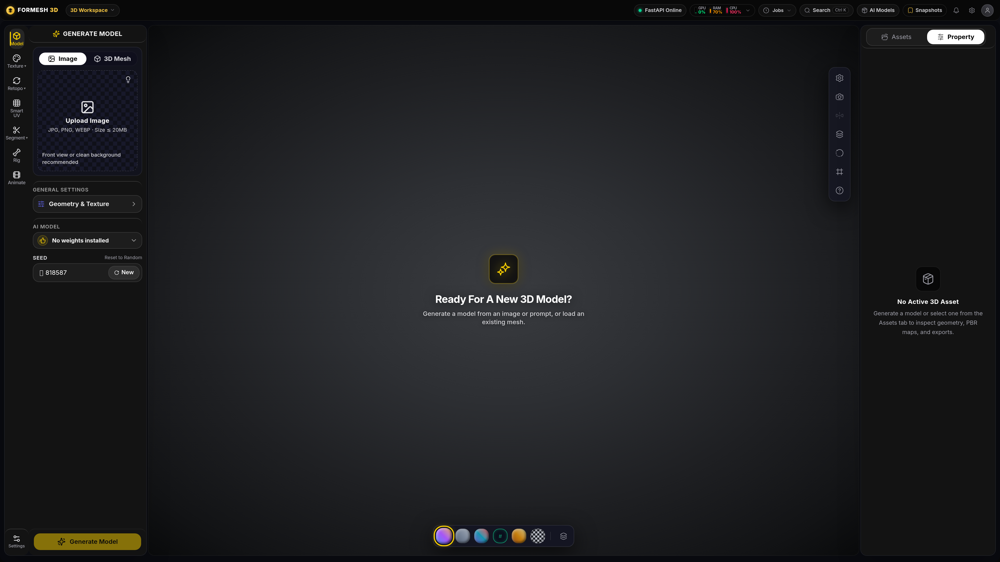

  

<h1 align="center">ForMesh3D</h1>

  A self-hosted AI 3D asset studio for generating, editing, and preparing production-ready meshes.

  
  
  
  
  
  

ForMesh3D brings image-to-3D generation and practical mesh-production tools into one local workspace. It combines a Next.js studio, a FastAPI service, model-specific inference adapters, and a persistent workspace/job layer. You run it on your own machine or VPS and install only the model checkpoints you intend to use.

## Workspace preview

  

## What you can do

| Area | Capabilities |
|---|---|
| **Image to 3D** | Generate raw 3D geometry from a reference image with Hunyuan3D, TripoSG, and TRELLIS adapters. |
| **Textured mesh generation** | Generate a textured mesh from an image with Stable Fast 3D. |
| **Texture painting** | Apply image-guided or text-guided materials to an existing mesh with Hunyuan3D, TRELLIS, and TripoSR Paint. TripoSR produces base color only. |
| **Segmentation** | Split a mesh into semantic parts with the PartField adapter. |
| **Retopology** | Rebuild mesh topology with TriFlow. |
| **UV unwrapping** | Generate UV layouts with PartUV. |
| **Auto-rigging** | Generate character rigs with SkinTokens and UniRig. |
| **Motion generation** | Generate character motion with the ARDY adapter. |
| **3D inspection** | Inspect GLB assets in the local Three.js viewport, with workspace tools and asset selection alongside it. |

Model availability is controlled by <code>backend/config/models.yaml</code>. A model marked <code>enabled: true</code> is registered for use; it is not proof that its weights are installed or that inference has been validated on your GPU.

## How it works

The application keeps the browser UI, API, model registry, scheduler, and storage responsibilities separate. Model-specific code stays behind adapters, while job and workspace state is persisted by the backend.

~~~mermaid
flowchart TD
    U["User"] --> UI["Next.js Studio Workspace & 3D Viewport"]
    UI --> API["FastAPI /api/v1"]
    API --> REG["Model Manifest models.yaml"]
    REG --> SCH["Model Scheduler"]
    SCH --> AD["Thin Model Adapter isolated worker"]
    AD -->|"1. sm &lt; 80"| PAT["patcher/&lt;model&gt;"]
    AD -->|"2. use_thirdparty + resolve_pretrained"| GPU["backend/thirdparty &amp; pretrained"]
    GPU --> OUT["Mesh / texture / motion outputs"]
    OUT --> STORE["backend/storage files + SQLite job state"]
    STORE --> API
    API --> UI
~~~

### Runtime modes

- **Single-worker:** the API process owns the scheduler and its model workers.
- **Multi-worker:** API workers communicate through Redis with a separate scheduler service.
- **Viewport:** GLB assets are loaded and rendered locally in the browser with Three.js and <code>GLTFLoader</code>. The previous server-side WebSocket/WebRTC mesh-streaming implementation is not part of the current viewer.

## Model lineup

The enabled model manifest currently covers these tools:

| Workspace tool | Configured models |
|---|---|
| Image-to-raw-mesh | Hunyuan3D-2.1 Shape, Hunyuan3D-2 Mini Turbo, TripoSG, TripoSR, TRELLIS |
| Image-to-textured-mesh | Stable Fast 3D |
| Image-guided texture painting | Hunyuan3D-Paint v2.1, Hunyuan3D-Paint v2.0, TRELLIS Paint, TripoSR Paint |
| Text-guided texture painting | TRELLIS Text Paint |
| Mesh segmentation | PartField |
| Retopology | TriFlow |
| UV unwrapping | PartUV |
| Auto-rigging | SkinTokens, UniRig |
| Motion generation | ARDY |

The TRELLIS text-paint entry reuses the existing TRELLIS checkpoint and adapter implementation; it is a separate feature registration, not a second set of model weights. Disabled/experimental model entries remain disabled unless deliberately changed.

## Architecture

- **Frontend:** Next.js 16, React 19, TypeScript, Three.js, Zustand, and TanStack Query.
- **Backend:** FastAPI, Python 3.10, Pydantic, and SQLite-backed workspace/job persistence.
- **Model manifest:** <code>backend/config/models.yaml</code> is the single source for enabled model IDs, VRAM budgets, supported formats, model paths, and capabilities.
- **Adapter registration:** enabled model IDs live in <code>backend/core/scheduler/model_factory.py</code> (and <code>backend/adapters/__init__.py</code> derives <code>_ADAPTER_MAP</code> from it).
- **Workspace route:** <code>/workspace/generate/&lt;workspace_id&gt;</code>.
- **Persistent storage:** <code>backend/storage/</code>, including <code>backend/storage/job_queue.db</code> for the single-worker workspace flow.
- **Third-party code:** pinned Git submodule at <code>backend/thirdparty</code>, loaded dynamically via <code>backend/core/utils/upstream.py</code>.

### How to Add a New Model

1. **Weights & Repo:** Place upstream source under `backend/thirdparty/<Repo>` and weights under `backend/pretrained/<Model>`.
2. **Optional Patcher:** Add `patcher/<model>/__init__.py` (`apply_patch()`) for any `sm < 80` or worker-local shims (never leak across sibling pipelines).
3. **Thin Adapter:** Subclass `BaseModel` in `backend/adapters/<model>_adapter.py` using `resolve_pretrained("<Model>")` and `with use_thirdparty("<Repo>"):` (or `load_thirdparty_script(...)`), applying `patcher.<model>.apply_patch()` **first**.
4. **Register:** Add the model entry to `backend/config/models.yaml` and `ModelFactory.ADAPTER_REGISTRY` in `backend/core/scheduler/model_factory.py`.

See [Docs/ARCHITECTURE.md](Docs/ARCHITECTURE.md) for execution and ownership boundaries, and [Docs/api-documentation.md](Docs/api-documentation.md) for API route groups.

## Requirements

- Linux is the primary development/runtime target.
- Python 3.10.
- Node.js 24.21.x and Bun 1.4.2.
- Git with submodule support.
- NVIDIA GPU and a compatible CUDA/PyTorch environment for GPU model inference.
- Disk space for model checkpoints and generated 3D assets.

A CPU-only setup is available for development and supported CPU tasks. GPU inference requires the relevant model checkpoints and compatible hardware.

## Quick start

Clone the repository with its pinned third-party submodule:

~~~bash
git clone --recurse-submodules https://github.com/Silentzx2/ForMesh3D.git
cd ForMesh3D
bun install
bash scripts/setup.sh
~~~

For a CPU-only setup:

~~~bash
bash scripts/setup.sh --cpu
~~~

Start the studio:

~~~bash
bash scripts/start.sh
~~~

Then open:

- Studio: [http://localhost:3000](http://localhost:3000)
- Backend API: [http://localhost:7842](http://localhost:7842)
- Swagger UI: [http://localhost:7842/docs](http://localhost:7842/docs)
- OpenAPI schema: [http://localhost:7842/openapi.json](http://localhost:7842/openapi.json)

Install/download only the checkpoints for models you plan to use. The model manifest describes configuration; it does not download weights automatically.

## Development checks

Run the frontend checks:

~~~bash
bun install --frozen-lockfile
bun run test       # TypeScript type check
bun run lint
bun test
bun run build
~~~

Run the backend checks:

~~~bash
python -m compileall -q backend/adapters backend/api backend/core backend/pipelines backend/scripts backend/tests backend/utils backend/loader.py patcher scripts
python -m pytest -q backend/tests/test_batch1_regressions.py
python -m pytest -q backend/tests/test_partfield_adapter.py
python -m pytest -q backend/tests/test_batch3_queue_and_lifecycle.py backend/tests/test_workspace_regeneration.py backend/tests/test_batch4_api_integration.py
python scripts/verify_contracts.py
bash -n backend/scripts/download_models.sh
bash scripts/tests/compute_mode_test.sh
bash scripts/test_env_resolution.sh
~~~

The first-party Python compile check intentionally excludes the pinned <code>backend/thirdparty</code> submodule. That upstream source has a separate known syntax issue; it should not mask syntax failures in ForMesh3D-owned code. These checks do not perform full GPU inference or certify model quality/performance.

## Project structure

~~~text
ForMesh3D/
├── app/                    # Next.js routes and application shell
├── assets/                 # README banner and workspace screenshots
├── backend/
│   ├── adapters/           # Model-specific inference adapters
│   ├── api/                # FastAPI app and route modules
│   ├── config/
│   │   └── models.yaml     # Canonical model manifest
│   ├── core/               # Config, scheduler, runtime and shared logic
│   ├── storage/            # Runtime assets and SQLite state
│   └── thirdparty/         # Pinned upstream submodule
├── components/             # Shared UI components
├── features/workspace/     # Workspace panels, viewer and state
├── services/               # Frontend API client
├── scripts/                # Setup, startup and verification scripts
└── Docs/                   # Architecture, API and project documentation
~~~

## Documentation

- [Architecture](Docs/ARCHITECTURE.md)
- [Product requirements](Docs/PRD.md)
- [API documentation](Docs/api-documentation.md)
- [Current implementation and verification notes](Docs/MEMORY.md)
- [Tasks and engineering notes](Docs/TASKS.md)
- [UI design system](Docs/DESIGN.md)
- [Agent/project rules](AGENTS.md)
- [Contributing](CONTRIBUTING.md)
- [Security policy](Docs/SECURITY.md)

## Project status and limitations

ForMesh3D is a personal self-hosted project. Model adapters, checkpoints, and hardware requirements vary; a configured model may be unavailable until its dependencies and weights are installed. Treat the live API schema and current code as authoritative when behavior differs from historical screenshots or design notes.

Before changing code, read [AGENTS.md](AGENTS.md). Keep changes focused, trace callers and adapter registration end to end, preserve disabled model states, and update tests/documentation with the implementation.

TripoSR uses one official TSR Python pipeline for image-to-mesh and image-guided mesh painting. On the Generate page, Texture OFF extracts raw geometry without loading the baker; Texture ON extracts geometry and calls official `bake_texture()` to create a base-color atlas. On the Texture Painting page, the same baker applies the reference image to the supplied mesh while preserving its geometry. It does not generate additional PBR maps. Source is expected at `backend/thirdparty/TripoSR`; weights are downloaded to `backend/pretrained/TripoSR` with `bash backend/scripts/download_models.sh -m triposr`.
