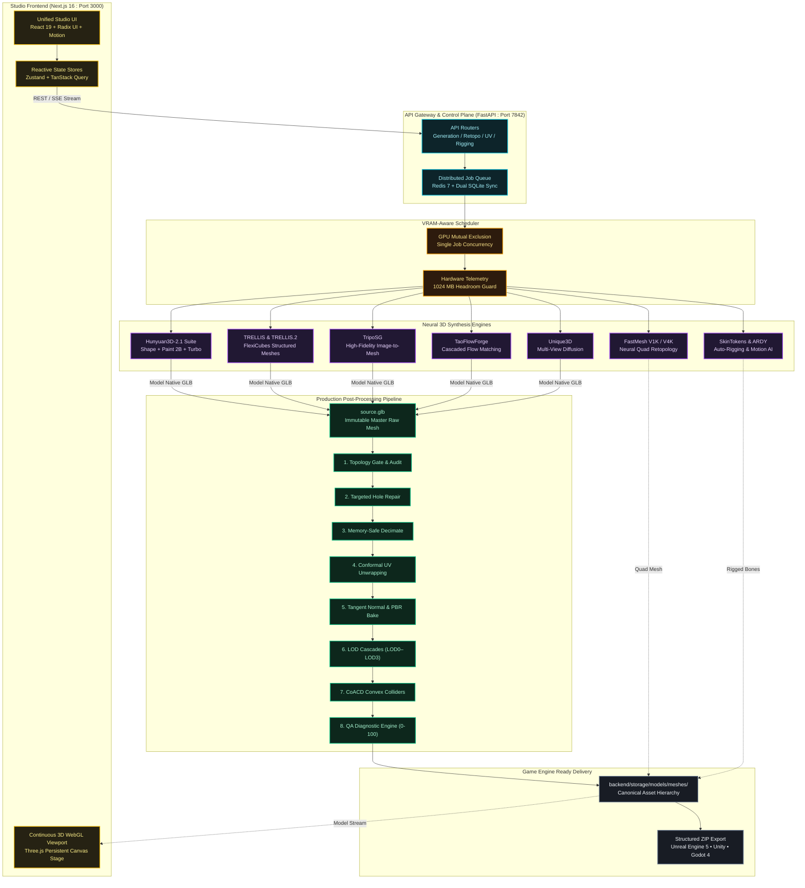
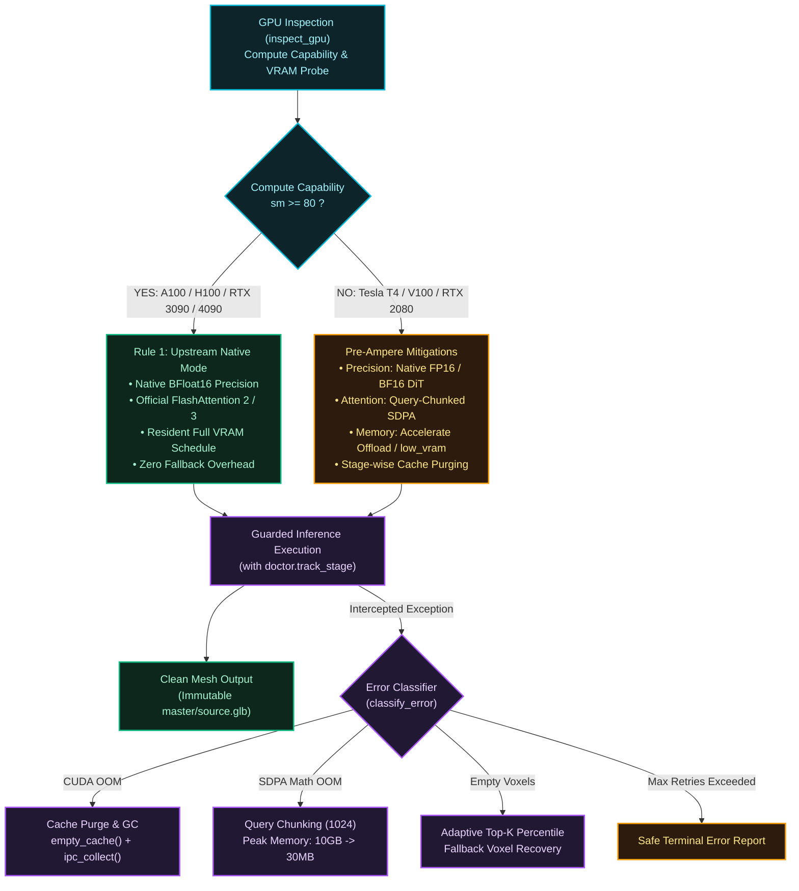
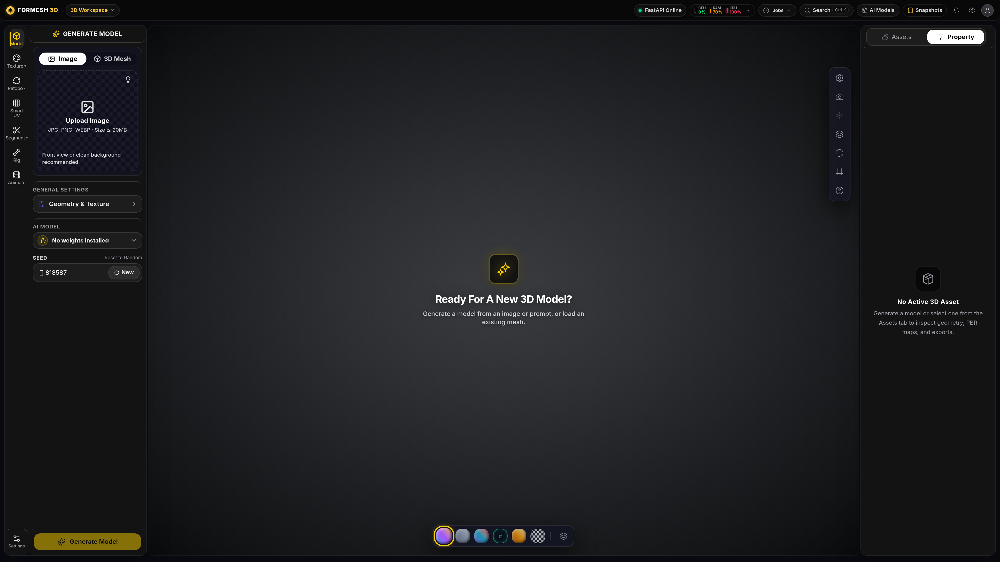

<!-- ===================== HERO BANNER ===================== -->

<p align="center">
  
</p>

<h1 align="center">
  ForMesh3D — Open-Source Generative 3D Studio & Production Pipeline
</h1>

<p align="center">
  <strong>A unified, self-hosted 3D creation suite for neural 3D generation, asset finishing, and engine-ready delivery</strong><br>
  <em>Text-to-Motion • Image-to-3D • Quad Retopology • PBR Material Painting • Auto-Rigging • Automated LODs • Game Engine Ready</em>
</p>

<!-- ===================== DEVELOPER BADGE BAR ===================== -->

<p align="center">
  <a href="LICENSE"></a>
  <a href="https://developer.nvidia.com/cuda-toolkit"></a>
  <a href="https://fastapi.tiangolo.com/"></a>
  <a href="https://nextjs.org/"></a>
  <a href="https://www.python.org/"></a>
  <a href="https://bun.sh/"></a>
  <a href="Docs/MEMORY.md"></a>
</p>

<p align="center">
  <strong>⚡ Quick Start:</strong> <code>git clone --recurse-submodules https://github.com/Silentzx2/ForMesh3D.git</code> → <code>bash scripts/setup.sh</code> → <code>bash scripts/start.sh</code> → Open <a href="http://localhost:3000">http://localhost:3000</a>
</p>

---

## 📑 Table of Contents

- [1. Overview & Core Mission](#1-overview--core-mission)
- [2. Core Capability Matrix](#2-core-capability-matrix)
- [3. End-to-End Asset Generation Pipeline](#3-end-to-end-asset-generation-pipeline)
- [4. System Architecture](#4-system-architecture)
- [5. Supported AI Model Catalog](#5-supported-ai-model-catalog)
- [6. GPU Doctor & Hardware Execution Planner](#6-gpu-doctor--hardware-execution-planner)
- [7. Studio Workspace & Interactive 3D Viewport](#7-studio-workspace--interactive-3d-viewport)
- [8. Production Post-Processing Engine](#8-production-post-processing-engine)
- [9. Technology Stack](#9-technology-stack)
- [10. Installation & Quick Start](#10-installation--quick-start)
- [11. REST & Streaming API Reference](#11-rest--streaming-api-reference)
- [12. Verification & Test Suite](#12-verification--test-suite)
- [13. Frequently Asked Questions (FAQ)](#13-frequently-asked-questions-faq)
- [15. State Machines and Implicit State Machine Audit](#15-state-machines-and-implicit-state-machine-audit)
- [16. Technical Documentation Index](#14-technical-documentation-index)
- [17. License & Legal Attribution](#15-license--legal-attribution)

---

## 1. Overview & Core Mission

> [!NOTE]
> **Phase: BETA** — ForMesh3D core studio, API gateway, and post-processing pipeline are active and stabilizing. Breaking changes may land before 1.0.

**ForMesh3D** is an open-source, self-hosted generative 3D asset creation and mesh-finishing platform. It bridges modern open research neural models into a single, cohesive studio running entirely on your local workstation or private GPU cluster.

Traditional AI 3D generators typically output dense, raw, untextured "triangle soups" that require hours of manual cleanup in external 3D software. ForMesh3D solves this by integrating neural generation directly with a complete production finishing pipeline:

- **100% Private & Self-Hosted**: Run neural inference locally on NVIDIA GPUs without cloud subscriptions, usage queues, or uploading proprietary concept art to external services.
- **Immutable Source Preservation**: Raw model-native generation is snapshotted at `master/source.glb` with SHA-256 validation before any downstream production decimation or retopology.
- **Production Asset Finishing**: Complete post-processing engine forked and customized from **[3DGenStudio](https://github.com/visualbruno/3DGenStudio)**, delivering watertight repair, conformal UV unwrapping, PBR material baking, quad retopology, multi-tier LOD cascades, and CoACD convex collision hulls.
- **Hardware-Adaptive GPU Doctor**: Standalone hardware compatibility and memory execution planner ([`patcher/doctor.py`](patcher/doctor.py)), guaranteeing 100% native BFloat16 FlashAttention on modern GPUs (`sm >= 80`) and mathematically exact query-chunked SDPA on pre-Ampere GPUs (`sm < 80`).

### Choose Your Contributor Path

| No GPU (CPU-Only Contributor) | GPU Workstation (NVIDIA CUDA 12.4+) |
|---|---|
| • Studio UI/UX, React Three Fiber Viewport | • Model Adapters (TRELLIS.2, Hunyuan3D, TaoFlowForge, TripoSG) |
| • API Gateway routers, job queues, SQLite sync | • GPU Doctor hardware execution planning & attention routing |
| • Mesh algorithms, contract tests & documentation | • Live GPU inference validation & production quality gates |
| 🔗 **[Explore Task Tracker & Roadmap →](Docs/TASKS.md)** | 🔗 **[Review System Architecture →](Docs/ARCHITECTURE.md)** |

> [!WARNING]
> ### ⚖️ Licensing, Commercial & SaaS Advisory (Important)
>
> 1. **Core Repository License**: ForMesh3D's original code (orchestrator, API gateway, scheduler, and Next.js studio UI) is open-source under the **[Apache License 2.0](LICENSE)**.
> 2. **Post-Processing Provenance**: The mesh post-processing engine (`backend/postprocess/`) was forked and customized from **[visualbruno/3DGenStudio](https://github.com/visualbruno/3DGenStudio)** under the **3D Gen Studio Community License**. See **[backend/postprocess/THIRD_PARTY_LICENSE.md](backend/postprocess/THIRD_PARTY_LICENSE.md)**.
> 3. **Use of Generated Outputs**: Rights to generated outputs depend on upstream model/checkpoint terms and applicable law. The Apache license on this repository does not grant unrestricted rights to every third-party model output; check the exact model and checkpoint terms before commercial use.
> 4. **Notice for Commercial & SaaS Implementors**:
>    - The Apache 2.0 license applies **strictly to ForMesh3D's original code**. We do **not** own or re-license underlying third-party models, research weights, or ported submodules.
>    - The ported `3DGenStudio` post-processing pipeline prohibits hosting the software as a paid public/private commercial SaaS service without explicit written consent from the upstream author (`visualbruno`).
>    - Individual model source snapshots and checkpoints have their own terms. Read the **[`backend/thirdparty/LICENSE`](backend/thirdparty/LICENSE)** directory for complete license details.
>    - **Do NOT blindly deploy or redistribute ForMesh3D as a paid commercial product or SaaS** without auditing and complying with the respective licenses of each integrated model and component!

---

## 2. Core Capability Matrix

| Capability | Technical Implementation | Output Deliverable |
|---|---|---|
| **Neural 3D Generation** | Upstream model adapters with locked native inference contracts | Immutable `master/source.glb` |
| **Source Preservation** | SHA-256 lineage tracking before any destructive modifications | Canonical source snapshot |
| **Production Decimation** | Feature-preserving QEM decimation protecting crease edges ($>35^\circ$) | Targeted budget polygon count |
| **Quad Retopology** | FastMesh V1K / V4K neural quad-dominant edge-loop reconstruction | Clean animatable quad mesh |
| **Conformal UV Unwrapping** | Automated GPU PartUV routing with CPU/GPU xatlas fallback ($0\%$ overlap) | Single/Multi-chart UV atlas |
| **PBR Material Baking** | Tangent-space normal baking (OpenGL Y+ convention) & packed RMA maps | Complete 5-channel PBR material maps |
| **LOD Generation** | Cascaded LOD0 to LOD3 with `meshoptimizer` vertex-cache optimization | Multi-tier `lods/lod[0-3].glb` |
| **Physics Collision Hulls** | CoACD approximate convex decomposition with mass & inertia tensors | Watertight `collision.glb` & `physics.json` |
| **Automated Rigging & Motion** | SkinTokens unified autoregressive armature generation & ARDY motion synthesis | Rigged FBX/GLB & playable motion JSON |
| **Game Engine Packages** | Structured directory packaging for Unreal Engine 5, Unity, and Godot 4 | Complete engine-ready ZIP archive |

---

## 3. End-to-End Asset Generation Pipeline

ForMesh3D enforces an **immutable master preservation architecture**. The raw neural model output is immediately snapshotted at `master/source.glb` before any downstream finishing operations, guaranteeing zero accidental loss of fine surface detail:

```mermaid
flowchart LR
    %% High-Contrast Styling
    classDef input fill:#262213,stroke:#eab308,stroke-width:2px,color:#fef08a;
    classDef neural fill:#211833,stroke:#a855f7,stroke-width:2px,color:#e9d5ff;
    classDef master fill:#0d242a,stroke:#06b6d4,stroke-width:2px,color:#a5f3fc;
    classDef post fill:#0d271c,stroke:#10b981,stroke-width:2px,color:#a7f3d0;
    classDef export fill:#181c24,stroke:#64748b,stroke-width:2px,color:#f1f5f9;

    IMG["Input Concept Image<br/>(Single Reference)"]:::input
    MODEL["Neural Model Adapter<br/>TRELLIS.2 / Hunyuan3D / TripoSG"]:::neural
    MASTER["master/source.glb<br/>Immutable Raw Mesh<br/>(SHA-256 Verified)"]:::master

    subgraph Finishing ["Production Post-Processing Engine"]
        GATE["1. Topology Gate"]:::post
        REPAIR["2. Hole Repair"]:::post
        DECIMATE["3. Decimation"]:::post
        UV["4. UV Resolver"]:::post
        PBR["5. PBR & Bake"]:::post
        LOD["6. LODs & Physics"]:::post
    end

    OUT["Game-Ready Package<br/>• game_ready.glb<br/>• lod0-lod3.glb<br/>• collision.glb & physics.json"]:::export

    IMG --> MODEL
    MODEL --> MASTER
    MASTER --> GATE
    GATE --> REPAIR
    REPAIR --> DECIMATE
    DECIMATE --> UV
    UV --> PBR
    PBR --> LOD
    LOD --> OUT
```



---

## 4. System Architecture

The following diagram illustrates the multi-tier system architecture connecting the Next.js studio frontend, FastAPI control plane, VRAM scheduler, neural adapters, and post-processing pipeline:



---

## 5. Supported AI Model Catalog

The model registry is dynamically configured via `backend/config/models.yaml` and loaded lazily:

| Model Architecture | Registered Model ID | Category / Task | VRAM Budget | Key Technical Capabilities & Live Audit Status |
|---|---|---|:---:|---|
| **Hunyuan3D-Shape-v2.1** | `hunyuan3d_shape_v21_image_to_raw_mesh` | Raw Mesh | ~10 GB | 3.3B shape model, official 2.1 pipeline, octree res 1300. **Status: VERIFIED PASS / LOCKED** (live Kaggle GPU verified: 935k faces, 16.1MB GLB). |
| **Hunyuan3D-DiT-v2-mini-Turbo** | `hunyuan3d_dit_v2_mini_turbo_image_to_raw_mesh` | Raw Mesh | ~6 GB | 0.6B low-VRAM step-distilled shape model. **Status: VERIFIED PASS / LOCKED** (live Kaggle GPU: 758k faces, 13.0MB GLB, 3.87GB VRAM). |
| **Unique3D** | `unique3d_image_to_raw_mesh` | Raw Mesh | ~10 GB | Multi-view geometry reconstruction, SD1.5 dependency bypassed. **Status: VERIFIED PASS / LOCKED** (live Kaggle GPU: 54k faces, 1.0MB GLB). |
| **TRELLIS.2** | `trellis2_image_to_3d` / `trellis2_image_to_raw_mesh` | Raw Mesh | 23.5 GB | High-fidelity FlexiCubes geometry; FP32 attention on pre-Ampere prevents logit collapse; adaptive top-k percentile voxel fallback; rembg zero-alpha guard; texture generation via `pipeline(mesh=, image=, seed=)` — implemented, 4K atlas |
| **TaoFlowForge** | `taoflowforge_image_to_raw_mesh` | Raw Mesh | 20 GB (10 GB low-VRAM) | Progressive native-mesh generation. Stage 1 query chunking SDPA (diff=0.0) eliminates 10.06 GiB OOM; stage offload enforced. |
| **Pixal3D** | `pixal3d_image_to_raw_mesh` / `pixal3d_image_to_3d` | Raw Mesh | ~18 GB configured reservation | Pixel-aligned O-Voxel source; DinoV3 feature extractor condition models initialized. |
| **Hunyuan3D-Paint-v2.1** | `hunyuan3d_paint_v21_image_mesh_painting` | PBR Texture | ~12 GB configured reservation | 2B PBR texture checkpoint, internal RealESRGAN, exported 4K/8K atlas validation. |
| **TripoSG** | `triposg_image_to_raw_mesh` | Image/Scribble to 3D | 8 GB | High-fidelity image and scribble guided 3D geometry; model-specific patcher in `patcher/triposg/`. |
| **SkinTokens** | `skintokens_auto_rigging` | Auto-Rigging | 14 GB | Unified autoregressive armature and discrete skin token generation. |
| **ARDY** | `ardy_motion_generation` | Motion AI | CPU-only | Interactive autoregressive text-to-motion generation; CPU/RAM-bound. |
| **PartUV** | `partuv_uv_unwrapping` | UV Unwrapping | 7 GB | Automated seam placement and GPU UV chart packing. |
| **TRELLIS** | `trellis_image_to_3d` / `trellis_image_to_raw_mesh` | Raw Mesh | 11.5 GB | Raw FlexiCubes geometry; texture generation via `to_glb(gs, mesh, texture_size=...)` — implemented, 2K atlas |

### Texture Pipeline & Texture-Capable Models

Texture generation runs inside the selected model's adapter after raw mesh inference, using already-loaded weights — no second weights load for models that share the texture-capable adapter. The raw `master/source.glb` stays immutable; textured output is stored as a separate artifact (`textures/<base>_textured.glb`).

|| Model | Texture Capability | Status |
|---|---|---|
| **Hunyuan3D-2.1** (`hunyuan3d_paint_v21_image_mesh_painting`) | PBR texture with internal RealESRGAN enhancement; 4K/8K atlas targets | Done — texture runs in `hunyuan3d_adapter_v21.py` `_process_request` after raw inference |
| **TRELLIS** (`trellis_image_to_raw_mesh`) | Texture via `to_glb(gs, mesh, texture_size=...)` | Done — implemented in `_TrellisBaseAdapter._process_request`, 2K atlas |
| **TRELLIS.2** (`trellis2_image_to_raw_mesh`) | Texture via `pipeline(mesh=, image=, seed=)` | Done — implemented in `Trellis2ImageToRawMeshAdapter._process_request`, 4K atlas |

Paint3D has been removed from the main repo. All texture resolutions now route to Hunyuan3D-Paint v2.1.

> **Registry source of truth:** the catalog above mirrors `backend/config/models.yaml`. Only entries with `enabled: true` are exposed by `GET /api/v1/system/models`. `backend/config/smart_presets.yaml` holds the intent presets (`mobile`, `game_ready`, `cinematic`, `animation`, `3d_print`; `native` is a backend-only sentinel).

---

## 6. GPU Doctor & Hardware Execution Planner

ForMesh3D features **GPU Doctor** ([`patcher/doctor.py`](patcher/doctor.py)), a lightweight, non-invasive hardware compatibility, precision routing, and memory management subsystem. Built strictly following **Ponytail Ultra** principles (single compact file, zero unnecessary dependencies, native PyTorch + Hugging Face Accelerate), GPU Doctor resolves hardware heterogeneity between modern cloud GPUs and budget pre-Ampere workstations:



### Core Architecture Invariants:
1. **Rule 1 Priority (Zero Modern GPU Regression)**: On modern GPUs (`sm >= 80`, e.g. A100, RTX 3090/4090, H100), GPU Doctor preserves 100% native BF16 precision and native FlashAttention with zero fallbacks, zero performance penalties, and official README parity.
2. **Mathematically Exact Query-Chunked SDPA**: On pre-Ampere GPUs (`sm < 80`), large token sequences (e.g. 15,000+ tokens in TaoFlowForge Stage 1) trigger PyTorch SDPA Math fallback, causing 10.06 GiB OOM crashes. GPU Doctor slices query tokens along the sequence dimension (`chunk_size=1024`) while evaluating against all key/value tokens. Because softmax normalizes along the key dimension, the output is mathematically identical (`diff = 0.0`) while peak attention memory drops from 10.06 GiB to ~30 MB across both 3D and 4D tensors.
3. **Structured Diagnostics & Bounded Recovery**: Tracks stage-by-stage timings, peak VRAM allocations, and classifies exceptions into 7 actionable categories (`cuda_oom`, `unsupported_precision`, `dtype_mismatch`, `device_mismatch`, `attention_backend_failure`, `sparse_empty_voxels`, `unknown`) with a strict retry limit (`max_retries=2`) to prevent infinite failure loops.

---

<!-- ===================== STUDIO WORKSPACE SHOWCASE (MIDDLE OF README) ===================== -->

## 7. Studio Workspace & Interactive 3D Viewport

<div align="center">
  
</div>

<p align="center">
  <sub><b>Figure 1:</b> ForMesh3D unified Studio Workspace — live interactive Three.js viewport, Generate Model panel with image/mesh upload, geometry & texture settings, AI model selector, and production post-processing toggles. Captured from <code>http://localhost:3000/workspace</code>.</sub>
</p>

The ForMesh3D Studio UI integrates neural generation and mesh finishing into a cohesive desktop-grade web application:

### 🎮 Viewport & Generation Controls:
- **Interactive Three.js Viewport**: Smooth orbital camera controls, perspective/orthographic toggle, wireframe overlay, PBR matcap rendering, and continuous WebGL staging.
- **Floating XYZ Orientation Gizmo**: Reference-matched image-backed camera control with interactive positive and negative X/Y/Z snaps, integrated into the existing viewport without a second renderer.
- **Real-Time Geometry Telemetry HUD**: Direct in-viewport telemetry tracking triangle count, vertex count, watertight manifold status, physical bounding box dimensions ($W \times H \times D$), and quality score — replaces the collapsible Mesh Details panel formerly in `ViewportToolOverlay`.
- **Hardware-Aware Model Selector**: Real-time VRAM estimator comparing model memory reservations with live GPU telemetry (`torch.cuda.mem_get_info`) to prevent out-of-memory crashes before jobs are queued.
- **Production Post-Processing Controls**: Toggle automated quad retopology, hole repair, conformal UV unwrapping, normal baking, and collision hull generation without mutating the immutable `master/source.glb`.

### 🧰 Creative Workspace Modules:
- **Generate Studio (`/workspace`)**: Image-to-3D generation with reference image intake, model selector, unified Target Polycount, and Output Presets (`mobile`, `game_ready`, `cinematic`, `animation`, `3d_print`, `native`).
- **Texture Studio (`/workspace/texture`)**: Multi-view PBR texture painting and PBR map inspection/export (Albedo, Normal, Roughness, Metallic, AO). Hunyuan3D-Paint v2.1 runs internal RealESRGAN enhancement for 4K/8K atlas targets.
- **Retopology & Remesh (`/workspace/remesh`)**: FastMesh quad-dominant retopology with V1K and V4K target presets.
- **UV Unwrapping (`/workspace/uv`)**: Automated conformal seam placement and atlas chart packing.
- **Mesh Segmentation (`/workspace/segment`)**: Semantic part decomposition interface.
- **Animation & Motion (`/animation`)**: SkinTokens autoregressive armature generation and ARDY motion synthesis.
- **Jobs & Run Inspector (`/workspace/jobs`)**: Real-time progress tracking, step telemetry, and VRAM monitoring.
- **Admin & Model Registry (`/admin?tab=models`)**: Live GPU health, temperature, and adapter configuration.
- **Database Administration (`/admin?tab=database`)**: Cross-store statistics (SQLite/Redis/queue/file-metadata/disk), read-only Redis key inspector, and paginated jobs table with per-row cancel/delete.

---

## 8. Production Post-Processing Engine

Raw AI generative meshes typically suffer from non-manifold triangles, missing UV layouts, dense topological noise, and absence of physics colliders. ForMesh3D's post-processing engine (ported and enhanced from [3DGenStudio](https://github.com/visualbruno/3DGenStudio)) automates asset finishing:

```text
backend/storage/models/meshes/<asset_name>_<job_id>/
├── master/
│   └── source.glb              # Immutable master raw mesh (SHA-256 verified)
├── game_ready/
│   └── <asset_name>_<job_id>.glb # Production engine-ready model
├── lods/
│   ├── lod0.glb                # LOD0 (100% detail)
│   ├── lod1.glb                # LOD1
│   ├── lod2.glb                # LOD2
│   └── lod3.glb                # LOD3 (at most 4 levels; ratios follow LOD preset)
├── collision/
│   └── collision.glb           # Watertight CoACD convex hull
├── textures/                   # PBR texture maps (Albedo, Normal, Roughness, Metallic, AO)
├── previews/                   # Rendered thumbnail images
└── metadata/
    ├── asset.json              # Canonical asset manifest
    ├── quality_report.json     # QA 0-100 score & stage trace
    └── physics.json            # Mass, center of mass, inertia tensor
```

### Core Finishing Highlights:
1. **Topology Gating & Clean Passthrough**: Evaluates 14 geometric and topological metrics (non-manifold edges/vertices, boundary holes, floater ratio, aspect-ratio percentiles). Clean meshes bypass repair entirely; small boundary loops are routed to targeted repair.
2. **Targeted Hole Repair**: Traverses directed boundary loops and triangulates small holes ($\le 50$ vertices) with fan triangulation without altering or smoothing uncorrupted surfaces.
3. **Memory-Safe Staged Decimation**: Feature-preserving QEM decimation protecting crease edges ($>35^\circ$); meshes exceeding 2M triangles engage staged 50% chunked decimation with live psutil RAM tracking (80% headroom cap) and aggressive garbage collection.
4. **Centralized UV Backend Resolver**: Single-point resolver automatically routing meshes $\ge 500\text{k}$ triangles to GPU PartUV (when CUDA and 7GB VRAM are free), falling back to high-throughput CPU/GPU xatlas with 0% overlap and strict $[0, 1]$ bounds.
5. **Tangent Normal Bake & 5-Channel PBR Validation**: Tangent-space normal baking (OpenGL Y+ convention) from high-poly master, validating non-degenerate textures, packed roughness (G) / metallic (B) channels, and atlas space utilization.
6. **CoACD Physics Colliders & WebSim**: Computes approximate convex decomposition for game engine colliders with in-browser Rapier3D physics preview.

---

## 9. Technology Stack

| Component | Technology | Rationale |
|---|---|---|
| **Frontend Framework** | **Next.js 16** (App Router), React 19, TypeScript | Server Components, fast client routing, static optimization |
| **UI Design System** | Tailwind CSS v4, Radix UI, Hugeicons | Studio Gold dark theme (`hsl(48, 100%, 50%)`), accessible, responsive |
| **State & Query** | Zustand, TanStack Query | Reactive real-time stores and optimistic server-state sync |
| **3D Rendering** | Three.js, React Three Fiber | Real-time PBR shaders, wireframe inspection, matcaps |
| **Physics Preview** | `@dimforge/rapier3d-compat` (WebAssembly) | Fast browser physics simulation without external dependencies |
| **Backend API** | **FastAPI**, Python 3.10, Pydantic V2 | Async high-throughput REST, SSE event streaming |
| **GPU Scheduling** | Multiprocess VRAM Scheduler, Redis 7 Queue | Mutual exclusion, 1GB headroom buffer, memory safety |
| **Hardware Doctor** | PyTorch Native + Hugging Face Accelerate | Clean precision routing, query-chunked SDPA, zero regression |
| **Geometry Core** | PyMeshLab, Trimesh, CoACD, meshoptimizer | Watertight repair, quad retopo, texture decimation |
| **Package Managers** | Bun (Frontend), Conda (Python 3.10 `3daigc-api`) | Ultra-fast JS bundling and deterministic CUDA C++ bindings |

---

## 10. Installation & Quick Start

### Prerequisites
- **OS**: Linux (Ubuntu 20.04, 22.04, or 24.04 recommended) or Windows WSL2.
- **GPU**: NVIDIA GPU with CUDA 12.4+ (minimum 8GB VRAM for basic models, 16GB–24GB+ recommended).
- **Node Environment**: [Bun](https://bun.sh/) installed.
- **Python**: Python 3.10 via Conda (`conda create -n 3daigc-api python=3.10`).

### 1. Clone with Submodules
```bash
git clone --recurse-submodules https://github.com/Silentzx2/ForMesh3D.git
cd ForMesh3D

# Install frontend dependencies with Bun
bun install
```

### 2. Backend Environment & Setup
```bash
# Automated setup prepares the environment, builds C++/CUDA kernels,
# installs backend dependencies, and initializes the thirdparty submodule
bash scripts/setup.sh
```

### 3. Model Weights & Checkpoints
Download pre-trained weights for the models you wish to use:
```bash
# Download core model checkpoints
bash backend/scripts/download_models.sh
```

### 4. Running the Studio
```bash
# Launch both backend (Port 7842) and Next.js frontend (Port 3000)
bash scripts/start.sh
```

Open **`http://localhost:3000`** in your browser.

- Frontend Studio: `http://localhost:3000`
- Backend API: `http://localhost:7842`
- Interactive Swagger Docs: `http://localhost:7842/docs`
- Health Endpoint: `http://localhost:7842/api/v1/system/health`

### Docker Compose (NVIDIA GPU)
From the repository root, build and start the containerized backend stack:
```bash
docker compose -f docker-compose.yml up --build -d
```

---

## 11. REST & Streaming API Reference

The FastAPI backend exposes comprehensive REST and SSE streaming endpoints:

| Endpoint | Method | Description |
|---|:---:|---|
| `/api/v1/system/info` | `GET` | System health, GPU specs, VRAM utilization, active worker mode |
| `/api/v1/system/health` | `GET` | Lightweight liveness check |
| `/api/v1/system/models` | `GET` | List registered models, readiness, capabilities, and VRAM requirements |
| `/api/v1/mesh-generation/image-to-raw-mesh` | `POST` | Generate high-fidelity raw geometry from single reference image |
| `/api/v1/mesh-generation/image-to-textured-mesh` | `POST` | Backward-compatible endpoint; ordinary generation is raw-first with optional texturing |
| `/api/v1/mesh-generation/image-mesh-painting` | `POST` | Paint PBR textures onto existing 3D geometry |
| `/api/v1/mesh-generation/text-mesh-painting` | `POST` | Paint PBR textures onto existing 3D geometry from a text prompt |
| `/api/v1/smart-generation/generation` | `POST` | Intent-driven generation with deterministic model selection |
| `/api/v1/mesh-retopology/retopologize-mesh` | `POST` | Run FastMesh quad retopology on mesh |
| `/api/v1/mesh-uv-unwrapping/unwrap-mesh` | `POST` | Generate conformal UV atlas charts |
| `/api/v1/mesh-segmentation/segment-mesh` | `POST` | Segment mesh into semantic parts |
| `/api/v1/auto-rigging/generate-rig` | `POST` | Generate bipedal skeleton armature |
| `/api/v1/motion-generation/generate-motion` | `POST` | Synthesize motion sequence into playable JSON |
| `/api/v1/system/jobs/{job_id}` | `GET` | Durable job status and production progress polling |
| `/api/v1/system/jobs/{job_id}/postprocess/retry` | `POST` | Retry production processing from immutable master |
| `/api/v1/mesh-tools/*` | `POST` | In-process Auto UV, Retopo, Repair, Optimize, LOD, Collision, Bake, and Convert tools |

---

## 12. Verification & Test Suite

ForMesh3D maintains unit and regression tests across frontend and backend. Counts below reflect a clean run of `pytest backend/tests/` and `bun test` on the current tree:

```bash
# Backend Pytest Suite — 29 tests defined across 4 files;
# 23 collected in this environment: 11 passed, 7 failed, 5 skipped
# (failures/skips need optional modules not installed here: xatlas, rtree, pymeshlab;
#  test_retopo_and_metrics.py fails collection: ImportError: snap_to_features)
pytest backend/tests/

# Frontend Bun Test Suite — 11 tests across 3 files: 11 passed, 0 failed
bun test

# Verify clean compilation across all Python backend & patcher modules
python3 -m py_compile patcher/doctor.py patcher/__init__.py backend/tests/*.py

# Frontend type and lint checks
npx tsc --noEmit
bun run lint
```

**Verification Status (this session — November 12, 2026)**:
- **Pytest Backend**: 29 tests defined across 4 files → 23 collected: **11 passed, 7 failed, 5 skipped** (missing optional modules `xatlas`, `rtree`, `pymeshlab`); `test_retopo_and_metrics.py` fails collection on `ImportError: cannot import name 'snap_to_features'` (pre-existing; not re-fixed here).
- **Bun Frontend**: **11/11 passed** across 3 files (`buildGenerationParameters.test.ts`, `meshStats.test.ts`, `app/api/v1/[...path]/route.test.mjs`); 0 failures — all `generate_texture` contract assertions fixed.
- **Python Bytecode**: `py_compile` clean on backend test and patcher files.
- **GPU inference**: prior live-GPU claims (Hunyuan3D-Shape v2.1, DiT Mini Turbo, Unique3D) carried from earlier releases; not re-run in this environment.

---

## 13. Frequently Asked Questions (FAQ)

<details>
<summary><strong>How does ForMesh3D protect source quality?</strong></summary>

Source generation uses model-specific inference schedules and source-density settings. The scheduler strips production-only face, decimation, remesh, LOD, physics, and paint orchestration controls before adapter inference. The resulting `master/source.glb` is immutable; downstream production budgets operate on derived artifacts only.
</details>

<details>
<summary><strong>Can I use ForMesh3D commercially or deploy it as a paid SaaS service?</strong></summary>

**For Outputs**: Do not assume unrestricted commercial rights. Check the upstream model and checkpoint terms for the specific generator, along with applicable law, before redistributing or commercially using generated assets.

**For Code & Hosting**: ForMesh3D's original code is under Apache 2.0, while ported components, model source code, pretrained checkpoints, and datasets have separate terms. Review the [ThirdParty licensing directory](backend/thirdparty/LICENSE) and [post-processing attribution](backend/postprocess/THIRD_PARTY_LICENSE.md). The main repository license does not override upstream terms.
</details>

<details>
<summary><strong>Can I generate clean quad-topology meshes for game animation?</strong></summary>

Yes. ForMesh3D natively integrates **FastMesh** alongside an adaptive **AutoRetopo** pipeline. Unlike raw generative outputs that yield messy triangle soups, ForMesh3D outputs clean quad-dominant edge loops with preserved feature creases, ready for skeletal auto-rigging and subdivision.
</details>

<details>
<summary><strong>Can ForMesh3D run 100% offline without internet?</strong></summary>

Yes. Once your model checkpoints are downloaded via `bash backend/scripts/download_models.sh`, ForMesh3D operates **completely offline**. No telemetry, prompts, reference images, or generated models are ever transmitted to any external server, ensuring complete data privacy and NDA compliance for commercial game studios.
</details>

<details>
<summary><strong>What GPU hardware is required to run ForMesh3D?</strong></summary>

ForMesh3D runs on modern NVIDIA GPUs supporting CUDA 12.4+. VRAM figures are the scheduler reservations declared in `backend/config/models.yaml`:
- **Lightweight Models (6 GB–10 GB VRAM)**: TripoSG (~8 GB), Hunyuan3D-DiT-v2-mini-Turbo (~6 GB), Unique3D (~10 GB), PartUV (~7 GB).
- **Standard Models (11.5 GB–14 GB VRAM)**: TRELLIS (~11.5 GB), Hunyuan3D-Paint v2.1 (~12 GB configured reservation), SkinTokens (~14 GB).
- **Heavy & High-Poly Models (16 GB–24 GB+ VRAM)**: FastMesh V1K (~16 GB), Pixal3D (~18 GB), TaoFlowForge (~20 GB / 10 GB low-VRAM), TRELLIS.2 (~23.5 GB, runs on RTX 3090, 4090, A10, A100).
</details>

<details>
<summary><strong>What file formats can ForMesh3D export for game engines?</strong></summary>

ForMesh3D exports standard **GLB / glTF 2.0**, **OBJ**, **STL**, and **FBX** (via isolated Blender automation). Downloaded ZIP archives are structured specifically for **Unreal Engine 5**, **Unity**, and **Godot 4**, containing game-ready meshes, LOD cascades (`lod0.glb`–`lod3.glb`), convex collision hulls (`collision.glb`), and portable physics metadata (`physics.json`).
</details>

---

## 16. Technical Documentation Index

| Documentation Guide | Description |
|---|---|
| 🏛️ **[System Architecture](Docs/ARCHITECTURE.md)** | Deep architectural layers, gateway design, and scheduler contracts |
| 📋 **[Product Requirements (PRD)](Docs/PRD.md)** | Core features, target users, and product roadmaps |
| 🎨 **[Design System](Docs/DESIGN.md)** | Studio Gold color tokens, UI component specifications, and layouts |
| 🛡️ **[Agent & Engineering Rules](AGENTS.md)** | Authoritative coding standards, minimalist practices, and change policies |
| 📝 **[Project Decisions (ADRs)](Docs/DECISIONS.md)** | Architecture Decision Records (up to ADR-103) |
| 🧠 **[Project Memory & Status](Docs/MEMORY.md)** | Active state, hardware prerequisites, and verified milestones |
| 📜 **[Change Log](Docs/CHANGELOG.md)** | Chronological history of releases, fixes, and optimizations |
| 📋 **[Task Tracker](Docs/TASKS.md)** | Future tasks and follow-ups; new tasks will be added here |
| ⚡ **[Physics Runtime Specification](Docs/SYSTEM-BLUEPRINT.md#physics-path)** | Rigid-body simulation, mass properties, and Rapier3D integration |
| 🔌 **[API Documentation](Docs/api-documentation.md)** | Complete endpoint schemas, request payloads, and status codes |
| ⚖️ **[Third-Party Model Sources & Licensing](backend/thirdparty/LICENSE)** | Upstream model inventory, licensing terms, and usage conditions |
| 🔒 **[Security Policy](Docs/SECURITY.md)** | Vulnerability reporting and isolated environment safety guidelines |

---

## 15. State Machines and Implicit State Machine Audit

ForMesh3D's studio and scheduler are driven by dozens of scattered booleans, enums, and flags that act as **implicit state machines** — none centralized in a state-chart library. The full inventory, with verified file paths and line numbers, lives in **[Docs/TASKS.md](Docs/TASKS.md)** ("ForMash3D — Implicit State Machine Inventory"), a read-only multi-agent audit.

### Frontend machines (F1–F62)
Generation/execution FSM, batch queue, viewport model load, image/mesh upload, task polling, SSE connection, feature availability, navigation/tool, hover/part highlight, turntable, animation mixer, viewport UI shell, settings popover, job polls, job status lifecycle, wireframe toggle, shading-mode cycle, camera preset, lighting tone/exposure, snapshot, export modal, comparison divider, animation playback, viewer store, upload lifecycle, dynamic inspectors, panels, and app-store machines (downloads, tasks, current job, install progress, history, sidebars, command palette, recent jobs).

### Backend machines (B1–B38)
Job lifecycle and queue residency, worker lifecycle and busy bookkeeping, admission/placement outcomes, model load states, VRAM tracking, rate limiter, deployment mode, SSE log stream, app lifespan, scheduler start/stop, job-queue persistence, Redis hooks, single-worker lifespan, postprocess stage axis, job timeouts, queue-age staleness, Redis cancel signaling, worker creation handshake, model residency TTL/eviction, batch concurrency slots, settings lazy init, model download lifecycle, service/menu lifecycle.

### Audit methodology
On every task, scan the codebase for scattered booleans/flags acting as implicit state machines — UI toggles, loading/idle/error flows, compare modes, shading modes, presets, turntable, wireframe, snapshot, settings popover, mesh upload lifecycle, job status transitions, texture pipeline states, abort/controller flows, panel open/close, camera presets, lighting tone, exposure slider, model loader states, scheduler/worker states, job queue states, adapter registry states. For each machine report: name, states, transitions, triggers, file + line, and explicit vs implicit. Resolve overlaps, delete dead machines with zero callers (e.g. `setRigStatus`), and fix shared transition logic once rather than per caller.

Docs/TASKS.md is the source of truth for the inventory; update it when machines are added, promoted to explicit enums, or removed.

## 17. License & Legal Attribution

- **ForMesh3D Core**: Licensed under the **[Apache License 2.0](LICENSE)**.
- **Post-Processing Pipeline**: Ported and adapted from **[visualbruno/3DGenStudio](https://github.com/visualbruno/3DGenStudio)** under the **3D Gen Studio Community License**. See **[backend/postprocess/THIRD_PARTY_LICENSE.md](backend/postprocess/THIRD_PARTY_LICENSE.md)**.
- **Backend API Gateway Base**: Forked and modernized from **[FishWoWater/3DAIGC-API](https://github.com/FishWoWater/3DAIGC-API)**.
- **Neural Model Checkpoints**: Source and checkpoint terms are controlled by their respective upstream authors. See the [ThirdParty licensing directory](backend/thirdparty/LICENSE).
