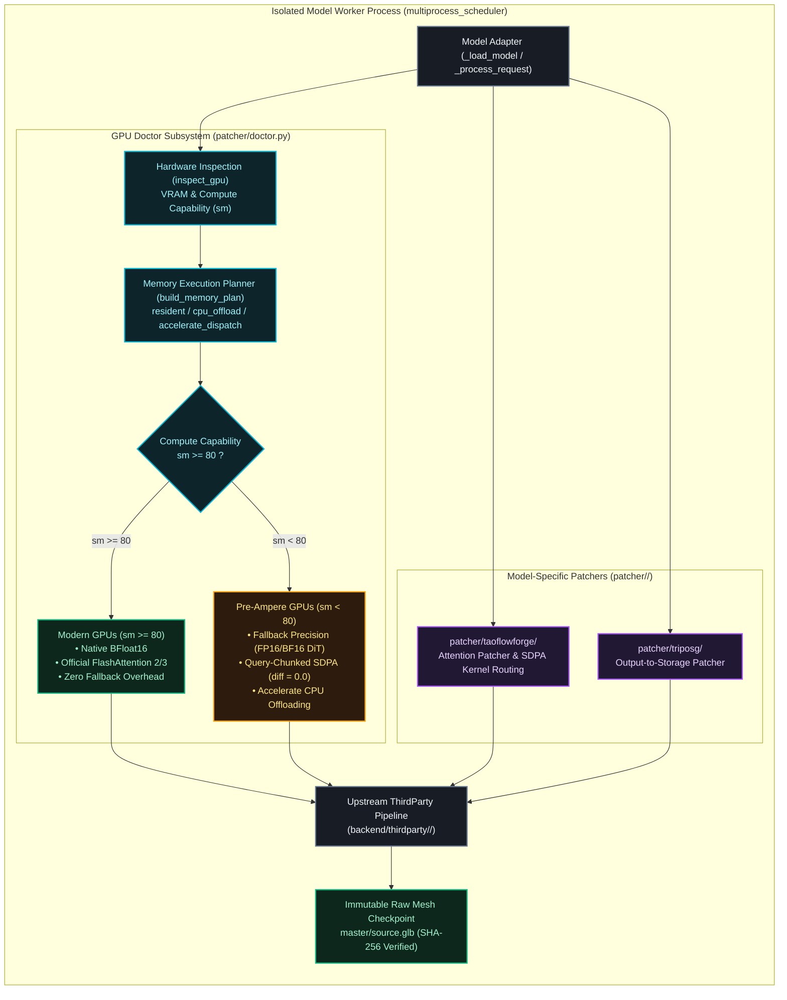

# ForMesh3D Patcher & GPU Doctor Infrastructure

## 1. Overview & Purpose

The `patcher/` package directory provides two critical capabilities for the ForMesh3D generative runtime:

1. **GPU Doctor (`patcher/doctor.py`)**: A centralized, lightweight, hardware-aware execution planner, precision router, query-chunked attention optimizer, and bounded recovery coordinator.
2. **Model-Specific Runtime Patchers (`patcher/<model-name>/`)**: Isolated, process-scoped compatibility patches that execute strictly inside an individual model's worker process when external pipeline adjustments or initialization hooks are necessary.

Strictly governs and enforces **Priority Rules 1, 2, and 3** from `AGENTS.md`:
- **Rule 1 (Zero Modern GPU Regression)**: Under no circumstances should logic, attention kernels, precision (native BFloat16), or upstream flows for modern large GPUs (`sm >= 80`, e.g. A100, RTX 3090, RTX 4090, H100) be altered, degraded, or modified.
- **Rule 2 (No Global Monkeypatching)**: Patching must never alter global framework primitives (such as modifying `torchvision_fix.py` or `tl.store` globally).
- **Rule 3 (Strict Worker Isolation)**: Model-specific patches live in dedicated subdirectories (`patcher/<model-name>/`) and execute strictly within that model's dedicated worker process.

---

## 2. Architecture & Lifecycle Flow



---

## 3. Directory Layout & Module Index

```text
patcher/
├── __init__.py           # Re-exports GPUDoctor, GPUInfo, DoctorConfig, ModelProfile, DoctorReport, StageRecord
├── README.md             # This architecture documentation
├── doctor.py             # Central GPU Doctor engine (hardware planner, chunked SDPA, recovery)
├── taoflowforge/         # TaoFlowForge model-specific patcher
│   └── __init__.py       # Pre-Ampere SDPA attention router and compute dtype guard
└── triposg/              # TripoSG model-specific patcher
    ├── __init__.py       # Patcher initializer
    └── output_to_storage.py # Raw mesh output resolution for isolated worker processes
```

---

## 4. GPU Doctor Specification (`patcher/doctor.py`)

GPU Doctor is implemented as a single, fully typed, dependency-lightweight module (`patcher/doctor.py`) using native PyTorch and Hugging Face `accelerate`.

### Public Interfaces & Contracts
- **`GPUDoctor(config: Optional[DoctorConfig])`**:
  - `inspect_gpu(device: Optional[Union[int, str]]) -> GPUInfo`: Inspects physical GPU properties, compute capability (`major`, `minor`), total/free VRAM, BF16 native support (`major >= 8`), and FlashAttention compatibility.
  - `select_precision(model_profile: ModelProfile, gpu_info: Optional[GPUInfo]) -> torch.dtype`: Selects optimal precision adhering to Rule 1. Modern GPUs (`sm >= 80`) receive native BF16; pre-Ampere receives FP16 (or BF16 range for DiT Euler steps).
  - `select_attention_backend(gpu_info, preferred) -> str`: Selects `flash_attn` for `sm >= 80`; `sdpa` or `xformers` for `sm < 80`.
  - `build_memory_plan(model_name, model_profile, model, gpu_info) -> Dict[str, Any]`: Computes deterministic strategy (`resident`, `cpu_offload`, `accelerate_dispatch`).
  - `prepare_model(model, plan) -> Any`: Applies Accelerate auto device mapping or native pipeline `low_vram=True`.
  - `chunked_scaled_dot_product_attention(q, k, v, mask, chunk_size, scale)`: Mathematically exact query chunking across 3D and 4D tensors, reducing peak attention memory from 10.06 GiB down to ~30 MB (`diff = 0.0`).
  - `clean_cache()`: Garbage collection + PyTorch caching allocator purge + IPC collection.
  - `track_stage(stage_name) -> Generator[StageRecord]`: Context manager measuring stage duration and peak VRAM.
  - `classify_error(exc) -> str`: Categorizes errors into 7 taxonomy classes (`cuda_oom`, `unsupported_precision`, `dtype_mismatch`, `device_mismatch`, `attention_backend_failure`, `sparse_empty_voxels`, `unknown`).
  - `recover(stage_name, exc, retry_count) -> RecoveryEvent`: Bounded recovery (`max_retries=2`) preventing infinite failure loops.

### Declarative Model Profiles
Built-in profiles are registered for:
- **`trellis2`**: Native BF16 DiT, native FP16 decoder, sequential `low_vram=True` CPU offload, non-split module classes.
- **`pixal3d`**: Accelerate auto dispatch support, `DinoV3ProjFeatureExtractor` no-split module class, chunked SDPA enabled.
- **`taoflowforge`**: DiT BF16 range protection, stage-wise CPU offload (`offload="on"`), chunked SDPA (`chunk_size=1024`) preventing 10.06 GiB Stage 1 Math OOM.

---

## 5. Model-Specific Patchers

### `patcher/taoflowforge/`
- **Problem addressed**: Pre-Ampere GPUs (`sm < 80`) lack hardware FlashAttention 2/3. PyTorch's default SDPA falls back to `SDPBackend.MATH` during Stage 1 refinement (15,000+ tokens), allocating a 10.06 GiB dense attention matrix and causing immediate CUDA OOM crashes.
- **Fix applied**: Routes pre-Ampere attention requests through memory-efficient xFormers or query-chunked SDPA (`chunk_size=1024`), computing attention in slices with mathematical exactness (`diff = 0.0`). Modern GPUs (`sm >= 80`) continue running official native FlashAttention with zero overhead.

### `patcher/triposg/`
- **Problem addressed**: Multi-process worker isolation requires the generated mesh to be delivered deterministically to the canonical job workspace directory without colliding with other worker processes.
- **Fix applied**: Wraps request processing to ensure output artifacts are mirrored to the designated job storage path upon successful generation.

### `patcher/trellis2/`
- **Problem addressed**: `sparse_structure_decoder` checkpoint in `pipeline.json` references `microsoft/TRELLIS-image-large/ckpts/ss_dec_conv3d_16l8_fp16` (original TRELLIS repo), not compatible with TRELLIS.2's flow model. Produces all-negative logits (~ -75) → zero occupied voxels → hollow box output instead of input object.
- **Fix applied**: Monkey-patches `sample_sparse_structure` to print debug stats after `z_s` and raw logits computation, detect incompatible decoder (all logits negative), and raise a clear actionable error referencing microsoft/TRELLIS.2#160 instead of silently producing a hollow box.

---

## 6. How to Add a New Model Patcher (Rules for Contributors)

Follow this checklist strictly before adding anything to `patcher/`:

1. **Verify Root Cause First**: Check whether the issue can be resolved inside the adapter (`backend/adapters/<model>_adapter.py`) or upstream submodule. Only use `patcher/` if the fix must run **before** third-party imports occur or needs worker process encapsulation.
2. **One Model Per Subdirectory**: Create `patcher/<model-name>/`. Never combine patches for multiple models into a single file.
3. **Execute Strictly Inside Worker Process**: The patch must be imported and applied inside `_load_model()` of that specific model's adapter. Never apply patches globally at backend startup.
4. **Preserve Modern GPUs**: Always guard pre-Ampere workarounds behind `_is_pre_ampere` or capability checks. Never alter modern GPU (`sm >= 80`) native execution.
5. **Add Unit Tests**: Write unit tests in `backend/tests/` verifying both modern GPU parity and pre-Ampere compatibility.
